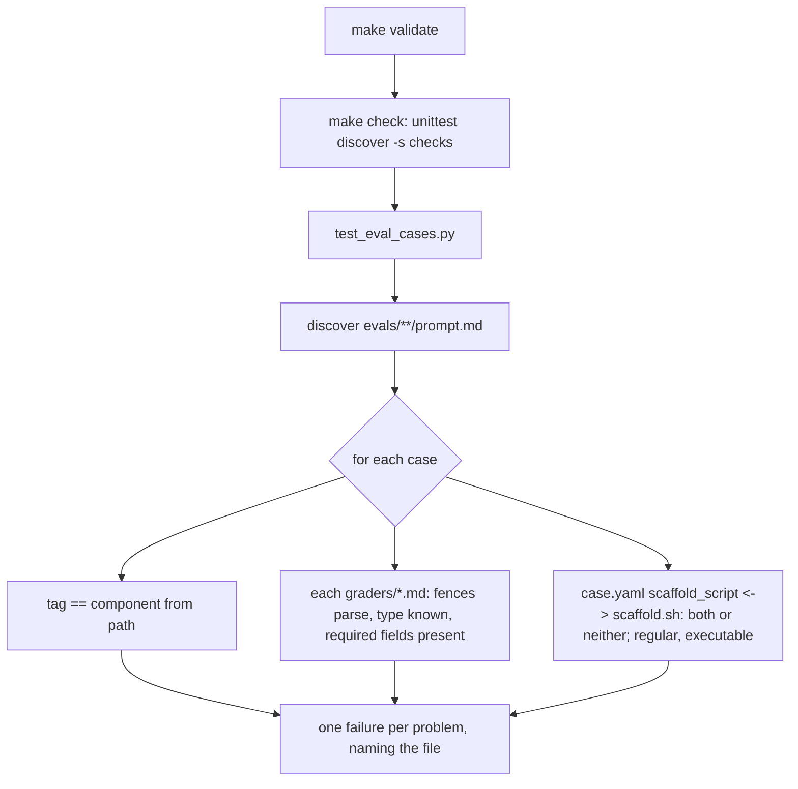

# Design Document

## Overview

One new free check, one README edit, one Makefile comment edit, and one scratch container run that leaves nothing behind. `checks/test_eval_cases.py` walks every `prompt.md` under `evals/`, derives the component from the path, and asserts the tag, the graders and the scaffold wiring, in the style of `checks/test_issue_forms.py` (Requirement 1). `evals/README.md`'s Running and Writing-a-case sections gain the cadence and the `--case` rule, and the Makefile header agrees (Requirement 2). The Linux hook eval runs once from a container built in the scratchpad with the token passed as an environment variable, and its table goes on issue #4 (Requirement 3). The PR closes the three issues (Requirement 4).

The one fact established by reading rather than from the docs: an `llm` grader carries only `type: llm` in its frontmatter and its judging prompt as the body, so its required field is a non-empty body, not a frontmatter key.

## Architecture

Key decision, one test method per concern, not one per case. `unittest` has no parametrisation; the issue-forms check loops inside a method and reports the first failing file with its name. The same shape here: a method for tags, one for graders, one for scaffolds, each looping over all cases and collecting every problem into one assertion message, so a single run lists everything wrong (Requirement 1.3, 1.5, 1.6). Trade-off: one red test per concern rather than per case; the message carries the detail.

Key decision, a hand-rolled frontmatter reader rather than a YAML dependency. The repository's checks are standard-library only (Requirement 1.8), and grader frontmatter is flat `key: value` lines between `---` fences, with one inline-map value (`target: { source: file, path: ... }`) that the check treats as an opaque string. Rejected alternative, PyYAML: not installed, and the code-changes rule forbids a new dependency without asking.

Key decision, the known-type table lives in the check. Four types with their required fields (Requirement 1.5, 1.9). A new type fails with a message to add it, so the list is edited on purpose. Rejected alternative, accept any `type`: would let a typo (`regx`) pass and the grader silently never score.

Key decision, the Linux run is scratch, not shipped. The author chose a one-off over a committed script; the comment on #4 holds the exact command so it can be repeated by hand (Requirement 3.3, 3.4).

## Components and Interfaces

| Component | Responsibility | Requirements |
|-----------|----------------|--------------|
| `checks/test_eval_cases.py`, `cases()` | Yield `(path, component)` for every `evals/**/prompt.md`; component from the path segments; fail if none | 1.2, 1.3 |
| `checks/test_eval_cases.py`, `frontmatter(path)` | Return the `key: value` pairs between the first two `---` lines, and the body after; raise a clear error when the fences are missing | 1.5 |
| `checks/test_eval_cases.py`, `KNOWN_TYPES` | `{"regex": ("pattern",), "tool_used": ("tool",), "file_exists": ("path", "exists"), "llm": ()}`; `llm` additionally needs a non-empty body | 1.5, 1.9 |
| `test_every_case_is_tagged_with_its_component` | Loop; collect `(case, missing tag)`; one assertion | 1.3 |
| `test_every_case_has_valid_graders` | Loop; at least one grader; each parses, type known, fields present, llm body non-empty; collect problems | 1.4, 1.5, 1.9 |
| `test_scaffolds_are_wired_and_executable` | `case.yaml` present: the named script exists, `is_file()` and not `is_symlink()`, owner-executable; `scaffold.sh` present without `case.yaml`: problem | 1.6, 1.7 |
| `evals/README.md`, Running | Cadence paragraph rewritten: component only, iterate at 1, confirm at 2 or 3; `--case` one glob, last wins | 2.1, 2.2, 2.3 |
| `evals/README.md`, Writing a case | The check named as what keeps tags, graders and scaffolds valid | 2.5 |
| `Makefile` header comment | Cadence and `--case` lines agree with the README | 2.4 |
| Scratch container (scratchpad only) | `node:22-bookworm`-family tagged image, `npm install -g @anthropic-ai/claude-code`, checkout copied in, `make eval-hook` with the token from `-e` | 3.1, 3.2, 3.4, 3.5 |
| Issue #4 comment | Table, image tag, Claude Code version, command | 3.3 |
| Issue #3 and #13 comments, PR description | Size-check half shipped in #21; fewer-variants item dropped by decision; PR closes #3, #13, #4 | 4.1, 4.2 |

## Data Models

Case, as the check sees it:

| Field | Source | Constraint |
|-------|--------|------------|
| `path` | directory of `prompt.md` | under `evals/` |
| `component` | path: `evals/<kind>/<name>/<case>/` gives `name`; `evals/hook/<case>/` gives `hook` | must appear in `tags` |
| `tags` | `prompt.md` frontmatter, `[a, b]` list syntax | contains `component` |
| `graders` | files `graders/*.md` | at least one |
| `scaffold` | `case.yaml` `context.scaffold_script`, read by a line match, no YAML parser | exists, regular, owner-executable; and `scaffold.sh` implies `case.yaml` |

Grader frontmatter:

| Field | Required for | Note |
|-------|--------------|------|
| `type` | all | one of `KNOWN_TYPES` |
| `pattern` | `regex` | string, quoted or not |
| `tool` | `tool_used` | string |
| `path`, `exists` | `file_exists` | string, boolean |
| body | `llm` | non-empty after the closing fence |
| `flags`, `match`, `target`, `min`, `max`, `arm`, `weight` | optional | not validated |

Cadence rule text, for the README's Running section and the Makefile header: run only the `make` target of the component touched, the whole suite only for a change to `hooks/` or the Makefile; iterate at `--runs 1`; confirm at two runs when every grader is `regex`, `tool_used` or `file_exists`, at three when any grader is `llm`; `--case` takes one glob and the last `--case` flag wins, so several named cases need one invocation each.

## Correctness Properties

### Property 1: Every case is reachable by its target

*For any* case under `evals/`, the `make eval-*` target enumerated from its parent directory selects it, because its tags contain the component the path names.

**Validates: Requirements 1.2, 1.3**

### Property 2: Every grader can score

*For any* grader file under any case, its frontmatter parses, its `type` is one the harness supports, and the fields that type needs are present, so the harness never throws on it.

**Validates: Requirements 1.4, 1.5, 1.9**

### Property 3: Scaffolds run when named and are named when present

*For any* case, `case.yaml` names a scaffold if and only if a scaffold file exists, and the named file is a regular, owner-executable file.

**Validates: Requirements 1.6, 1.7**

## Error Handling

| Condition | Category | Behaviour | Requirements |
|-----------|----------|-----------|--------------|
| No `prompt.md` under `evals/` | EMPTY | Fail: "no eval cases found" | 1.2 |
| Tag missing | UNTAGGED | Fail, listing `case: expected tag <component>` for each | 1.3 |
| Case has no graders | UNGRADED | Fail, listing the case | 1.4 |
| Grader fences missing or a line is not `key: value` | MALFORMED | Fail, listing `file: <reason>` | 1.5 |
| Grader `type` unknown | UNKNOWN_TYPE | Fail, listing the file and "add it to KNOWN_TYPES with its required fields" | 1.9 |
| Required field missing, or `llm` body empty | INCOMPLETE | Fail, listing the file and the field | 1.5 |
| `case.yaml` names a missing, symlinked or non-executable script | BAD_SCAFFOLD | Fail, listing the case and which condition | 1.6 |
| `scaffold.sh` without `case.yaml` | UNWIRED | Fail, listing the case | 1.7 |
| Docker daemon down or token unset (Linux run) | STOP | Say so and stop; no run elsewhere | 3.5 |

## Testing Strategy

- The check is itself the test for Properties 1 to 3 against the live suite. Its own correctness is proved by an ephemeral check: copy one case into a scratch directory under the scratchpad, break it four ways in turn (drop the tag, misspell a grader type, remove `pattern`, `chmod -x` the scaffold), point the check at that root via its `ROOT` constant or an environment variable, and confirm each produces the matching failure message; then delete the scratch copy.
- Run time: the check file alone, `python3 -B -m unittest discover -s checks -p test_eval_cases.py`, under five seconds (Requirement 1.8).
- Existing suite: `make validate` green with all 29 cases passing the new check unchanged, or the offending case fixed and named in the PR (Requirement 4.3).
- README and Makefile: read back against the requirement text; `make help` unchanged.
- The Linux run proves nothing about this branch's code; it is the evidence #4 asks for, recorded there with the image tag, the Claude Code version and the command.
