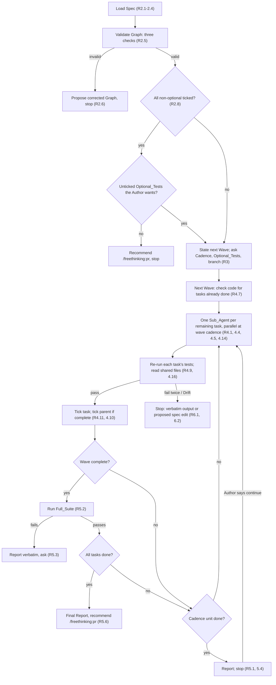
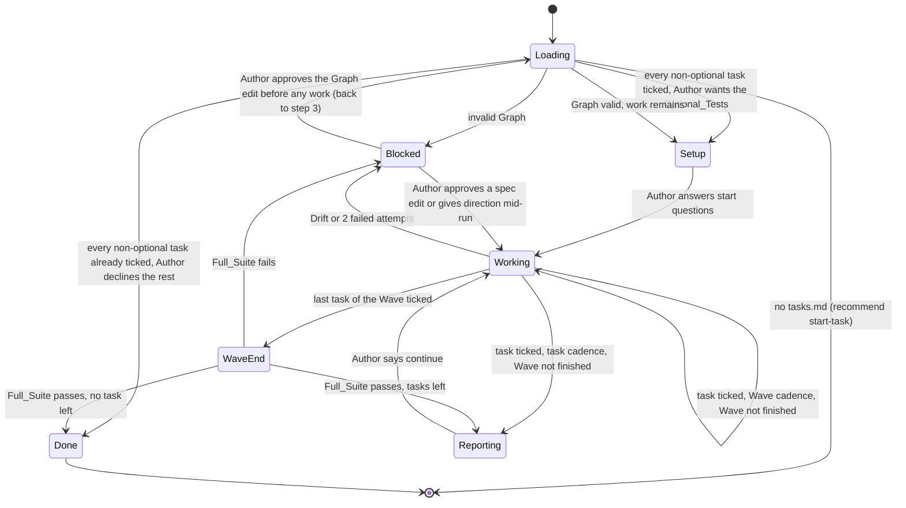

# Design Document

## Overview

`implement-spec` is a prompt-only skill, like the three handbook skills that exist: a `skills/implement-spec/SKILL.md` that Claude follows step by step, with no scripts or code of its own. It reads the Spec, validates the Graph, asks the Author one round of start questions, then works wave by wave: check which of the wave's tasks already appear done in the code, launch one Sub_Agent per remaining task (in parallel at wave Cadence, one at a time at task Cadence), each producing only the code its task describes since tests are tasks of their own, re-run the task's tests when its Sub_Agent returns, tick it, run the Full_Suite when the Wave completes, and stop when the Cadence unit is done. Drift and failure always stop the loop with a proposal rather than a unilateral change.

The prerequisite (Requirement 1) is a change to `start-task` and its task-list template so that the Graph is the single statement of execution order: every leaf task in it exactly once, task numbers used only as identifiers, and no checkpoint tasks. Review points are not data in the Spec; they are the end of every task or every Wave, chosen by the Author's Cadence. The rest of the work is wiring: the workflow rule, the README, the start-task hand-off, one eval case, and a version bump.

## Architecture

The skill is a sequence of numbered steps in `SKILL.md`, each mapping to a requirement. The flowchart shows the run loop; the state diagram shows the states a Run moves through and which transitions need the Author.





**Key decision: review points are Wave boundaries, not tasks.** The Graph is a DAG, but its Waves are already a linearisation: Wave N runs only after every task in Wave N-1. A human review is a global act over the whole working tree, so a Wave boundary is the natural place for it, and the Cadence (Requirement 3.2) decides which boundaries the Author sees. The Full_Suite runs at the end of every Wave (Requirement 5.2), which is what a checkpoint used to do. Trade-off: a spec author cannot mark one boundary as more important than another; with a Cadence of one task or one Wave the Author stops at all of them anyway, so nothing is lost. A coarser Cadence such as "until done" can be added later without reintroducing checkpoints.

Rejected alternative: checkpoint tasks, each alone in a Wave of its own. A checkpoint is a task with no work in it, needs a special validation rule, has to be positioned in the numbering, and never changes where the skill stops under a task or Wave Cadence. It also reads as if task numbering were execution order, which it is not.

Rejected alternative: a `review` flag on a Wave. Simpler than a task, but it never fires differently from a plain Wave stop under the Cadences that exist.

**Key decision: one Sub_Agent per Leaf_Task, parallel within a Wave.** A Wave is by construction a set of tasks that depend only on earlier Waves, so its tasks can run at once (Requirement 4.1). Each Sub_Agent gets a fresh context with exactly what its task needs (Requirement 4.4), produces only what its task describes (Requirement 4.6; a spec puts tests in tasks of their own, so a code task does not write them and is proved by an Ephemeral_Check instead), and returns a summary (Requirement 4.5), which keeps the main conversation to the Report rather than every file read. Trade-off: the Author sees summaries, not the work, so the Skill re-runs each task's tests itself before ticking (Requirement 4.10) and, at wave Cadence, ticks nothing until every Sub_Agent of the Wave has returned and reads any file two of them both touched (Requirement 4.9). Each Sub_Agent is told which other tasks are in flight and to touch only the files its own task needs (Requirement 4.4), which is what keeps parallel edits apart; the combined-diff read catches the cases where that was not enough. At task Cadence the Sub_Agents run one at a time (Requirement 4.8), so the hand-back after each task still makes sense.

Rejected alternative: implement every task in the main conversation. Simpler to follow, but serial, and a long Wave fills the context with reads that the Report never needs.

**Key decision: a Wave starts with a done-already check.** Work may have landed outside the Skill, so before launching Sub_Agents the Skill looks for each task's outcome in the code and says which appear done (Requirement 4.7). Such a task skips the Sub_Agent and is ticked only if its tests pass; if they fail, it gets a Sub_Agent after all, so a wrong guess costs nothing.

**Key decision: task numbers identify, the Graph orders.** Tasks are numbered as they are thought of; the Graph is built afterwards from content and is the only statement of order (Requirement 1.2). Validation therefore never compares document position with Wave position. Within a Wave, order does not matter.

**Key decision: validation is a procedure Claude performs, not a script.** The skill lists the Leaf_Task ids from the checkboxes and the ids from the Graph, then compares them against the three checks in Requirement 2.5. Trade-off: a script would be deterministic, but the lists are short, and the plugin's skills are prompt-only; a script would add a runtime dependency on every engineer's machine and a second thing to maintain. The procedure is written so the two lists are shown in the conversation, which lets the Author spot a miss.

Rejected alternative: a `validate-tasks.py` beside the skill. Deterministic, but the other three skills carry no code, and the eval suite is the only place the handbook runs anything.

**Key decision: Cadence and Optional_Tests are asked, not defaulted.** Requirements 3.2 and 3.3 say the Author chooses; the skill reads a `task` or `wave` word from `$ARGUMENTS` or the Author's message first and asks only if neither is there. The Optional_Test choice is per Wave, so a Wave with none skips the question. Trade-off: one more question at the start; batched with the branch question per Requirement 3.4.

**Key decision: the Report has a fixed shape.** Five headed lists in a fixed order so the PR skill's Testing section can be written from it later (Requirement 5.4).

## Components and Interfaces

| Component | Responsibility | Requirements |
|-----------|----------------|--------------|
| `skills/implement-spec/SKILL.md` | The skill: load, validate, set up, work loop, report, continue, finish | 1.5, 2 to 7.1 |
| `skills/start-task/SKILL.md` step 5 | Instruct that the Graph names every leaf task once, optional tests included, and that the Graph, not numbering, orders the work; no checkpoint tasks | 1.1, 1.2 |
| `skills/start-task/SKILL.md` step 6 | Hand off to `/freethinking:implement-spec` | 7.5 |
| `skills/start-task/spec-template/tasks.md` | No checkpoint tasks; define a leaf task; state the two Graph rules; example Graph that satisfies them | 1.3 |
| `rules/workflow.md` | Route "existing spec" to `/freethinking:implement-spec`; describe stops as Cadence | 7.2, 7.7 |
| `README.md` | Skills table row and eval mention; describe stops as Cadence | 7.3, 7.7 |
| `evals/skills/implement-spec/<case>/` | At least one eval case | 7.4 |
| `.claude-plugin/plugin.json` | Version bump to 0.4.0 | 7.6 |

### `SKILL.md` steps

The skill body follows the house pattern of the pr and bugfix skills: a short statement of purpose and accountability, `$ARGUMENTS` named, then numbered steps.

| Step | What it does | Requirements |
|------|--------------|--------------|
| Frontmatter | `name: implement-spec`, trigger description, `argument-hint: "[task-name] [task|wave]"`, `allowed-tools` for read-only git, `ls` of `.claude/specs`, and `cat` of spec files | 7.1 |
| 1. Find the Spec | Parse `$ARGUMENTS` and the Author's message for the task name and a `task`/`wave` Cadence word. With no name, `ls .claude/specs/*/tasks.md`: one open Spec, name it and confirm; several, ask; none, say so and recommend start-task. Missing `tasks.md` stops with the start-task recommendation. Read all three files | 2.1 to 2.4, 2.9 |
| 2. Validate the Graph | Build the Leaf_Task table and the Graph table (Data Models), show both in the conversation, run the three checks. Any failure: list problems by id, propose the corrected JSON or the removal of a task with no work in it, stop | 1.5, 2.5, 2.6 |
| 3. Find the position | First unticked Leaf_Task in Wave order. All non-optional ticked: report done and ask about any unticked Optional_Tests; yes goes to step 4 with those as the work, no recommends pr and stops | 2.7, 2.8 |
| 4. Set up | State the next Wave and its tasks. One batched question round: Cadence if not in arguments, Optional_Tests for the first Wave if any, branch if on the Default_Branch. No code until answered | 3.1 to 3.6 |
| 5. Work the wave | New Wave with Optional_Tests: ask once. Check the code for each unticked task and say which appear done. For each remaining task, state id, text and cited requirements, then launch a Sub_Agent with the task text, the cited requirements, the matching design sections, the code-changes rules with their spec exception, the other tasks in flight, and the instruction to stop on drift; it gathers context, implements only what the task describes, proves it with an Ephemeral_Check and the existing tests, and returns a summary with the check's code. Parallel at wave Cadence, one at a time at task Cadence. At wave Cadence wait for every Sub_Agent of the wave; at task Cadence handle each as it returns. For each: re-run its tests, read any file another Sub_Agent of the wave also changed, then tick, and tick the parent if all its sub-tasks are ticked. Fail: have the Sub_Agent fix at most twice, then step 6. Design cannot be followed: step 6. Last task of a Wave other than a Skipped_Test ticked: run the Full_Suite; if it fails, step 6 with the output | 4.1 to 4.6, 3.3, 5.2, 5.3 |
| 6. Stop and report | Reached at the end of a Cadence unit, on a failed Full_Suite, on Drift or on failure. Write the Report. Drift: add the evidence and the proposed spec edit. Failure: add verbatim output and open and confirmed causes. Never commit | 5.1, 5.4, 5.5, 6.1, 6.2, 6.5 |
| 7. Continue | On "continue", resume at step 5 with the same choices. On an approved spec edit, apply it to the named file and resume where the Run stopped (step 3 if the edit was a Graph fix at load). On a request to skip or reorder, name dependents from the Graph and wait for confirmation | 5.7, 6.3, 6.4 |
| 8. Finish | When every task other than a Skipped_Test is ticked, write the Report with the final Wave's Full_Suite result, recommend `/freethinking:pr`, stop | 5.6 |

### Report shape

```
## Done
- 3.1 Implement create with validation (Requirements 1.1-1.4)
## Tests
- `npm test -- create.test.ts`: 6 passed (existing tests for the code touched)
- Full suite `npm test` at end of wave 2: 41 passed
## Files changed
- src/create.ts
## Skipped / follow-ups
- 3.3 optional property test skipped at the Author's request
## Next
- 4.1 Implement the Visit Counter Worker (wave 3)
```

## Data Models

The skill holds no persistent state of its own. Everything it needs is in `tasks.md`, which it parses into two tables it shows the Author during validation.

Leaf_Task, one per checkbox line with no sub-tasks:

| Field | Type | Source | Requirements |
|-------|------|--------|--------------|
| `id` | string, for example `2.1` or `1` | the number before the task text; an identifier, not an order | 2.5 |
| `text` | string | the task line | 4.4 |
| `ticked` | boolean | `[x]` versus `[ ]` | 2.7, 4.11 |
| `optional` | boolean | `[ ]*` marker | 3.3, 4.16 |
| `requirements` | list of ids | the `_Requirements: ..._` line | 4.4 |
| `property` | string or none | the `**Property N**` line | 4.14 |

Graph, from the `waves` JSON block:

| Field | Type | Constraint | Requirements |
|-------|------|------------|--------------|
| `waves[].id` | integer | unique, ascending | 2.5 |
| `waves[].tasks` | list of Leaf_Task ids | every id exists; each Leaf_Task in exactly one Wave | 1.1, 2.5 |

Run choices, held in the conversation for the Run:

| Field | Values | Requirements |
|-------|--------|--------------|
| `cadence` | `task` or `wave`; at `task` Sub_Agents run one at a time | 3.2, 4.8 |
| `optional_tests[wave]` | `do` or `skip`, asked when the Wave starts | 3.3 |
| `branch` | current branch after setup | 3.5 |

The template example Graph after the prerequisite, with the checkpoint tasks removed and the metrics tasks renumbered 4.x:

```json
{
  "waves": [
    { "id": 0, "tasks": ["1"] },
    { "id": 1, "tasks": ["2.1"] },
    { "id": 2, "tasks": ["2.2", "3.1", "3.2"] },
    { "id": 3, "tasks": ["3.3", "4.1", "4.2"] },
    { "id": 4, "tasks": ["4.3"] }
  ]
}
```

## Correctness Properties

### Property 1: The Graph is a partition of the Leaf_Tasks

*For any* Task_List that passes validation, the multiset of ids across all Waves equals the set of Leaf_Task ids, with no id repeated and no id absent.

**Validates: Requirements 1.1, 1.4, 2.5**

### Property 2: Wave order is respected

*For any* Run, unless the Author confirmed a skip or reorder under Requirement 6.3, no Leaf_Task in Wave N+1 is started before every Leaf_Task in Wave N other than a Skipped_Test is ticked, and the Full_Suite has run after the last of those was ticked.

**Validates: Requirements 4.1, 4.2, 4.8, 5.2**

### Property 3: A tick follows a passing test

*For any* checkbox the skill changes from unticked to ticked during a Run, the Report for that Run names a test command that ran and passed for that task, or a stated manual check, before the tick.

**Validates: Requirements 4.7, 4.10, 4.11, 4.12, 4.13**

### Property 4: The spec text is read-only without approval

*For any* Run, the diff of `requirements.md`, `design.md` and `tasks.md` from start to end contains only `[ ]` to `[x]` changes, unless the Author approved a specific spec edit in that Run.

**Validates: Requirements 4.17, 6.1, 6.4**

### Property 5: No work past the Cadence

*For any* Run, the Leaf_Tasks ticked all lie within the Cadence units the Author started or continued, and the Run ends with a Report.

**Validates: Requirements 5.1, 5.4, 5.7**

## Error Handling

| Condition | Category | Behaviour | Requirements |
|-----------|----------|-----------|--------------|
| No argument and no Spec with open tasks | NOT_FOUND | Say there is nothing to implement, recommend start-task, stop | 2.9 |
| No argument and several Specs with open tasks | AMBIGUOUS | List them, ask which | 2.3 |
| Named Spec has no `tasks.md` | NOT_FOUND | Recommend `/freethinking:start-task`, no code change | 2.4 |
| Graph missing or fails any check | VALIDATION | List problems by id, propose corrected JSON or removal of a task with no work, no code change until approved | 1.5, 2.5, 2.6 |
| Every non-optional Leaf_Task ticked at load | DONE | Report complete, ask about unticked Optional_Tests, else recommend `/freethinking:pr`, stop | 2.8 |
| On the Default_Branch | PRECONDITION | Propose a branch, create on confirmation, no code before | 3.5 |
| Task tests fail after 2 fix attempts | FAILURE | Stop, verbatim output, confirmed and open causes, ask | 6.2 |
| Sub_Agent reports passing tests but the Skill's own run fails | FAILURE | Treat as a failed attempt; never tick on the report alone | 4.10 |
| Two Sub_Agents changed the same file | CONFLICT | Tick nothing in the wave until all have returned; read the combined diff before ticking either task | 4.9 |
| Design cannot be followed | DRIFT | Stop, evidence, proposed spec edit, wait | 6.1 |
| Full_Suite fails at the end of a Wave | FAILURE | Report verbatim, ask before the next Wave | 5.3 |
| Author asks to skip or reorder | OVERRIDE | Name dependents from the Graph, proceed only on confirmation | 6.3 |
| Problem found outside the current task | SCOPE | Note as follow-up in the Report, do not fix | 6.5 |
| Author asks to commit | OUT_OF_SKILL | Do it only because asked; the skill never commits on its own | 5.5 |

## Testing Strategy

The skill is a prompt, so its tests are `make validate` for the frontmatter and manifest, eval cases for behaviour, and manual review for the properties that an eval cannot observe cheaply.

- `make validate` after every change to a `SKILL.md`, the template, `plugin.json` or `rules/`. It is also this repository's Full_Suite.
- Eval case `evals/skills/implement-spec/no-spec-recommends-start-task/`: prompt `/freethinking:implement-spec link-shortener` in the empty sandbox. Graders: a `regex` for `start-task` and a `file_exists` with `exists: false` for `**/*`. Covers Requirements 2.4 and 3.6 and runs in about four turns. Run twice before trusting it, per the README.
- Eval case `evals/rules/workflow/spec-routes-to-implement-spec/`: a prompt saying a `tasks.md` exists for the work and asking to continue it. Grader: a `regex` for `implement-spec`. Covers Requirement 7.2.
- Property 1 is checked by hand against the updated template example and against this spec's own `tasks.md`. A Graph-validation eval needs a fixture `tasks.md` in the sandbox; whether `claude plugin eval` supports fixture files is not known from this repository (inferred, not observed). The task list includes a step to check the docs and add the case if it does.
- Properties 2 to 5 are reviewed by reading the skill text against the requirement, and exercised once by running the finished skill on this spec's own `tasks.md` at `task` Cadence, which is the manual check recorded in the PR's Testing section.
- Evals are run by hand with `make eval-skill-implement-spec` and `make eval-rule-workflow`, never in CI.
