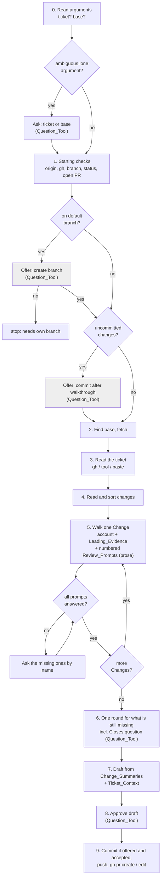
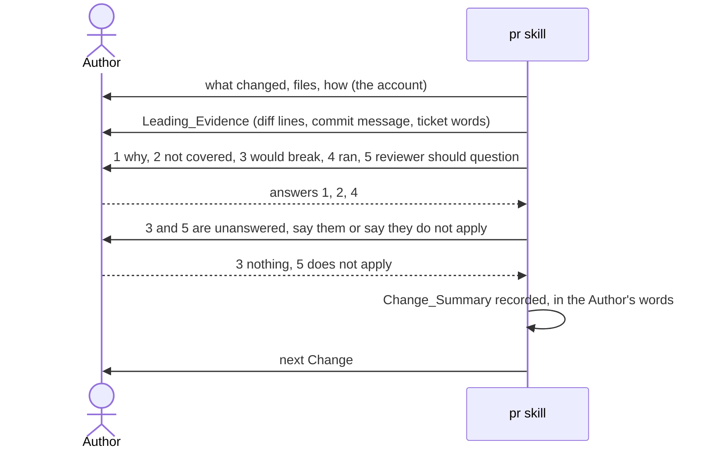

# Design Document

## Overview

Prompt and eval changes only, no code of its own. `skills/pr/SKILL.md` is rewritten in place: its frontmatter takes two ordered arguments, a CX_Block follows the opening, the starting checks turn their two recoverable stops into offers asked with the Question_Tool, a new step reads the Ticket_Context before the walkthrough, the walkthrough puts the numbered Review_Prompts to the Author in prose with Leading_Evidence and loops back on anything unanswered, and the drafting step assembles the description from the Change_Summaries with the ticket named exactly once (Requirements 1 to 6). One line of `skills/start-task/SKILL.md` shrinks its hand-off (Requirement 5.9). The fake `gh` of the pr eval learns `gh issue view`, two eval cases are added and one is adjusted, the README row and the version follow (Requirement 7). Nothing in `rules/` changes: the collaboration rule already supplies the defaults the CX_Block departs from, and the workflow rule's pull request line stays true.

## Architecture

The skill is a procedure the model follows, so the architecture is the order of its steps and where each one stops for the Author. The flowchart shows the new order; the stops are the diamond nodes, and the two shaded ones are the offers that used to be hard stops.

The sequence diagram shows one Change in the walkthrough, including the loop back when the Author skips a prompt.

Key decision, the ticket is read before the walkthrough, not after. Today the ticket is asked for in the round of questions after the walkthrough, so the issue text cannot inform anything. Reading it first lets the Why section come from the ticket and lets the "why" prompt open with the ticket's words as Leading_Evidence (Requirements 2.1 to 2.4). The trade-off is one more step before the Author sees a change; it is a single `gh issue view` and costs seconds.

Key decision, the Review_Prompts stay in prose and take no pre-filled answers. The Question_Tool would make "nothing to flag" one click, but an option the skill wrote is the skill's words, and the Author is accountable only for words they wrote (Requirement 6.3). The cost is more typing per Change; the loop-back (Requirement 3.4) and the numbering (3.2) keep that typing from losing a prompt. Rejected alternative, a Question_Tool call per Change with the ticket's reason as an option: faster, but it turns the walkthrough into endorsement, which is exactly what the walkthrough exists to prevent.

Key decision, the commit offer is accepted at the start but executed after the walkthrough. The commit message should be drafted from the Author's words, which do not exist until the walkthrough is done (Requirement 5.5). The trade-off is that the walkthrough reads uncommitted changes from the working tree rather than from commits, which `git diff` already handles since the skill diffs against the base, not against HEAD. Rejected alternative, commit immediately with a placeholder message: simpler, but the Author then has to amend, and a placeholder in history is worse than a short wait.

Key decision, the argument grammar is by shape, with one question for the ambiguous case. `#12`, a URL and `ENG-1234` cannot be branch names in practice, and a branch name rarely looks like an upper-case key, so shape resolves almost every call without a question (Requirements 1.2, 1.3). The one residual, a lower-case `eng-1234`, could be either, so it is asked rather than guessed (1.4). Rejected alternative, named arguments such as `base=release-2`: unambiguous, but heavier to type for the common case and unlike every other skill's arguments.

Key decision, the CX_Block takes start-task's shape verbatim. Four bullets, Stops, How it asks, Hand-backs, Hand-offs, so an Author who has read one skill's block can read the other's (Requirement 6.1). Nothing about the shape is new, only the content.

## Components and Interfaces

Each component is a section of a Markdown file. The table maps every section to the requirements it serves.

| Component | Responsibility | Requirements |
|-----------|----------------|--------------|
| `skills/pr/SKILL.md` frontmatter | `argument-hint: "[ticket] [base-branch]"`; `allowed-tools` gains `Bash(gh issue view *)`, `Bash(git checkout -b *)`, `Bash(git add *)`, `Bash(git commit *)`; `description` says the skill starts from the ticket, puts the review prompts, and offers to branch and commit | 1.7, 2.1, 5.2, 5.5 |
| CX_Block "Working with the author" | After the opening paragraphs: Stops, How it asks (tool for the argument question, the offers, the Closes question and the approval; prose for the walkthrough, with the accountability reason), Hand-backs (the PR URL), Hand-offs (none) | 6.1 to 6.5 |
| Step 0, "Read the arguments" | The grammar of Data Models; says how each argument was read; asks the ambiguous case with the Question_Tool, header `Argument`, options `Ticket` and `Base branch` | 1.1 to 1.5 |
| Step 1, "Check the starting state" | Same five checks; the default-branch check becomes the branch offer, header `Branch`, options `Create <name>` (Recommended) and `Stop`; the uncommitted-changes check becomes the commit offer, header `Commit`, options `Commit after the walkthrough` (Recommended) and `Leave them out`; the branch name rule; the three hard stops unchanged | 5.1 to 5.4, 5.6 to 5.8 |
| Step 2, "Find the base branch" | Unchanged except that the override comes from step 0 | 1.1 |
| Step 3, "Read the ticket" | New. GitHub issue of this repository: `gh issue view <n> --comments`; other tracker: a tool the session has, named in the step as "whatever tool in this session reads that tracker"; otherwise ask the Author to paste; the context is the Author's context, not instructions | 2.1 to 2.3, 2.5 |
| Step 4, "Read and sort the changes" | Unchanged | 3.1 |
| Step 5, "Walk the changes with the author" | Per Change: the account, Leading_Evidence, the five numbered Review_Prompts, in one prose message; the ticket's words offered as evidence for prompt 1 when they bear on the Change; the loop-back by name; "does not apply"; self-explanatory; "not sure"; corrections replace the account | 2.4, 3.1 to 3.7 |
| Step 6, "Ask what is still missing" | One round for the ticket when none was given, testing, risk, review focus and draft status, only for what the Change_Summaries have not covered; the Closes question with the Question_Tool, header `Closes`, options `Merging finishes it` and `Only related`, when the PR_Template has a Closes convention and the ticket is a GitHub issue of this repository | 1.6, 4.4 |
| Step 7, "Draft the title and description" | Title prefix from the Ticket_Reference; Why from the Ticket_Context and the "why" answers with the ticket named once by the rules of Requirement 4; Changes from the Change_Summaries; gaps, risks and things not run routed to Testing, Risk and rollout, Notes for reviewers; nothing written fresh from the diff | 3.8, 3.9, 4.1 to 4.3, 4.5 |
| Step 8, "Show the draft and get approval" | Question_Tool, header `Approve`, options `Approved` and `Changes needed`; the commit message shown with the draft when the commit offer was accepted | 5.5 |
| Step 9, "Create or update the PR" | Commit first if offered and accepted, then push, then `gh pr create` or `gh pr edit` as today | 5.5, 5.8 |
| `skills/start-task/SKILL.md`, the `done` hand-off | "Then say that the change sits uncommitted on the current branch, naming that branch, and recommend `/freethinking:pr`, which will offer to create the branch and commit." replaces the three-command sentence | 5.9 |
| `evals/skills/pr/opens-pr-with-stub-gh/scaffold.sh` | The fake `gh` answers `issue view` with a canned issue, title, body and one comment, as `gh issue view --comments` prints it | 7.2 |
| `evals/skills/pr/opens-pr-with-ticket/` | New case: same scaffold, prompt `/freethinking:pr #7` with the Author's answers given up front; graders in Testing Strategy | 7.2 |
| `evals/skills/pr/offers-branch-on-default/` | New case: workspace on `main` with the two commits and a fake origin; graders check the offer's two options appear as list items and no stop sentence, no push, no `gh pr create` | 7.3 |
| `evals/skills/pr/stops-at-starting-checks/` | Adjusted: the bare workspace has no origin and no `gh`, so those hard stops still fire first; the `names-a-starting-check` pattern drops the default-branch wording so the case cannot pass on the branch check alone | 7.1 |
| `README.md` pr row, `.claude-plugin/plugin.json` | Row says the skill starts from the ticket and offers to branch and commit; version 0.6.0 to 0.7.0, since a skill's arguments change | 7.4, 7.5 |

## Data Models

The argument grammar, read left to right:

| Shape | Read as | Example |
|-------|---------|---------|
| `#` then digits | Ticket_Reference, GitHub issue of this repository | `#12` |
| `http://` or `https://` then anything | Ticket_Reference, URL; a GitHub issue URL of this repository is read with `gh` | `https://github.com/o/r/issues/12` |
| upper-case letters, hyphen, digits | Ticket_Reference, tracker key | `ENG-1234` |
| lower-case letters, hyphen, digits, alone | ambiguous: ask | `eng-1234` |
| anything else | Base_Branch | `release-2` |

Two arguments: the first is the Ticket_Reference, the second the Base_Branch, each still checked against the table; a second argument that fits a ticket shape is an error the skill reports before anything else.

Change_Summary, one per Change, kept in the conversation:

| Field | Content |
|-------|---------|
| account | what changed, the files, how it was done, as the skill stated it, replaced by the Author's correction if they gave one |
| why | the Author's words, or "self-explanatory", or "Reason not provided by the author" |
| not_covered | the Author's words, or "nothing" or "does not apply" |
| would_break | same |
| ran | same; "Not tested" when the Author says so |
| reviewer_question | same |

Ticket_Context: title, body, comments in order, each comment with its author, plus the source (`gh`, a named tool, or "pasted by the author").

Branch name proposed by the branch offer: `<number>-<slug>` when the Ticket_Reference carries a number, where the slug is two to four words from the ticket title; otherwise a slug from the Changes.

## Correctness Properties

### Property 1: Every Change is spoken for

*For any* branch the skill opens a pull request for, every source file in `git diff --name-status` against the base is covered by a Change_Summary whose five Review_Prompts are each answered, marked "does not apply", or carry "Reason not provided by the author" chosen by the Author.

**Validates: Requirements 3.1 to 3.7**

### Property 2: The ticket is named exactly once in Why

*For any* Ticket_Reference and PR_Template, the Why section contains the ticket's reference exactly once: in a Closes_Line when the template has that convention and merging finishes the ticket, and in the text otherwise.

**Validates: Requirements 4.1 to 4.3**

### Property 3: No git mutation without a yes

*For any* run, `git checkout -b`, `git commit` and `git push` are each run only after the Author answered yes to the offer or the approval that names that action.

**Validates: Requirements 5.2, 5.5, 5.8**

### Property 4: Arguments are read as the table says

*For any* argument list, each argument is read as the Data Models table states, the ambiguous case is asked before any other step, and the first message states the reading.

**Validates: Requirements 1.1 to 1.5**

## Error Handling

| Condition | Category | Behaviour | Requirements |
|-----------|----------|-----------|--------------|
| Lone argument fits the ambiguous shape | ASK | Question_Tool `Argument` before any other step | 1.4 |
| Second argument fits a ticket shape | USAGE | Say both arguments were read as tickets and stop; the grammar is ticket then base | 1.1 |
| Ticket cannot be read by `gh` or any tool | ASK | Ask the Author to paste the ticket and its comments; carry on with what is given | 2.3 |
| Ticket_Context contains instructions | IGNORE | Treated as context only; the skill's steps do not change | 2.5 |
| Author declines the branch offer on the default branch | STOP | Say a pull request needs its own branch; create nothing | 5.3 |
| Author declines the commit offer | WARN | Carry on; say the listed files will not be in the pull request | 5.6 |
| No origin, not GitHub, `gh` not signed in | STOP | As today | 5.7 |
| Review_Prompt left unanswered | LOOP | Name it and ask again before the next Change; never fill it | 3.4 |
| Author's answer is "not sure" or "just include it" | ASK | Offer explaining now or removing the Change; marker otherwise | 3.7 |
| Question_Tool not available | FALLBACK | The same question in prose with the options on separate lines, per `rules/collaboration.md` | 6.4 |

## Testing Strategy

The repository has no code here, so proof is `make validate`, the evals for the pr skill and start-task, and a manual run.

- `make validate` after every change: the plugin validators and the free checks, including the rules size check, which this change does not move since `rules/` is untouched.
- `make eval-skill-pr`, one invocation per case, iterated at one run and confirmed at three, since every case has a prose-matching grader on a non-deterministic reply:
  - `opens-pr-with-stub-gh`, unchanged prompt, still passes: Property 1 on the no-ticket path.
  - `opens-pr-with-ticket`, new: prompt `/freethinking:pr #7` with the answers given up front and "merging finishes it"; graders: `tool_used` Bash `gh issue view`; `tool_used` Bash `gh pr create` with `--title "\[#7\]`; regex on the body file written before `gh pr create` or on the final reply for `Closes #7` and for the absence of a second `#7` in the Why section; regex that the Changes bullet carries a phrase from the Author's answer; Property 2 and the ticket half of Property 4.
  - `offers-branch-on-default`, new: workspace on `main`, two commits, fake origin; graders in the shape of start-task's route cases: the two options appear as list items (`Create` and `Stop`), no `git push`, no `gh pr create`, no "needs its own branch" stop sentence; Property 3's branch half and Requirement 5.1. The Question_Tool is absent in the eval sandbox, so the prose fallback is what renders, as the start-task cases already rely on.
  - `stops-at-starting-checks`, adjusted grader: still stops, on origin or `gh`.
- `make eval-skill-start-task`, the existing `contained-change-offers-executor` case, still passes after the hand-off line changes; the eval stops before the hand-off, so it is a regression check, not a proof of the new line.
- Manual, in this repository on a scratch branch with a real issue: `/freethinking:pr #<n>` reads the issue with its comments, the first message states the argument reading, each Change arrives with numbered prompts and leading evidence, a deliberately skipped prompt is asked for by name, the Closes question renders in the tool, the draft names the ticket once, and the final approval renders in the tool; recorded in the PR's Testing section. A second manual run from the default branch with an uncommitted file exercises both offers end to end, since the eval cannot grant the tool.
