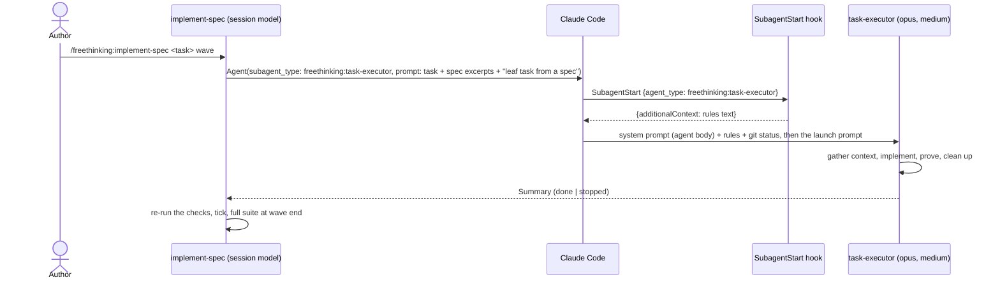
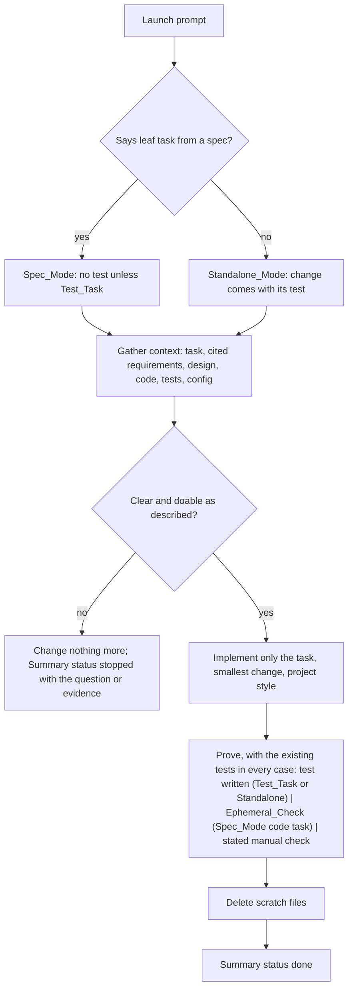

# Design Document

## Overview

Three pieces, all prompt and configuration, no code of their own. A `SubagentStart` hook in `hooks/hooks.json` runs the existing rules script through a JSON wrapper so every sub-agent starts with the team rules in its context (Requirement 1). A plugin agent, `agents/task-executor.md`, carries the executor's procedure, its two modes and the Summary shape, pinned to Opus at medium effort (Requirements 2 and 3). `implement-spec` step 5 launches that agent by scoped name with a launch prompt reduced to the task and its spec excerpts plus a one-line Spec_Mode marker (Requirement 4). README, evals and the version bump wire it in (Requirement 5).

The one thing the design had to establish by experiment rather than from the docs: plain stdout from a `SubagentStart` hook is not added to the sub-agent's context, but JSON `additionalContext` is. A probe on a scratch copy of the plugin confirmed a sub-agent then reports the rules present, where without the hook it reports none.

## Architecture





**Key decision: rules through a `SubagentStart` hook, not in the agent body.** The hook fires for every sub-agent the session launches, so general-purpose sub-agents get the rules too, and the rules text stays in one place (Requirements 1.3, 2.12). Trade-off: a second hook entry and a JSON wrapper script; the agent body then names only the rules its procedure leans on. Rejected: restating the rules in the agent body. Two copies drift, and only this agent would be covered. Rejected: having the agent read `rules/` at start. It depends on a path variable inside the sub-agent that the docs do not promise, and costs a tool call per launch.

**Key decision: one script, two shapes, no runtime dependency.** `load-rules.sh` keeps printing plain text for SessionStart. A new `load-rules-subagent.sh` pipes that output through a JSON string encoder written in POSIX `awk`, which escapes backslash, double quote and every control character, and wraps the result in the `SubagentStart` JSON (Requirement 1.2). Given `-` as its argument it encodes stdin instead, which is what the unit check feeds. Trade-off: hand-written escaping, so a round-trip check in `make validate` proves it on adversarial input (see Testing Strategy). Rejected: `python3`, `node` or `jq` as the encoder, each a runtime dependency the plugin otherwise lacks and absent on some fresh machines; a shipped binary, unreviewable and per-platform. If the escaping ever needs to grow, it grows in the awk, under the same round-trip check.

**Key decision: mode from the launch prompt alone.** The agent is in Standalone_Mode unless the prompt says the task is a leaf task from a spec (Requirement 2.7). The marker is one sentence the skill always includes (Requirement 4.2). Trade-off: a direct user who pastes a spec task without the sentence gets a test written for it, which is the safer default. Rejected: inferring the mode from the presence of `.claude/specs/` in the repo, which would silently change behaviour for any direct use inside a spec'd repo.

**Key decision: pinned model and effort.** `model: opus`, `effort: medium` in the frontmatter (Requirement 2.1). Trade-off: every executor costs the same regardless of task size; the orchestrating skill stays on the session's model, so the author's choice of Fable for the session is not overridden. `effort` is a documented frontmatter field; unknown fields are ignored silently, so the testing strategy checks it took effect.

**Key decision: the skill launches by scoped name and stops restating.** Step 5's launch bullets shrink to the task, its quoted requirements and design sections, the sibling tasks in flight, the property tag, and the mode sentence (Requirements 4.2, 4.3). The verification, ticking and suite steps do not change (Requirement 4.5). A `stopped` Summary is handled by the existing Drift path in step 6 (Requirement 4.4).

## Components and Interfaces

| Component | Responsibility | Requirements |
|-----------|----------------|--------------|
| `hooks/hooks.json` | Register `SubagentStart` with no matcher, running the subagent rules script | 1.1 |
| `hooks/load-rules-subagent.sh` | Print the rules as `SubagentStart` JSON `additionalContext`, from `load-rules.sh`; with `-`, encode stdin | 1.2, 1.3, 1.5 |
| `checks/test_hook_encoder.py` (run by `make validate`) | Fixed-table, seeded-fuzz and real-run checks of the encoder, free, in CI | 1.2 |
| `checks/test_agents.py` (run by `make validate`) | Agent frontmatter: `name` equals the file stem, `description` present, `tools`, `model` and `effort` from their known sets; every `freethinking:<name>` the skills reference exists | 2.1, 4.1, 6.1 |
| `agents/task-executor.md` | The Agent: frontmatter and procedure | 2.1 to 2.12, 3.1 to 3.3 |
| `skills/implement-spec/SKILL.md` step 5 | Launch the Agent by scoped name with the reduced prompt; treat `stopped` as Drift; review each wave with the Reviewer before ticking | 4.1 to 4.7 |
| `agents/wave-reviewer.md` | The Reviewer: read-only, gathers the diff itself, judges each change by what it is, returns Findings | 6.1 to 6.8 |
| `evals/agents/wave-reviewer/` | A planted-contradiction case and a clean-diff control | 5.6 |
| `README.md` | Agents section | 5.1 |
| `evals/agents/task-executor/` | Spec_Mode and Standalone_Mode cases | 5.2 |
| `evals/hook/subagent-rules-loaded/` | A sub-agent reports the rules present | 1.4, 5.3 |
| `evals/skills/implement-spec/works-one-wave/` | Still passes with the Agent as executor | 5.4 |
| `.claude-plugin/plugin.json` | Version 0.5.0 | 5.5 |
| `Makefile` | `eval-agent-task-executor` gets Bash, Write, Edit, the scaffold and the `bin` PATH entry | 5.2 |

### `agents/task-executor.md`

| Part | Content | Requirements |
|------|---------|--------------|
| Frontmatter | `name: task-executor`; `description`: builds one well-specified change, from a spec task or a single change you describe, use it directly for a contained task; `tools: Read, Glob, Grep, Edit, Write, Bash`; `model: opus`; `effort: medium` | 2.1, 2.2 |
| Role | One change, as specified, nothing else; the Author owns the code | 2.3 |
| Mode | Spec_Mode if the launch says the task is a leaf task from a spec, else Standalone_Mode; what each means for tests | 2.5, 2.6, 2.7 |
| Procedure | 1 gather context; 2 implement only the task, smallest change, project style; 3 prove it; 4 delete scratch files; 5 return the Summary | 2.3, 2.4, 2.10 |
| Never | edit spec files or tick; commit, push, branch; add a dependency, framework or tool; write a test for a code task in Spec_Mode; produce code for another task | 2.5, 2.8, 2.9 |
| Stop and ask | On Drift or an unclear task: change nothing more, return `stopped` with the question or evidence; do not assume or work around | 2.11 |
| Summary | The fixed shape below | 3.1 to 3.3 |
| Rules | One line: the team rules are in your context; the ones this procedure leans on are smallest change, no new dependency, say what you are unsure of | 2.12 |

### Wave review

The `wave-reviewer` agent, one launch per wave, from a "Reviewing the wave" step of the skill between "When a task comes back" and "Ending a wave": after every executor of the wave has returned and each task's own checks have passed, before any tick (Requirements 4.6, 4.7, 6). At task cadence, where earlier tasks were ticked at their hand-backs, the review runs once when the wave's last task has passed its checks, before that task's tick, and covers the whole wave. The orchestrator passes it the file list, the cited requirement and design excerpts, and the files that cite the changed ones; the reviewer runs `git diff` and reads the files itself, so the diff never enters the orchestrator's context, and returns Findings. The `unsure` items from the Summaries stay with the orchestrator, which already holds them. The reviewer's procedure, in its own body rather than in the launch, in substance: "Here is one wave of changes to review: these files, implementing these requirements under this design, which these other files cite. Read the diff as a reviewer. Where the text instructs, follow it in your head against a concrete case and report where you were unsure what to do. Where the code cannot run here, reason it through. Where a file changed, check the files that cite it. Report contradictions, two-way readings and gaps, each with an exact quote and a severity. Empty list if it holds." The orchestrator fixes each finding before ticking or carries it as a follow-up with the reason. One reader, no repeated lenses, no refuters: across two waves of this spec, every real defect came from a fresh reader following the text or comparing two documents, and none from refuters restating requirements.

### `agents/wave-reviewer.md`

| Part | Content | Requirements |
|------|---------|--------------|
| Frontmatter | `name: wave-reviewer`; `description`: reviews one set of changes against the requirements and design they implement and the files they must agree with, use it directly on any diff; `tools: Read, Glob, Grep, Bash`; `model: opus`; `effort: high` | 6.1 |
| Role | Read only; nothing is edited, written, created, deleted or committed; Bash is for `git diff`, `git status` and reading | 6.2 |
| Procedure | 1 gather: `git diff` of the listed tracked files, the full content of listed new files, the cited excerpts, the citing files; stop with a blocker if any is missing; 2 classify each change: instructing text, code the suite cannot run here, or a file others cite; 3 dry-run, reason through, or cross-check accordingly; 4 return Findings | 6.3, 6.4, 6.7 |
| Standard | The team rules in context are the bar; a code task in a spec wave correctly lacks a test | 6.5, 6.8 |
| Findings | The fixed shape below | 6.6 |

Findings shape:

```
verdict: holds | findings
findings:
- file: <path>
  quote: <exact text>
  problem: <one sentence>
  severity: blocker | should-fix | nit
unsure:
- <anything the reviewer could not settle, or "nothing">
```

### Summary shape

```
status: done | stopped
files changed:
- <path>
checks run:
- `<command>`: <result>
ephemeral check:
<the script or call, inline, or "none: <why>">
unsure:
- <anything inferred or unverified, or "nothing">
stopped because:
<question or evidence; omitted when done>
```

### `implement-spec` step 5, launch bullets after the change

- `subagent_type: freethinking:task-executor`.
- The sentence "This task is a leaf task from a spec; tests are tasks of their own."
- The task text and its cited requirements, quoted.
- The design sections the task touches, quoted.
- The other tasks of the wave in flight, with the instruction to touch only this task's files.
- For a property-test task, the design property to tag.

Removed from the launch: the procedure, the rules excerpt, the Summary shape, the stop-on-drift instruction. "When a task comes back" reads the Summary's `status` first: `stopped` goes to step 6 as Drift.

## Data Models

The hook output, one JSON object on stdout:

| Field | Type | Value | Requirements |
|-------|------|-------|--------------|
| `hookSpecificOutput.hookEventName` | string | `SubagentStart` | 1.2 |
| `hookSpecificOutput.additionalContext` | string | the exact text `load-rules.sh` prints | 1.2, 1.3 |

The launch prompt, as the Agent reads it:

| Field | Source | Effect | Requirements |
|-------|--------|--------|--------------|
| mode sentence | present or absent | Spec_Mode or Standalone_Mode | 2.7, 4.2 |
| task text | skill or Author | what to build | 2.3 |
| cited requirements, design sections | skill | context to gather first | 2.3 |
| siblings in flight | skill | files to avoid | 4.2 |
| property to tag | skill | test tag | 4.2 |

The Summary fields and order are given above; `status` is the only field a Launcher branches on.

## Correctness Properties

### Property 1: Every sub-agent starts with the rules

*For any* sub-agent launched in a session with the plugin enabled, whatever its type, the rules text is in its context before its first prompt.

**Validates: Requirements 1.1, 1.2, 1.4**

### Property 2: Mode is a function of the launch prompt

*For any* launch, the Agent is in Spec_Mode if and only if the prompt says the task is a leaf task from a spec; nothing else about the repository or the task changes the mode.

**Validates: Requirements 2.7, 4.2**

### Property 3: Tests follow the mode

*For any* Spec_Mode launch of a non-Test_Task, no test file is created or changed; for any Standalone_Mode launch that changes behaviour, a test is written in the project's test framework.

**Validates: Requirements 2.5, 2.6**

### Property 4: A stop changes nothing more

*For any* launch that returns `stopped`, every file change the Agent made precedes the point at which it detected the Drift or unclarity, and the Summary states the question or evidence.

**Validates: Requirements 2.11, 3.1**

### Property 5: Summary shape is constant

*For any* launch, the Summary has the fields in the fixed order, `status` is `done` or `stopped`, and a run with no test and no Ephemeral_Check says why.

**Validates: Requirements 3.1, 3.2**

### Property 6: The Reviewer's verdict follows the diff

*For any* review, the verdict is `findings` if and only if the Findings list is non-empty, and a diff that contradicts a cited requirement yields a finding that names the file.

**Validates: Requirements 6.4, 6.6, 6.7**

## Error Handling

| Condition | Category | Behaviour | Requirements |
|-----------|----------|-----------|--------------|
| Encoder mis-escapes a character | HOOK_FAILURE | Caught by the fixed-table or fuzz check in `make validate` before it ships; at run time Claude Code rejects the malformed JSON, the sub-agent starts without rules, and the error shows in its transcript | 1.2, 1.5 |
| Launch prompt lacks the mode sentence | DEFAULT | Standalone_Mode | 2.7 |
| Task unclear or design does not fit the code | DRIFT | Stop, no further change, `stopped` with the question or evidence | 2.11 |
| Task needs a new dependency, framework or tool | DRIFT | Same; the Agent never adds one | 2.9, 2.11 |
| Nothing to exercise (docs, config) | MANUAL | Stated manual check in the Summary | 2.4, 3.2 |
| Project has no test framework, Standalone_Mode | MANUAL | Say so, record a manual check, do not add a framework | 2.7 |
| Launcher gets `stopped` from implement-spec | DRIFT | Skill step 6, no unprompted retry | 4.4 |
| Reviewer cannot gather the diff or a cited file is missing | INCOMPLETE | `verdict: findings` with one blocker naming what is missing | 6.7 |
| `effort` field ignored by the runtime | SILENT | Caught by the testing strategy's check, not at run time | 2.1 |

## Testing Strategy

- `make validate` after every change to the agent file, the hook config, the skill or the manifest. The validator reads `agents/`. `validate` also runs `python3 -m unittest discover -s checks`: standard-library Python 3.9 files under `checks/`, with no venv, pip or requirements file and no model call. `test_hook_encoder.py` holds three checks of the encoder: a fixed table of the known-hard inputs (empty, lone quote, lone backslash, backslash before quote, every ASCII control character alone and inside a line, non-ASCII, no trailing newline, CRLF); a seeded fuzz of 500 random strings up to 2,000 characters from a pool that over-represents quotes, backslashes, control characters, non-ASCII and newlines; and the real run, whose `hookEventName` must be `SubagentStart` and whose `additionalContext` must equal the current `load-rules.sh` output. Each input goes through `load-rules-subagent.sh -`, the output is parsed, and the decoded text is compared byte for byte; the first mismatch prints the input as a literal. NUL is excluded, since it cannot cross a shell pipeline as text and never appears in a rule. The fixed seed makes a failure reproducible in CI. python3 is a developer-side dependency, shipped with the same Command Line Tools as make and git on macOS and present on ubuntu-latest; using the plugin needs only Claude Code.
- `checks/test_agents.py`: for each `agents/*.md`, a frontmatter block, `name` equal to the file stem, a non-empty `description`, `tools` a subset of the known tool names, `model` and `effort` in their sets; and every `freethinking:<name>` referenced under `skills/` names an existing agent or skill. Flat `key: value` parse, no PyYAML; free, in CI. Requirements 2.1, 4.1, 6.1.
- Hook: `evals/hook/subagent-rules-loaded/`, a case with `Agent` in `allowed_tools` whose prompt launches a general-purpose sub-agent and asks it to report the rule headings it sees without tools; graders are regexes for `Code changes` and `Workflow` and the absence of `NO RULES`. Property 1.
- Agent, Spec_Mode: `evals/agents/task-executor/spec-mode/`, the calc fixture from the implement-spec work-loop case, a prompt that launches `freethinking:task-executor` with the mode sentence and task 1; graders: `calc/ops.py` contains `subtract`, `tests/test_ops.py` unchanged (no `subtract`), the final message contains `status: done`, `checks run:` and `ephemeral check:`. Properties 2, 3, 5.
- Agent, Standalone_Mode: `evals/agents/task-executor/standalone-mode/`, same fixture, same task text without the mode sentence; graders: `subtract` in `calc/ops.py` and `test_subtract` in `tests/test_ops.py`, `status: done`. Properties 2, 3.
- Agent, stop: an optional case whose task names a module that does not exist; graders: `status: stopped` in the final message and no file created. Property 4.
- `effort`: one kept run of the Spec_Mode case, reading the sub-agent's trace for the model and effort it ran with; recorded in the PR, since no grader can see it.
- Reviewer: `evals/agents/wave-reviewer/finds-the-contradiction/`, the calc fixture plus a scaffold-written uncommitted diff that adds `subtract` returning `b - a` while the launch's cited requirement says a minus b; the prompt launches `freethinking:wave-reviewer` with the file list and the requirement text; graders: `verdict: findings`, `ops.py` and `subtract` in the final message. `evals/agents/wave-reviewer/passes-a-clean-diff/`, the same fixture with a correct `subtract`; grader: `verdict: holds`. Both need the `eval-agent-wave-reviewer` target: Bash and the scaffold, with `bin` on the PATH for the git wrapper. Requirement 5.6, Property 6.
- implement-spec: `make eval-skill-implement-spec` passes with the Agent as executor, the work-loop case included. Requirement 5.4.
- Makefile: `eval-agent-task-executor: CASE_ARGS += --allow-tools Bash Write Edit --scaffold` and the `bin` PATH entry, same as the pr and implement-spec targets.
- Fixtures: every project a case builds lives once as real files under `evals/fixtures/<tree>/`, copied into the workspace by `evals/fixtures/setup.sh <tree> <branch> [wrappers]`, which inits git with one commit, checks out the branch and writes the bin wrappers when asked. Each case's `scaffold.sh` is its own file that calls the setup script and adds only what the case needs; no scaffold is a symlink. Requirements 5.2, 5.4, 5.6.
