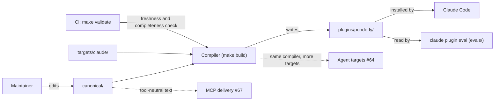
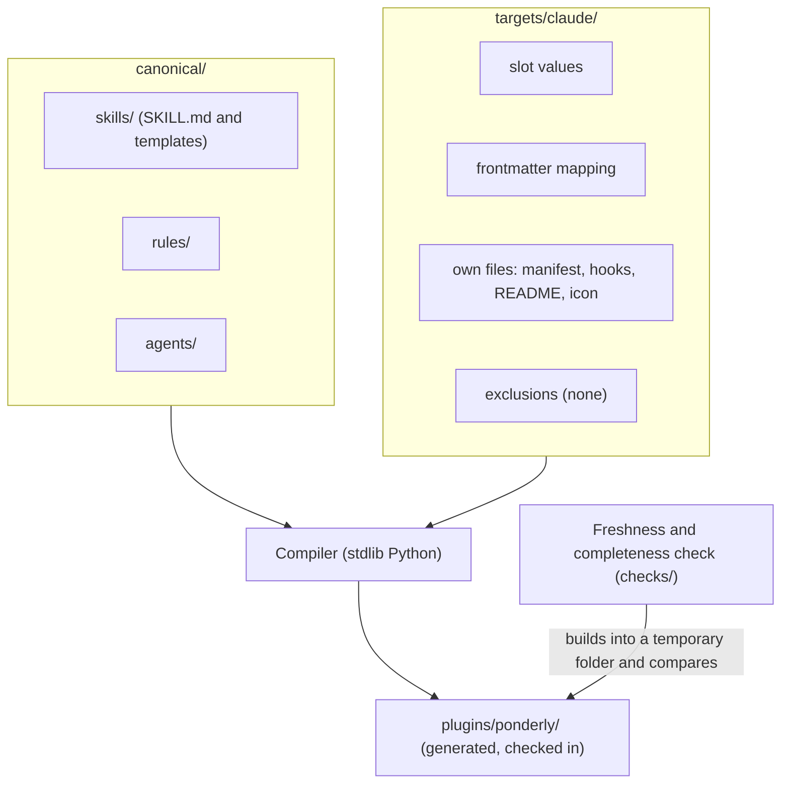

# Canonical source

Parent: .ponderly/strategies/multi-tool-plugin.md

> **Draft, not approved.** The `hld` skill stopped at its questions on 2026-10-26, and the author asked to commit the work so far. Every answer marked *(provisional)* is Claude's recommendation, not yet the author's answer. The document has not been through the `document-reviewer` agent. The seven open questions are listed under "Open questions" at the end.

## Scope

This design takes the strategy's first stream, canonical source and the Claude Code target (issue #63). It serves goals 1, 2 and 3.

It covers four things:
- the canonical folder that holds every skill, rule and agent once;
- the neutral markers where agents differ;
- the compiler, with its freshness and completeness check;
- the first target, Claude Code, whose generated output must match today's `plugins/ponderly/` byte for byte, so the migration changes no behaviour.

Every other agent's target is the agent targets stream, #64. The eval harness is the cross-agent evals stream, #65.

## Context

The maintainer edits only `canonical/` and a target's own files. `make build` writes `plugins/ponderly/`, the folder Claude Code's marketplace installs and `evals/` reads, so neither changes. CI runs the freshness and completeness check through `make validate`. The agent targets stream adds more targets to the same compiler, and the MCP delivery stream reads the same canonical text.

## Architecture

- **`canonical/`** *(provisional names)*: the eight skills with their templates, the five rules and the three agents, each written once. Where agents differ, the text holds a marker in place of agent-specific syntax.
- **Markers** *(provisional)*:
  - **Named slots** for the differences the spike in #61 measured: the ticket and base-branch arguments, the skill's own folder, a prefetch command, the question tool, and naming an agent or a skill to hand off to.
  - **Per-agent blocks,** a rare escape hatch, to include or leave out a passage for one agent.
  - Expanded with stdlib Python only, with no template engine.
- **`targets/claude/`** *(provisional names)*: everything specific to Claude Code.
  - The value of each slot. For example, the skill-folder slot becomes `${CLAUDE_SKILL_DIR}`, a prefetch slot becomes a `` !`…` `` line, and the question slot names AskUserQuestion.
  - The frontmatter mapping.
  - Its own files, copied into place:
    - `.claude-plugin/plugin.json`;
    - `hooks/hooks.json`, `load-rules.sh` and `load-rules-subagent.sh`;
    - the listing README and the icon.
  - Its exclusions, which are none.
- **Compiler:** a stdlib Python script behind `make build`. It reads `canonical/` and one target folder, expands the slots and blocks, maps the frontmatter, copies the target's own files, and writes the target's output. For Claude Code, that output is `plugins/ponderly/`.
- **Freshness and completeness check:** a stdlib `unittest` file under `checks/`, run by `make validate` in CI.
  - It builds every target into a temporary folder and fails when the result differs from the checked-in output.
  - It also fails when a target leaves out a canonical skill, rule or agent that is not in that target's exclusions *(provisional definition)*.

A change moves through it like this. The maintainer edits a skill in `canonical/` and runs `make build`, which rewrites `plugins/ponderly/`. Both are committed together, and CI fails if the second was forgotten.

## Key decisions

**Key decision: the Claude Code target must reproduce today's plugin byte for byte before anything else changes.** The migration copies `plugins/ponderly/` into `canonical/` as it is. It then replaces Claude-only syntax with slots one kind at a time, and after each kind `make build` must leave no diff *(provisional order)*. That way the benchmark tool, Claude Code, reads exactly what it reads today, and every step can be checked mechanically.

The trade-off is a slower migration, done in several small steps rather than one rewrite.

Rejected: rewriting the canonical text in a neutral voice first and accepting a Claude Code diff. That would change the benchmark while building the thing meant to measure against it.

**Key decision: named slots for measured differences, with per-agent blocks only as an escape hatch** *(provisional)*. Slots keep the canonical text readable and the markers few. That answers the strategy's risk of the markers growing into a programming language.

The trade-off is that a difference no slot covers needs either a new slot, decided deliberately, or a block, which is noisier.

Rejected:
- Blocks everywhere, which turn each skill into one copy per agent inside a single file.
- A template engine such as Jinja, which would be the repository's first dependency outside the stdlib.

**Key decision: skills, rules and agents are canonical; manifests, hooks, README and icon belong to each target** *(provisional)*. The canonical folder holds what every agent shares, and a target holds what only its agent reads.

The trade-off is that a file such as the README, which mixes shared description with Claude-only listing rules, stays per target and is maintained once per agent.

Rejected: canonical hooks. The Claude Code hook scripts are bound by the plugin directory's validator rule, which allows "no other variable" than `CLAUDE_PLUGIN_ROOT`, as `load-rules.sh` records. No other agent runs them as they are.

**Key decision: canonical frontmatter holds every field any agent uses; each target maps it** *(provisional)*. A skill or agent declares `allowed-tools`, `arguments`, `model` and `effort` once. Each target keeps, translates or drops each field, and every dropped field is recorded as that agent's gap.

The trade-off is canonical frontmatter that is a superset no single agent reads in full.

Rejected: per-target frontmatter files beside each skill, which would multiply the files per skill by the number of agents.

**Key decision: a stdlib Python compiler with checked-in output and a freshness check.** This follows the strategy's principles. The repository's checks are already stdlib Python. Checked-in output means no install needs a build of its own.

The trade-off is generated files in every diff, and a build on every edit.

Rejected: building at install time.

## Cross-cutting concerns

- **The benchmark.** The byte-for-byte requirement means no Claude Code eval needs to run during the migration itself. Once canonical text starts to differ from today's, every Claude Code eval target runs before and after, as the strategy sets.
- **Validation.** `plugins/ponderly/` must keep passing `claude plugin validate --strict` and `checks/test_listing.py`. The existing checks under `checks/` read `plugins/ponderly/`. They keep doing so, now against generated output.
- **Size.** Rules still reach Claude Code through hook output capped at 10,000 characters, which `checks/test_rules_size.py` guards.
- **No checks on prompt text.** The freshness check compares built files, and the completeness check compares which skills, rules and agents are present. Neither reads a skill's wording.

## Risks

- **A construct resists a slot.** Some Claude-only text may not fit any named slot. Likely for one or two passages; it would cost a block or a new slot. The migration meets these one at a time, and each new slot is decided in the low level design, not ad hoc.
- **Generated output is edited by hand.** Likely, especially at first, since `plugins/ponderly/` is where every edit happens today. It would cost a silent revert at the next build. The freshness check fails in CI, and the plugin's README and the contributing guide say where edits go.
- **Byte-for-byte parity hides a slot bug.** A slot that expands correctly for Claude Code could still be wrong for other agents. Possible. The agent targets stream, #64, proves each target with the cross-agent evals, #65.
- **The build becomes a barrier to small fixes.** Certain, and a small cost on every edit. `make build` is one command, and the freshness check names the file to rebuild.

## Out of scope

- Every target other than Claude Code: the agent targets stream, #64.
- The eval harness and its scenarios: the cross-agent evals stream, #65.
- The weekly format watch, #66, and the MCP server, #67.
- The IDEs, as the strategy sets.

## Low level designs

- `canonical-layout-and-slots`: the folder layout, the list of named slots with each one's Claude Code value, the per-agent block syntax, and the canonical frontmatter.
- `compiler-and-check`: the stdlib compiler and `make build`, the target folder's contract (slot values, frontmatter mapping, own files, exclusions), and the freshness and completeness check under `checks/`.
- `claude-target-migration`: moving today's plugin into `canonical/` and `targets/claude/`, kind by kind, with no diff after each step, and how contributors learn that edits now go to `canonical/`.

## Open questions

Asked of the author on 2026-10-23 and not yet answered. The recommendation for each is written into the design above as *(provisional)*.

1. **Folder names.** `canonical/` and `targets/<agent>/`, with Claude Code's output staying at `plugins/ponderly/`?
2. **What is canonical and what a target owns.** Are skills, rules and agents canonical, while the manifest, hooks, README and icon belong to each target?
3. **The marker syntax.** Named slots for the measured differences, plus per-agent blocks as a rare escape hatch, expanded with stdlib Python only?
4. **Frontmatter.** Should canonical frontmatter hold every field any agent uses, with each target keeping, translating or dropping each one, and a dropped field recorded as a gap?
5. **What "complete" means.** Is a target complete when every canonical skill, rule and agent appears in its output or is listed in its exclusions with a reason?
6. **The migration order.** Copy today's plugin into `canonical/` as it is, then convert one kind of construct at a time, requiring no diff after each?
7. **More risks or out of scope?** Is there anything beyond the other streams and the IDEs?
