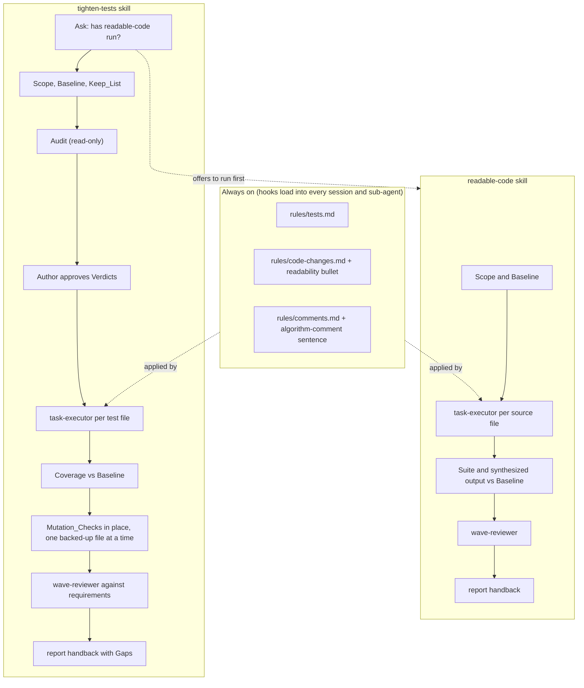

# Design Document

## Overview

The preferences split by when they apply. What shapes every test and line as it is written goes into the always-on rules, which the plugin's hooks load into every session and sub-agent: a new `rules/tests.md`, one bullet in `rules/code-changes.md` and one sentence in `rules/comments.md`. What is a procedure run on purpose over a branch goes into two skills, `readable-code` and `tighten-tests`, which do their per-file work through the plugin's existing `task-executor` agent and their reviews through the existing `wave-reviewer` agent, so the change adds no agent and no hook. `tighten-tests` checks that `readable-code` has run rather than containing it, so the rule that readability comes first lives in one place. The README, the issue forms, the size check, the manifest version and the eval suite are updated to ship them.

## Architecture



```mermaid
sequenceDiagram
    actor A as Author
    participant S as tighten-tests
    participant E as task-executor (one per test file)
    participant R as wave-reviewer
    A->>S: /ponderly:tighten-tests [paths]
    S->>A: Scope; has readable-code run on the final code?
    A-->>S: yes
    S->>S: Baseline: counts, per-line coverage
    S->>A: Keep_List gathered; anything to add?
    S->>S: Audit, read-only
    S->>A: Verdicts (drops and merges in full, keeps counted)
    A-->>S: Approved, with changes
    S->>E: apply this file's Verdicts; change no source
    E-->>S: Summary
    S->>S: coverage vs Baseline; restore any lost line's test
    S->>S: Mutation_Checks in place, each file backed up and restored
    S->>R: review the test changes against the requirements
    R-->>S: Findings
    S->>A: report handback: problems, counts, coverage, Gaps
```

Key decision 1: preferences in rules, procedures in skills. The rules carry the test and readability preferences because only an always-on rule shapes a test while it is being written, which is where the bloat starts (Requirements 1, 2), and the skills carry the cleanup because it is several steps run on purpose (Requirements 4 to 8). The trade-off is the hook budget: the rules take about 1,500 more characters, leaving roughly 400 of the 10,000. Rejected: rules only, because the procedure alone would exceed the budget; skills only, because nothing would stop new tests codifying values between cleanups.

Key decision 2: a new `rules/tests.md` for how tests are written, rather than more bullets in `code-changes.md`. `code-changes.md` keeps when a test is required, and the new rule says what a good test is (Requirements 1.1, 1.9). The trade-off is one more file heading in the hook output. Rejected: extending `code-changes.md`, which would grow it to about 3,000 characters and mix two concerns.

Key decision 3: two skills, with `tighten-tests` checking for `readable-code` and offering it rather than containing it (Requirements 4, 5.2). The readability pass is useful on its own, and renames and restructures change what the tests should assert, so readability goes first. The trade-off is one more question at the start of `tighten-tests`. Rejected: one combined skill, which would drag the test cleanup along whenever only the code needs tidying.

Key decision 4: reuse `task-executor` and `wave-reviewer` (Requirements 4.5, 4.8, 7.1, 8.1, 9.5). The executor already builds one contained change and returns a fixed Summary, and the reviewer already reads a diff against what it must satisfy. The launch prompt carries what is particular: for a readability file, "no behaviour change, no rename for taste, prove it with the existing tests", which keeps the executor's standalone mode from adding a test for a change that has no new behaviour; for a test file, its approved Verdicts and "change no source file". The trade-off is that the guarantees rest on the launch prompt and on the skill's own checks after it. Rejected: dedicated audit and mutation agents, which the brief asks not to add unasked.

Key decision 11: one Executor per File_Group, all given the Shared_Decisions (Requirements 4.5, 7.1). One executor per file gave similar files, such as several pages of one kind, separate judgements that came out slightly different. So the skill first reads Scope, groups files that share a template, role or pattern, and writes a short list of how each recurring issue is handled; the Author approves both before any change. A group's executor fixes the shared issues the same way across its files, and the list makes every executor agree on cross-cutting choices. The trade-off is fewer parallel executors and a larger context per group, and grouping is a judgement the Author checks. Rejected: one executor per file, which made inconsistent choices on similar files; a shared list alone, which leaves subtle differences between similar files to separate judgements.

Key decision 5: the Audit and the Mutation_Checks run in the skill's own session, not in executors (Requirements 6, 7.6 to 7.10). The Audit needs every test in Scope side by side to find duplicates across files, and Mutation_Checks change real source files one at a time, so running them serially avoids two checks breaking the same code at once. The trade-off is time and context on a large branch: the checks run one at a time, each with only the test file that should fail. Rejected: one executor per test file doing its own mutations, because concurrent changes to shared source would make a passing test meaningless.

Key decision 6: Mutation_Checks change the real file in place, with a backup (Requirement 7.10). Each check copies the one source file to a backup outside the repository, breaks one place in it, runs only the test file that should fail, and restores the file from the backup at once; `git diff` of the real tree is then compared with the record taken before the checks. At its start the skill restores any backup an interrupted run left behind. The trade-off is that an interrupted check leaves one file broken until the next run or `git diff` shows it. Rejected: a scratch git worktree, because it lacks the project's installed dependencies, which must be linked in, and the branch's uncommitted work, which must be copied in, plumbing that breaks easily and prompts the author for each copy command; a mutation-testing tool, because it adds a dependency to every project and is slow and noisy where a targeted check per test is wanted.

Key decision 7: coverage is compared line by line, not as percentages (Requirements 5.3, 7.4, 7.5). "No covered line lost" needs the set of covered lines per module, which the project's coverage tool gives in its machine-readable report. The numbers are reported but no threshold is set, because a threshold counts entry files that cannot be tested and invites placeholder tests. With no coverage tool the skill stops and asks (Requirement 5.4).

Key decision 8: the Audit shows decisions, not the whole table (Requirement 6.5). Every `drop` and `merge` is listed in full, with the path it proves and the reason, and `keep`s are counted per file, because the drops and merges are what the Author decides and a branch can hold hundreds of keeps. The trade-off is that the Author must ask to see the keeps. Rejected: the full table in the conversation, which buries the decisions.

Key decision 10: review findings are fixed by the same mechanism `implement-spec` uses (Requirements 4.8, 8.1). A `blocker` or `should-fix` goes to the Executor that owns the file, or a new one given the finding, for up to two fix attempts, with that file's checks re-run in the skill's session; for `tighten-tests` the source check and the Mutation_Check of every test the fix changed run again after each fix, and a file the slimming made wrong without changing it, such as a fake only dropped tests used or a document that counts the tests, gets a new Executor with the finding as its whole task; a finding that needs a source change is carried. Anything still open after two attempts, and every `nit`, goes to the hand-back's problems. Rejected: handing every finding to the Author, which leaves fixable problems for them to relaunch by hand.

Key decision 9: Gaps go back as a list, not as work (Requirement 8.3). The hand-back names each Gap as a task one `start-task` run could take, and offers to file them as issues; on a yes, the skill files them with `gh issue create`. Rejected: filling Gaps in the cleanup, which grows the cleanup into new features.

Adjacent fix: `comments.md` has two typos in lines this change already touches, "One write inline comments" and "return types ,"; they are corrected here.

## Components and Interfaces

### Test rule (`rules/tests.md`)

Says what a good test is, in every session and sub-agent.

| Operation | Input | Output | Requirements |
|-----------|-------|--------|--------------|
| loaded by `load-rules.sh` and `load-rules-subagent.sh` | the file | its text in the context | 1.1 to 1.9, 3.1 |

### Readability bullet and comment sentence

One bullet in `code-changes.md` preferring readable code and questioning hidden side effects; one sentence in `comments.md` fixing algorithm comments by fixing the code.

| Operation | Input | Output | Requirements |
|-----------|-------|--------|--------------|
| loaded with the rules | the files | their text in the context | 2.1 to 2.4 |

### `readable-code` skill

Runs the readability pass over Scope and proves no behaviour changed.

| Operation | Input | Output | Requirements |
|-----------|-------|--------|--------------|
| state Scope | target branch, paths passed | one line; stop when no source file | 4.1, 4.2 |
| take Baseline | the suite; synthesized output where infrastructure | recorded results; a question when the suite already fails | 4.3, 4.4 |
| launch executors | one source file each | Summaries | 4.5 |
| prove no change | suite and synthesized output after | a match, or the differing file and a revert-or-keep question | 4.6, 4.7 |
| review | the pass's changes | Findings; `blocker` and `should-fix` fixed by the owning executor within two attempts | 4.8 |
| hand back | everything above | a `report` handback; hand-off to `tighten-tests` or `pr` | 4.9 |

### `tighten-tests` skill

Runs the test cleanup over Scope, from preparation to hand-back.

| Operation | Input | Output | Requirements |
|-----------|-------|--------|--------------|
| state Scope and check readability | target branch, paths passed | one line; offer to run `readable-code` | 5.1, 5.2 |
| take Baseline | the suite, the coverage tool | counts and covered lines per module; a question when there is no tool | 5.3, 5.4 |
| gather Keep_List | the Author, the spec or ticket, the tests | the Keep_List | 5.5 |
| audit | every test the branch adds or changes in Scope | Verdicts, counts before and after, Gaps | 6.1 to 6.4 |
| get approval | the Audit | approved Verdicts | 6.5 |
| launch executors | one test file and its Verdicts each | Summaries | 7.1 to 7.3 |
| compare coverage | covered lines after | both reports; restored tests for lost lines | 7.4, 7.5 |
| mutation-check | each dropped, kept and new test | which tests failed; restored dropped tests; fixed or reported Vacuous_Tests; a diff of the real tree | 7.6 to 7.10 |
| review | the test changes, the requirements or Keep_List | Findings; `blocker` and `should-fix` fixed by the owning executor within two attempts; offers to restore a lost proof | 8.1, 8.2 |
| hand back | everything above | a `report` handback with counts, coverage and Gaps; an offer to file Gaps | 8.3, 8.4 |

### Shipping

| Operation | Input | Output | Requirements |
|-----------|-------|--------|--------------|
| README rows | the new skills and rule | rows in the skills and rules tables; updated rows for the two changed rules | 9.1 |
| issue forms | four forms with a component dropdown | three new options in each | 9.2 |
| manifest | `plugin.json` | version 0.17.0 | 9.3 |
| size check | `checks/test_rules_size.py` | limits for `tests`, `code-changes`, `comments` | 3.2, 3.3 |
| eval cases and targets | the skills and rule | one case each; Makefile per-target flags for the two skill targets | 9.4 |

## Data Models

Skill files follow the existing skills' frontmatter:

| Field | `readable-code` | `tighten-tests` |
|-------|-----------------|-----------------|
| `name` | `readable-code` | `tighten-tests` |
| `description` | when to use it and what it does, in the shape of the other skills' descriptions | the same |
| `argument-hint` | `"[paths]"` | `"[paths]"` |
| `allowed-tools` | read-only `git` commands, `git diff`, and `cp` for the Baseline copies | read-only `git` commands, `cp` and `mkdir` for the Mutation_Check backups, `gh issue create` for Gaps on a yes |

Rule size limits in `RULE_LIMITS`, in characters, chosen so the hook output stays under 10,000:

| Rule | Limit | Today |
|------|-------|-------|
| `tests` | 1,000 | new |
| `code-changes` | 2,450 | 2,044 |
| `comments` | 1,450 | 1,240 |

The Audit's Verdict record, as shown to the Author:

| Field | Notes |
|-------|-------|
| test | file and test name, quoted |
| proves | the path, corner case or gotcha, in a phrase |
| verdict | `keep`, `merge` or `drop` |
| into / why | the test it merges into, or why it adds nothing |
| on Keep_List | yes or no; a yes forces `keep` (Requirement 6.4) |

## Correctness Properties

### Property 1: The rules fit the hook
*For any* state of `rules/` this change leaves, the output of `load-rules.sh` is under 10,000 characters and each limited rule is within its limit.
**Validates: Requirements 3.1, 3.2**

### Property 2: Readability changes no behaviour
*For any* run of `readable-code` that ends without a reported difference, the suite result and the synthesized output after the pass equal the Baseline's.
**Validates: Requirements 4.6, 4.7**

### Property 3: The test pass leaves the source alone
*For any* run of `tighten-tests`, the diff of source files in Scope between the Baseline and the hand-back is empty.
**Validates: Requirements 7.2, 7.10**

### Property 4: No covered line lost
*For any* run of `tighten-tests` with a coverage tool, every line covered at the Baseline is covered after the slimming, or the hand-back names it as a problem.
**Validates: Requirements 7.4, 7.5**

### Property 5: The Keep_List survives
*For any* test on the Keep_List, the test is present after the slimming.
**Validates: Requirements 6.4, 8.2**

### Property 6: No silent vacuous test
*For any* kept, new or merged test, either it fails under its Mutation_Check or the hand-back names it as vacuous.
**Validates: Requirements 7.8, 7.9**

## Error Handling

| Condition | Category | Behaviour | Requirement |
|-----------|----------|-----------|-------------|
| Scope holds no source file (or no test, for `tighten-tests`) | input | say so and stop, changing nothing | 4.2 |
| Suite fails at Baseline | precondition | report the failures, ask whether to go on | 4.4 |
| Suite or synthesized output differs after the readability pass | behaviour change | name the file, ask revert or keep | 4.7 |
| No coverage tool | precondition | say so, ask: add one, or go on with Mutation_Checks alone | 5.4 |
| An executor returns `stopped` | drift | show its Summary, leave that file, carry it to the hand-back | 4.5, 7.1 |
| A test exposes a source defect | defect | mark it Expected_Failure, report it | 7.3 |
| A covered line loses its test | regression | restore a covering test, report it | 7.5 |
| No kept test fails for a dropped test's mutation | regression | restore the dropped test, report it | 7.7 |
| A test is vacuous | weak test | relaunch the executor on that file to fix it; report it if it still passes | 7.9 |
| The real tree's diff changed during Mutation_Checks | safety | stop and report the diff | 7.10 |
| The review finds a requirement with no proof | regression | report it, offer to restore its test | 8.2 |
| `wave-reviewer`, `task-executor` or `report` is missing | environment | say which is missing and stop; do not do its work | 4.5, 4.8, 4.9 |

## Testing Strategy

- **Free checks.** `make validate` runs `test_rules_size.py` with the new limits (Property 1) and the existing frontmatter, listing and skill-name checks over the new skills. No new check file is added.
- **Eval cases.** One case under `evals/rules/tests/` for the Test_Rule, measured with `--ablation with-without` against a baseline, and one under each of `evals/skills/readable-code/` and `evals/skills/tighten-tests/`. As agreed with the Author, each case's behaviour is chosen while its skill is built rather than fixed here. The candidates are Properties 2 and 3, Property 5, and a Vacuous_Test caught by mutation. A skill case that needs an over-tested project gets a fixture under `evals/fixtures/`. Evals run by hand, one target at a time.
- **Manual run.** One run of each skill on a small real branch before the pull request, with the hand-back pasted into the Testing section.
