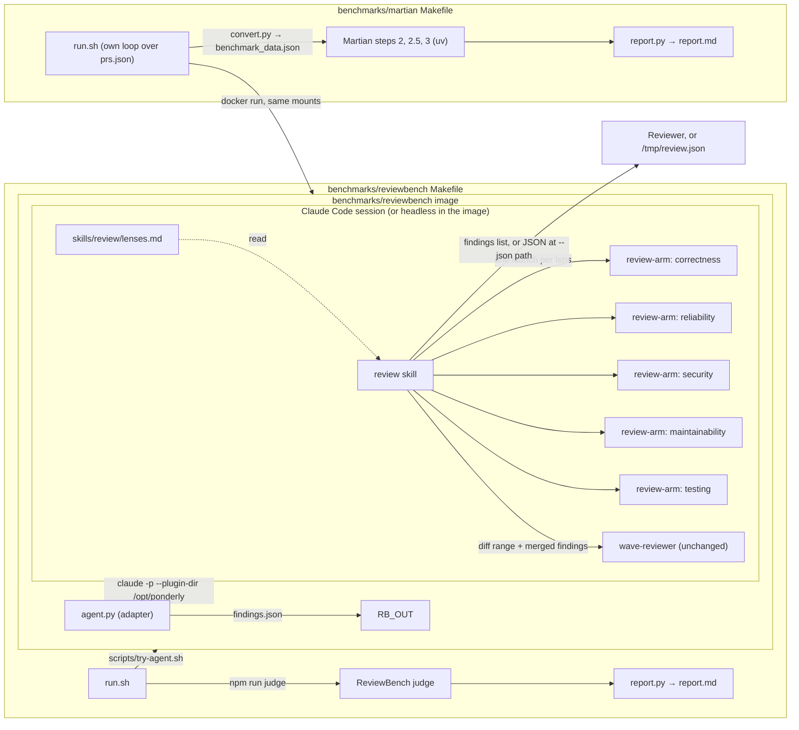
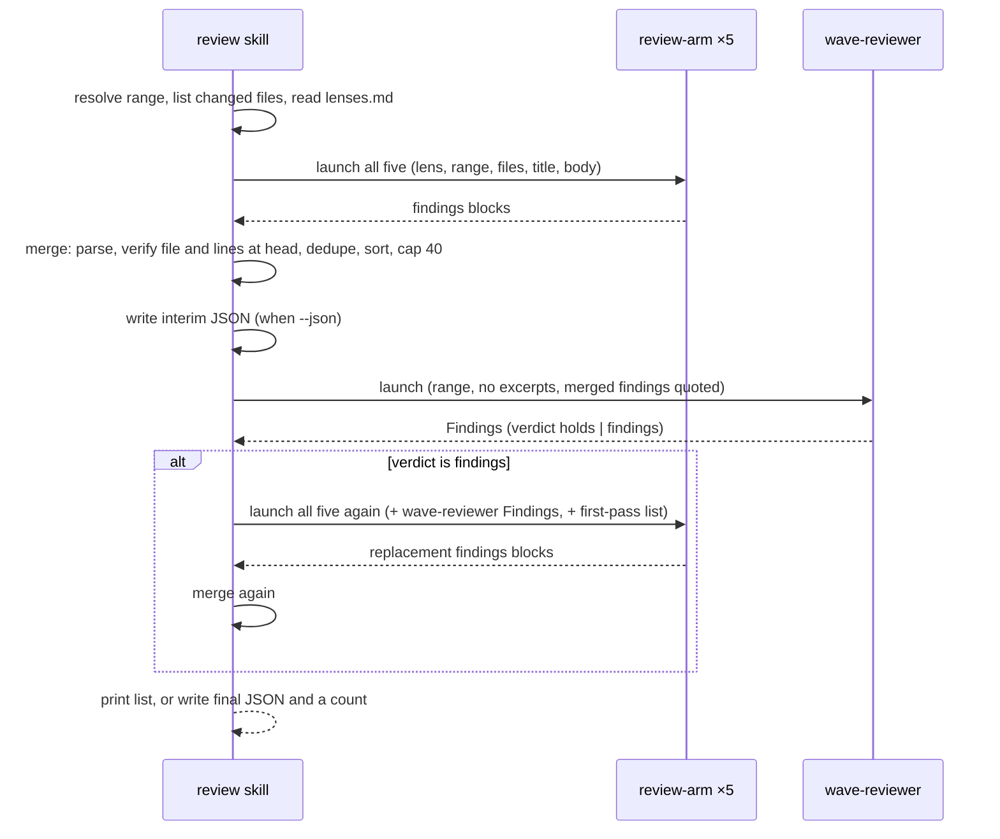
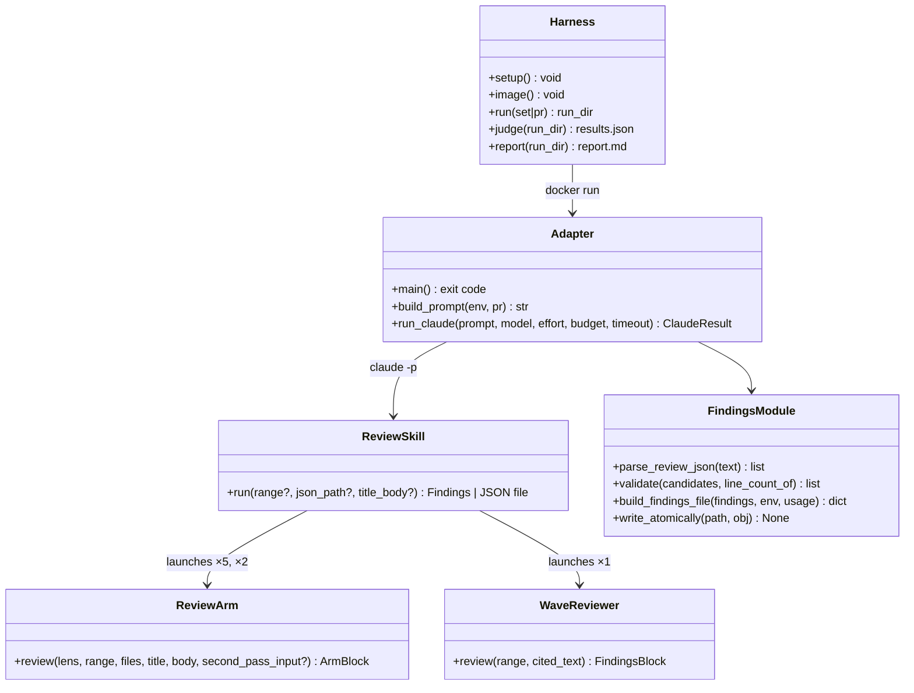

# Design Document

## Overview

The review is two new plugin pieces and one benchmark folder. A `review` skill orchestrates: it finds the pull request's range, launches one `review-arm` agent per lens, all at once, merges what they return into line-anchored findings, has the existing `wave-reviewer` read the diff with those findings quoted, and runs the arms once more when the `wave-reviewer` returns findings. In a session the skill prints the findings; with a `--json <path>` argument it writes them as JSON outside the repository, which is how the benchmark adapter collects them. `benchmarks/reviewbench/` holds a Docker image that runs Claude Code headlessly with the plugin copied in from the working tree, a Python adapter that satisfies ReviewBench's agent contract, and a Makefile that drives ReviewBench's own runner and judge and prints a score report. A second folder, `benchmarks/martian/`, runs the same image over Martian's 50 pull requests with its own loop, converts the findings files into Martian's data file and runs Martian's judge. Nothing in either benchmark folder ships with the plugin.

## Architecture





Key decision, one arm agent parameterised by a lens. There is one `review-arm` agent file; the lens text comes in the launch prompt from `plugins/ponderly/skills/review/lenses.md`, which holds the five lenses as sections. This satisfies Requirement 2.1 and 2.3: the Operator edits one file to change a lens, and the agent file pins the tools, the output shape and the discipline once. The trade-off is that an arm cannot have its own model or effort; all arms share the session's model and the arm's one `effort`. Rejected: five agent files, one per lens, which would repeat the procedure five times and drift; and inline Agent launches with the whole prompt written in the skill, which would spread the arm's procedure through the skill and leave no agent to eval on its own.

Key decision, arms gather the diff themselves. Like the `wave-reviewer`, an arm receives the range and the file list and runs `git diff` and reads files itself, so the diff never enters the orchestrating session and the session's context stays small enough for five arms and two passes (Requirement 1.1, 2.1). Trade-off: each arm reads the diff once, so the model cost is paid five times, plus twice more on a second pass. Rejected: pasting the diff into each launch, which would put the diff in the session six times and overflow on large pull requests.

Key decision, the `wave-reviewer` is launched unchanged, with the merged findings as the text it cross-checks. The agent already accepts a git range in place of a file list, reviews against the team rules when no excerpt is given, and cross-checks a "cited" text against the code, reporting every place the two disagree. Quoting the merged findings as that text makes the `wave-reviewer` a second reader of both the code and the arms' claims: a finding the code contradicts comes back as a `blocker` or `should-fix` naming it, and a problem the arms missed comes back as a finding of its own (Requirement 3.1). Trade-off: the `wave-reviewer`'s findings are quote-anchored, not line-anchored, so they cannot go into the output directly; the Second_Pass converts them. Rejected: a new critic agent, which the author ruled out for the first version; and editing the `wave-reviewer`, which is out of scope.

Key decision, the Second_Pass replaces each arm's list. Each arm receives the `wave-reviewer`'s Findings block and the first pass's merged list, and returns the full list for its lens again: findings it keeps, findings it withdraws because the reviewer contradicted them, and the reviewer's findings it could anchor to lines. The merge takes the second-pass list of every arm that returned and the first-pass list of any arm that failed (Requirement 3.2, 1.6). Trade-off: the second pass costs as much as the first. Rejected: a delta format ("add these, drop these"), which the merge would have to apply by matching free text and would get wrong more often than a plain replacement.

Key decision, the skill writes JSON only outside the repository. With `--json <path>` the skill writes the findings object to that path, twice, after the first merge and at the end, and refuses a path under the repository root, so Requirement 1.5 holds in a session and the adapter gets an interim file to fall back on at the time limit (Requirement 5.5). Rejected: parsing a fenced JSON block out of the final message, which is lost when the session is killed at the time limit; and Claude Code's `--json-schema` structured output, which also arrives only at the end.

Key decision, the plugin is copied into the image at build time and loaded with `--plugin-dir`. The Dockerfile's build context is the repository root, so the image holds `plugins/ponderly/` exactly as the working tree has it, and a benchmark run measures the checked-out plugin (Requirement 5.1). No marketplace or GitHub call happens at run time, which the egress allowlist would refuse. Claude Code itself is pinned by version in the Dockerfile. The image runs as a non-root user, because Claude Code refuses `bypassPermissions` as root. Rejected: `claude plugin install` at run time, which needs github.com.

Key decision, the adapter and the harness scripts are Python with the standard library, tested under `checks/`. The repository's checks are already Python `unittest` files run by `make check`, so the adapter's tests join them with no second test runner, and the report and converter scripts share the same language and tests. The image installs `python3` beside Node, which Claude Code needs anyway; size is not a concern. Rejected: a Node adapter, which would have added a `node --test` runner to the repository; and a bash adapter, which has no test framework here.

Key decision, the harness uses ReviewBench's own scripts from a pinned clone. `run.sh` clones `review-bench/ReviewBench` at the commit `REVIEWBENCH_COMMIT` names into `benchmarks/reviewbench/.reviewbench/`, gitignored, runs `npm ci` there, and calls its `scripts/try-agent.sh` and `npm run judge` (Requirement 6.2). Rejected: copying the scripts in, which would silently diverge from the benchmark.

Key decision, the Martian harness reuses the image and mirrors the runner. ReviewBench's `try-agent.sh` reads only its own manifests, so `benchmarks/martian/run.sh` does the same loop itself: fetch base and head from upstream with a blob-less filter, check out head, write `diff.patch` and `pr.json`, and `docker run` the image with the Contract's mounts and variables. Martian's steps 0 and 1, which fork pull requests and download comments from GitHub, are skipped: `convert.py` writes the `benchmark_data.json` those steps would have produced, straight from our findings files, so no GitHub app, fork or bot account is needed (Requirement 10.2, 10.3). Trade-off: the loop duplicates about forty lines of `try-agent.sh`, and the Martian golden files give only pull request URLs, so a one-time `make prs` resolves each one's base and head through `gh api` and stores them in `prs.json` (Requirement 10.1). Rejected: installing the review as a GitHub App on forks, which is what Martian's leaderboard needs but a local run does not.

## Components and Interfaces



### review skill (`plugins/ponderly/skills/review/SKILL.md`, `lenses.md`)

Orchestrates one review and returns the findings. Frontmatter: `argument-hint: "[base...head] [--json <path>]"`, `allowed-tools` limited to read-only git (`git status`, `git rev-parse`, `git merge-base`, `git diff`, `git show`, `git ls-files`, `git log`, `git cat-file`) plus `awk`.

| Operation | Input | Output | Requirements |
|-----------|-------|--------|--------------|
| resolve the range | no argument, or `base...head`, or `base head` | base and head (head is the working tree when no argument), found as `wave-reviewer` finds its base; the changed-file list; stops with "no diff" when empty | 1.1, 1.2, 1.4 |
| launch the arms | the five lens sections of `lenses.md`, the range, the files, the title and body from the text after the arguments | five arm blocks, in one message | 2.1, 2.2, 2.3 |
| merge | arm blocks | findings: an arm that did not return, returned no block or a malformed one, or did not review is launched once more with the same prompt, after the others have returned, and one that fails again is dropped and named as failed; each finding's file checked with `git cat-file -e head:path` and its lines against `git show head:path \| awk 'END{print NR}'`, which counts a last line with no newline (the working tree file when head is the tree); duplicates collapsed as `--duplicates` says, default `same-defect`: two candidates in the same file that name the same defect and the same fix become the one with the fuller message, keeping its own line range, and a different category is a sign they are not the same problem; `overlap` also collapses two whose ranges overlap in the same file; `keep` collapses none (the author's addition of 2026-10-29, after a run where a union of ranges could move a tight anchor onto a neighbouring defect's line); sorted high, medium, low; capped at 40 | 1.6, 2.4, 2.5, 2.6, 2.7 |
| write interim JSON | `--json <path>` outside the repository | the findings object at that path | 1.5, 5.5 |
| wave review | the range, the sentence that no requirement or design excerpt applies, the merged findings quoted as the text to cross-check | the `wave-reviewer`'s Findings block | 3.1 |
| second pass | verdict `findings`: the five lenses again, each with the Findings block and the first-pass list | replacement blocks, merged as above; runs at most once | 3.2, 3.3, 3.4 |
| report | the final findings | in a session: the list ordered by severity with file, lines, severity, category, message, then the counts (arms' candidates, removed by merge, removed by the wave review), the verdict and whether a second pass ran; with `--json`: the final file and a one-line count | 1.3, 3.5 |

### review-arm agent (`plugins/ponderly/agents/review-arm.md`)

Reads one pull request through one lens and returns an arm block. Frontmatter: `tools: Read, Glob, Grep, Bash, LSP`, `model: inherit`, `effort: high`, so in a session the arms follow the session's model and run at the level `wave-reviewer` runs at. In a benchmark run the adapter's environment variables below govern every agent, the `wave-reviewer`'s own `effort: high` included, so the configuration labels name what every agent used. The same read-only discipline as `wave-reviewer`: `Bash` for `git diff`, `git show`, reading, and checks that leave no file behind, with one allowance: when a candidate hinges on what the code computes and that code can be exercised on its own, the arm runs it once on the triggering input, from a scratch directory outside the repository with bytecode writing off, never the test suite, an install or code that reaches the network, a database or the filesystem, and quotes the result in the message (the author's addition of 2026-10-29, so a seen result backs a correctness or reliability finding).

| Operation | Input | Output | Requirements |
|-----------|-------|--------|--------------|
| review | the lens text, the range, the files, the title and body; on a second pass, the `wave-reviewer` Findings and the first-pass list | the arm block below | 2.1, 2.2, 4.1, 4.2, 4.3, 4.4 |

Its procedure: gather the diff for the range; read every changed file whole at head and the files they import or call where a claim needs them; for each problem the lens names, verify it against the code before reporting; anchor to the smallest range at head; write the message as what is wrong, why it matters and what would fix it, at most 120 words; report a pre-existing problem in a touched file when it is verifiable; report nothing it cannot verify, no style preference, no duplicate of its own, no advice that would not improve the change. On a second pass: keep, withdraw or add, and return the whole list.

### wave-reviewer agent (model line only)

Its `model: opus` becomes `model: inherit`, as do `task-executor`'s and `document-reviewer`'s, so every agent follows the session's model while its `effort` pin stays; Anthropic's official plugins follow this pattern, and the benchmark's environment variables govern every agent either way. Its procedure is unchanged. Launched as `implement-spec` and `readable-code` launch it, with the range in place of a file list, no excerpts, and the merged findings as the text it cross-checks (Requirement 3.1).

### Adapter (`benchmarks/reviewbench/agent/agent.py`, `findings.py`)

`agent.py` is the image's entrypoint; `findings.py` holds the pure functions the tests cover. Both use only the standard library.

| Operation | Input | Output | Requirements |
|-----------|-------|--------|--------------|
| check the environment | `RB_NWO`, `RB_PR_NUMBER`, `RB_BASE`, `RB_HEAD`, `RB_OUT`, `RB_AGENT`, and one of `ANTHROPIC_API_KEY` or `CLAUDE_CODE_OAUTH_TOKEN` (the subscription token `claude setup-token` prints, for local runs; the author's addition of 2026-10-29) | exit 2 naming the first missing one | 5.2, 5.4 |
| read settings | `RB_CONFIG_MODEL` (default `opus`), `RB_CONFIG_EFFORT` (default `high`), `RB_CONFIG_BUDGET_USD` (default `15`) | the line `model=<m> effort=<e> budget_usd=<b>` on stderr | 5.3 |
| build the prompt | `pr.json` title and body | `/ponderly:review <base>...<head> --json /tmp/review.json` then the title and body | 5.2 |
| run Claude Code | the prompt on stdin; after a kill, the child's output is read with a timeout and a process group already gone is not an error; flags `-p --output-format json --plugin-dir /opt/ponderly --permission-mode bypassPermissions --model --effort --max-budget-usd --no-session-persistence --add-dir /tmp`; cwd `/work/repo`; when the adapter runs as root, the child runs as the user `RB_CLAUDE_USER` names, default `reviewer`, through `subprocess`'s `user`, `group` and `extra_groups=[]` arguments, with `HOME` set to that user's home directory, and when it does not, as the adapter's own user with `RB_CLAUDE_USER` ignored and a line on stderr saying so; env with `DISABLE_TELEMETRY=1`, `DISABLE_AUTOUPDATER=1`, `CLAUDE_CODE_DISABLE_NONESSENTIAL_TRAFFIC=1`, and `CLAUDE_CODE_EFFORT_LEVEL=<effort>`, `CLAUDE_CODE_SUBAGENT_MODEL=<model>` and `CLAUDE_CODE_SUBAGENT_MODEL_FORCE=1`, which the Claude Code docs say take precedence over every agent's `effort` and `model` frontmatter and over a model or effort Claude passes at a launch; killed at 25 minutes | exit code, stdout JSON (`total_cost_usd`, `duration_ms`, `usage`) | 5.1, 5.5, 5.8 |
| collect | exit 0 and `/tmp/review.json` parses: build and write the Findings_File, exit 0; killed at the limit and an interim `/tmp/review.json` parses: the same, exit 0; a file whose `findings` is empty while `counts.failed_arms` is not is a review that did not happen: exit 1 with no file, so ReviewBench retries; otherwise exit 1 with no file | the Findings_File at `RB_OUT` | 5.5, 5.6, 5.7 |
| repair | a review file that raises in `parse_review_json` or returns a refused entry | one more Claude Code run with `RB_CLAUDE_BIN`, no plugin, the same user and environment as the review run, the same model and effort, `--max-budget-usd 1`, killed at the smaller of `RB_REPAIR_TIMEOUT_SECONDS` (default 180) and the seconds left before 29 minutes 30 seconds from the adapter's start, so the whole run ends inside the Contract's 30 minutes, given the file's text and the error or the refused entries on stdin and asked to write the file again at the review path in the Findings object's shape and nothing else; the file is parsed again; after the repair a file that still raises exits 1 with no `RB_OUT`, and entries still refused are dropped, counted on stderr, and the rest become the Findings_File with exit 0 | 5.6 |
| `parse_review_json(text)` | the skill's JSON | the candidates and, beside them, the entries refused with the field each lacks or mistypes; a raised error only when the text is not a Findings object with a `findings` list | 5.6 |
| `validate(candidates, line_count_of)` | candidates and a function giving a file's line count at head, or null when absent | findings with a forward-slash path, no leading `./` or `/`, integer lines within the file, severity order kept, at most 40; dropped entries counted on stderr | 2.5, 2.6, 4.5 |
| `build_findings_file(findings, env, usage)` | findings, `RB_*`, Claude's cost, duration and tokens | the Contract object with `agent` and every `producer` equal to `RB_AGENT`, `usage.time_in_ms`, `usage.cost_usd`, `usage.total_tokens`; the tokens are the sum of input, output, cache-creation and cache-read tokens over every entry of the result's `modelUsage`, which covers the sub-agents, and from the top-level `usage` only when `modelUsage` is absent | 4.5, 6.6 |
| `write_atomically(path, obj)` | the object | written to `path.tmp` then renamed | 5.6 |

### Image (`benchmarks/reviewbench/Dockerfile`)

`FROM node:22-slim`; installs `git`, `ca-certificates` and `python3`; installs `@anthropic-ai/claude-code` at the version `CLAUDE_CODE_VERSION` pins (2.1.312 on 2026-10-28); copies `plugins/ponderly` to `/opt/ponderly` and `benchmarks/reviewbench/agent` to `/agent`; creates user `reviewer` with no `USER` line, so the entrypoint runs as root and can write `/work/out` whatever the mount's owner, since ReviewBench's runner creates that folder on the host and bind-mounts it; the adapter starts the Claude Code child, and the repair run, as `reviewer` with `HOME=/home/reviewer`, because Claude Code refuses `bypassPermissions` as root; `ENTRYPOINT ["python3", "-I", "/agent/agent.py"]`. Built from the repository root with `docker build --platform linux/amd64 -f benchmarks/reviewbench/Dockerfile .`, with a `.dockerignore` at the repository root that keeps the build context to the two copied folders, since the root also holds the benchmark clones (Requirement 5.1, 5.8).

### Harness (`benchmarks/reviewbench/Makefile`, `run.sh`, `report.py`, `README.md`)

| Target | What it does | Requirements |
|--------|--------------|--------------|
| `check-tools` | stops naming the first of `docker`, `node`, `jq` that is missing, or that neither `ANTHROPIC_API_KEY` nor `CLAUDE_CODE_OAUTH_TOKEN` is set; the `judge` target requires `ANTHROPIC_API_KEY` itself, since ReviewBench's judge client reads it | 6.7 |
| `setup` | clones ReviewBench at `REVIEWBENCH_COMMIT` into `.reviewbench/`, `npm ci` there | 6.2 |
| `image` | builds `ponderly-review:dev` | 6.1 |
| `pr PR=<n>` | runs the image on one Test_Set pull request into `runs/<timestamp>-pr<n>/` | 6.1, 6.3 |
| `test-set`, `full-set` | runs the Set into `runs/<timestamp>-<set>/` | 6.1, 6.3 |
| `judge RUN=<dir>` | `npm run judge -- --candidate <dir>/findings --provider anthropic --model $(JUDGE_MODEL) --output <dir>/scoring/results.json`; `JUDGE_MODEL` defaults to `claude-sonnet-5`; records `judge_model` and `judge_base_url` in `run.json`; writes `.reviewbench/.judge/models.json` declaring `JUDGE_MODEL` under the `anthropic` provider with `JUDGE_BASE_URL` (default `https://api.anthropic.com`) as its base URL and runs the judge with `PI_CODING_AGENT_DIR` naming that folder, since the pinned clone's registry does not list the leaderboard's model | 6.4, 7.3 |
| `report RUN=<dir>` | `python3 report.py <dir>` writes and prints `<dir>/report.md` | 6.6, 7.1 |
| `manifest` | validates `ponderly.json` with the clone's `schema/validate-manifest.mjs`, which requires the file to be named after its `name` | 8.2 |

`run.sh` passes `-e ANTHROPIC_API_KEY -e CLAUDE_CODE_OAUTH_TOKEN -e RB_CONFIG_MODEL -e RB_CONFIG_EFFORT -e RB_CONFIG_BUDGET_USD` through, by name only, writes `run.json` as the Data Models give it, writes the runner's log to `<dir>/logs/try-agent.log`, and never runs in CI; `.github/workflows/validate.yml` is not changed to call it (Requirement 6.5).

### Martian harness (`benchmarks/martian/Makefile`, `run.sh`, `convert.py`, `report.py`, `prs.json`, `README.md`)

| Target | What it does | Requirements |
|--------|--------------|--------------|
| `check-tools` | stops naming the first of `docker`, `gh`, `uv`, `jq`, `MARTIAN_API_KEY` that is missing; `run`, `judge`, `prs` and `setup` each check their own tools and key first, through the same check (`run`: `docker`, `git`, `jq`, and one of `ANTHROPIC_API_KEY` or `CLAUDE_CODE_OAUTH_TOKEN`, both passed through by name; `judge`: `uv`, `jq`, `MARTIAN_API_KEY`; `prs`: `gh`; `setup`: `git`, `uv`) | 10.6 |
| `setup` | clones `withmartian/code-review-benchmark` at `MARTIAN_COMMIT` into `.martian/`, gitignored, and runs `uv sync` in its `offline/` | 10.4 |
| `prs` | reads the five golden files, resolves each pull request's base and head with `gh api repos/{owner}/{repo}/pulls/{n}`, and writes `prs.json` | 10.1 |
| `run` | the loop over `prs.json` into `runs/<timestamp>/findings/`, the same `docker run` as ReviewBench's runner, the same `-e` pass-through, and writes `run.json` | 10.2 |
| `convert RUN=<dir>` | `python3 convert.py <dir> .martian/offline/golden_comments` writes `<dir>/benchmark_data.json` | 10.3 |
| `judge RUN=<dir>` | copies the data file into the clone's `offline/results/`, runs `step2_extract_comments --tool ponderly`, `step2_5_dedup_candidates --tool ponderly` and `step3_judge_comments --tool ponderly --dedup-groups ...` with `MARTIAN_API_KEY`, `MARTIAN_BASE_URL` and `MARTIAN_MODEL` from the environment, and copies `evaluations.json` back into `<dir>/scoring/`; records the judge model and URL in `run.json` | 10.4 |
| `report RUN=<dir>` | `python3 report.py <dir>` writes `<dir>/report.md` with precision, recall and F1 under Strict, Core and All, computed from `evaluations.json` and the golden categories | 10.5, 10.7 |

The judge defaults are `MARTIAN_BASE_URL=https://api.anthropic.com/v1/` with Anthropic's OpenAI-compatible chat endpoint and `MARTIAN_MODEL=claude-sonnet-5`, the Operator overriding them for an OpenAI judge. Whether that endpoint satisfies Martian's client is checked on the first `judge` run and recorded in the folder's README (inferred until then).

### Score report (`report.py`)

Reads `scoring/results.json` (the judge's `macro` and `micro` overall, `by_severity` and `by_category` metric sets) and every `findings/*.json` `usage`, and writes `report.md`: a header with the plugin version, model, effort, Set, judge model, date and the commands run, all read from the run folder's `run.json`; then one table per metric group with a sentence saying what the number means before it, grounded F1 computed from grounded precision and recall, mean review duration from `usage.time_in_ms`, and total and mean cost from `usage.cost_usd` (Requirement 6.6, 7.1).

### Leaderboard files

`.github/workflows/publish-review-image.yml` runs on `workflow_dispatch` only, builds the image with `docker/build-push-action` for `linux/amd64`, pushes `ghcr.io/sabind/ponderly-review:<sha>` with the job's own token, and writes the digest to the step summary (Requirement 8.1). `benchmarks/reviewbench/ponderly.json` holds the manifest of Requirement 8.2 with a placeholder digest until the first publish, named after its `name` as the validator requires and as ReviewBench's `agents/` folder will hold it. `README.md` holds the portal steps (Requirement 8.3), and the note that a new GitHub Container Registry package is private until the Owner makes it public or declares a pull token in the manifest. Nothing runs the workflow or opens the ReviewBench pull request; the Owner does both by hand (Requirement 8.4).

### Evals and documentation

`evals/fixtures/shop/`: a small Python package with a request handler, a query builder and tests; branch `shop-search` adds a search endpoint with a planted SQL string concatenation (security) and an off-by-one in pagination (correctness). `evals/skills/review/finds-planted-defects/` launches `/ponderly:review` on it and grades with `regex` graders for the two files and line numbers and a `tool_used` grader for `Agent`; `evals/skills/review/clean-diff/` runs it on the `calc` fixture's clean branch with a `regex` grader, `match: not_contains`, on the shapes of a high finding the skill prints. `evals/agents/review-arm/security-lens/` launches the arm alone with the security lens and grades that it names the concatenation. The plugin README, `docs/reference.md`, `llms.txt` and the README's workflow diagram gain `review` and `review-arm` (Requirement 9.2, 9.3, 9.4).

## Data Models

Arm block, returned by `review-arm` as its final text:

```
lens: <name>
findings:
- file: <repository-relative path>
  start_line: <integer>
  end_line: <integer>
  severity: high | medium | low
  category: correctness | reliability | security | maintainability | testing | performance | documentation | api-architecture | accessibility
  message: <what is wrong, why it matters, what would fix it>
unsure:
- <text, or "nothing">
```

The categories are ReviewBench's own taxonomy, so the Score_Report's category split lines up with the golden set.

Findings object, written by the skill at the `--json` path and read by the adapter:

| Field | Type | Notes |
|-------|------|-------|
| `pass` | `"first"` or `"final"` | which merge wrote it (Req 5.5) |
| `verdict` | `"holds"`, `"findings"` or `null` | the wave review's verdict; `null` in the interim file (Req 3.5) |
| `second_pass` | boolean | whether the second pass ran (Req 3.5) |
| `counts` | `{candidates, removed_by_merge, removed_by_review, failed_arms: [lens]}` | Req 1.3, 1.6 |
| `findings` | array of Finding | ordered high, medium, low; at most 40 (Req 2.6) |

Finding:

| Field | Type | Notes |
|-------|------|-------|
| `file` | string | forward slashes, no leading `./` or `/` (Req 4.5) |
| `start_line`, `end_line` | integer | 1 ≤ start ≤ end ≤ lines in the file at head (Req 2.5, 4.2) |
| `severity` | `high`, `medium`, `low` | |
| `category` | string | one of the arm block's categories |
| `message` | string | at most 120 words (Req 4.1) |

Findings_File, written by the adapter at `RB_OUT`: the Contract's object, `pr.repo` as `https://github.com/<RB_NWO>`, `pr.pr_number` as a number, `pr.base`, `pr.head`, `agent`, `findings` as Contract entries (`file`, `start_line`, `end_line`, `message`, `producer`), and `usage` with `time_in_ms`, `cost_usd` and `total_tokens` (Req 4.5, 6.6).

Run folder `benchmarks/reviewbench/runs/<timestamp>-<set>/`: `run.json`, `findings/<pr key>.json`, `scoring/results.json` and the judge's per-PR files, `logs/try-agent.log`, `report.md` (Req 6.3, 7.3).

Run record `run.json` at the root of each run folder, written by `run.sh` when a run starts and read by `report.py`: `set` (`pr<n>`, `test` or `full`), `model`, `effort`, `budget_usd`, `image`, `plugin_version` read from `plugins/ponderly/.claude-plugin/plugin.json` at that moment, `started` as an ISO-8601 timestamp, `commands` as the list of `make` commands run on the folder, each target appending its own, and `judge_model` and `judge_base_url`, which the `judge` target fills. The Martian run folder holds the same file without `set` (Req 7.1, 10.5).

`benchmarks/martian/prs.json`: an array of `{nwo, pr_number, title, body, base, head, golden_url}`, one per Martian pull request, in the golden files' order (Req 10.1).

Martian_Data_File record, written by `convert.py` under the golden URL as key: `pr_title`, `original_url`, `source_repo`, `golden_comments` and `golden_source_file` copied from the golden file, `az_comment` null, and `reviews: [{tool: "ponderly", repo_name: <nwo>, pr_url: <golden_url>, review_comments: [{path, line, body}]}]`, one comment per Finding with `line` its `start_line` (Req 10.3).

Run folder `benchmarks/martian/runs/<timestamp>/`: `run.json`, `findings/`, `benchmark_data.json`, `scoring/evaluations.json`, `logs/run.log`, `report.md` (Req 10.2).

## Correctness Properties

### Property 1: Every finding is anchored in the head tree

*For any* findings object and any head tree, every Finding `validate` returns names a file present in the tree and a range with 1 ≤ `start_line` ≤ `end_line` ≤ that file's line count, and no returned Finding's path starts with `./` or `/`.

**Validates: Requirements 2.5, 4.2, 4.5**

### Property 2: The output is bounded and ordered

*For any* list of candidates, `validate` returns at most 40 Findings, in non-increasing severity, and when more than 40 are valid the ones dropped are of the lowest severity present.

**Validates: Requirements 1.3, 2.6**

### Property 3: The findings file echoes the contract's identity

*For any* findings and any `RB_*` environment, `buildFindingsFile` returns `pr.head` equal to `RB_HEAD`, `pr.pr_number` equal to `Number(RB_PR_NUMBER)`, `agent` equal to `RB_AGENT`, and `producer` equal to `RB_AGENT` on every entry.

**Validates: Requirements 4.5, 5.2**

### Property 4: A findings file exists exactly when the review produced parseable findings

*For any* Claude Code outcome (exit 0 with a parseable review file, exit 0 with a file that parses only after the one repair run, exit 0 with a file that does not parse after it, exit 0 without one, non-zero exit, kill at the time limit with or without an interim file), the adapter writes `RB_OUT` and exits 0 if and only if a parseable review file exists after at most one repair run and is not an empty list with a failed arm, and otherwise exits non-zero with no file at `RB_OUT`.

**Validates: Requirements 5.5, 5.6, 5.7**

### Property 5: The second pass runs at most once

*For any* pull request, the skill launches each arm at most twice per pass, the second time only when the first launch failed, runs at most two passes, and launches the `wave-reviewer` exactly once.

**Validates: Requirements 3.2, 3.3, 3.4**

### Property 6: The Martian data file keeps every finding once

*For any* set of findings files that each match a golden pull request, the Martian_Data_File `convert.py` writes has one record per matched golden pull request, one `ponderly` review per record, and exactly as many comments as the file had findings, each with the finding's file, start line and message.

**Validates: Requirements 10.3**

## Error Handling

| Condition | Category | Behavior | Requirements |
|-----------|----------|----------|--------------|
| No diff in the range | EMPTY | The skill says so and returns no findings | 1.4 |
| `--json` path under the repository root | VALIDATION | The skill refuses and says the path must be outside the repository | 1.5 |
| An arm returns no block or a malformed one | PARTIAL | The skill launches it once more; if that fails too, the merge drops it, names the lens as failed in the counts and the reply, and goes on | 1.6, 2.7 |
| The review file lists no findings and names a failed arm | FAILURE | The adapter exits 1 and writes nothing, so ReviewBench retries rather than scores a review that did not happen | 5.6 |
| The `wave-reviewer` does not return | PARTIAL | The skill returns the first-pass findings, says the wave review did not return, runs no second pass | 1.6 |
| A finding names a file absent at head or lines beyond it | VALIDATION | Dropped by the merge, and again by the adapter's `validate`, counted on stderr | 2.5 |
| More than 40 valid findings | LIMIT | The lowest severities are dropped to 40 | 2.6 |
| A required `RB_*` variable is missing, or neither `ANTHROPIC_API_KEY` nor `CLAUDE_CODE_OAUTH_TOKEN` is set | CONFIG | The adapter exits 2 naming it, before any model call | 5.2, 5.4 |
| Claude Code exits non-zero or its review file is missing | FAILURE | The adapter exits 1 and writes nothing, so ReviewBench retries | 5.6 |
| The review file does not parse or an entry lacks a field | REPAIR | One repair run; a file that still does not parse exits 1; entries still refused are dropped and counted, the rest are written and the adapter exits 0 | 5.6 |
| Claude Code still running at 25 minutes | TIMEOUT | Killed; the interim review file, if it parses, becomes the Findings_File and the adapter exits 0; otherwise exit 1; a repair that follows gets only the time left before 29 minutes 30 seconds | 5.5 |
| The review returns an empty list | EMPTY | A Findings_File with `"findings": []`, exit 0 | 5.7 |
| `docker`, `node`, `jq` or the key missing on the Operator's machine | CONFIG | `check-tools` stops naming it, before clone, build or model call | 6.7 |
| The judge's `results.json` is absent when `report` runs | CONFIG | `report.py` exits 1 naming the file and the `judge` target | 6.6 |
| `uv`, `gh`, `jq` or the Martian judge key missing | CONFIG | `check-tools` stops naming it, before clone, fetch or model call | 10.6 |
| A Martian pull request's base or head cannot be fetched | PARTIAL | `run.sh` logs it, skips it and reports the count at the end; `convert.py` writes no record for it | 10.2 |
| A findings file has no record in the golden files | VALIDATION | `convert.py` exits 1 naming the file | 10.3 |

## Testing Strategy

- Seeded property tests for Properties 1 to 3 in `checks/test_reviewbench_findings.py`, standard-library `unittest` with a `random.Random(0)` generator of candidate lists, at least 100 iterations each, the head tree faked by an in-memory map of path to line count; and one example test per outcome of Property 4 in `checks/test_reviewbench_agent.py`, since its outcomes are an enumeration, with Claude Code faked by a stub script named through `RB_CLAUDE_BIN` that the test tells to exit 0 with a review file, exit 0 without one, exit 1, or sleep past a short test time limit, with or without an interim file. `make check` already discovers every file under `checks/` (Requirement 9.1).
- A seeded property test for Property 6 in `checks/test_martian_convert.py`, generating findings files and golden records, and example tests for the Martian Error Handling rows `convert.py` owns (Requirement 9.1, 10.3).
- Example and edge-case tests for each Error Handling row the adapter and `report.py` own: a missing variable, a malformed review file, an empty findings list, a path with a leading `./`, a `start_line` of 0, a file of one line, 41 valid findings, awkward message text (joined emoji, a byte-order mark, whitespace only, a very long string).
- Property 5 and the skill's own rows are proven by the eval cases under `evals/skills/review/`, whose `tool_used` graders set `min` and `max` on `Agent` launches; the arm by `evals/agents/review-arm/` (Requirement 9.2, 9.3).
- The integration test is `make -C benchmarks/reviewbench pr PR=0` followed by `judge` and `report` on one Test_Set pull request, run by hand, with its report pasted into the pull request's Testing section and later `docs/evidence.md` (Requirement 7.2).
- `make validate` proves the documentation names resolve (Requirement 9.4).
