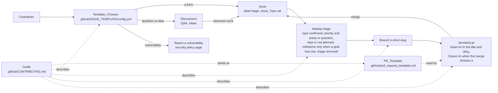
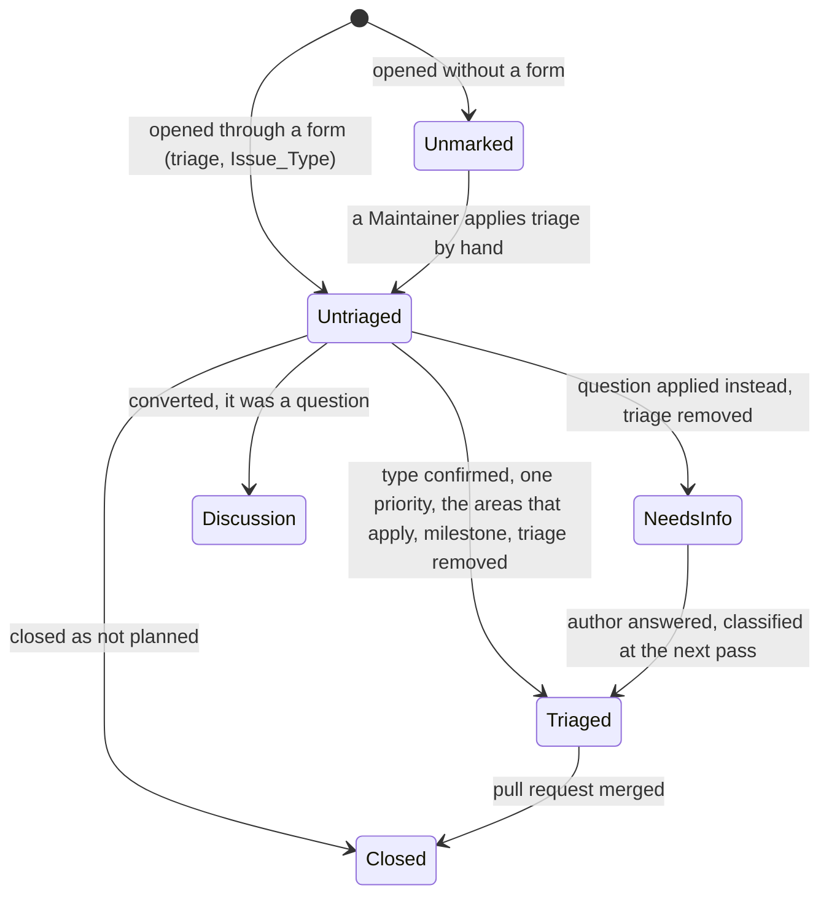

# Design Document

## Overview

The work is documents, templates, settings and one small skill change. Everything a contributor reads lives under `.github/`, beside the pull request template GitHub already picks up from there: the Guide, the code of conduct, the security policy, three Issue_Forms and the Template_Chooser. `LICENSE` stays at the repository root, the one place GitHub detects a license. The README keeps a pointer of at most three sentences. The pr skill changes in three places: its ticket question takes a Ticket_Reference in any form; its title example and Why bullet write the reference the way its tracker does, nothing more; and its template sentence, which already prefers a repository's own template, says that the template's comments decide what each section holds and points the fallback at `skills/pr/pull_request_template.md`, so that `.github/pull_request_template.md` becomes this repository's own PR_Template. That template is where the `Closes #<number>` convention lives, and the skill follows it here the way it follows any repository's own template. Everything else that is this repository's own process, the branch names, the labels, the triage pass, lives in the Guide and in repository settings, never in the plugin, so the plugin fits any organization's tracker. Labels and Issue_Types are applied with the gh CLI as part of the work, and the repository is made public with private vulnerability reporting on. Nothing here runs on a schedule or in CI beyond the existing `make validate`.

## Architecture

One flow matters: how an issue becomes a merged pull request, and which part of it each piece owns. The plugin's part is the single node on the left of the pull request; the Guide describes the rest.

**Decision 1: the contributor documents live under `.github/`** (Requirements 1, 6; the author's choice). GitHub reads `CONTRIBUTING.md`, `CODE_OF_CONDUCT.md` and `SECURITY.md` from `.github/` first, then the root, then `docs/`; it links the guide from the new-issue and new-pull-request pages and lists all three in the community profile. Keeping them with the pull request template leaves the root to what a plugin consumer sees: `.claude-plugin/`, `skills/`, `rules/`, `agents/`, `hooks/`. Trade-off: a reader browsing the tree does not see the guide at the top level; the README pointer of Requirement 1.5 covers that. `LICENSE` is the exception: GitHub's license detection reads only the root, so it stays there, and `plugin.json` gains `"license": "MIT"` so the marketplace listing shows it too.

**Decision 2: issue forms, not Markdown templates** (Requirements 2.1 to 2.3). A YAML form types its fields: a dropdown or checkboxes hold one of a known set of values, so a filter or a triage step reads a value rather than prose, and a field marked required cannot be left empty, so GitHub refuses an incomplete report at submission. Its top-level `labels` and `type` keys apply the Triage_Label and the Issue_Type at submission with no automation. A Markdown template can apply labels and a type from its frontmatter too, but its body is free text with nothing required. Trade-off: a form cannot be previewed locally and GitHub reads templates only from the default branch, so the forms are checked by hand after the merge (Requirement 7.4).

**Decision 3: kind lives in the Issue_Type, everything else in nine bare labels** (Requirement 3.1). The organization's `Bug`, `Feature` and `Task` types exist and are enabled (checked with `gh api` on the organization's issue types), so `bug`, `enhancement` and `documentation` would duplicate them. `quality` and `compatibility` are bare rather than `area:` prefixed: with two values a prefix adds nothing, and the small and mid-sized repositories surveyed use bare labels. Rejected: effort labels, a guess nobody acts on; prefixed areas, keys without a payoff; both the author's calls.

**Decision 4: triage is a habit the Guide defines, not an automation** (Requirement 2.5). One weekly pass over the `triage` label in the six steps of Requirement 2.5. Rejected: a stale bot or a labelling action; the author wants no automation around this repository's project management.

**Decision 5: the pr skill stays tracker-agnostic** (Requirement 4). The skill asks for the ticket in whatever form the author has it and writes it the way its tracker writes it: `#12` in the title's brackets and in Why for a GitHub issue, `ENG-1234` for a key, a link when the author gave a URL. It does not look the ticket up, add a closing keyword, or know this repository's branch names or labels; if confirming a ticket is worth doing, the session decides from the reference it was given. Rejected: a `gh issue view` check and an automatic `Closes #n` line, because they bake one organization's GitHub process into a skill meant to fit any tracker. The `Closes` convention lives in this repository's PR_Template instead (Decision 8): the skill uses a repository's own template when there is one, so here it drafts Why to that template's comment, and in another repository it never writes the line.

**Decision 6: no new eval; the existing pr case is the confirmation** (Requirement 7.2). The change is to the wording of one question, two examples and the template sentence, with nothing new the cases could grade, since neither case's workspace has a template of its own, so the two existing pr cases are run at three runs after the change and nothing is added to them; no grader reads the description, so the fallback's new path is confirmed from one kept transcript, as the Testing Strategy says. Rejected: graders for a ticket in the title and a `Closes` line, which would have tested behaviour Decision 5 removed.

**Decision 7: settings are applied with gh commands recorded in the task list, not by a script or a check in the repository** (Requirements 3.1, 7.5). Three `gh label create`, ten `gh label delete`, four `gh issue edit`, run once by the executor. Rejected: a `make labels` target, a labels file, or a unit test over the forms, because the plugin and its checks maintain the plugin, not this repository's project management; the Guide names the settings as settings so a reader knows they do not travel with the tree, and stops there. The `component` dropdown of the three forms lists the plugin's skills, agents, rules and hooks, so it changes when they do; the Guide's Make a change section says to update it, and no check guards it, for the same reason.

**Decision 8: two templates, one role each** (Requirements 1.3, 4.5, 4.6). Today `.github/pull_request_template.md` plays two roles: GitHub shows it for this repository's pull requests, and the pr skill ships it as the generic fallback for any repository without a template of its own, so anything this repository writes into it leaks into every other repository's fallback. The generic template moves to `skills/pr/pull_request_template.md`, inside the skill that reads it and named by its own path, so that it is grouped with its skill and a second skill with a template of its own would be as clear. `.github/pull_request_template.md` is then this repository's own template: the same sections, with the Why comment asking for the issue to be linked and for `Closes #<number>` when merging finishes the issue. `Closes` is one of GitHub's closing keywords, a documented feature: a pull request whose description carries it is linked to the issue as soon as it is opened, the link shows under Development on both, and the issue closes when the pull request merges into the default branch. The line reaches the description only through the draft the author approves, and only when the author said the merge finishes the issue; where their answers do not say, the skill asks, as it already does for anything it would otherwise have to invent. So the skill carries no closing keyword and no default, and follows the template's comments here the way it follows any repository's. The Guide points at the template rather than restating it, which closes the loop. Rejected: one file in both roles with the `Closes` prompt in it, because the fallback would carry this repository's convention into other organizations' pull requests; a convention stated only in the Guide, which the skill would not see; and a `Closes` line the skill writes unless told otherwise, because a line the author did not ask for is wiring the author does not want.

## Components and Interfaces

### Guide

`.github/CONTRIBUTING.md`, the one document. Sections in the order a new Contributor needs them.

| Section | Says | Requirements |
|---|---|---|
| Opening | What the plugin is, links to the Community_Files | 1.4 |
| Set up | Clone; `claude --plugin-dir .` loads the working copy for one session; `make validate` | 1.1 |
| Test | Free checks: `make validate`, the unit tests under `checks/` then the two validators. Evals by component with `make eval-<kind>-<name>`, model calls run by hand, the table into the pull request. A change to a skill, agent, rule or hook comes with an eval case or a change to one; when none is touched no eval is needed and `make validate` is the whole check. The commands and these rules only: for how the checks and evals work, the section links the README's Testing section and `evals/README.md` rather than restating them, so that the detail has one place | 1.1, 1.2, 1.6 |
| Make a change | Small change: make it. Sizeable: `/ponderly:start-task`, then `/ponderly:implement-spec`. Bug: `/ponderly:bugfix`. Branch `<issue number>-<short slug>` when an issue exists, a short slug otherwise, never the default branch; GitHub's Create a branch link on the issue gives that shape, and when `/ponderly:implement-spec` proposes the task name as the branch, the answer puts the issue number in front. `/ponderly:pr`, giving the issue number as the ticket; the PR_Template, linked from here, is the one place that says how the issue is linked and when to write `Closes #<number>`. A new skill, agent, rule or hook is also added to the `component` dropdown of all three forms, which name the plugin's components | 1.2, 1.3 |
| Issues | The three Issue_Forms and what submitting one does; the Template_Chooser links; triage as the six steps of Requirement 2.5, at least weekly; an issue opened without a form; a discussion that becomes work is converted to an issue, an issue that is a question is converted to a discussion at triage | 1.4, 2.5, 2.6, 5.3 |
| Labels and milestones | One Issue_Type per issue; each label group in one sentence; labels are lowercase and Issue_Types are written as GitHub names them; at most one Priority_Label and the Area_Labels that apply, none included; a new label is proposed in an issue; `good first issue` feeds the contribute page and GitHub's surfacing of approachable issues, `help wanted` is work a Maintainer would merge but will not write; a Milestone names a goal, the open ones are the roadmap | 3.2, 3.3, 3.4, 3.5, 3.6 |
| Compatibility | What portability across Claude Code, Cursor, Codex and other agent tools means for a skill or rule here; the checks known so far, seeded with the three in Data Models; the list grows from issues labelled `compatibility` | 1.7 |
| Settings, not files | One short paragraph: labels, Milestones, Discussions and Issue_Types are repository or organization settings and do not travel with the tree | 7.5 |

### Issue_Forms and Template_Chooser

Four files under `.github/ISSUE_TEMPLATE/`. Fields are in Data Models.

| File | `name` | Issue_Type | Labels | Requirements |
|---|---|---|---|---|
| `misbehaving-skill-or-agent.yml` | Report a misbehaving skill or agent | Bug | `triage` | 2.1, 2.2, 2.3 |
| `proposal.yml` | Propose a new or changed skill, agent or rule | Feature | `triage` | 2.1, 2.2, 2.3 |
| `eval-case.yml` | Propose an eval case | Task | `triage` | 2.1, 2.2, 2.3 |
| `config.yml` | blank issues off; links for a question, an idea and a vulnerability | | | 2.4, 5.2 |

### Community_Files

| File | Content | Requirements |
|---|---|---|
| `LICENSE` | The MIT License text with `Copyright (c) 2026 Dan Sabin` | 6.1 |
| `.claude-plugin/plugin.json` | gains `"license": "MIT"`, a documented manifest field holding an SPDX identifier; the marketplace entry has a relative-path source, so the listing shows it before install too | 6.1 |
| `.github/CODE_OF_CONDUCT.md` | Contributor Covenant 2.1, the contact placeholder replaced by the method the author names | 6.2 |
| `.github/SECURITY.md` | Report through GitHub's private vulnerability reporting, the Report a vulnerability button on the repository's Security tab, never in a public issue; the latest release is supported | 6.3 |

### README pointer

The "Add or change a skill or rule" section of `README.md` shrinks to at most three sentences that link the Guide; its command block moves into the Guide's Set up section, and the one contributing rule in the README's Testing section, that a new skill needs an eval case, moves to the Guide's Test section, so the README keeps the how and the Guide the must (Requirement 1.5).

### pr skill

`skills/pr/SKILL.md`. Three places change; step numbers, `allowed-tools` and every other step stay as they are.

| Operation | Where | Change | Requirements |
|---|---|---|---|
| Ask for the ticket | step 5, the Ticket bullet | asks for the ticket in whatever form the author has it, an issue number such as `#12`, an issue URL, or a key from another tracker such as `ENG-1234`, and says any form works | 4.1 |
| Write the ticket | step 6, Title and the Why bullet | the title example gains a GitHub form beside the key form, `[#12] Add retry to upload worker` and `[ENG-1234] Add retry to upload worker`; Why names the ticket as the tracker writes it and links it when the author gave a URL; nothing is added that the author's answers or the repository's own template did not call for | 4.2, 4.3, 4.4 |
| Template sentence | step 6, Description | keeps preferring a repository's own template and gains two things: the template's sections and the comments inside them say what that repository wants in each and take precedence over the bullets below, and a comment that asks for something the author's answers did not give is asked before drafting; the fallback becomes `${CLAUDE_PLUGIN_ROOT}/skills/pr/pull_request_template.md`. Proposed wording, for the author to amend: "If the repository has its own template (`.github/pull_request_template.md`), use it: its sections and the comments inside them say what that repository wants in each, and they take precedence over the bullets below; when a comment asks for something the author's answers did not give, ask before drafting. Otherwise use the skill's default template at `${CLAUDE_PLUGIN_ROOT}/skills/pr/pull_request_template.md`." | 4.5, 4.6 |

### PR_Template and the generic template

`.github/pull_request_template.md` keeps its six sections and becomes this repository's own: its Why comment asks for the problem or goal, for the issue to be linked, and for `Closes #<number>` when merging finishes the issue. The skill drafts to that comment from the author's answers and asks when they do not say whether the merge finishes the issue, so the line appears only when the author said so, and the author reads it again in the draft at approval. The generic template at `skills/pr/pull_request_template.md` is the current file moved unchanged, its Why comment still "Link the ticket if there is one" (Requirements 4.5, 4.6).

### pr eval case

`evals/skills/pr/` is not changed. Both cases, `opens-pr-with-stub-gh` and `stops-at-starting-checks`, run at three runs after the skill change as the confirmation, and one kept transcript of the first confirms the generic template's new path (Requirement 7.2).

### Repository settings

| Setting | Action | Requirements |
|---|---|---|
| Labels | create `quality`, `compatibility`, `triage`; delete `bug`, `enhancement`, `documentation`, `duplicate`, `invalid`, `wontfix`, `effort: high`, `effort: medium`, `effort: low`, `area: quality`; keep the rest as they are; applied before the merge, since a form's `labels` key adds only labels that already exist | 3.1 |
| Issues #1 to #4 | drop their `effort:` and `area: quality` labels, add `quality`, keep their priorities; set the Issue_Type with `gh issue edit <n> --type <Type>`, proposed as #1 Feature (a rule change), #2 Task (an eval case), #3 Task, #4 Task, confirmed by the author at hand-back | 7.5 |
| Discussions | already enabled on the repository (checked with `gh repo view`); confirm the Q&A and Ideas categories exist so the Template_Chooser links resolve | 5.1, 5.2 |
| Visibility | public, with GitHub's private vulnerability reporting enabled since `SECURITY.md` names it: `gh repo edit sabind/ponderly --visibility public --accept-visibility-change-consequences`, then `gh api -X PUT repos/sabind/ponderly/private-vulnerability-reporting`; the author's action, before the merge | 6.4, 7.5 |
| Milestone | "Listing on Claude marketplace" exists with the four issues; nothing to change | 3.3 |
| Version | `0.5.0` to `0.5.1` in `.claude-plugin/plugin.json`, a version string the docs do not check against semver, moved by a patch step for a wording change in the pr skill; the marketplace entry sets no version, so nothing else must agree | 7.3 |

## Data Models

### Labels

Nine rows. Colours are GitHub's for its own labels and the current ones for the priorities, so only the three new labels get a colour chosen here.

| Label | Group | Colour | Description |
|---|---|---|---|
| `priority: high` | Priority_Label | `d73a4a` | Do first |
| `priority: medium` | Priority_Label | `fbca04` | Do soon |
| `priority: low` | Priority_Label | `0e8a16` | When convenient |
| `quality` | Area_Label | `5319e7` | The behaviour of the skills, agents and rules, and the evals and checks that guard it |
| `compatibility` | Area_Label | `1d76db` | Working across Claude Code, Cursor, Codex and other agent tools |
| `triage` | Triage_Label | `e4e669` | Not yet classified by a maintainer |
| `question` | Info_Label | `d876e3` | Further information is requested |
| `good first issue` | contributor | `7057ff` | Good for newcomers |
| `help wanted` | contributor | `008672` | Extra attention is needed |

Names are lowercase, the GitHub convention the kept defaults already follow, and the forms' `type` keys and the Guide write the Issue_Types as GitHub names them, `Bug`, `Feature` and `Task` (Requirement 3.6). An issue carries the Area_Labels that apply; most issues about a new capability, the docs or the listing carry none, and the Milestone says what they are for.

An issue's lifecycle under these labels:

Constraints: a Triaged issue carries exactly one Priority_Label, the Area_Labels that apply, none, one or both, and never `triage`; a NeedsInfo issue carries `question` and no Priority_Label; `good first issue` and `help wanted` may sit on a Triaged issue; nothing else exists to apply (Requirements 3.1, 3.2).

### Issue_Form fields

Every form opens with a one-line Markdown pointer to the Guide's Issues section, then the preflight checkboxes, each required. Every field with a known answer set is a dropdown or checkboxes, and every field triage reads is required, so a submission is typed and complete (Requirement 2.3). Field ids are the YAML `id` values.

Report a misbehaving skill or agent (`type: Bug`):

| id | Kind | Required | Content |
|---|---|---|---|
| `preflight` | checkboxes | each | I searched the existing issues and found nothing that covers this; I am on the latest plugin version |
| `component` | dropdown | yes | start-task, implement-spec, pr, bugfix (skills); task-executor, wave-reviewer (agents); code-changes, comments, workflow (rules); the SessionStart hook; the SubagentStart hook; something else |
| `version` | input | yes | The plugin version, as `claude plugin list` shows it |
| `prompt` | textarea | yes | The prompt or command you gave |
| `happened` | textarea | yes | What happened |
| `expected` | textarea | yes | What you expected, with the sentence of the skill, agent, rule or hook it should have followed |
| `reproduces` | dropdown | yes | Every time; Sometimes; Once so far |

Proposal (`type: Feature`):

| id | Kind | Required | Content |
|---|---|---|---|
| `preflight` | checkboxes | each | I searched the existing issues; I looked in Discussions under Ideas |
| `kind` | dropdown | yes | New skill; Change to a skill; New agent; Change to an agent; New rule; Change to a rule |
| `component` | dropdown | no | the same list as the misbehaviour form, chosen for a change and left empty for something new |
| `behaviour` | textarea | yes | The behaviour or wording you propose |
| `case` | textarea | yes | The case that motivates it: what went wrong, or took too long, without it |

Propose an eval case (`type: Task`):

| id | Kind | Required | Content |
|---|---|---|---|
| `preflight` | checkboxes | each | I searched the existing issues; I read `evals/README.md` |
| `component` | dropdown | yes | the same list as the misbehaviour form |
| `behaviour` | textarea | yes | The behaviour the case should guard |
| `grading` | textarea | yes | How a run would be graded: what in the transcript or in the files shows pass or fail |
| `prompt` | textarea | no | A prompt that would exercise it |

Template_Chooser (`config.yml`): `blank_issues_enabled: false` and three `contact_links`, each with `name`, `url` and `about`: a question to `https://github.com/sabind/ponderly/discussions/categories/q-a`, an idea to `https://github.com/sabind/ponderly/discussions/categories/ideas`, a vulnerability to `https://github.com/sabind/ponderly/security/policy`, the page that shows `SECURITY.md` with GitHub's Report a vulnerability button.

### Ticket_Reference in the pr skill

What the skill writes for what it is given (Requirements 4.2 to 4.4). The rule is one line: write the reference the way its tracker writes it, and add nothing the author's answers or the repository's own template did not call for.

| Given | Title prefix | Why section |
|---|---|---|
| `#12`, or an issue URL of a GitHub repository | `[#12]` | names `#12`, linked when a URL was given |
| `ENG-1234`, or any other key | `[ENG-1234]` | names the key, linked when a URL was given |
| none | none | no ticket line |

### Branch name

`<issue number>-<short slug>`, for example `12-ticket-reference`; the slug alone without an issue. It is the shape of the branch GitHub makes from the Create a branch link under Development on an issue page, `<number>-<title as a slug>`, so a contributor who starts there complies without reading the rule, and the Guide's slug is only shorter. When `/ponderly:implement-spec` proposes the task name as the branch, the author answers with the issue number in front, `12-contributing-guide`; the skill proposes and the author decides, so the skill stays as it is (Requirement 1.3). The Guide states it; no skill checks it.

### Compatibility checks, the seed list

Three checks the Guide starts with, from what the plugin already shows (Requirement 1.7):

1. A rule is plain Markdown with no tool-specific syntax, so another tool can load it as instructions as it is.
2. A skill's steps run on commands anyone has, `git`, `gh`, `make`, and name a Claude-only tool only where no command does the job.
3. The Claude-only pieces are listed so a `compatibility` issue can start from the list: `$ARGUMENTS` and `${CLAUDE_PLUGIN_ROOT}` in skills, the hooks that load the rules, and the agents' frontmatter.

## Correctness Properties

### Property 1: Label closure

*For any* label on the repository after the work, it is one of the nine in the Labels table, and each of the nine exists exactly once.

**Validates: Requirements 3.1**

### Property 2: Every form arrives marked

*For any* Issue_Form under `.github/ISSUE_TEMPLATE/`, submitting it applies exactly the label `triage`, sets exactly one Issue_Type from `Bug`, `Feature` and `Task`, cannot be submitted with a preflight box unticked or a field triage reads empty, and holds one of a known set of values in every field whose answer set is known.

**Validates: Requirements 2.1, 2.2, 2.3**

### Property 3: No unrouted entry

*For any* visit to the Template_Chooser, the blank issue is disabled, and a question, an idea and a vulnerability each have a link to their destination.

**Validates: Requirements 2.4, 5.2**

### Property 4: The ticket passes through untouched

*For any* Ticket_Reference the author gives, the drafted title begins with it in brackets and the Why section names it, and the description contains no closing keyword, lookup result or convention that neither the author's answers nor the repository's own PR_Template called for, a line the PR_Template asks for on a condition appearing only when the author said the condition holds; *for any* run with no ticket, the title and the Why section are what the skill produced before this change.

**Validates: Requirements 4.2, 4.3, 4.4, 4.5**

### Property 5: One source for the contributing conventions

*For any* rule in the Guide's Set up, Test and Make a change sections about what a change must come with, no other document in the repository states it, the README's Testing section included; and the README's "Add or change a skill or rule" section is at most three sentences, one of them linking the Guide.

**Validates: Requirements 1.5**

## Error Handling

| Condition | Category | Behaviour | Requirements |
|---|---|---|---|
| The skill cannot tell which tracker a Ticket_Reference belongs to | AMBIGUITY | it writes the reference as the author gave it, in brackets in the title and named in Why, and asks nothing more | 4.2 |
| The repository the skill runs in has no template of its own | DEFAULT | the generic template at `skills/pr/pull_request_template.md` is used, as the `.github/` one was before the move; in another repository that read falls outside the working directory and may ask for approval, as it does today | 4.6 |
| The Ticket_Reference is not a GitHub issue, and the PR_Template asks for `Closes` | NOT_APPLICABLE | the template's comment speaks of an issue; Why names the ticket and no `Closes` line is written | 4.5 |
| The PR_Template's comment asks whether merging finishes the issue and the author's answers do not say | GAP | the skill asks before drafting, as its rule never to invent an answer says; it does not write the line by default | 4.5 |
| A form is submitted with a required field empty | VALIDATION | GitHub refuses the submission, so an incomplete report never reaches triage | 2.3 |
| An issue is opened without a form, by API, by email or by a Maintainer's quick note | GAP | a Maintainer applies `triage` by hand at the next pass | 2.6 |
| A label outside the nine seems needed | POLICY | proposed in an issue, not created on the spot | 3.4 |
| A vulnerability arrives as a public issue | SECURITY | a Maintainer closes it, removes the details if needed, and asks for a private report as `SECURITY.md` says | 6.3 |
| The repository is forked to an account without organization Issue_Types | PORTABILITY | GitHub cannot apply the form's `type`; the Guide's "Settings, not files" paragraph says Issue_Types are an organization setting | 7.5 |
| `plugin.json` rejects the `license` field | VALIDATION | `claude plugin validate --strict` fails in `make validate`; the field is dropped and `LICENSE` alone carries the license | 6.1, 7.1 |

## Testing Strategy

No property-based library applies to documents and settings, and the plugin's checks are not extended to cover this repository's project management. Each property is checked where its fact lives: the existing free checks and eval where the plugin holds it, a recorded manual check where GitHub holds it.

- Free checks: `make validate` stays green, with no new check (Requirement 7.1).
- Eval: `make eval-skill-pr` at three runs after the skill change, with both pr cases as they are (Requirement 7.2). `opens-pr-with-stub-gh` exercises the no-ticket half of Property 4, the prompt's "No ticket" answer being unchanged, and, since its workspace has no template of its own, takes the generic template's new path; its graders see only the push, the `gh pr create` call and the URL, so the path is confirmed from one run kept with `EVAL_ARGS="--keep-temp --case opens-pr-with-stub-gh"`, whose `out/trace.jsonl` shows the read of `skills/pr/pull_request_template.md` and a body carrying the template's six headings, recorded in the Testing section beside the eval table. `stops-at-starting-checks` stops at step 1 and never reaches the template.
- Manual checks, each recorded in the pull request's Testing section: the pr skill run from the working copy (`claude --plugin-dir .`) on this branch, once with `#<n>` as the ticket, to see the question's wording, the `[#n]` title, the skill asking whether the merge finishes the issue when the answer did not say, and a Why drafted to this repository's PR_Template, naming the issue and ending with `Closes #<n>` when it does (the ticket half of Property 4); `gh label list` showing exactly the nine (Property 1); `gh issue list --json number,labels,issueType` showing the four issues relabelled and typed; `gh repo view --json hasDiscussionsEnabled` and the two category pages; the README section counted at three sentences or fewer with its link (Property 5).
- After the merge, since GitHub reads templates and community files from the default branch only: the Template_Chooser shows the three forms and the three links, each form opens with its fields and required marks (Requirement 7.4, the GitHub half of Properties 2 and 3), and the community profile lists the license, code of conduct, contributing guide and security policy. A problem found there is fixed in a follow-up pull request; the eval and the free checks cannot see it.
