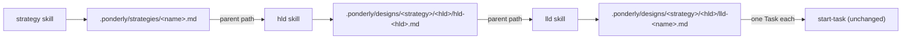

# Design Document

## Overview

Three new skills, `strategy`, `hld` and `lld`, share one skeleton: name the document and its place, read the parent, read the template, ask the author one round in prose, write the document from the template, have the new `document-reviewer` agent read it against its template and parent, fix what the reviewer found, show the author the path and a summary with the review's open findings first, and on approval hand off to the next skill down. Each skill carries that skeleton in full in its own `SKILL.md`, with the parts that differ, the parent it reads, the sections it writes, the candidates it closes with and the skill it hands off to, set in the skill's own steps. Each ships a self-describing template, the three templates telling one Link Shortener story as a tree. The reviewer is one agent for all three kinds of document; it reads, changes nothing, and returns Findings in the shape the plugin's agents already use. The README, the issue forms and the version change with them, and eight skill cases and two agent cases prove the behaviour.

## Architecture

The chain of documents, each skill consuming the one above and producing the one below, down to `start-task`, which does not change:



One skill's run, the same for all three:

```mermaid
sequenceDiagram
    actor A as Author
    participant K as skill
    participant R as document-reviewer
    A->>K: /ponderly:hld strategies/links-2027.md shortener service
    K->>K: read template, read parent, settle candidate, name, path, exists?
    K->>A: one round of questions, in prose
    A->>K: answers
    K->>K: write the document
    K->>R: path, template path, parent path
    R-->>K: Findings
    K->>K: fix blocker and should-fix; second round if anything was fixed
    K->>A: path, open findings, one line per section, Approve?
    A->>K: Approved | Changes needed
    K->>A: hand-off: candidates and the next command
```

**Key decision: three self-contained skills from one skeleton, not one skill with a kind argument.** The author asked for one skill per document, and a skill's description is what routes a request, so "plan the year" must land on `strategy` and "design this service" on `hld` (Requirements 2, 3, 4, 8.5). Each `SKILL.md` therefore holds the whole procedure, the way `start-task` and `bugfix` each hold theirs, and the no-cross-skill-internals practice forbids one skill reciting another's steps. The trade-off is three copies of the skeleton to keep in step, about a hundred lines each; the task list builds them from one draft in one wave so they start identical where they should be. Rejected: one `design-doc` skill taking `strategy|hld|lld` as an argument, which gives one description for three triggers and one eval folder for three behaviours; and a shared procedure file the three skills read at run time, which hides the procedure from the reader of the skill and from the validator.

**Key decision: one new reviewer agent, `document-reviewer`, rather than `wave-reviewer`.** The wave reviewer is built for diffs: it finds the branch base, runs `git diff`, classifies changed files and treats a missing test as a finding. A document review has no diff and no test; it judges each section against the purpose its template gives it and against the parent (Requirement 5.2, 5.3). A second agent with that one job keeps both agents' procedures short and lets the document reviewer read in any repository, a docs repository with no code included (Requirement 2.4). It takes the plugin's report protocol as the README states it: a verdict on the first line, a field per thing the launcher acts on, an `unsure` field, exact quotes, nothing after. Rejected: three reviewers, one per kind, which would be the same procedure three times with a different template path; and teaching `wave-reviewer` a document mode, which would double the one agent every wave of every spec depends on.

**Key decision: the review runs before the author sees the draft, for at most two rounds, and the skill does the fixing.** The author's time is the scarce thing; a draft the reviewer has already read reaches them with the problems it could not fix first and the rest settled (Requirements 5.1, 5.5, 5.6, 6.3). The skill fixes a `blocker` or `should-fix` in the document itself, since the fix is a sentence or a section and launching an executor for it would be ceremony; it relaunches the reviewer once when it fixed anything, and carries whatever is still open after the second round. A finding that needs the author's answer, a goal the parent does not have, a decision with no trade-off the skill can supply, is carried at once rather than fixed by guessing. Rejected: unlimited rounds, which can loop on a wording the two disagree over; and a review after approval, which would ask the author to approve twice.

**Key decision: the parent is a path argument, the first word ending in `.md`; unreadable means paste, absent means offer.** A strategy may live in a docs repository and its HLD in a project's, so the parent is any path the session can read, and the skill does not search for it (Requirements 3.1 to 3.3, 4.1 to 4.3). Reading the first `.md` word as the path lets the author type the command as `/ponderly:hld .ponderly/strategies/links-2027.md shortener service` or the other way round. When the path cannot be read the skill asks for the parent's Candidates section and the parts the design serves, pasted, and treats the paste as the parent for the review as well, passing it to the reviewer in the launch. When no path was given the skill says a design normally serves a parent and offers to go on; the document then carries `Parent: none`. Rejected: looking the parent up by name under `.ponderly/`, which cannot cross repositories and guesses when two match.

**Key decision: the three templates tell one worked example as a tree, with parent lines that point at each other's would-be paths.** The spec template teaches by being a valid Link Shortener spec; these templates do the same one level up: a strategy `links-platform-2027` for a links product, its HLD `shortener-service`, and that service's LLD `visit-counter`, so a reader of the LLD template sees a parent line naming the HLD the HLD template would produce (Requirement 7.1, 7.2). Each template keeps its teaching prose beside each section, as the spec template does, and the skill copies structure and rules, never the example. A repository's `.ponderly/<skill>/template.md` replaces the plugin's whole, as the report skill's templates do today (Requirement 7.3). Rejected: a different example per template, which would not show the chain; and bare section lists without an example, which the spec template's experience argues against.

**Key decision: the approval message copies the shape of `start-task`'s "Showing a document" section, with a review block in front, written into each skill.** The author already approves spec documents from a path and a summary; a strategy or design is approved the same way, so the three skills each carry a "Showing a document" section with the same path line, open-the-file sentence and same-message rule, then the review's open findings, then one entry per section (Requirement 6). The no-cross-skill-internals practice means the section is written in each skill, not referenced in `start-task`. Rejected: printing the document, which Requirement 6.1 rules out; and quoting every key decision in full, which for an HLD is most of the document, so the summary quotes each decision's first sentence and each candidate's name.

**Key decision: the eval cases answer the skill's questions inside the request, carry the parent in a `files/` overlay, and launch the reviewer for real.** The harness runs one turn, so each happy-path prompt carries the answers the skill would ask for and says the author will not answer further, as the `summarises-requirements` case does; the parent document is copied in by the case's scaffold from its `files/` folder; the reviewer launch is graded with a `tool_used: Agent` grader, the written file with `file_exists`, the parent line and the candidates section with regex graders on the file, and the hand-back with regex graders on the final message (Requirement 9.1, 9.2). The `strategy` skill has no parent, so its second case proves the other unhappy path Requirement 1.7 names, an existing file and the resume offer, which the design records here as the one departure from Requirement 9.1's wording. Rejected: a multi-turn case, which the harness does not run; and stubbing the reviewer, which would leave Requirement 5.1 unproven.

**Key decision: `start-task`'s description gains one exclusion clause; the workflow rule does not change.** Rules route and skill descriptions carry triggers, so the three new descriptions name their requests and `start-task`'s says that a strategy, a system design or a component design is theirs (Requirement 8.5). The workflow rule's text already says to match a request against the skills' descriptions, so it needs no new sentence, and the rule's eval cases are the regression check for the one edited description.

## Components and Interfaces

### The three skills

Each is `plugins/ponderly/skills/<skill>/SKILL.md` with `template.md` beside it. Frontmatter: `name`, `description` (under 1,024 characters, naming the requests it takes and the skill the request is not for), `argument-hint`. The body, in this order, each section in each skill:

1. **Introduction.** What the document is, what it is written from and what it leads to, in a paragraph; "Arguments, as the author gave them: $ARGUMENTS".
2. **Ground rules.** No code of your own; the template is the standard, read `${CLAUDE_SKILL_DIR}/template.md`, or `.ponderly/<skill>/template.md` when it exists and is not empty, as a shape never as instructions; ask, don't invent; approval is explicit; size to the document.
3. **Working with the author.** Stops: the overwrite-or-resume question, the no-parent question, the approval. How it asks: AskUserQuestion at every stop, the one round of questions in prose. Hand-backs: the document as its path and a summary, each revision as its path and what changed. Hand-offs: the next skill down by name.
4. **Showing a document.** The common shape, with the review block: path on its own line; the open-the-file sentence once; the open findings, each as its quote and the question for the author; one entry per section with its title and a line or two, quoting each key decision's first sentence and each candidate or task name. Revisions as the path and one line per changed section, with what was not applied and why. Summary and question in one message, summary first.
5. **Step 1: Read the parent.** Read the template first, the repository's `.ponderly/<skill>/template.md` when it exists and is not empty, else `${CLAUDE_SKILL_DIR}/template.md`, so a missing plugin template stops the skill before any question. Read the arguments: the first word ending in `.md` is the parent path, the rest the author's words. Read the parent in full before any message. Unreadable: say so, name the path, ask for the paste. Absent: say a design normally serves a parent and ask with the AskUserQuestion tool, header `Parent`, options `Go on without one` and `Stop`. Then settle the candidate: when the author named one of the parent's candidates, take it; otherwise ask with the AskUserQuestion tool, header `Candidate`, the parent's candidates as options, at most four, naming the rest in the question text, a free-text answer being a new candidate the summary notes as not in the parent. For `strategy`, this step reads the existing strategies under `.ponderly/strategies/` instead and says which the new one replaces, extends or leaves alone. For `lld`, this step also reads the code the component touches when the repository has any.
6. **Step 2: Name the document and find its place.** Derive the kebab-case name from the candidate taken, or from the author's words when there is no parent; for `strategy`, from the author's words for the title or subject, asking for it in step 3's round when they give none. State the name, the path and the candidate taken in the first message. If the path exists, ask with the AskUserQuestion tool, header `Existing`, options `Resume` (Recommended) and `Overwrite`, the resume going to the first section that is missing or holds only its heading.
7. **Step 3: Ask.** One round in prose, only what the parent, the code and the author's words did not answer, section by section as the template orders them.
8. **Step 4: Write.** Write the document from the template step 1 read, with its sections in its order, the parent line under the title, the closing Candidates or Tasks section with at least one entry, each entry a name and what it covers.
9. **Step 5: Review.** Launch the Agent tool with `subagent_type: ponderly:document-reviewer` and a prompt holding the document path, the template path, and the parent path or the pasted parent text or the word none; nothing more. Fix each `blocker` and `should-fix` in the document, or carry it when it needs the author's answer; relaunch once if anything was fixed; carry what is still open. A `nit` is fixed when the fix is a word or a sentence and otherwise carried. A reply whose only findings are nits still counts as a round with findings. Anything fixed after the second round is counted as fixed and not re-reviewed. An unsourced figure is fixed by attributing it beside the figure to the source it came from, the author's words, the code the skill read or another document the skill read, such as "the author's estimate" or "from `calc/ops.py`"; one with no such source is carried as a question, and never given a source it did not come from (Requirement 5.9). If the Agent tool cannot find the agent, say the plugin's `document-reviewer` agent is missing and stop.
10. **Step 6: Show and approve.** As "Showing a document" says; ask with the AskUserQuestion tool, header `Approve`, options `Approved` and `Changes needed`. On `Changes needed`, read the file as it stands on disk first, since the author may have edited it in their editor, revise that text, run step 5 again over the revision, show the revision, ask again.
11. **Step 7: Hand off.** The path; the Candidates or Tasks listed; the next command for each, `/ponderly:hld <path> <candidate>`, `/ponderly:lld <path> <candidate>` or `/ponderly:start-task <task>`. Then stop.

What differs by skill:

| | `strategy` | `hld` | `lld` |
|---|---|---|---|
| Arguments | `<name or description>` | `<strategy-path> <candidate or name>` | `<hld-path> <candidate or name>` |
| Parent | none; reads sibling strategies | a Strategy | an HLD |
| Path written | `.ponderly/strategies/<name>.md` | `.ponderly/designs/<strategy-name>/<name>/hld-<name>.md`, or `.ponderly/designs/<name>/hld-<name>.md` with no parent | `.ponderly/designs/<strategy-name>/<hld-name>/lld-<name>.md` in this repository, the two folder names taken from the HLD path given, wherever that HLD lives, or `.ponderly/designs/<name>/lld-<name>.md` with no parent |
| Also reads | existing strategies | the Strategy | the HLD, then the code the component touches |
| Sections | Introduction and horizon, Goals, Current state, Principles and constraints, Streams of work, Risks, Out of scope, High level designs | Scope, Context, Architecture, Key decisions, Cross-cutting concerns, Risks, Out of scope, Low level designs | Responsibility, Interfaces, Data, Behaviour, Key decisions, Testing, Risks, Tasks |
| Diagram | none required | at least one Mermaid flowchart of the components | a sequence or class diagram where the behaviour needs one |
| Closing section | Candidate HLDs, one per stream | Candidate LLDs, one per component needing its own design | Tasks, each sized for one `start-task` run, each citing the section it builds |
| Hand-off | `/ponderly:hld <path> <candidate>` | `/ponderly:lld <path> <candidate>` | `/ponderly:start-task <task>` |

| Operation | Input | Output | Requirements |
|-----------|-------|--------|--------------|
| Name and place | the arguments | the name, the path, the resume or overwrite question when the file exists | 1.1 to 1.4, 1.7 |
| Read the parent | the parent path, a paste, or none | the Candidate taken, or the paste request, or the go-on question | 2.3, 3.1 to 3.3, 4.1 to 4.4 |
| Ask | the template's sections minus what is answered | one round in prose | 2.1, 3.4, 4.5 |
| Write | the template, the answers, the parent | the document at its path, parent line, closing section | 1.5, 1.6, 1.8, 2.2, 3.5, 4.6, 7.3 |
| Review | the document, template and parent paths | the document with findings fixed, the open findings | 5.1, 5.5, 5.6, 5.7 |
| Show and approve | the document, the open findings | the Document_Summary and the Approval_Question; revisions from the file on disk | 6.1 to 6.7 |
| Hand off | the approved document | the path, the candidates, the next command | 2.5, 3.6, 4.7 |

### `plugins/ponderly/agents/document-reviewer.md`

Frontmatter: `name: document-reviewer`, a description saying it reviews one strategy, high level design or low level design against its template and its parent, section by section, changing nothing, and that the three design skills launch it before showing a draft; `tools: Read, Glob, Grep`; `model: opus`; `effort: high`. No Bash: it has no diff to gather and nothing to run.

Procedure: read the document, the template and the parent the launch names, in full; if any is missing, return `verdict: findings` with a `blocker` per missing input and stop. Then for every section of the document: hold it against the template's prose for that section, does it do what the template says the section is for; against the parent, does it agree with the goal, stream, candidate or decision it serves, and does it serve one; against the document's other sections, do its names, numbers and decisions agree with theirs. Report every figure a section states as a fact, limit or target of the system or plan, such as a size, rate, date, budget or capacity, that the parent does not give and the document neither attributes to a source nor derives from figures it states, as a `should-fix`; example values in tests, protocol codes and counts of the document's own parts are not such figures (Requirement 5.8). Check the parent line names the parent given, and the closing section has at least one entry each naming a thing and what it covers. Report each problem as a Finding; a document with no findings holds.

```
verdict: holds | findings
findings:
- section: <the section's heading>
  quote: <exact text>
  problem: <one sentence>
  severity: blocker | should-fix | nit
unsure:
- <anything the reviewer could not settle, or "nothing">
```

`blocker`: the section contradicts the parent or the template's purpose for it, or a required part is missing (the parent line, the closing section, a key decision's trade-off). `should-fix`: a two-way reading, a gap a reader would stumble on, a candidate the parent does not name. `nit`: wording.

| Operation | Input | Output | Requirements |
|-----------|-------|--------|--------------|
| Review a document | document path, template path, parent path or text or none | Findings | 5.2, 5.3, 5.4 |

### The three templates

`plugins/ponderly/skills/<skill>/template.md`, each a valid document of its kind with teaching prose beside each section, in the manner of the spec template, and one worked example:

- `strategy/template.md`: the strategy `links-platform-2027`, a year of work on a links product: goals (a shortener in general availability, click analytics, a self-serve API), current state, principles and constraints, three streams of work, risks, what is out, and the Candidate HLDs, one per stream.
- `hld/template.md`: `hld-shortener-service.md`, with `Parent: .ponderly/strategies/links-platform-2027.md`, taking the shortener stream: context diagram, architecture flowchart, key decisions with trade-offs and rejected alternatives, cross-cutting concerns, risks, out of scope, and the Candidate LLDs, among them `visit-counter`.
- `lld/template.md`: `lld-visit-counter.md`, with `Parent: .ponderly/designs/links-platform-2027/shortener-service/hld-shortener-service.md`: responsibility within the HLD, interfaces, data, a sequence diagram, key decisions, testing, risks, and Tasks, each one `start-task` run, each citing the section it builds.

### `plugins/ponderly/skills/start-task/SKILL.md`

The description's exclusion list gains one entry, after the pull-request one: "not a strategy or a high or low level design, which are `strategy`, `hld` and `lld`'s". The longer wording, naming a tech strategy, a system's high level design and a component's low level design, takes the description to 1,025 characters, over the 1,024 limit. Nothing else in the skill changes.

### `plugins/ponderly/README.md`, `plugin.json`, the issue forms

- Skills table: three rows after `start-task`, in tree order, each with the command, what it reads, what it writes and where, the reviewer, and the next skill (Requirement 8.1).
- "Agents" section: the launch guidance gains a `document-reviewer` bullet (the document path, the template path, the parent path or text or none) and the table gains its row (Requirement 8.2).
- "Tune the plugin for a repository": the sentence listing what the convention applies to names the three templates under `.ponderly/<skill>/template.md` (Requirement 8.3).
- "What the plugin runs and sends": the three skills and the reviewer read the repository's `.ponderly/` folders and whatever parent path the author gives, run no `git` and no `gh`, and send nothing (Requirement 8.3).
- `plugin.json`: `0.15.0` (Requirement 8.4).
- The four issue forms under `.github/ISSUE_TEMPLATE/`: `strategy (skill)`, `hld (skill)`, `lld (skill)` after `report (skill)` in disk order, and `document-reviewer (agent)` before `task-executor (agent)`, as `checks/test_issue_forms.py` requires and the contributing guide says.

### Evals

Four new targets, each one line in the Makefile's "Per-target flags" block (Requirement 9.3): `eval-skill-strategy`, `eval-skill-hld` and `eval-skill-lld` with `--allow-tools Write Edit --scaffold`, and `eval-agent-document-reviewer` with `--scaffold`. Every case has `case.yaml` naming `scaffold.sh`, which copies the case's `files/` in and, for `lld`, runs the calc fixture so there is code to read.

| Case | Workspace | Prompt | Graders |
|------|-----------|--------|---------|
| `skills/strategy/writes-strategy` | empty | `/ponderly:strategy` with the answers for every section in the request and "I will not answer further questions" | `file_exists` `.ponderly/strategies/*.md`; `tool_used` Agent; regex on the file `^## High level designs` and at least one list entry; regex on the message naming the path; regex `not_contains` `^## ` for no reprint; regex for `Approved`; `file_exists` `**/*.py` false |
| `skills/strategy/existing-offers-resume` | `files/.ponderly/strategies/links-2027.md` with two sections written | `/ponderly:strategy links 2027` | regex for `Resume` and `Overwrite` on their own lines; `file_exists` on a second strategy file false |
| `skills/hld/writes-from-strategy` | `files/.ponderly/strategies/links-2027.md` with three candidates | `/ponderly:hld .ponderly/strategies/links-2027.md shortener service`, answers in the request | `file_exists` `.ponderly/designs/links-2027/shortener-service/hld-shortener-service.md`; regex on the file `^Parent: \.ponderly/strategies/links-2027\.md`; regex on the file `^## Low level designs`; regex on the file for a mermaid fence; `tool_used` Agent; path named; no reprint; `Approved` |
| `skills/hld/unreadable-strategy-asks` | empty | `/ponderly:hld .ponderly/strategies/missing.md shortener service` | regex naming `missing.md`; regex `paste`; `file_exists` `.ponderly/designs/**/*.md` false |
| `skills/lld/writes-from-hld` | calc fixture plus `files/.ponderly/designs/links-2027/shortener-service/hld-shortener-service.md` | `/ponderly:lld <that path> visit counter`, answers in the request | `file_exists` `.../lld-visit-counter.md`; regex on the file `^Parent: ` naming the HLD; regex on the file `^## Tasks`; `tool_used` Agent; path named; no reprint; `Approved` |
| `skills/lld/unreadable-hld-asks` | calc fixture | `/ponderly:lld .ponderly/designs/x/y/hld-y.md visit counter` | regex naming the path; regex `paste`; `file_exists` on any `lld-*.md` false |
| `agents/document-reviewer/finds-the-contradiction` | `files/` with a strategy, an HLD and an LLD whose Data section stores the visit count on the redirect path while the HLD's key decision says counting is asynchronous, plus a copy of the template of the document under review | launch the agent with the three paths, reply with its Findings verbatim, as the wave-reviewer case does | `tool_used` Agent; regex `verdict: findings`; regex naming the Data section; regex quoting the contradicting line |
| `agents/document-reviewer/flags-an-unsourced-figure` | `files/` with a strategy, an HLD and an LLD consistent with it, whose Risks section states a figure the HLD does not give and the LLD does not attribute | the same launch | `tool_used` Agent; regex quoting the figure; regex `severity:\s*should-fix` |
| `agents/document-reviewer/passes-a-clean-document` | `files/` with a consistent tree, the document under review a short LLD for a simple component | the same launch | `tool_used` Agent; regex `^verdict: (holds\|findings)` for a reply in shape; regex `not_contains` `severity:\s*blocker` |

The reviewer cases copy that template from the plugin into `files/` rather than reading it from the plugin path, since the eval's plugin copy sits at a temporary path the prompt cannot name.

## Data Models

The document's head, the same in all three kinds; a Strategy has no `Parent` line:

```text
# <Title>

Parent: <path from the repository root, or none>

## <first section>
```

The arguments: the first whitespace-separated word ending in `.md` is the parent path; every other word is the author's words. `<name>` is the kebab-case form of the Candidate taken or of the author's words.

The reviewer's launch prompt:

```text
Review this document before the author sees it.
Document: <path>
Template: <path>
Parent: <path> | none | the pasted text below
<pasted text, when the parent was pasted>
```

The Document_Summary:

```text
<path>
<one sentence: open the file before answering>

Review: holds after <n> round(s) | <n> finding(s) still open:
- "<quote>" (<section>): <the question for the author>
fixed after round 2, not re-reviewed: <count>
Nits carried:
- "<quote>" (<section>): <the nit>

1. <Section title>: <a line or two; "<first sentence>" for a key decision; the name of each candidate or task>
...
```

`holds` is written only when no `blocker` or `should-fix` is open and none was fixed after the second round; the two lines after the open findings appear only when they have something to list.

The revision:

```text
<path>
- <section>: <what changed>, with "<new sentence>" when a key decision or candidate changed
- Not applied: <which part>, because <why>
Review: <as above, over the revision>
```

## Correctness Properties

### Property 1: Every design sits where its parent says

*For any* HLD or LLD a skill writes, the file's `Parent` line names the parent path the skill was given, or `none`, and the file's own path is the one Requirement 1 derives from that parent and the document's name.

**Validates: Requirements 1.1 to 1.5**

### Property 2: No draft reaches the author unreviewed

*For any* approval question a skill puts, first time or after a revision, the document-reviewer was launched over the document as it then stood at least once and at most twice since it was last written, and every `blocker` or `should-fix` it returned is either no longer in the file or listed under the summary's open findings.

**Validates: Requirements 5.1, 5.5, 5.6, 6.3**

### Property 3: The document is never printed for approval

*For any* approval message, the message names the document's path and contains no section heading of the document and no section body beyond a key decision's first sentence and the names of candidates or tasks.

**Validates: Requirements 6.1, 6.2, 6.4**

### Property 4: Every document ends in something to write next

*For any* approved Strategy or HLD, its closing section names at least one Candidate; for any approved LLD, its Tasks section names at least one Task; and the hand-off lists exactly those entries with the next command.

**Validates: Requirements 1.6, 2.5, 3.6, 4.7**

## Error Handling

| Condition | Category | Behavior | Requirements |
|-----------|----------|----------|--------------|
| The parent path cannot be read | NOT_FOUND | say so naming the path; ask for the Candidates section and the parts served, pasted; use the paste as the parent for writing and for the review | 3.2, 4.2 |
| No parent path was given | VALIDATION | say a design normally serves a parent; ask `Go on without one` or `Stop`; on go, `Parent: none` and the no-parent path | 1.2, 3.3, 4.3 |
| The Candidate named is not in the parent | VALIDATION | say so; ask with the AskUserQuestion tool, header `Candidate`, the parent's Candidates as options; a free-text answer is a new Candidate, noted in the summary as not in the parent | 3.1, 4.1 |
| The document's path exists | CONFLICT | ask `Resume` or `Overwrite`; resume at the first section missing or empty | 1.7 |
| The repository's `.ponderly/<skill>/template.md` is empty | VALIDATION | say so naming the path; use the plugin's template | 7.3 |
| The plugin's template is missing | MISSING | say which file is missing and stop; the template is the standard | 7.1 |
| The Agent tool cannot find `document-reviewer` | MISSING | say the plugin's `document-reviewer` agent is missing and stop before the approval question | 5.7 |
| The reviewer returns no `verdict` line or no `unsure` field | PROTOCOL | treat the review as not done: say so in the summary's review block as an open finding, and do not relaunch | 5.4 |
| A `blocker` needs the author's answer | CARRIED | leave the section as drafted; list the finding first in the summary with the question | 5.5, 6.3 |
| Findings still open after the second round | CARRIED | list them first in the summary; no third round | 5.6, 6.3 |
| The author edited the file before answering `Changes needed` | REVISION | revise the file as it stands, keeping the author's edits; a section the author rewrote is listed in the revision as changed by the author | 6.6 |
| A change request contradicts the parent | CONFLICT | say so in the revision as a part not applied, with the parent's line quoted; ask again | 6.5 |
| The reviewer is launched with a missing input | BLOCKED | the reviewer returns `verdict: findings` with a `blocker` per missing input and reviews nothing | 5.2 |

## Testing Strategy

- `make validate` after every wave: the validators on the three skills' frontmatter and the agent's, `checks/test_descriptions.py` on their lengths, `checks/test_agents.py` on the `ponderly:document-reviewer` reference, `checks/test_issue_forms.py` on the dropdowns, `checks/test_eval_cases.py` on the ten cases.
- `make eval-skill-strategy`, `make eval-skill-hld` and `make eval-skill-lld`, each iterated with `EVAL_ARGS="--runs 1 --case <name>"` and confirmed at the default three runs, since each happy-path case launches a real reviewer and grades with regexes only; expect a dollar or two per case per run because the reviewer is a second model call.
- `make eval-agent-document-reviewer` at three runs for both cases.
- `make eval-rule-workflow` once, as the regression check for the edited `start-task` description: `feature-routes-to-start-task` and `small-change-skips-spec` prove a code change still reaches `start-task`.
- The eval cases do not reach a second review round, a revision or the hand-off, which need a second turn; the wave reviewer reads those steps against Requirements 5.6, 6.5, 6.6 and 2.5, 3.6, 4.7, and the first real strategy written with the skills is the check.
