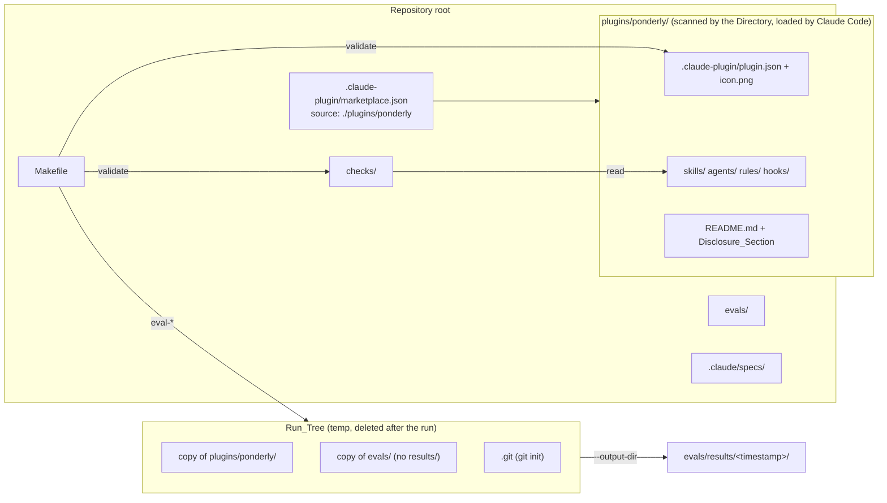
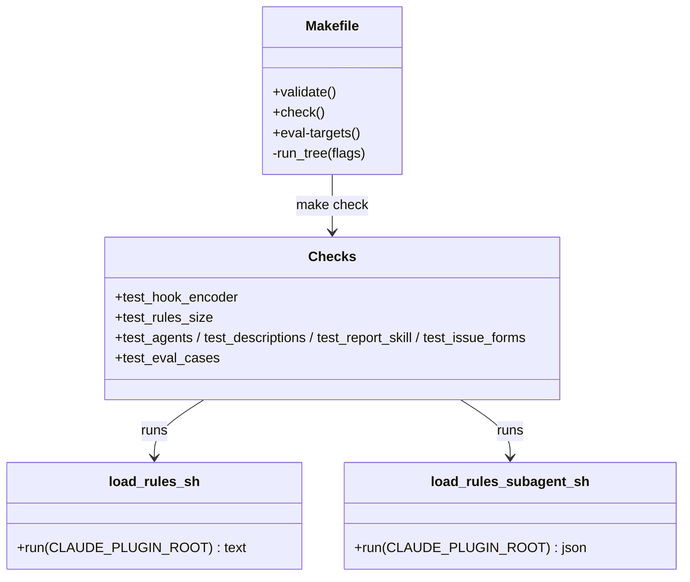

# Design Document

## Overview

The plugin's files move into `plugins/ponderly/` and everything else stays at the repository root, so the folder the Directory scans holds only what an installed plugin loads. Three things follow from that move. The eval runner only reads cases from inside the plugin root, so the Makefile builds a throwaway Run_Tree per invocation, a copy of `plugins/ponderly/` with a copy of `evals/` inside it, and writes results back to the root. The Directory's validator follows a subfolder plugin's hook scripts only when they use literal paths under `${CLAUDE_PLUGIN_ROOT}` and nothing else, so both scripts are rewritten to that shape, each reading `rules/*.md` straight into one `awk` program. The free checks, the Makefile's validate target and the four guides are re-pointed at the new paths, and the manifest gains the listing fields with the README gaining the Disclosure_Section.

## Architecture



```mermaid
sequenceDiagram
    participant C as Contributor
    participant M as make eval-skill-pr
    participant T as Run_Tree
    participant H as claude plugin eval
    participant S as scaffold.sh (copy)
    C->>M: make eval-skill-pr EVAL_ARGS="--runs 1"
    M->>T: mktemp -d; copy plugins/ponderly/. and evals/ (minus results/); git init
    M->>H: claude plugin eval <Run_Tree> --tag pr --output-dir <root>/evals/results/<ts> ...
    H->>S: run scaffold in the case sandbox
    S->>T: git rev-parse --show-toplevel = Run_Tree; bash $ROOT/evals/fixtures/setup.sh
    H-->>M: table, exit status
    M->>T: rm -rf (trap on EXIT, pass or fail)
    M-->>C: exit status of claude plugin eval
```

Key decision, the plugin in `plugins/ponderly/` with the marketplace file left at the root. The Directory scans the folder holding the manifest and nothing above it, and a marketplace entry may point at any folder in the repository, so this is the one layout that hides `evals/`, `checks/` and `.claude/specs/` from the scan while keeping them in the repository beside the code they test and record (Requirements 1.1 to 1.4). The install id does not change, because neither name changes, so no `renames` entry is needed (Requirement 1.6). Rejected alternative, a second repository for the evals: the runner would still need the cases inside a plugin folder, so the copy would still be needed, and a case would no longer sit beside the skill it grades. Rejected alternative, `export-ignore` in `.gitattributes`: the Directory stops validation on it. Rejected alternative, a gitignored copy of `evals/` inside `plugins/ponderly/`: it leaves a transient tree in the source folder that `claude plugin validate` and `--plugin-dir` would see, and a stale copy would grade stale cases.

Key decision, the Run_Tree is a plain copy with `git init`, plus the one repository file a scaffold reads, `.github/pull_request_template.md`. Probed on 2026-10-16: `--eval-dir ../evals` is refused ("must stay inside the plugin root"), an absolute path is refused, and a symbolic link to `evals/` outside the plugin is refused by name at run time, while a copy with a git repository initialised at its top ran a scaffolded case to a score of 1.00 with results written to the real tree through `--output-dir`. The `git init` is what lets the 23 scaffolds that locate `evals/fixtures/setup.sh` through `git rev-parse --show-toplevel` keep working unchanged (Requirement 5.3). The copy is about 350 small files; `evals/results/` is excluded so old results are never copied. Rejected alternative, scaffolds that locate the fixtures by a relative path from `$0`: 23 edits for no gain once the copy has a git top. Rejected alternative, `--output-dir` left at the default: results would land inside the Run_Tree and be deleted with it.

Key decision, both hook scripts become one `awk` program each over `"${CLAUDE_PLUGIN_ROOT}"/rules/*.md`. The Validator_Shape forbids any other variable, any command substitution and any call to another file, so the session script's `$(dirname "$0")` fallback and loop variable go, and the subagent script stops running the session script and capturing its output (Requirement 4.1). `awk` reading the files directly replaces the sentinel trick, because the files are the input rather than a captured string: each record is emitted with `\n`, which reproduces every file that ends in a newline byte for byte and adds one to a file that does not, in both scripts alike, so the two outputs stay equal (Requirement 4.3). The two-line "Handbook rules" header is now written in both scripts, with a comment in each naming the other, which is the cost of not calling across files. The `awk` program itself is inline in the script, as it is today; the portal flagged only the script-runs-script step on the current layout, and Requirement 7 is where a hold on an inline `awk` would show. Rejected alternative, leaving the scripts as they are: one hold, "Scripts the validator couldn't follow", on every version.

Key decision, `plugins/<name>/` rather than a single `plugin/` folder. The docs' marketplace layout keeps every plugin under `plugins/`, so a second plugin is a sibling folder and one more entry in the marketplace file, and nothing moves twice (Requirement 6.5). The Makefile and each check name the folder once, in `PLUGIN` and a top-of-file constant. What this design does not do is split the eval suite: the runner ties a suite to one plugin's eval directory, so a second plugin would need `evals/<plugin>/` and the Makefile copying the matching one; that is one edit when the day comes and nothing now. Rejected alternative, splitting `evals/` today: churn in 274 files and every eval target's enumeration for a plugin that does not exist.

Key decision, two READMEs. The Directory shows the plugin's README as the listing's description, so `plugins/ponderly/README.md` keeps the user-facing sections and ends with the Disclosure_Section, while a short root README orients a contributor and takes the Testing and "Add or change a skill or rule" sections, which describe the repository's checks and evals rather than the installed plugin (Requirements 3.1 to 3.5). Rejected alternative, one README at the root with a link from `plugins/ponderly/`: the Directory requires a README of at least 40 words inside the plugin folder.

## Components and Interfaces



### Repository layout

Moves files; no logic.

| Operation | Input | Output | Requirements |
|-----------|-------|--------|--------------|
| `git mv` of `.claude-plugin/plugin.json`, `.claude-plugin/icon.png`, `skills/`, `agents/`, `rules/`, `hooks/`, `README.md` into `plugins/ponderly/` | the root tree | the Plugin_Folder, with `.claude-plugin/marketplace.json` left at the root | 1.1, 1.2, 1.3 |
| `marketplace.json` entry `source` | `"./"` | `"./plugins/ponderly"` | 1.4 |
| new root `README.md` | the moved README's Testing and "Add or change" sections | a root README that names the layout and links to `plugins/ponderly/README.md` and the contributing guide | 3.4 |

### Manifest

`plugins/ponderly/.claude-plugin/plugin.json`, fields in this order: `name`, `displayName`, `version`, `description`, `author`, `homepage`, `repository`, `license`, `icon`, `keywords`. Values as Requirement 2 gives them. `claude plugin validate ./plugins/ponderly --strict` is the check (Requirements 2.1 to 2.6).

### Hook scripts

| Script | Behaviour | Requirements |
|--------|-----------|--------------|
| `plugins/ponderly/hooks/load-rules.sh` | `[ -d "${CLAUDE_PLUGIN_ROOT:-}/rules" ] \|\| exit 0`; then one `awk` over `"${CLAUDE_PLUGIN_ROOT}"/rules/*.md` that prints the header, then every record with `\n`, a blank line before each file after the first and one after the last, so the text equals today's `cat` loop output | 4.1, 4.2, 4.4 |
| `plugins/ponderly/hooks/load-rules-subagent.sh` | `[ -d "${CLAUDE_PLUGIN_ROOT:-}/rules" ] \|\| { echo "load-rules-subagent.sh: no rules under CLAUDE_PLUGIN_ROOT, so this sub-agent gets no rules" >&2; exit 1; }`; then one `awk` over the same files that prints the JSON prefix, the header and every record JSON-escaped with `\\n`, the same blank-line rule, and the JSON suffix | 4.1, 4.3, 4.4 |

Both scripts keep `set -eu` and `#!/bin/sh`. Neither names `$0`, `$1`, `$f`, `$dir`, `$hooks` or `$text`. The `awk` escape table is the one in today's subagent script.

### Makefile

| Variable or target | Definition | Requirements |
|--------------------|------------|--------------|
| `PLUGIN := plugins/ponderly` | the Plugin_Folder | 5.1, 6.2 |
| the results folder, set inside each recipe as `results=$$(pwd)/evals/results/$$(date +%Y-%m-%dT%H-%M-%S)` | one Results_Folder per eval recipe, made with `mkdir -p` before the run; computed in the recipe rather than in a make variable so two targets in one invocation get two folders and `make help` runs no `date` | 5.2 |
| `validate: check` | `claude plugin validate . --strict`, `claude plugin validate ./$(PLUGIN) --strict`, `claude plugin validate ./$(PLUGIN)/skills --strict` | 6.1, 6.2 |
| `RUN_EVAL` (a `define` the eval recipes expand) | `set -eu; results=$$(pwd)/evals/results/$$(date +%Y-%m-%dT%H-%M-%S); run=$$(mktemp -d "$${TMPDIR:-/tmp}/ponderly-eval.XXXXXX"); trap 'rm -rf "$$run"' EXIT; trap 'exit 130' HUP INT TERM; cp -R $(PLUGIN)/. "$$run"/; tar -C . --exclude=evals/results -cf "$$run/evals.tar" evals; tar -C "$$run" -xf "$$run/evals.tar"; rm "$$run/evals.tar"; mkdir -p "$$run/.github"; cp .github/pull_request_template.md "$$run/.github/"; git -C "$$run" init -q; mkdir -p "$$results"; claude plugin eval "$$run" --trust-plugin --ablation none --no-publish --max-cost-usd $(EVAL_MAX_COST_USD) --output-dir "$$results" $(EVAL_ARGS) $(CASE_ARGS) $(1)`. The copy of `evals/` is three commands rather than a pipeline, because under `/bin/sh` a pipeline hides the first `tar`'s failure from `set -e`. The pull request template is copied in because the `opens-pr-with-ticket` scaffold reads it from the repository top, the one file outside `evals/` any scaffold reads. The second `trap` turns a signal into an exit so the EXIT trap runs under `dash` too, where a signal alone would skip it | 5.1, 5.2, 5.3, 5.5 |
| `eval`, `eval-hook`, `eval-skill-%`, `eval-rule-%`, `eval-agent-%` | each recipe is `$(call RUN_EVAL,--tag $*)` or the `eval` form with no tag; names, enumeration, per-target flags and `help` unchanged | 5.4 |

The recipe is one shell line, so `set -e` and the `trap` hold for the whole run and the exit status of `claude plugin eval` is the recipe's status. The `PATH := bin:$(PATH)` exports stay as they are: `bin` is relative to the case sandbox the harness creates, not to the repository.

### Checks

| File | Change | Requirements |
|------|--------|--------------|
| `test_agents.py`, `test_descriptions.py`, `test_report_skill.py`, `test_rules_size.py` | `PLUGIN = ROOT / "plugins" / "ponderly"` (or the `os.path.join` form), one constant at the top of each file, and every `skills`, `agents`, `rules`, `hooks` path under it; `test_rules_size.py` sets `CLAUDE_PLUGIN_ROOT` to the Plugin_Folder | 4.6, 6.1 |
| `test_issue_forms.py` | the skill, agent, rule and hook enumeration reads under `plugins/ponderly/`; `FORMS_DIR` stays at the root | 6.1 |
| `test_listing.py` (new) | reads the Manifest; asserts `README.md` in the Plugin_Folder with at least 40 words outside fenced blocks; asserts `LICENSE` in the Plugin_Folder or a `license` field; opens the file the `icon` field names, checks the 8-byte PNG signature and reads width and height from the IHDR chunk with `struct`, and asserts square and 512 to 2048 | 8.1, 8.2, 8.3, 8.4 |
| `test_eval_cases.py` | unchanged; `evals/` is still at the root | 5.6 |
| `test_hook_encoder.py` | `roundtrip(part, text)` writes a temp folder with `rules/a.md` holding `text`, runs the subagent script with `CLAUDE_PLUGIN_ROOT` set to it, and compares the decoded `additionalContext` with the session script's output on the same folder, byte for byte; `test_fixed_table` and `test_seeded_fuzz` keep their inputs, with a file that does not end in a newline as one more fixed case; `test_real_run` runs both scripts on the Plugin_Folder and compares; a fourth test proves the no-rules branch: an empty temp folder gives the session script exit 0 with no output and the subagent script a non-zero exit with one stderr line | 4.4, 4.5 |

The fixed table writes one file per case; the 500 fuzz strings are written twenty to a folder, as `rules/f00.md` to `rules/f19.md`, so the fuzz test makes 25 folders and 50 subprocesses and the whole check runs in about three seconds, and the multi-file blank-line separator is exercised on fuzz data as well as on the real rules.

### Guides

| File | Change | Requirements |
|------|--------|--------------|
| `plugins/ponderly/README.md` | the moved README minus Testing and "Add or change"; Install section without the read-access and `gh auth` paragraphs; the Disclosure_Section last, with the sentences Requirement 3.2 lists | 3.1, 3.2, 3.3, 3.5 |
| `README.md` (root) | title, one paragraph on what the repository is, a short layout list (`plugins/ponderly/`, `evals/`, `checks/`, `.claude/specs/`), links to `plugins/ponderly/README.md` and `.github/CONTRIBUTING.md`, then "Add or change a skill or rule" and Testing, the Validator subsection naming the three validate commands and the Evals subsection saying an Eval_Target copies the plugin and `evals/` into a temporary tree and writes results to `evals/results/` | 3.4, 6.4 |
| `.github/CONTRIBUTING.md` | `claude --plugin-dir ./plugins/ponderly`; the Test section's link to the root README's Testing section stays valid; one sentence that `evals/` sits outside the plugin and the Makefile copies it in for a run | 6.4 |
| `evals/README.md` | "the Makefile runs `claude plugin eval` against a temporary copy of `plugins/ponderly/` with `evals/` inside it" in place of `claude plugin eval . --tag <name>`; results path unchanged; the scaffold note that `git rev-parse --show-toplevel` resolves to the copy | 6.4 |

## Data Models

Manifest, the fields the Directory reads:

| Field | Type | Value | Requirement |
|-------|------|-------|-------------|
| `name` | string | `ponderly`, unchanged | 1.4 |
| `displayName` | string | `Ponderly` | 2.1 |
| `version` | string | `0.13.0` | 2.4 |
| `author` | object | `name`, `email`, `url` as Requirement 2.2 | 2.2 |
| `homepage`, `repository` | string (URL) | the GitHub repository | 2.1 |
| `license` | string | `MIT` | 2.1 |
| `icon` | path | `./.claude-plugin/icon.png`, a 1024 by 1024 PNG | 2.1, 2.5 |
| `keywords` | array of strings | the eight of Requirement 2.3 | 2.3 |

Run_Tree, as the Makefile builds it:

| Entry | Source | Notes |
|-------|--------|-------|
| `<tmp>/` | `mktemp -d` under `$TMPDIR` or `/tmp` | deleted by the `trap` on exit |
| `<tmp>/.claude-plugin/`, `skills/`, … | `cp -R plugins/ponderly/.` | the plugin as installed |
| `<tmp>/evals/` | `tar` of `evals/` excluding `evals/results` | cases, fixtures, graders |
| `<tmp>/.github/pull_request_template.md` | `cp` from the repository root | read by the `opens-pr-with-ticket` scaffold |
| `<tmp>/.git` | `git init -q` | gives the scaffolds their top level |

## Correctness Properties

### Property 1: The plugin folder is the plugin

*For any* commit after the move, the set of skill, agent, rule and hook names found under `plugins/ponderly/` equals the set found at the root before it, and no path under `plugins/ponderly/` starts with `evals/`, `checks/` or `.claude/specs/`.

**Validates: Requirements 1.1, 1.3**

### Property 2: Both hooks say the same rules

*For any* folder with a `rules/` subfolder of Markdown files, the `additionalContext` the subagent script prints, JSON-decoded, equals the bytes the session script prints for the same folder.

**Validates: Requirements 4.2, 4.3**

### Property 3: An eval run leaves only results behind

*For any* Eval_Target invocation, pass or fail, the repository differs afterwards only under `evals/results/`, and no Run_Tree remains under `$TMPDIR`.

**Validates: Requirements 5.1, 5.2**

### Property 4: Every named path exists

*For any* backticked repository path in the root README, `plugins/ponderly/README.md`, the contributing guide and `evals/README.md`, a file or folder exists at that path after the move.

**Validates: Requirement 6.6**

## Error Handling

| Condition | Category | Behavior | Requirements |
|-----------|----------|----------|--------------|
| `CLAUDE_PLUGIN_ROOT` unset or without `rules/` | MISSING_INPUT | session script exits 0 with no output; subagent script exits 1 with one stderr line | 4.4 |
| A rule file without a trailing newline | EDGE | both scripts print it with a trailing newline, so their outputs stay equal | 4.3 |
| `mktemp`, `cp`, `tar` or `git init` fails | BUILD_FAILURE | `set -e` stops the recipe with that command's error; the `trap` removes whatever was made; no eval runs | 5.5 |
| `claude plugin eval` exits non-zero | EVAL_FAILURE | the `trap` removes the Run_Tree; the recipe exits with the same status; results already written stay | 5.1 |
| A listing field missing or mistyped | VALIDATION | `claude plugin validate ./plugins/ponderly --strict` fails and so does `make validate` and CI | 2.6, 6.1 |
| README under 40 words, no license, or an icon that is missing, not PNG, not square or outside 512 to 2048 px | VALIDATION | `test_listing.py` fails and so does `make validate` and CI | 8.1, 8.2, 8.3 |
| A guide names a path that no longer exists | REVIEW | the wave reviewer reports it as a finding, fixed in the same wave | 6.6 |
| The portal still holds a version | MANUAL | the author records the finding on issue #43 | 7.1, 7.2 |

## Testing Strategy

- Property 2 is proved by `checks/test_hook_encoder.py`: the fixed table, the 500 seeded fuzz strings and the real plugin, each written as a rules file and compared across the two scripts. Property 1 is an ephemeral check in the move's task: list the component names before and after and diff them.
- Example tests cover each Error Handling row the checks can reach: the no-rules branch of both scripts in the encoder check, and the size limits in `test_rules_size.py` against `plugins/ponderly/`.
- `test_listing.py` is proved on the real Plugin_Folder and by an ephemeral negative check in its task: a temp folder with a 300 px icon and a 10-word README fails each assertion.
- `make validate` is the integration check for the layout, the checks and the manifest, and CI runs it on the pull request.
- One eval invocation with a scaffolded case, `make eval-skill-pr EVAL_ARGS="--runs 1 --case opens-pr-with-stub-gh"`, proves Property 3 and Requirement 5.3 on the real suite: the results folder appears at the root, the scaffold ran from the copy, and nothing is left in `$TMPDIR`. One `make eval-hook EVAL_ARGS="--runs 1"` proves the rewritten hooks load the rules in a session and a sub-agent.
- A local install proves Requirement 1.6: `claude plugin marketplace add <path to the checkout>` from another folder, `claude plugin install ponderly@sabind`, and `claude plugin details ponderly` listing five skills, two agents and two hooks.
- Requirement 7 is the author's manual check in the developer portal after the merge, recorded on issue #43.
