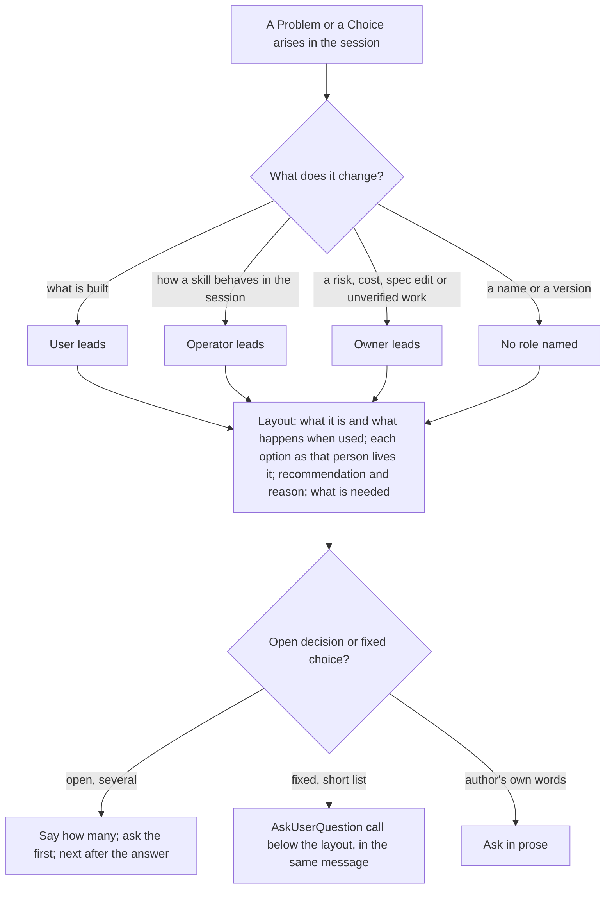
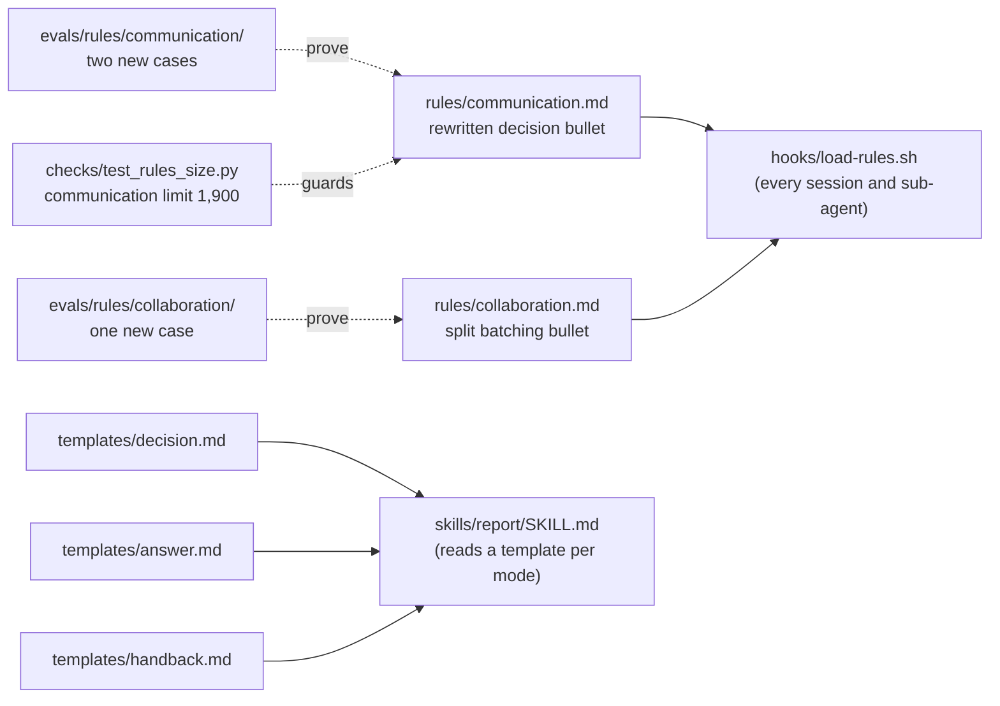

# Design Document

## Overview

Two rule files and three report templates change their wording, three eval cases prove the wording changes what Claude writes, and one check constant moves. Nothing new is added to the plugin's structure: the communication rule's "Lay out a decision before asking it" bullet is rewritten to carry the leading role, the shape and the layout-above-the-question; the collaboration rule's "Batch the questions" bullet is split by kind of question; the decision, answer and handback templates say where the role goes and show it in their worked examples. The rule rewrite does not fit the 1,600-character limit without losing meaning the requirements ask for, which the wave 0 review showed, so Requirement 4.4's fallback applies and the communication limit rises to 1,900. Issues #56 and #57.

## Architecture

The plugin has no code path here; the components are text files Claude reads, and the "flow" is how a message to the author is formed under the new rules.

Where the words live:

**Key decision: rewrite the existing bullet and raise the communication limit to 1,900.** Requirements 1 to 3 go into the "Lay out a decision before asking it" bullet rather than into new bullets, because the existing bullet already says most of it and one bullet reads as one instruction. The first approved text trimmed the rest of the rule to fit 1,600 characters; the wave 0 review found eight should-fix gaps in it against the requirements (a problem could be named by mechanism alone, an explanation had no shape, the tool's options could carry the layout, "what is built" covered internal choices, and a skill's own bare question was exempt unconditionally), and the text that answers them is 1,837 characters. On 2026-10-23 the author chose Requirement 4.4's fallback: `RULE_LIMITS["communication"]` becomes 1900 and the README's sentence about the limit says 1,900, and the text under Data Models is landed as written. The whole hook output stays near 8,600 of 10,000 characters (Requirement 4.3). Trade-off: every session carries about 350 more characters of rule than today; the author noted the limit is to be looked at again next time the rule changes. Rejected: a separate bullet per requirement, which would read as three rules and cost more characters. Rejected: putting the layout-above-the-question sentence into the collaboration rule, which is about how to ask, because the sentence is about what the message holds and the two rules would each tell half the story. Rejected after review: the 1,599-character text, which fit the limit by trimming meaning.

**Key decision: one leading role, chosen by what the choice changes.** The rule names the user, the operator and the owner once, each with the kind of choice that makes them lead, and asks for a second role only where its experience differs (Requirements 1.2, 1.3). Trade-off: the writer has to judge which role leads, and may pick wrong; the cost of a wrong pick is one clarifying question, the same as today. Rejected: naming all three on every problem, which the first draft of #56 proposed; the transcripts show the author accepted replies that led with one role, and three lines per item is its own noise. Rejected: no role vocabulary at all, only "say who is affected"; the three words give the writer a question to answer and give the graders something to look for.

**Key decision: the sandbox has no question tool, so the layout is proved in its prose form.** The eval sandbox grants only the tools a case lists and treats an ungranted tool as absent, and the existing pr cases record that AskUserQuestion is absent there; the wave 1 review found this, and the earlier premise that the harness renders a tool call's options as bullets was wrong: the start-task cases see bullets because Claude writes the options on separate lines, as the collaboration rule's fallback says. That prose form is the record of how the tool would have been called, the layout above and the option lines below, so it is what the case grades (Requirement 6.2, revised 2026-10-26): a recommendation on a line that is not an option bullet, each option as a bullet line, and the fixture's word for the person who waits before the first option bullet. No `tool_used` grader; the tool-call form is checked by hand in a live session. "Experience before mechanism" is a regex that the user's word (subscriber, reader, recipient) precedes the first mention of the failing test's name (Requirement 6.1). Trade-off: a regex can be satisfied by a message that names the role and then explains nothing; the case prompt carries a concrete effect the fixture's README states, so a message that names it is one that read it. Rejected: an `llm` grader, which the eval guide reserves for what regex cannot express and which needs three runs per case. Rejected: granting AskUserQuestion in `allowed_tools`, which the guide gives no sign the sandbox honours and would cost a paid run to find out.

**Key decision: fixed choices stay batched.** The collaboration rule splits by kind of question (Requirement 5.1) instead of asking everything one at a time, so the `pr` skill's three closing questions (commit, closes, draft) stay in one call and `implement-spec`'s cadence and optional-test questions stay in one round. Trade-off: the writer judges which kind a question is; the rule gives the tests, a fact or short list needing no context versus a judgement needing context. Rejected: one question per message for everything, which would turn every skill's set-up into three or four rounds.

**Key decision: skills are not edited to restate the rules.** `start-task`'s spec questions are the author's own words about scope and constraints, asked in prose, so they are not open decisions and stay in one round. `implement-spec`'s hand-back lists its problems under the handback template, whose Problems bullets now open with who it lands on, and its Next carries one proposal or question, so it already asks one open decision at a time. `bugfix`'s ticket comment and `pr`'s Notes for reviewers draw from the hand-back. No skill text is found to contradict the new rules, so none is changed (Requirement 5.4, 7.4).

## Components and Interfaces

| Component | Responsibility | What changes | Requirements |
|-----------|----------------|--------------|--------------|
| `rules/communication.md` | How any message to the author is written | Replaced by the text under Data Models: "Problems come first" gains "who it lands on and how"; the decision bullet carries the leading role, the four-part shape, "not its mechanism" and the layout above the question; the opening sentence and three bullets lose restating words | 1.1–1.5, 2.1, 3.1–3.3, 4.1 |
| `rules/collaboration.md` | How questions are asked | "Batch the questions" becomes "Batch facts, ask decisions one at a time" | 5.1–5.3, 4.2 |
| `skills/report/templates/decision.md` | Shape of a decision message | Sections 1 and 2 name the leading role's experience; the After example opens with what the owner takes on | 2.2, 2.5, 2.6 |
| `skills/report/templates/answer.md` | Shape of an answer | Section 1 names the leading role's experience; the After example leads with what the executor's choice means for whoever runs it | 2.3, 2.5, 2.6 |
| `skills/report/templates/handback.md` | Shape of a hand-back | Section 1's bullet shape opens with who it lands on and how; the After example's Problems do so | 2.4, 2.5, 2.6 |
| `skills/report/templates/status.md` | Shape of a status message | Section 1's bullet shape opens with who it lands on and how; the After example's Problems do so; added 2026-10-26 after the wave 1 review found it left out | 8.1, 8.2, 2.6 |
| `evals/rules/communication/user-effect-before-mechanism/` | Proves 1.1 | New case, scaffold, graders | 6.1, 6.7 |
| `evals/rules/communication/lays-out-before-asking/` | Proves 3.1, 3.2 | New case, graders | 6.2, 6.7 |
| `evals/rules/collaboration/one-open-decision-at-a-time/` | Proves 5.1–5.3 | New case, graders | 6.3, 6.7 |
| `checks/test_rules_size.py` | Rule sizes | `communication` limit 1900 | 4.3, 4.4 |
| `plugins/ponderly/README.md` | What the plugin does | Rows for the two rules and the report skill; the limit sentence says 1,900 | 7.1, 4.4 |
| `plugins/ponderly/.claude-plugin/plugin.json` | Version | 1.0.0 to 1.1.0 | 7.2 |

## Data Models

**The communication rule**, whole, at 1,837 characters; the executor lands this text and may change a word only if the count stays at or under 1,900:

> # Writing to the author
>
> How any skill or agent writes to the author, who did not watch the work.
>
> - **Problems come first.** A bullet for each failed check, check not run, finding not fixed, task that stopped and assumption made for the author: who it lands on and how, what it is, why it matters, the options.
> - **Name a thing by what it is.** Never a label coined during the work, nor a mechanism alone; quote the line when it is text.
> - **Say what a result means before the number.** A number alone leaves the author to guess whether it is good.
> - **Do not narrate.** Leave out the running account of tool calls and what is pending; the plan stated once before acting is not narration.
> - **Lay out a problem, an explanation or a decision as the person it changes will live it.** What the thing is and what happens when it is used; each option as what that person sees or takes on, not its mechanism; the recommendation and why; what is needed from the author. The user leads when it changes what the built thing does, the operator when it changes how a skill or agent behaves in the session, the owner when it is a risk, a cost, a spec edit or unverified work; a second role only where its experience differs, none when no one feels it, as with a name or a version. The layout sits above an AskUserQuestion call in the same message and the tool holds only the options; a bare question is a decision not laid out.
> - **Write plainly and stop.** One idea per sentence; end when the content ends, with no offer and no restatement.
> - **Deliver with the skill.** To hand back work, ask for a decision, report status or answer what something is or why, use `/ponderly:report`, which holds each shape. A skill's own stops and questions keep their shape where the layout already precedes them, as does an agent reporting to its launcher.

**The collaboration rule's batching bullet**, which brings that rule to 1,591 characters:

> - **Batch facts, ask decisions one at a time.** Facts and short fixed choices that need no context to pick, a name, a version, a plain yes, go together in one round, unless one answer decides the next question. An open decision, one that needs the author's judgement and the context behind it, is asked alone: the context it rests on, then the options, the recommendation and the question; the next comes after the answer. When several are open, say how many and ask the first.

**Check constant**: `RULE_LIMITS = {"collaboration": 1600, "communication": 1900}`.

**Template sections that change** (each template stays under 3,000 characters; handback is at 2,829, so its Before/After texts are trimmed to make room):

| Template | Section | Now says | Will say |
|----------|---------|----------|----------|
| decision | 1. What is being decided | the choice in one or two plain sentences | the choice and what happens to the leading role when it is used |
| decision | 2. Options | what it is in plain words and what it costs | what the leading role sees or takes on under it, then what it costs |
| answer | 1. What it is | the thing asked about, in plain words | the thing asked about as the leading role meets it, in plain words |
| handback | 1. Problems | what it is, why it matters, the options | who it lands on and how, then what it is, why it matters, the options |
| status | 1. Problems | what it is, why it matters, the options | who it lands on and how, then what it is, why it matters, the options |

**Eval case folders**, in the shape `checks/test_eval_cases.py` requires: `prompt.md` with `description`, `tags`, `max_turns`, `allowed_tools` and `expected_outcome` in its frontmatter, `case.yaml` with `schema_version: "1.1"`, a `scaffold.sh` where a fixture is built, and one grader file per check under `graders/`.

| Case | Scenario | Graders |
|------|----------|---------|
| `user-effect-before-mechanism` (communication) | A small Python package `digest` whose README says it builds the weekly email that goes to subscribers; `render_subject` cuts the subject at 60 characters mid-word; `test_render_subject_width` fails. Prompt: run the tests and say how it went. | regex: a subscriber/reader/recipient word precedes the first mention of `test_render_subject_width`; regex: names the failure by its test, `test_render_subject_width`, or by its function or file, `render_subject` or `subject.py`, a choice the author made on 2026-10-26 after the first run showed the rule itself pushes the test's id out of a message that names the function and file; regex: the message does not open with the test name or a path; no-narration regex copied from `failing-check-first` |
| `lays-out-before-asking` (communication) | A project whose README asks for a choice with three named options and gives the facts to decide it, such as a retry ceiling of 3, 5 or 10 with the queue's observed failure rates. Prompt: pick with me. | regex: `recommend` on a line that is not an option bullet; regex: each option appears as a bullet line; regex: the fixture's word for the person who waits precedes the first option bullet |
| `one-open-decision-at-a-time` (collaboration) | Prompt asks for a retry on an upload worker and names three undecided things in order: the backoff shape (fixed or exponential), where the attempt count lives (in memory or in the database), what happens after the last failure (drop or dead-letter). | regex: `three` or `3` decisions named; regex: `fixed` and `exponential` appear as option bullets; regex not_contains: `dead-letter` or `in memory` as an option bullet; regex: exactly one question mark at the end |

## Correctness Properties

### Property 1: Experience precedes mechanism

*For any* message that states a problem or lays out a choice under the rule, the first sentence about each problem or option names what a person sees or takes on, and any requirement number, grader name, path or verdict comes after it.

**Validates: Requirements 1.1, 1.5, 2.1, 2.4**

### Property 2: A question never stands alone

*For any* message that carries an AskUserQuestion call for a choice, the message's prose above the call holds what is being decided, each option's effect and a recommendation.

**Validates: Requirements 3.1, 3.2**

### Property 3: One open decision per message

*For any* message under the collaboration rule that puts an open decision, it puts exactly one, and when more are open it says how many.

**Validates: Requirements 5.1, 5.2, 5.3**

### Property 4: Sizes hold

*For any* state of the branch, the communication rule is at most 1,900 characters, the collaboration rule at most 1,600, the hook output under 10,000, the report skill under 4,000 and each template under 3,000.

**Validates: Requirements 2.6, 4.1, 4.2, 4.3, 4.4**

## Error Handling

| Condition | Category | Behaviour | Requirements |
|-----------|----------|-----------|--------------|
| Rewritten communication rule over 1,900 | SIZE | `make validate` fails naming the count; the task trims before it is done | 4.1, 4.4 |
| Collaboration rule over 1,600, or a template over 3,000 | SIZE | `make validate` fails; trim | 4.2, 2.6 |
| A new case missing a frontmatter field or a grader field | SHAPE | `checks/test_eval_cases.py` fails naming the file | 6.7 |
| A new case scores the same in both arms | MEASUREMENT | Not a failure; the Baseline transcript is read and the PR says whether its graders passed on the behaviour or for another reason | 6.5, 6.6 |
| The sandbox has no AskUserQuestion | HARNESS | Expected; Claude asks in prose with the options on separate lines, which the ordering regexes grade | 6.2 |
| An existing case fails after the rewrite | REGRESSION | The wording goes back a round; the case is not edited to pass | 6.4 |

## Testing Strategy

- `make validate` runs every check under `checks/`, including the two size checks and the eval-case shape check, after each task and at the end of every wave (Property 4).
- The three new cases run under `make eval-rule-communication` and `make eval-rule-collaboration` with `EVAL_ARGS="--runs 2"` while iterating, since every grader is regex or tool_used, and once with `--ablation with-without` for the table in the pull request (Properties 1 to 3).
- The existing four communication cases and `short-list-asks-with-tool` run at the same time, so a regression in the rewritten wording shows in the same table.
- Each case's prompt frontmatter names the property and requirement it proves, the convention the existing cases follow.
