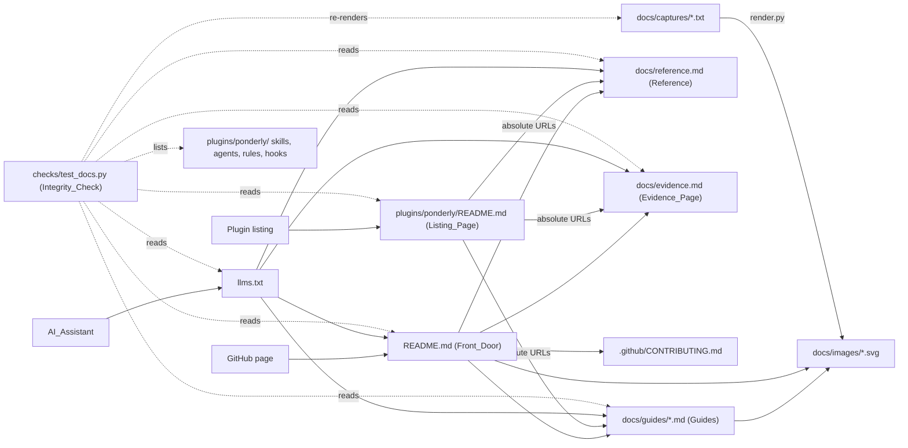
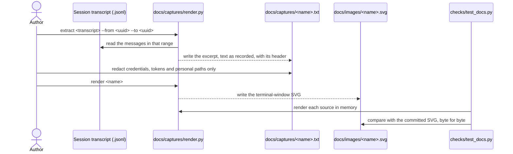

# Design Document

## Overview

The documentation splits by reader and by where it is read. The root `README.md` becomes the Front_Door, a short newcomer page that GitHub shows. `plugins/ponderly/README.md` becomes a short Listing_Page that stands on its own in the plugin listing. Everything deeper lives in a new `docs/` folder at the repository root, outside the plugin, with five Guides, the Reference and the Evidence_Page, and an `llms.txt` sits beside the README. The contributor material in today's root README moves into `.github/CONTRIBUTING.md`.

Two pieces of tooling keep the pages honest, both standard-library Python with no new dependency. `docs/captures/render.py` turns an excerpt of a real session transcript into an SVG drawn as a terminal window, so every Session_Capture can be regenerated from a text file in the repository. `checks/test_docs.py` is the Integrity_Check: it confirms that every name, path, link, command and image a Doc_Page mentions exists, that every component appears where it must, and that every SVG matches its source.

The words that must be the author's are recorded here, with spelling and grammar corrected and nothing added, so the pages quote them rather than paraphrase.

**Pitch** (Requirements 1.1, 2.1, 10.1):

> This plugin helps you write code like a seasoned engineer, even if you don't know all the best practices. It leans on our own thinking for reasoning, since even the best AIs cannot reason: they predict the next token in a sequence, and we have to decide which direction to point them in. It aims to slow the AI down when the scope is unclear and let it run fast when it knows what to do. At the same time, it catches the AI before it lets itself make mistakes or assumptions, so the pace always fits the level of understanding.

**Origin_Story** (Requirement 4.5):

> I built this to avoid constantly re-prompting, or having to switch between Kiro and Claude. At Amazon I spent time developing tools that wrote code like this before Claude was even available internally. These became industry standard, and I've kept making small refinements to them in areas where I've seen even Kiro fail.

## Architecture

A Session_Capture is made in three steps, and only the last runs in `make validate`:

Key decision: the root README is the Front_Door and the plugin README is a short Listing_Page. GitHub shows the root README on the repository's page and the plugin listing shows the plugin README, so each reader lands on a page written for them (Requirements 1.1, 2.1). Both open with the Pitch and the install commands; only the Front_Door carries the image, the Diagram, the "when to use it" list and the evidence summary. The trade-off is that the Pitch and the install commands appear on two pages; the Integrity_Check cannot keep prose in step, so both quote the Pitch from this design, and the review of each wave compares them.

Rejected alternative: one full README inside the plugin folder, with the root README pointing to it. An Evaluator on GitHub would land on a pointer and need a second click, and the long page would ship to every user.

Rejected alternative: the same README copied into both places. The two would drift, and the Listing_Page would carry Mermaid and relative image links that the plugin listing may not render; whether it renders Mermaid is not known, so the Listing_Page uses neither.

Key decision: every other Doc_Page lives in `docs/` at the repository root, with `llms.txt` at the root (Requirements 2.4, 8.1). Anthropic's directory scans every file in `plugins/ponderly/` and ships it, and llmstxt.org places the file at the site root. The trade-off is that the Listing_Page must link with absolute `https://github.com/sabind/ponderly/blob/main/...` URLs (Requirement 2.3), which the Integrity_Check maps back to local paths.

Key decision: the contributor sections of today's root README ("Add or change a skill or rule" and "Testing", with its Validator, Unit tests and Evals parts) move into `.github/CONTRIBUTING.md`, merged into its existing "Make a change" and "Test" sections, and the Front_Door keeps one "Develop the plugin" line linking there (Requirement 1.7). The repository layout list moves with them. The trade-off is a longer contributing guide; nothing is deleted.

Key decision: Session_Captures are emulated terminals drawn as SVG by a standard-library Python script from excerpts of real transcripts (Requirements 6.4, 6.5, 6.6, 6.7). The script's `extract` command copies the text of a range of messages from a Claude Code session's `.jsonl` file, so the excerpt starts as recorded; the author then redacts only credentials, tokens, private repository names, email addresses and home-directory paths, each replaced by `[redacted]` or `~`, and replaces the plugin's, marketplace's and repository's former names with their current ones. Its `render` command draws a fixed-width terminal window with a title bar, monospace text wrapped at 100 columns, the author's prompts, Claude's text and tool calls in three colours, and a footer with the date and the plugin version. GitHub shows an SVG as an image, the text stays selectable, and the same input gives the same bytes, so the Integrity_Check can compare them. The trade-off is that the window looks like Claude Code's terminal rather than being a pixel copy of it.

Rejected alternative: hand-taken screenshots. They cannot be regenerated when the plugin changes, and nothing can check that their text was not edited.

Rejected alternative: a terminal recorder such as VHS, asciinema or termtosvg. Each is a new tool (Requirement 6.7), each records a live session rather than rendering a saved transcript, and a live Claude session does not replay the same way twice.

Rejected alternative: an HTML terminal emulator such as xterm.js or Hyper. GitHub strips scripts from Markdown, so the page would have to be screenshotted by a headless browser, which is a new tool and gives back a hand-taken screenshot's problems.

Key decision: captures come from real sessions in the author's public repositories, this one and `inline-email`. Where a real session of a Guide's job already exists, its transcript is the source; where none does, the author runs the Guide's job in a fresh session while the Guide is written, and that run is both the capture's source and the proof that the Guide's steps work (Requirements 5.3, 5.7, 6.4). Two sources are already known:
- The design-skills work on this repository (issue #50, PR #53), for the feature Guide's spec, waves and hand-back.
- The newcomer-docs build of `inline-email`, where an executor returned `status: stopped` because "The README cannot meet Requirements 1.1 and 1.6 with the Quickstart the task asks for", with the line count that proved it. This is the stop the feature Guide shows (Requirement 5.5).

The hero image is a hand-back from the design-skills session that lists problems first, then what was done, then the next step (Requirement 6.1). The trade-off is that the author runs up to three short sessions for the plan-a-year, contained-change and tune-a-template Guides.

Key decision: the Evidence_Page shows new runs of the rule targets with `EVAL_ARGS="--ablation with-without"`, which runs each case with and without the plugin and prints a Δ column, copied as printed under a heading that gives the date, the plugin version and the command (Requirements 4.2, 4.3). No saved run measured the baseline: all 35 runs under `evals/results/` on this machine used `--ablation none`. The rule targets are measured because a rule is exactly what the plugin adds to a plain session. The skill targets are listed as not measured against the baseline, because without the plugin the skill does not exist and their graders check for it (Requirement 4.4). The author runs each target by hand, one at a time. A workflow run cost about $3.54 at three runs on 2026-10-21, so with-without at three runs is expected near twice that; the other rule targets have no recorded cost. The trade-off is that the numbers are a snapshot, labelled as one.

Rejected alternative: a script that writes the Evidence_Page from `evals/results/`. The results folder is gitignored and local to one machine, so the page could not be regenerated anywhere else.

Key decision: the Integrity_Check checks names it can find without reading any skill's text: links, images, `/ponderly:` commands, `ponderly:` agent names, `make` targets, and backticked paths under the repository's own top-level folders. It lists components from the folder structure alone: skill folders, agent files, rule files and hook scripts (Requirement 9). A backticked path that names a user's repository, such as `.ponderly/strategies/links-2027.md` in a Guide, is not checked, because it does not exist here; only paths under `plugins/`, `evals/`, `checks/`, `docs/`, `.github/`, `.claude-plugin/` and `bin/`, and the root files, are. A path holding `<`, `*` or `{` is a pattern and is skipped. The trade-off is that a misspelt bare skill name in prose, such as `implement-specs`, passes unless it is part of a command or a link.

Key decision: the version rises to 0.17.0, because the Listing_Page and `plugin.json`'s description ship with the plugin, and an unchanged version means `claude plugin update` delivers nothing (the 0.15.0 collision fixed by PR #54). This serves Requirements 2.1 and 10.1.

Key decision: GitHub's description, topics and homepage are set with `gh repo edit` only after the author approves the exact values (Requirement 10.3). The description is the Pitch's first sentence. The topics are `claude-code`, `claude-code-plugin`, `claude-skills`, `ai-coding`, `spec-driven-development` and `developer-tools`. The homepage stays empty, because no page exists outside the repository (Requirement 10.4).

## Components and Interfaces

### Front_Door (`README.md`)

Sections in order: title and Pitch; a "Docs:" line linking each Guide, the Reference, the Evidence_Page and the contributing guide; the install commands; the hero Session_Capture; "What it does", three or four sentences plus the skill hand-off Diagram; "When to use it", with Claude Code without the plugin and Kiro; "How it is tested", two sentences and a link to the Evidence_Page; "What this does not do"; "Develop the plugin", one line to the contributing guide; License.

| Operation | Input | Output | Requirements |
|-----------|-------|--------|--------------|
| open with the Pitch and the install | the Pitch above | the first 40 lines | 1.1, 1.2, 1.3 |
| link the docs | Guide, Reference, Evidence_Page and contributing paths | one "Docs:" line | 1.4 |
| show the hero and the Diagram | `docs/images/hero-handback.svg`, a Mermaid flowchart | an image with alt text, a Diagram | 6.1, 6.2, 6.8 |
| compare with the Neighbours | Claude Code's and Kiro's own documentation, the author's use of Kiro | one or two sentences each | 3.1, 3.2, 3.3, 3.4 |
| state the limits | what the plugin leaves to the author | the "What this does not do" section | 1.5 |
| report the length | the first draft | line count against 220 | 1.6 |

### Listing_Page (`plugins/ponderly/README.md`)

Sections in order: title and Pitch; Install; Stay up to date, kept as it is; Skills, one line per skill saying when to use it; Agents and Rules, one line each; What the plugin runs and sends, kept as it is; Learn more, with absolute links. The per-skill paragraphs, the agents' detail and "Tune the plugin for a repository" move to the Reference, each leaving a one-line pointer.

| Operation | Input | Output | Requirements |
|-----------|-------|--------|--------------|
| stand on its own | the Pitch, the install commands, one line per component | the page | 2.1, 2.2 |
| link the docs | absolute GitHub URLs | the Learn more section | 2.3 |
| leave pointers | each moved section | one line naming its Reference section | 7.4 |

### Guides (`docs/guides/`)

Five files, in this order: `plan-a-year.md`, `build-a-feature.md`, `fix-a-bug.md`, `make-a-small-change.md` and `tune-a-template.md`. Each has the same shape: the job and what the Reader has at the end; "Before you start"; numbered steps, each the exact command or request, then a Session_Capture or a description of what the plugin shows, then the files it writes; each stop with the options it offers; "Next", linking the next Guide and the Reference sections used. Sequence Diagrams go in `plan-a-year.md` (the skill and `document-reviewer` rounds), `build-a-feature.md` (an `implement-spec` wave with its executors and reviewer) and `make-a-small-change.md` (`start-task` launching `task-executor`).

| Operation | Input | Output | Requirements |
|-----------|-------|--------|--------------|
| walk one job | a real session's transcript | a Guide | 5.1, 5.2, 5.3, 5.4, 5.6 |
| show the stop | the inline-email `status: stopped` excerpt | a Session_Capture and what the author did next | 5.5 |
| describe what has no capture | the step | words, no output | 5.7 |
| draw multi-agent jobs | the job's agents | a sequence Diagram | 6.3 |

### Reference (`docs/reference.md`)

A table of contents, then sections in the order Skills, Agents, Rules, Hooks, Tune the plugin for a repository, What the plugin runs and sends. Each skill's section gives its command and arguments, when it applies, what it asks, what it writes and what it hands off to, drawn from today's Listing_Page table and each skill's description. Each component's heading is its name, as `### start-task`.

| Operation | Input | Output | Requirements |
|-----------|-------|--------|--------------|
| describe every component | the plugin folder, the current Listing_Page | one section each | 7.1, 7.3 |
| index it | the section headings | a table of contents | 7.2 |

### Evidence_Page (`docs/evidence.md`)

Sections: Why it was built, the Origin_Story; How it is tested, in plain words, for the free checks and the evals, with the commands; Results against Claude Code without the plugin, one table per rule target with its date, version and command; Not measured, listing the skill and agent targets and why; A real example, linking `.ponderly/specs/design-skills/`.

| Operation | Input | Output | Requirements |
|-----------|-------|--------|--------------|
| explain the tests | `checks/`, `evals/`, the Makefile | the How it is tested section | 4.1 |
| show the baseline | with-without runs of the rule targets | tables with date, version and command | 4.2, 4.3 |
| name the gaps | the targets with no baseline run | the Not measured section | 4.4 |
| tell the origin | the Origin_Story | the Why it was built section | 4.5 |
| show a real output | a merged spec | a link | 4.6 |

### `llms.txt`

In the llmstxt.org shape: `# ponderly`, a blockquote with the Pitch's first two sentences, a paragraph with the install commands, what the plugin needs, its license and what it runs and sends, then `## Skills`, `## Agents`, `## Rules` and `## Docs`, each a list of `- [name](absolute URL): when to use it`.

| Operation | Input | Output | Requirements |
|-----------|-------|--------|--------------|
| summarise for a model | the Pitch, the components, the docs | the file | 8.1, 8.2, 8.3, 8.4 |

### Capture renderer (`docs/captures/render.py`)

Standard library only, Python 3.9 syntax, run as `python3 docs/captures/render.py <command>`.

| Operation | Input | Output | Requirements |
|-----------|-------|--------|--------------|
| `extract <transcript> --from <uuid> --to <uuid> --name <name>` | a session `.jsonl`, the first and last message ids | `docs/captures/<name>.txt` with its header and the messages' text as recorded | 6.4, 6.5 |
| `render <name>` | `docs/captures/<name>.txt` | `docs/images/<name>.svg` | 6.6 |
| `render_svg(source_text)` | a source's text | the SVG as a string, the same bytes for the same input | 6.6, 9.4 |

### Integrity_Check (`checks/test_docs.py`)

Standard-library `unittest`, run by `make check` and so by `make validate`; it imports `render_svg` from the renderer by path.

| Operation | Input | Output | Requirements |
|-----------|-------|--------|--------------|
| resolve links and images | every Doc_Page | a failure per missing file or heading, with page and line | 9.2, 9.4, 9.5 |
| resolve commands, agents and targets | `/ponderly:`, `ponderly:` and `make` mentions | a failure per missing skill, agent or target | 9.2, 9.5 |
| resolve repository paths | backticked paths under the repository's own folders | a failure per missing path | 9.2, 9.5 |
| check coverage | the plugin folder's components | a failure per component missing from the Listing_Page, the Reference or `llms.txt` | 8.5, 9.3, 9.5 |
| check captures | each source and SVG | a failure per SVG that differs from its re-render, per SVG with no source, per source with no SVG | 6.6, 9.4 |
| scan captures | each source | a failure per credential, token, email address or home-directory path | 6.9 |
| check alt text | every image in a Doc_Page | a failure per image with empty alt text | 6.8 |
| check the Listing_Page's words | `plugins/ponderly/README.md` | the existing `checks/test_listing.py` check, unchanged | 2.5 |

### Metadata

| Operation | Input | Output | Requirements |
|-----------|-------|--------|--------------|
| align the manifests | the Pitch | `description` in `marketplace.json` and `plugin.json`, at most 350 characters | 10.1 |
| align GitHub | the approved values | `gh repo edit --description ... --add-topic ...` | 10.1, 10.2, 10.3, 10.4 |

## Data Models

A capture source, `docs/captures/<name>.txt`, is plain UTF-8 text: a header, a blank line, then the excerpt.

| Field | Type | Notes |
|-------|------|-------|
| `title` | string | the window's title bar, such as `ponderly — start-task` |
| `date` | ISO date | the session's date, shown in the footer (Req 6.4) |
| `plugin` | name and version | the plugin's name and version loaded in the session, such as `ponderly 0.16.0`, shown in the footer (Req 6.4) |
| `source` | string | the repository, and the session id or eval case it came from |
| `alt` | string | the alt text the pages use for the image (Req 6.8) |
| body | lines | each line prefixed `> ` for the author, `● ` for Claude's text, `⏺ ` for a tool call, or `  ` for a continuation, otherwise as recorded; a subagent's hand-back is shown as the report it carries, its harness frame dropped; an answer to a question is shown after the question (Req 6.5) |

The SVG, `docs/images/<name>.svg`, is generated, never edited: a fixed width of 100 columns, a height set by the wrapped line count, a `<title>` holding `alt`, and one `<text>` element per line.

A Guide's file name is its job in two to four words; the order of the five is fixed by the Front_Door's "Docs:" line and each Guide's "Next" link (Req 5.1, 5.6).

## Correctness Properties

### Property 1: Every name a page mentions exists

*For any* Doc_Page and any link, image, `/ponderly:` command, `ponderly:` agent name, `make` target or checked repository path it mentions, the thing named exists in the repository.

**Validates: Requirements 9.2, 9.4**

### Property 2: Every component is named where it must be

*For any* skill folder, agent file or rule file under `plugins/ponderly/`, its name appears in the Listing_Page, as a `###` heading in the Reference, and in `llms.txt`.

**Validates: Requirements 7.1, 8.2, 8.5, 9.3**

### Property 3: Rendering is deterministic

*For any* capture source, rendering it twice gives the same bytes.

**Validates: Requirements 6.6, 9.4**

### Property 4: Rendering keeps the text as recorded

*For any* capture source, every character of its body appears in the SVG's text, in order, after XML escaping and line wrapping are undone.

**Validates: Requirements 6.5**

### Property 5: A failure names its place

*For any* broken mention the Integrity_Check finds, its failure message holds the page's path, the line number and the name.

**Validates: Requirements 9.5**

## Error Handling

| Condition | Category | Behaviour | Requirements |
|-----------|----------|-----------|--------------|
| A Doc_Page links a missing file, heading or image | DRIFT | the Integrity_Check fails with page, line and target | 9.2, 9.4, 9.5 |
| A page names a missing skill, agent or `make` target | DRIFT | the Integrity_Check fails with page, line and name | 9.2, 9.5 |
| A component is missing from the Listing_Page, Reference or `llms.txt` | DRIFT | the Integrity_Check fails naming the component and the page | 8.5, 9.3, 9.5 |
| An SVG differs from its re-rendered source | STALE | the Integrity_Check fails with the command to re-render it | 6.6, 9.4 |
| A capture source holds a credential, token, email address or home path | PRIVACY | the Integrity_Check fails with source and line; the image is not shipped | 6.9 |
| An image has empty alt text | ACCESS | the Integrity_Check fails with page and line | 6.8 |
| `extract` is given an id not in the transcript | INPUT | the renderer exits non-zero naming the id and writes nothing | 6.5 |
| A Guide step has no real session to show | GAP | the Guide describes the step in words and shows no output | 5.7 |
| A statement about a Neighbour has no source | UNSOURCED | it is left out | 3.3 |
| A component has no baseline run | GAP | the Evidence_Page lists it under Not measured | 4.4 |
| The Listing_Page falls under 40 words | LISTING | `checks/test_listing.py` fails, as today | 2.5 |
| A GitHub metadata change has no author approval | OUTWARD | it is not made | 10.3 |

## Testing Strategy

- The Integrity_Check is itself tested in `checks/test_docs.py` against small fixture trees built in a temporary directory: a broken link, a missing heading, a missing skill in a command, a missing `make` target, a component missing from each of the three pages, a stale SVG, a source with a token and an image with no alt text each make the matching check fail, and a clean tree passes. These implement Properties 1, 2 and 5.
- The renderer's tests, in `checks/test_capture_render.py`, render a set of sources twice and compare bytes (Property 3), and confirm that each source's body survives into the SVG text (Property 4), including lines longer than 100 columns, XML special characters and non-ASCII text.
- `make validate` runs both against the real pages, so the real documentation is checked on every PR.
- Each Guide whose capture comes from a new session is proven by that session: the author follows its steps as written, and a step that did not go as written is corrected before the Guide is ticked.
- The Front_Door's first draft is shown with its line count against 220, and the author sets the bound (Requirement 1.6).
- The Pitch, the Origin_Story and each Neighbour sentence are checked by the author before the wave that writes them is ticked, since no check can judge prose.
