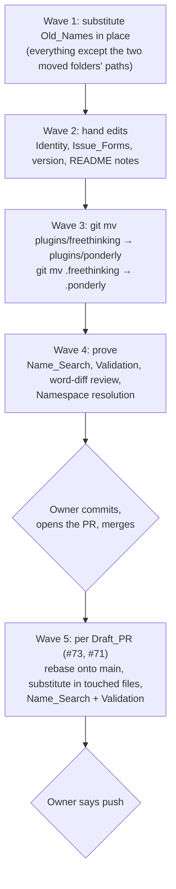
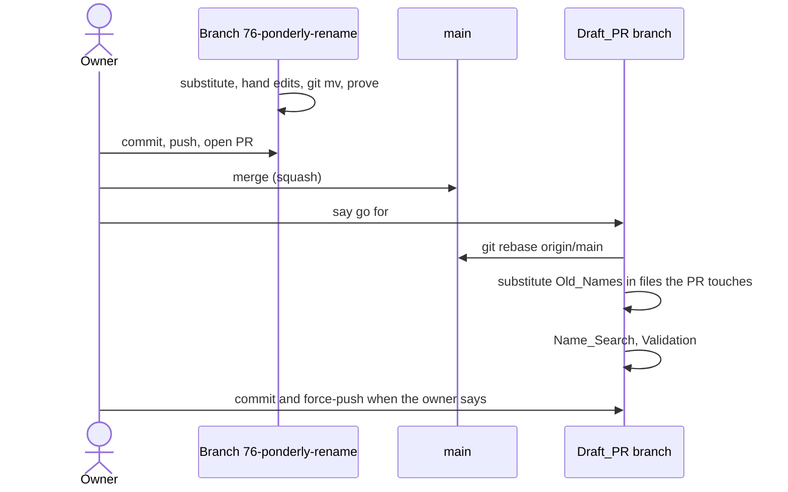
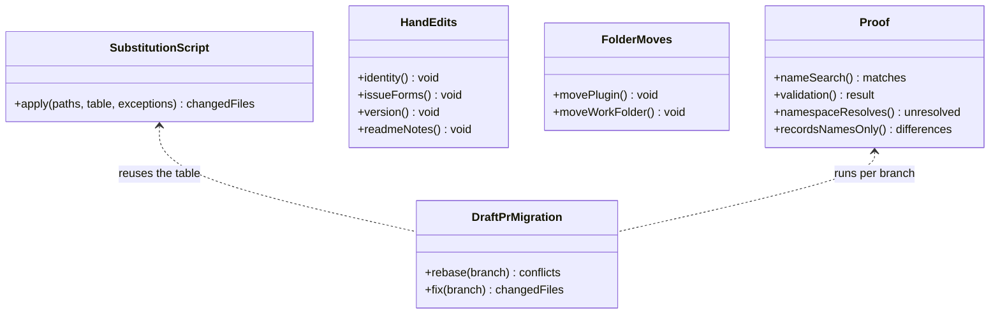

# Design Document

## Overview

The rename is three moves and one ordered text substitution, then a few hand edits that no substitution can make. `git mv` moves `plugins/freethinking/` to `plugins/ponderly/` and `.freethinking/` to `.ponderly/`, so every file keeps its history. A scratch script then replaces the Old_Names across the working tree in a fixed order, longest and most specific form first, so that `freethinkingit/dev_tools` becomes `sabind/ponderly` before a bare `freethinking` becomes `ponderly`. The Identity, the Issue_Forms' Type_Labels and the version are edited by hand. A handful of Judgment_Lines, where the plain substitution would be wrong or false, are then corrected by hand after reading them in context. The Name_Search and the Validation prove the result, and a word-level review of the diff proves that every other change is a name. The Draft_PRs are rebased onto `main` once this task has merged, and get the same substitution on the files they touch.

## Architecture

Key decision — one ordered substitution table applied by a scratch script, then a review of the diff. The Old_Names come in a handful of forms (`github.com/freethinkingit/dev_tools`, `freethinkingit/dev_tools`, `freethinking@freethinkingit`, `freethinkingit`, `.freethinking/`, `freethinking:`, `plugins/freethinking`, `freethinking.it`, bare `freethinking`, `dev_tools`), about 640 occurrences in some 160 files. Ordering the table from most to least specific maps each form to the right New_Name in one pass (Requirements 1.2, 2.2, 3.1, 3.4, 4.1, 5.3, 6.1). The trade-off is that a blind substitution can rewrite a name that should stay, so the script skips the listed exceptions and the whole diff is reviewed before the proof wave. The script lives in the scratchpad and is deleted when the task is done.

Rejected alternative — a single `sed s/freethinking/ponderly/g`. It turns `freethinkingit` into `ponderlyit` and `freethinkingit/dev_tools` into `ponderlyit/dev_tools`, both wrong, and leaves `dev_tools`.

Rejected alternative — editing each file by hand. Over 640 occurrences make misses likely, and the Name_Search would then find them one at a time.

Key decision — substitute first, move folders after. The session building this task runs the installed plugin, which reads its spec from `.freethinking/specs/ponderly-rename/`. Moving `.freethinking/` while the run is in progress would take the spec away from it mid-run, so the folder moves come in the last build wave, and the spec's last ticks are made at `.ponderly/specs/ponderly-rename/` (Requirement 3.2). The trade-off is that for two waves the text says `.ponderly/` while the folder is still `.freethinking/`; nothing reads those paths in between, because the installed plugin, not the working copy, runs the session.

Rejected alternative — move first. Simpler to describe, but it breaks the run that implements it.

Key decision — the script does the one-answer forms, a person does the Judgment_Lines. Nearly every occurrence is a skill or agent name, a path, a link or the install id, each with exactly one right replacement, where a program is more reliable than hand edits. A few lines need the sentence read: the Identity, `FreeThinking IT`, and Records that would state something false once the name changes, such as an address "the organization's profile already lists" or `gh api orgs/sabind/...` for what is a personal account. Those are corrected by hand after the script runs, using the least rewording that keeps the sentence true without an Old_Name (Requirements 4.2, 7). Every other changed word is checked in a word-level diff against `main` to be an Old form turned into its New form (Property 2). The trade-off is a reviewed diff in place of a mechanical proof.

Rejected alternative — prove the Records by applying the table in reverse. `ponderly` comes from both `freethinking` and `dev_tools`, so the reverse is ambiguous and needs line-by-line matching against `main`, which is more machinery than the dozen lines that need judgment.

Rejected alternative — every replacement by hand. About 600 identical edits by hand are slower, cost far more, and risk typos such as `ponderly:start-tsak` that the Name_Search cannot see.

Key decision — the external package follows its own rename. `@freethinkingit/gherkin-harness` in `strategies/multi-tool-plugin.md` names a private package in the owner's `dansabin` repository, which the owner is renaming there to `@sabind/gherkin-harness`. Row 6 of the substitution table gives that name, so the strategy needs no special case (Requirement 4.3). The trade-off is that until the `dansabin` change lands, the strategy names a package by a name it does not yet have.

Key decision — `type:` becomes a second label beside `triage`. Each Issue_Form already sets `labels: ["triage"]`, so its `type: <Kind>` line is removed and its Type_Label is added to that list, giving for example `labels: ["triage", "type: bug"]` (Requirements 6.2, 6.3).

Key decision — Draft_PRs are rebased onto `main` after this task merges, not onto this branch. The Repository squash-merges, so a Draft_PR rebased onto this branch would carry this branch's commits and need a second rebase after the merge. Rebasing onto `main` once this has merged is one rebase per Draft_PR. Git's rename detection carries their edits under `plugins/freethinking/` to `plugins/ponderly/`, and the same substitution table fixes the Old_Names in the files each Draft_PR adds or changes (Requirements 8.1, 8.2). This reads Requirement 8.1's "when this task's branch is ready" as "once it has merged". The trade-off is that the Draft_PRs wait for the merge, and their wave runs after the owner has committed, pushed and merged this branch.

Rejected alternative — rebase now onto this branch. It needs this branch committed first, which the owner has not asked for, and a second rebase later.

Key decision — `handbook` stays. The hook's "Handbook rules" heading and the rules' "this handbook" wording are a description, not one of the Old_Names, and the requirements leave them alone.

## Components and Interfaces

### Substitution script

A scratch Python script in the session's scratchpad that applies the Substitution Table to text files, skipping `.git/` and the Exceptions, and can apply the inverse table to one file.

| Operation | Input | Output | Requirements |
|-----------|-------|--------|--------------|
| `apply(paths, table, exceptions)` | the working tree, or a Draft_PR's touched files | the files it changed | 1.2, 2.2, 3.1, 3.4, 4.1, 5.1, 5.2, 5.3, 6.1, 6.4, 8.2 |
### Hand edits

Changes no substitution can make.

| Operation | What changes | Requirements |
|-----------|--------------|--------------|
| `identity()` | `plugin.json` author name, email and URL; `LICENSE` holder; `CODE_OF_CONDUCT.md` contact; marketplace `owner` | 7.1, 7.2, 7.3, 7.4 |
| `issueForms()` | each form's `type:` line removed and its Type_Label added to `labels:` | 6.2, 6.3 |
| `version()` | `plugin.json` version `1.0.0` | 1.4 |
| `readmeNotes()` | the Plugin README's 0.14.0 `.claude/specs/` note removed; its Work_Folder section reads `.ponderly/` | 3.3 |

### Folder moves

| Operation | Command | Requirements |
|-----------|---------|--------------|
| `movePlugin()` | `git mv plugins/freethinking plugins/ponderly` | 1.1 |
| `moveWorkFolder()` | `git mv .freethinking .ponderly` | 3.2 |

### Proof

| Operation | What it runs | Requirements |
|-----------|--------------|--------------|
| `nameSearch()` | the Name_Search | 1.3, 9.1, 9.2 |
| `validation()` | `make validate` and `make check`, which include the three `claude plugin validate --strict` runs | 2.3, 5.4 |
| `namespaceResolves()` | every `ponderly:<name>` in the Repository names a skill folder or agent file under `plugins/ponderly/` | 1.2 |
| `wordDiffReview()` | `git diff --word-diff=porcelain -M origin/main`: every changed word outside the Judgment_Lines and the hand edits is an Old form becoming its New form | 4.2 |

### Draft PR migration

Run once per Draft_PR, #73 then #71, in a separate worktree, after the owner says go.

| Operation | What it does | Requirements |
|-----------|--------------|--------------|
| `rebase(branch)` | `git rebase origin/main`; stops and shows any conflict that is not a name change | 8.1, 8.4 |
| `fix(branch)` | `apply` on the files the Draft_PR adds or changes; Name_Search and Validation on the branch | 8.2, 8.3 |

Neither operation commits or pushes until the owner says so; nothing touches `newcomer-docs` or #72 (Requirements 8.5, 8.6, 9.3).

## Data Models

The Substitution Table, applied top to bottom, each row on the text the earlier rows left:

| # | Old form | New form |
|---|----------|----------|
| 1 | `github.com/freethinkingit/dev_tools` | `github.com/sabind/ponderly` |
| 2 | `freethinkingit/dev_tools` | `sabind/ponderly` |
| 3 | `freethinking@freethinkingit` | `ponderly@sabind` |
| 4 | `hello@freethinking.it` | `dan.sabin@gmail.com` |
| 5 | `https://freethinking.it` | `https://dansabin.com` |
| 6 | `freethinkingit` | `sabind` |
| 7 | `Freethinking` | `Ponderly` |
| 8 | `freethinking` | `ponderly` |
| 9 | `dev_tools` | `ponderly` |

Rows 6 to 9 cover the remaining forms: the Marketplace, `.freethinking/`, `freethinking:`, `plugins/freethinking`, the temporary eval folder name and the Repository's short name. Row 9 replaces the repository's short name, `dev_tools`, wherever it stands alone; where the text means the full name, rows 1 and 2 have already given `sabind/ponderly`.

The Exceptions, left unchanged by `apply` and listed at hand-back:

| Text | Where | Why |
|------|-------|-----|
| every Old_Name | `specs/ponderly-rename/` | this spec describes the rename, and its substitution table must name the Old_Names to work (Requirement 9.1) |

The Judgment_Lines, found by searching for the organisation's address, its display name and `orgs/` calls before the run, and corrected by hand after the script; any further line the diff review finds false joins them:

| Line | What the script leaves | Correction |
|------|------------------------|------------|
| `specs/directory-listing/requirements.md:47` | `FreeThinking IT` untouched | `Dan Sabin`, matching the new Identity |
| `specs/contributing-guide/design.md:34` | `gh api orgs/sabind/issue-types`, but `sabind` is a personal account | reword so it names the organisation's issue types without an Old_Name |
| `specs/contributing-guide/tasks.md:67` | `dan.sabin@gmail.com` as "the address the organization's profile already lists" | reword so the claim about the organisation's profile no longer names an address |
| `specs/contributing-guide/tasks.md:91` | the conduct contact settled on 2026-10-12 as `dan.sabin@gmail.com` | reword to "the organisation's contact address" |
| `plugins/ponderly/.claude-plugin/plugin.json:7` | `FreeThinking IT` untouched | handled by the Identity edit |

Issue_Form label mapping:

| Form | Removed line | `labels:` after |
|------|--------------|-----------------|
| `misbehaving-skill-or-agent.yml` | `type: Bug` | `["triage", "type: bug"]` |
| `proposal.yml` | `type: Feature` | `["triage", "type: feature"]` |
| `eval-case.yml` | `type: Task` | `["triage", "type: task"]` |
| `spike.yml` | `type: Spike` | `["triage", "type: spike"]` |

## Correctness Properties

### Property 1: No Old_Name is left

*For any* file in a finished branch's working tree outside `.git/`, the Name_Search finds no match except the Exceptions.

**Validates: Requirements 1.3, 3.1, 4.1, 5.3, 6.1, 8.3, 9.1**

### Property 2: Every other change is a name

*For any* word that differs between `main` and the finished branch, outside the Judgment_Lines and the hand edits of the Identity, Issue_Forms, version and READMEs, the old word is an Old form and the new word is its New form under the Substitution Table.

**Validates: Requirements 4.1, 4.2, 4.4**

### Property 3: Every Namespace reference resolves

*For any* `ponderly:<name>` in the Repository outside the Records, `plugins/ponderly/skills/<name>/SKILL.md` or `plugins/ponderly/agents/<name>.md` exists.

**Validates: Requirements 1.2, 5.3**

### Property 4: Moved files keep their history

*For any* file under `plugins/ponderly/` or `.ponderly/` that existed at `main`, `git log --follow` reaches its commits from before the move.

**Validates: Requirements 1.1, 3.2**

## Error Handling

| Condition | Category | Behaviour | Requirements |
|-----------|----------|-----------|--------------|
| The Name_Search finds a match after the substitution | INCOMPLETE | List each match with file and line; fix by hand or add it to the Exceptions with the owner's say; not done until empty | 9.2 |
| The word-diff review finds a change that is not a name, outside the Judgment_Lines and hand edits | NON_NAME_CHANGE | Restore that text from `main` and re-apply the name only | 4.2 |
| A substituted line in a Record states something false | JUDGMENT_LINE | Reword it by hand as little as keeps it true without an Old_Name, and list it in the hand-back | 4.2 |
| A `ponderly:<name>` names no skill or agent | BROKEN_HANDOFF | Fix the reference; a typo in the Old_Name text is fixed, not carried over | 1.2 |
| `make validate`, `make check` or a `claude plugin validate` run fails | VALIDATION | Stop; report the failing check and its output | 2.3, 5.4 |
| A Draft_PR rebase conflict that is not a name change | CONFLICT | Stop the rebase and show the conflict to the owner | 8.4 |
| An Old_Name names something outside the Repository | EXTERNAL_NAME | Add it to the Exceptions and list it for the owner | 4.3 |

## Testing Strategy

No eval target runs (Requirement 5.5). The proof is deterministic and free:

- Property 1 is the Name_Search itself, run at the end of the build waves and again on each Draft_PR branch.
- Property 2 is a review of `git diff --word-diff=porcelain -M origin/main`, filtered to the changed words, each checked against the Substitution Table, with the Judgment_Lines and hand edits read by eye.
- Property 3 is a scratch script that collects every `ponderly:<name>` with `rg` and checks each against the skill folders and agent files; it is deleted when done.
- Property 4 is `git log --follow --oneline` on a sample of moved files from each folder, and `git status` showing the moves as renames.
- The Validation (`make validate`, `make check`) is the integration test: it runs every check under `checks/` against `plugins/ponderly/`, checks the issue forms' component dropdowns, and runs `claude plugin validate --strict` on the Marketplace, the Plugin and its skills.
- Each Error Handling row is exercised by the run itself: a non-empty search, a non-name change in the word diff or a failed validation stops the wave.
