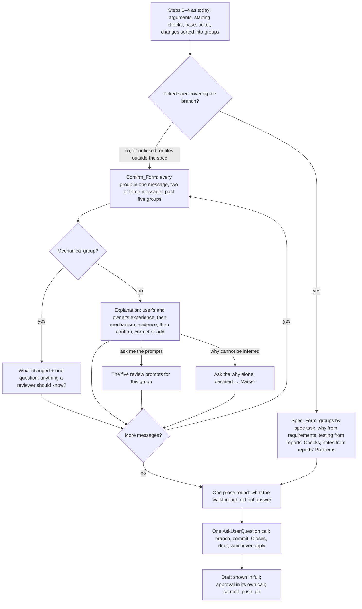

# Design Document

## Overview

One skill file changes its premise and four eval cases prove it. `skills/pr/SKILL.md` keeps its starting checks, its ticket reading, its change sorting, its drafting rules and its `gh` steps, and replaces the middle: step 5 becomes two forms chosen by whether the branch has a ticked spec, the Confirm_Form, where the skill explains every group as the user and the owner experience it in one message, or two or three on a large branch, and the author confirms or corrects in one reply per message, and the Spec_Form, where the groups are the spec's tasks and the why, testing and notes come from the spec and the reports, with one prose round; step 6 shrinks to that round; the four fixed choices move into one call after the walkthrough; mechanical groups get one question and nothing answered is asked twice. The description carries the confirmed words with no marker, because the author's approval of the draft is the record. The `opens-pr-with-ticket` case is rewritten to a confirmation given in advance, and three cases are added: the confirm form, the spec form, and a mechanical group with a pre-answered confirmation. Issues #69, #45 and #55.

## Architecture

**Key decision: the form is chosen by the branch, not by an argument.** The skill looks for `.ponderly/specs/*/tasks.md` whose non-optional leaf tasks are all ticked and whose top-level tasks name the files the diff changes; when it finds one, it takes the Spec_Form and says which spec; otherwise, or when a task is unticked, it takes the Confirm_Form and says why; files no task names are walked in the Confirm_Form after the spec groups (Requirement 1). Trade-off: the match between task names and changed files is a judgement, so a branch with a spec and much extra work gets a mixed walkthrough. Rejected: a `--short` argument, which the author would have to remember and which hides the reason the skill chose a form. Rejected: the Spec_Form for every branch, which has no spec to draft from on a branch Claude built without one, and would make the skill invent the why.

**Key decision: the skill explains and the author confirms.** The sentence "An option the skill wrote is the skill's words, and the author is accountable only for words they wrote themselves, so the review prompts take no pre-filled answers" and the rule "Do not propose an answer to any prompt" are removed. In their place, each group gets an Explanation written by the skill in the shape the communication rule gives, the user's and the owner's experience before the mechanism, and the author's accountability is their reading and Confirmation of it and their approval of the whole draft (Requirements 2, 6). The author chose no marker in the description. Trade-off: a reviewer cannot tell from the description which words were the author's own; the author decided the approval is the record, as on PRs #49, #53 and #73. Rejected: a line under Notes for reviewers or a marker per bullet, which the author declined on 2026-10-26. Kept: the five Review_Prompts on request, and the Marker for a why the skill could not infer and the author declined to give, so the one case where accountability has nothing to confirm still shows in the PR.

**Key decision: every group in one message, split only when the branch is large.** The Confirm_Form puts every group's Explanation in one message and takes the author's confirmations in one reply; past five groups it splits them into two or three messages of roughly equal size, in the order that tells the branch's story, each with its own reply, and the first says how many there are (Requirement 2.2). The author chose this on 2026-10-26 after first choosing one group per message: the reading is now the skill's words rather than the author's writing, so one message is a lighter read than a turn per group, and a cap keeps a thirty-file branch from arriving as one wall. Trade-off: a group in the middle of a long message can slip by unread; the confirmation question names each group so a reply has to account for all of them. Rejected: one group per message, the shape of the walkthrough today, which makes a ten-group branch ten turns. Rejected: a split by file count, which would separate a change from its test.

**Key decision: the Spec_Form drafts from the spec and the reports, and asks once.** Groups are the spec's top-level tasks; the why is the requirement each task cites plus the spec's introduction; testing is the reports' Checks and the tasks' ephemeral checks; notes are the reports' Problems; the eval table in a report goes into Testing. One message shows every group with what changed and its drafted why in a line or two, then one prose round asks for risk and rollout, review focus, and any reason that changed during the run (Requirement 3). When the reports are not in the conversation, the skill drafts from the spec alone and says the testing is as written in the tasks, not as seen. Trade-off: the author reads a longer single message; they approved each spec document already, so this is a recap. Rejected: walking spec groups one per message with a confirmation each, which re-asks what the spec approvals settled, the cause of #45.

**Key decision: the fixed choices go in one call after the walkthrough.** The branch offer, the commit offer, the Closes question and the draft question are all short fixed lists the author can pick without context, so under the collaboration rule they batch (Requirement 5). Step 1 still reads the starting state and stops on a missing origin, a signed-out `gh` or an unreadable ticket, but it only notes uncommitted files and the default branch; the questions come after the walkthrough, when the author has seen what would be committed. The Closes question stays separate only when the ticket arrives in the prose round. Trade-off: on the default branch the walkthrough runs before the branch exists, which is fine since nothing is committed until approval. Rejected: asking each at its own step, as today, which is four calls where one will do.

**Key decision: mechanical groups and answered questions.** A group whose diff is a version bump, a rename, generated output or a one-line configuration change is shown with what changed and one question, "anything a reviewer should know?" (Requirement 4.1). An answer the author gave earlier in the session or in the request is taken, named, and never re-asked; the skill treats listing an answered question as open as its own defect (Requirements 4.2, 4.3). Rejected: a size threshold in lines, which would call a one-line logic change mechanical.

**Key decision: the cases grade the message and the `gh pr create` body.** Each new case copies the `opens-pr-with-ticket` scaffold, a feature branch two commits ahead with a fake `gh` and the repository's template, and grades the last message with regex and the pushed description with a `tool_used` grader on Bash whose `input_match` reads the body passed to `gh pr create`, as `carries-authors-words` does today. The absence of the five prompts is a `not_contains` regex on "What would break it". The spec case plants `.ponderly/specs/add-greeting/` with a ticked `tasks.md` naming `demo/greeting.py` and `tests/test_greeting.py` on the branch, and no reports exist in the sandbox, which exercises Requirement 3.4. Rejected: an `llm` grader; the shapes here are all regex-checkable.

## Components and Interfaces

| Component | Responsibility | What changes | Requirements |
|-----------|----------------|--------------|--------------|
| `skills/pr/SKILL.md` description | Says when and how the skill applies | Says it explains each change and asks the author to confirm, drafts a ticked spec's branch from the spec and reports, and keeps the fixed choices in one call; under 1,024 characters | 8.1 |
| `SKILL.md` "Working with the author" | The skill's stops and how it asks | Stops: the starting checks, the walkthrough's confirmations, the prose round, the one fixed-choice call, the approval. How it asks: prose for confirmations and the round; the tool for the fixed choices and the approval | 2.1, 5.1, 5.4 |
| `SKILL.md` step 1 | Starting checks | Stops as today; notes the default branch and uncommitted files for the fixed-choice call instead of asking | 5.1, 5.3 |
| `SKILL.md` step 4 | Read and sort changes | Adds the Ticked_Spec check and the Mechanical_Group sort | 1.1–1.5, 4.1 |
| `SKILL.md` step 5 | The walkthrough | Rewritten as the Confirm_Form and the Spec_Form | 1.3, 2.1–2.7, 3.1–3.5, 4.1–4.4 |
| `SKILL.md` step 6 | What is still missing | The prose round for both forms; the ticket-in-prose Closes exception | 3.3, 5.2 |
| `SKILL.md` new step | The fixed choices | One AskUserQuestion call: branch, commit, Closes, draft, whichever apply | 5.1 |
| `SKILL.md` steps 7–9 | Draft, approve, create | Changes bullets from confirmed Explanations or Corrections, no marker; the rest as today | 6.1–6.4 |
| `evals/skills/pr/opens-pr-with-ticket/` | Proves the ticket path | Prompt gives a Confirmation in advance; `carries-authors-words` becomes `carries-confirmed-words` | 7.1 |
| `evals/skills/pr/explains-and-asks-to-confirm/` | Proves the Confirm_Form | New | 7.2, 7.7 |
| `evals/skills/pr/drafts-from-ticked-spec/` | Proves the Spec_Form | New | 7.3, 7.7 |
| `evals/skills/pr/one-question-for-a-version-bump/` | Proves the mechanical rule and no re-ask | New | 7.4, 7.7 |
| `plugins/ponderly/README.md` | What the plugin does | The `pr` row | 8.2 |
| `plugins/ponderly/.claude-plugin/plugin.json` | Version | The next minor above `main` at merge: 0.18.0 if #73 (0.17.0) merges first, else 0.17.0 | 8.3 |

## Data Models

**The Ticked_Spec test** (step 4): among the specs whose directory `.ponderly/specs/<task>/` the branch's diff adds or changes, one whose `tasks.md` has every `- [ ]` leaf line marked `*` (optional) or absent. The skill never scans the specs on the base branch: one the diff does not touch is a record and never counts, and when the diff touches no spec but the request or the Ticket_Context names one, the skill asks in one line whether to draft from it instead of deciding. The spec's own three files are not walked as groups; they are the evidence, so the Spec_Form's first line says they are in the branch and map the source changes. The first such spec wins: its task texts, sub-task texts and detail bullets name the source files it covers, and those are the spec groups; where the code differs from what a task describes, the skill explains the code and names the difference; any other source file the diff changes is walked in the Confirm_Form after the spec groups, and the skill says so. A spec the diff adds or changes with any unticked non-optional leaf is named, with that task, as the reason for the Confirm_Form.

**The Explanation** (Confirm_Form, one per group; all groups in one message, or two or three messages of roughly equal size past five groups), in this order:

1. The group's number and name, and the files.
2. What changes for whoever uses the software, and what the author takes on: what it does not cover, what would break it, any care on rollout; then how it was done. Drawn from the diff, the commits, the Ticket_Context and the spec where one exists.
3. What was run for it and the result, from the commits, the tests in the diff and the ticket; "not seen run" when nothing says.
4. Evidence: one to three lines quoted from the diff or the commits.
5. After the last group of the message, one question in prose naming every group in it: confirm, correct or add, per group; "ask me the prompts" for any group brings the five for it.

**The Mechanical_Group message**: the group's number, name and files; what changed in one sentence; the one question "anything a reviewer should know?". A file sorted as Generated in step 4 is never walked. Generated source, a file a generator wrote that a person reviews and commits, is sorted as Source and walked like any other: it is a Mechanical_Group only when its diff holds no logic, such as a regenerated table; generated code whose diff changes behaviour gets the full Explanation.

**The Spec_Form message**: one line naming the spec and that the branch is drafted from it and the reports; then one entry per top-level task, in task order: the task's number and title, the files, what changed in a line, and the drafted why, the requirement it cites in plain words; then the prose round: risk and rollout, review focus, any reason that changed during the run, and the ticket when none was given.

**The fixed-choice call**: up to four questions in one AskUserQuestion call, each only when it applies: `Branch` (Create `<name>` (Recommended), Stop) when the branch is the default; `Commit` (Commit after the walkthrough (Recommended), Leave them out) when files are uncommitted; `Closes` (Merging finishes it, Only related) when the ticket is a GitHub issue and the template has the convention; `Draft` (Ready for review, Draft). The option texts stay as the skill writes them today.

**The Changes bullet**: what changed, then the why, in the Explanation's words as confirmed or the author's Correction; a Mechanical_Group's bullet is what changed plus the author's answer when there was one; a self-explanatory group's bullet is what changed alone; a declined why carries the Marker and a Notes for reviewers entry.

**Eval case shapes**, following `opens-pr-with-ticket`: `scaffold.sh` building the demo repo, the fake `gh`, the git wrapper, the template on `main` and the `add-greeting` branch two commits ahead; `prompt.md` with `tags: [skill, pr]`, `max_turns: 20`, `allowed_tools: [Read, Glob, Grep]`; the Makefile's pr target grants Bash and runs the scaffold.

| Case | Prompt | Graders |
|------|--------|---------|
| `opens-pr-with-ticket` (rewritten) | `/ponderly:pr #7` plus: "I cannot answer during this run. Confirm every explanation as written, with one correction: the why is that the CLI needed a greeting helper. Merging finishes the ticket; not a draft; treat the draft as approved." | as today for title, Closes, push and URL; `carries-confirmed-words`: `tool_used` Bash, `input_match` on the `## Changes` section holding "greeting helper" |
| `explains-and-asks-to-confirm` | `/ponderly:pr` with no answers in advance | regex: in the first walkthrough message, the first group's heading line names `demo/greeting.py`, and the user's or the owner's experience (who uses the greeting, or what the author takes on) comes after that heading and before the mechanism (`greet`, `return` or `Hello`); regex: "confirm" and "correct" in a question; regex: both groups, the helper and its test, are named in that one message; regex `not_contains`: "What would break it"; `tool_used` Bash with `max: 0` on `gh pr create` (it stops at the confirmation) |
| `drafts-from-ticked-spec` | `/ponderly:pr #7` on a branch whose scaffold commits `.ponderly/specs/add-greeting/` with requirements, design and a fully ticked `tasks.md` naming the two files | regex: names the spec and the Spec_Form in the first walkthrough message; regex: a group named by task "1" or its title; regex `not_contains`: "What would break it"; regex: asks about risk or review focus |
| `one-question-for-a-version-bump` | `/ponderly:pr #7` on a branch whose third commit bumps a version line in `demo/__init__.py`, with the advance text "The greeting group: confirmed as you explain it. The version bump: nothing a reviewer needs." | regex: the version-bump group gets "anything a reviewer should know" or its answer taken; regex `not_contains`: that question asked after the answer was given, approximated as at most one occurrence of "reviewer should know"; `tool_used` Bash on `gh pr create` with `input_match` on a Changes bullet naming the version |

## Correctness Properties

### Property 1: Every source change is explained and confirmed

*For any* branch the skill walks, every source file is covered by a group whose Explanation the author confirmed or corrected, a mechanical group the author answered, a spec group drafted from a ticked spec, or a bullet carrying the Marker.

**Validates: Requirements 1.5, 2.1, 2.3, 2.6, 3.1, 4.1, 6.1**

### Property 2: Nothing answered is asked again

*For any* question or prompt the author answered in the session or the request, the skill names the answer taken and does not put the question again.

**Validates: Requirements 4.2, 4.3**

### Property 3: A ticked spec never meets the five prompts

*For any* branch with a Ticked_Spec covering its changes, the walkthrough puts no Review_Prompt and asks exactly one prose round before the fixed choices.

**Validates: Requirements 1.1, 3.3**

### Property 4: The fixed choices are one call

*For any* run that reaches the draft, every applicable Fixed_Choice was asked in one AskUserQuestion call, and the approval in another.

**Validates: Requirements 5.1, 5.4**

## Error Handling

| Condition | Category | Behaviour | Requirements |
|-----------|----------|-----------|--------------|
| A spec exists with an unticked non-optional leaf | STATE | Confirm_Form, naming the task | 1.4 |
| Branch changes files no spec task names | STATE | Those files walked in the Confirm_Form after the spec groups | 1.5 |
| Reports not in the conversation on the Spec_Form | STATE | Draft from the spec; say testing is as written, not seen | 3.4 |
| The why of a group cannot be inferred | GAP | Ask the why alone; declined → Marker and Notes for reviewers | 2.5, 2.6 |
| The author answers a question already answered | DEFECT | Counted as the walkthrough's defect; the case for 7.4 catches it | 4.3 |
| No origin, signed-out `gh`, unreadable ticket | STOP | As today, before any walkthrough | 5.3 |
| Ticket named only in the prose round | ORDER | Read it, then the Closes question in its own call | 5.2 |
| Description over 1,024 characters | SIZE | `checks/test_descriptions.py` fails; trim | 8.1 |

## Testing Strategy

- `make validate` runs the description, listing and eval-case checks after each task.
- The four pr cases run under `make eval-skill-pr EVAL_ARGS="--runs 2"` while iterating, every grader being regex or tool_used, and once with `--ablation with-without` for the pull request's table (Properties 1 to 4); the two cases whose prompts give nothing in advance stop at the confirmation and prove the shape of the first message.
- The existing cases `follows-repo-template`, `offers-branch-on-default`, `offers-commit-on-dirty-tree`, `opens-pr-with-stub-gh` and `stops-at-starting-checks` run in the same table; `offers-branch-on-default` and `offers-commit-on-dirty-tree` grade that the offers are made and nothing is committed, which still holds when the offers move into the one call after the walkthrough, and their prompts are read for any wording that pins the offer to step 1.
- Each case's prompt frontmatter names the property and requirement it proves.
