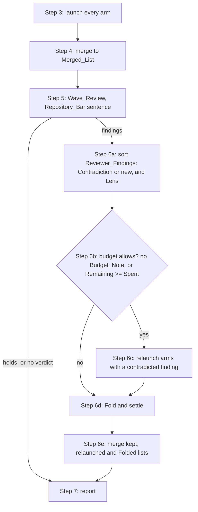

# Design Document

## Overview

The review skill keeps its first pass and its wave review as they are, and replaces step 6's "relaunch every arm" with a settle step run by the main session. The session sorts each Reviewer_Finding into a Contradiction of a Merged_List finding or a new finding, gives each the Lens whose kind of problem it names, and decides from the latest Budget_Note whether a Second_Pass may run. Only arms with a contradicted finding are relaunched, and only when the budget allows; every other Reviewer_Finding is Folded into the list by the session, anchored from its quote at the head, and every Contradiction no arm settles is settled by the session reading the quoted code. The merged result goes through the existing head check, duplicate collapse, ordering and cap. Step 5's launch sentence changes to name the Repository_Bar and the nit rule, and the `wave-reviewer`'s Standard gains a matching branch keyed on that sentence, so every other launch of the reviewer keeps the Team_Rules as today. The Findings_File gains one count, `removed_by_cap`, the findings the cap of 40 dropped; the count line gains the Fold, relaunch and cap facts.

## Architecture

Key decision, the main session Folds the reviewer's findings instead of relaunching arms to anchor them. A Reviewer_Finding carries a file and an exact quote, which is enough to find its lines at the head with a search; an arm relaunched only to anchor it costs about as much as its first pass. On the chunk 2 pull request the five arms cost about $4.40 and the Wave_Review $1.40, so a full Second_Pass could not fit the $8 cap, and the session dropped the reviewer's findings rather than run out (Requirements 1.1, 1.2, 2.7). The trade-off is that a Folded finding is anchored and categorised by the session, not re-verified by an arm with the lens in hand; the Wave_Reviewer already verified it against the code, and the head check still drops one whose lines do not exist.

Key decision, an arm is relaunched only for a Contradiction. A new Reviewer_Finding needs anchoring, which the Fold does; a Contradiction asks whether an arm's own finding is wrong, which the arm that made it can judge with its lens and the code. Arms with no contradicted finding keep their first-pass list (Requirements 2.1, 2.4). The trade-off is that an arm no longer gets the reviewer's notes to look again for what it missed; the reviewer's own findings cover what it saw.

Key decision, "the budget allows" means no Budget_Note, or a Remaining at least as large as Spent. A Second_Pass of one arm costs a fraction of the first pass, but the session cannot know that fraction before it launches, while Spent at that point is the first pass plus the Wave_Review, an upper bound on any Second_Pass. Comparing the two needs no estimate and no number in the skill (Requirements 2.2, 2.3). The trade-off is that a review that could have afforded one relaunched arm folds instead when Remaining is just under Spent; the Fold still keeps every finding.

Key decision, the Repository_Bar reaches the Wave_Reviewer through the launch sentence, and the agent's Standard branches on it. The Review_Skill already tells the reviewer what applies with one fixed sentence, and the Standard already branches on "These changes come from a spec wave"; a second sentence keeps every Spec_Wave_Review untouched (Requirements 4.1, 4.4). The trade-off is a second sentence the Standard must recognise verbatim.

Key decision, a Team_Rules departure without a Concrete_Cost becomes a nit, and a nit Folds as low. The Owner wants the team's view kept but not weighed as a defect; low findings sort last and are the first cut by the cap of 40, so on a long list they drop out of the scored findings and on a short one they stay visible (Requirements 1.2, 1.5, 4.2).

Rejected alternative, always run the full Second_Pass and leave the budget to the harness. On the chunk 2 pull request it would have run out at the cap halfway through and the adapter would have read the interim first-pass file, losing the same findings for about $2 more.

Rejected alternative, relaunch every arm whose Lens a Reviewer_Finding touches. On the chunk 2 pull request that was every lens but security, so it saves little and still needs the budget a full pass needs.

Rejected alternative, decide the Second_Pass by a fixed dollar estimate in the skill. A number in the skill goes stale with each model and price change and with the size of the pull request.

## Components and Interfaces

### Review_Skill (`plugins/ponderly/skills/review/SKILL.md`)

| Operation | Responsibility | Requirements |
|-----------|----------------|--------------|
| Step 5, launch the Wave_Review | Replace the sentence "No requirement or design excerpt applies to these changes; review them against the team rules." with the Repository_Bar sentence below; the rest of the launch is unchanged | 4.1 |
| Step 6a, sort | For each Reviewer_Finding: a Contradiction when it names a Merged_List finding by its file and lines or its message and says it is wrong; otherwise new. Give each the Lens whose kind of problem it names, by `lenses.md`'s own words; for a Contradiction, the Lens of the finding it contradicts | 1.1, 2.1 |
| Step 6b, budget | Read the latest Budget_Note in the session, any line of the form `USD budget: $<spent>/$<cap>; $<remaining> remaining`, whether Claude Code showed it or the session's prompt carries it; the budget allows a Second_Pass when there is none or its Remaining is at least its Spent | 2.2, 2.3 |
| Step 6c, Second_Pass | When the budget allows and at least one Merged_List finding is contradicted, relaunch the arms of those findings' Lenses, all in one message, with step 3's prompt plus the reviewer's Findings block and the Merged_List, as today; relaunch a failed arm once, as step 4 says | 2.1, 2.5, 2.6 |
| Step 6d, Fold and settle | Fold each Reviewer_Finding not left to a relaunched arm: find its quote in its file at the head, anchor the smallest range holding it, map blocker to high, should-fix to medium, nit to low, take a category its Lens carries, and use its problem as the message; count one whose file or quote is not found as not anchored. Settle each Contradiction no relaunched arm covers by reading the quoted code at the head: remove or correct the contradicted finding only when the code bears the Contradiction out. For an arm that failed its relaunch, keep its first-pass list and Fold its Lens's Reviewer_Findings | 1.1, 1.2, 1.3, 1.6, 2.5 |
| Step 6e, merge | Merge the first-pass lists of arms not relaunched, the second-pass lists of arms relaunched, and the Folded findings, with step 4's head check, duplicate collapse, order and cap | 1.4, 1.5, 2.4 |
| Steps 4 and 6e, cap count | Count the findings each merge's cap of 40 drops as `removed_by_cap`, summed over both merges, apart from what the head check and duplicate collapse remove, and keep the four counts disjoint so they add up to the candidates | 3.4, 3.5 |
| Step 6d, quote | Put the quote's line to awk as a single-quoted shell word with each `'` in it written as `'\''`, so a quote holding a single quote still anchors | 1.2 |
| Step 7, report | Extend the count line with the Folded count, the not-anchored count, each relaunched Lens or "none", whether a Budget_Note stopped a Second_Pass, and the number the cap dropped; write the Findings_File in its shape with `counts.removed_by_cap` added, `second_pass` true when an arm was relaunched | 3.1, 3.2, 3.3, 3.4 |
| Frontmatter description and "Working with the author" | Say that the reviewer's findings are Folded and arms the reviewer contradicted are relaunched when the budget allows, in place of "runs the arms once more when it returns findings" | 5.1 |

The Repository_Bar sentence, verbatim: "These changes are a pull request reviewed for the review skill: judge style, structure, comments and tests against the repository's own bar, what its CLAUDE.md, its contributing guide and the code around the change already do, and report a team-rule departure the repository also shows, or one with no concrete cost in this change, as a nit."

### Wave_Reviewer (`plugins/ponderly/agents/wave-reviewer.md`)

| Operation | Responsibility | Requirements |
|-----------|----------------|--------------|
| Standard, review-skill branch | When the launch holds the Repository_Bar sentence, read the repository's `CLAUDE.md`, its contributing guide and the code around the change before judging style, structure, comments and tests; report a Team_Rules departure with no Concrete_Cost as a nit, whether or not the Repository_Bar also shows it; a departure with a Concrete_Cost keeps the severity the Findings section gives that cost, even when the Repository_Bar also shows it; with none of the three to read, judge by the Team_Rules and keep the nit rule | 4.2, 4.3, 4.5 |
| Standard, every other launch | Unchanged: the Team_Rules are the bar, and the spec-wave sentence waives a missing test | 4.4 |
| Description | Unchanged except "review launches it once per review with the merged findings quoted" stays true | 5.1 |

### Review_Arm description (`plugins/ponderly/agents/review-arm.md`)

| Operation | Responsibility | Requirements |
|-----------|----------------|--------------|
| Frontmatter description | Replace "and once more per lens with the wave-reviewer's Findings for a second pass" with "and once more, for a lens whose findings the wave-reviewer contradicted, with its Findings for a second pass"; the procedure and its Second pass section stay as they are | 5.1 |

### Reference (`docs/reference.md`)

| Change | Requirements |
|--------|--------------|
| `review` entry: the Fold, the Second_Pass only for contradicted arms and only within budget, the extended count line | 5.1 |
| `wave-reviewer` entry: the Repository_Bar sentence and the nit rule beside the spec-wave sentence | 5.1 |
| `review-arm` entry: relaunched only for a contradicted lens | 5.1 |

### ReviewBench README (`benchmarks/reviewbench/README.md`)

| Change | Requirements |
|--------|--------------|
| The Review health paragraph's "how often a second pass ran" becomes how often a second pass relaunched arms, matching `second_pass` now being true only when an arm was relaunched; the one file under `benchmarks/` this task changes, a documentation edit that no running chunk reads | 5.1 |

### ReviewBench report (`benchmarks/reviewbench/report.py`)

| Change | Requirements |
|--------|--------------|
| The Review health line "Second pass ran" becomes a label that says arms were relaunched, with its three assertions in `checks/test_reviewbench_report.py`; the count stays `second_pass` | 5.1 |
| Review health also prints the mean findings cut by the cap from `counts.removed_by_cap`, beside the merge's and the review's; a review file without that count, written before this change, is still readable and is left out of that mean only | 5.1 |

### ReviewBench adapter (`benchmarks/reviewbench/agent/agent.py`)

| Change | Requirements |
|--------|--------------|
| `FINDINGS_SHAPE`, the shape the repair prompt gives, gains `"removed_by_cap": integer` in its counts after `removed_by_merge`, so a repaired review file carries the count | 3.2 |

### Evals (`evals/`)

| Case | What it proves | Requirements |
|------|----------------|--------------|
| `evals/agents/wave-reviewer/judges-by-the-repository-bar` | A repository whose own modules use divider comments, a change that adds a module with them and one real defect; launched with the Repository_Bar sentence, no divider-comment finding is above nit and the defect is should-fix or blocker | 4.1, 4.2, 4.3, 5.3 |
| `evals/skills/review/finds-planted-defects` | Its description and expected outcome say "the arms again" for any findings; reworded to the new Second_Pass | 5.1 |
| `evals/skills/review/clean-diff` | Its description and expected outcome name the wave-reviewer and nothing after it; reworded to say the reviewer's findings are Folded, so a reviewer blocker would reach the reply as high and fail `no-high-finding`, which is the behaviour the case holds | 5.1 |

## Data Models

Findings_File, unchanged in shape:

| Field | Type | Change |
|-------|------|--------|
| `pass` | `"first"` or `"final"` | none |
| `verdict` | `"holds"`, `"findings"` or `null` | none |
| `second_pass` | boolean | true when at least one arm was relaunched |
| `counts.candidates` | integer | every first-pass arm entry, plus each entry a relaunched arm adds that is not in its first-pass list at the same file and an overlapping range, plus every Folded finding; each finding counted once |
| `counts.removed_by_merge` | integer | the sum of what each merge's head check and duplicate collapse removed, excluding cap drops |
| `counts.removed_by_cap` | integer | new: the findings the cap of 40 dropped, summed over both merges |
| `counts.removed_by_review` | integer | first-pass findings removed in step 6: a Contradiction the session upheld by removing the finding, or a finding a relaunched arm withdrew; no longer counts what the cap cut |

The four removal counts are disjoint: `candidates` = the Final_List's length + `removed_by_merge` + `removed_by_cap` + `removed_by_review`, on every review.
| `counts.failed_arms` | list of Lens names | none |
| `findings` | list | Folded findings carry the same six fields as an arm's |

Severity mapping for a Fold:

| Reviewer severity | Final severity |
|-------------------|----------------|
| blocker | high |
| should-fix | medium |
| nit | low |

Count line, appended after today's facts: `folded <n>, not anchored <n>, relaunched <lens, ...> or none, cut by the cap <n>, budget stopped the second pass` when it did.

## Correctness Properties

### Property 1: No reviewer finding is silently lost

*For any* review whose Wave_Review returns `findings`, every Reviewer_Finding is Folded, left to a relaunched arm, counted as not anchored, or settles a Contradiction; none is dropped without being counted.

**Validates: Requirements 1.1, 1.3, 2.5, 2.7**

### Property 2: A relaunch only where a finding was contradicted, and only within budget

*For any* review, an arm is relaunched only when a Merged_List finding of its Lens was contradicted, and no arm is relaunched when the latest Budget_Note shows a Remaining smaller than its Spent.

**Validates: Requirements 2.1, 2.2, 2.3**

### Property 3: Spec waves keep their bar

*For any* launch of the Wave_Reviewer without the Repository_Bar sentence, its judgement of the Team_Rules is the same as before this change.

**Validates: Requirements 4.4**

## Error Handling

| Condition | Category | Behavior | Requirements |
|-----------|----------|----------|--------------|
| A Reviewer_Finding's file is absent at the head, or its quote is not in it | NOT_FOUND | Not Folded; counted as not anchored | 1.3 |
| A relaunched arm fails twice | AGENT_FAILURE | Keep its first-pass list, Fold its Lens's Reviewer_Findings, name it as failed | 2.5 |
| The latest Budget_Note shows Remaining below Spent | BUDGET | No relaunch; Fold every Reviewer_Finding and settle every Contradiction; the count line says the budget stopped it | 2.2, 3.1 |
| No Budget_Note in the session | NO_BUDGET | The budget allows a Second_Pass | 2.3 |
| The Wave_Review did not return or did not run | NO_REVIEW | The Merged_List is final, nothing is Folded, the count line says so | 3.3 |
| A Folded finding duplicates a Merged_List finding | DUPLICATE | Collapsed by step 4's rule for `--duplicates` | 1.4 |
| The repository has no `CLAUDE.md`, no contributing guide and no code around the change | NO_BAR | The Wave_Reviewer judges by the Team_Rules and keeps the nit rule | 4.5 |

## Testing Strategy

- Property 1 has no eval case of its own: any defect the Wave_Review can catch, a Review_Arm can catch first (the maintainability lens looks for stale docs, the correctness lens for disagreeing callers), so no fixture forces the Fold path and a fold case would fail on correct runs. The Fold is proved by reading step 6, by the `finds-planted-defects` case's expected outcome, and by the next ReviewBench chunk, whose count lines report the folded findings. A fold case was written in this run and dropped for that reason.
- Property 3 by the existing `wave-reviewer` eval cases, `finds-the-contradiction` and `passes-a-clean-diff`, which launch without the new sentence and must give the same verdicts as before.
- Requirement 4 by the `judges-by-the-repository-bar` eval case.
- Property 2's budget branch has no eval case: the eval runner's cost ceiling never reaches Claude Code as a spending cap, so a case would have to write the Budget_Note into its prompt, and it bites only when the Wave_Review contradicts an arm. It is proved by step 6b's text and by the next ReviewBench chunk, which runs every review under a real $8 cap, where `review.json`'s `second_pass` and the count line show whether a relaunch ran. A budget case was written in this run and dropped for that reason.
- `make validate` after every change; no eval case runs until the Owner asks.
