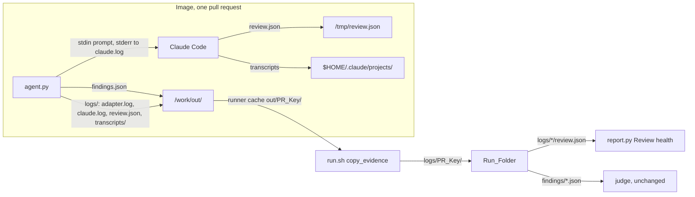
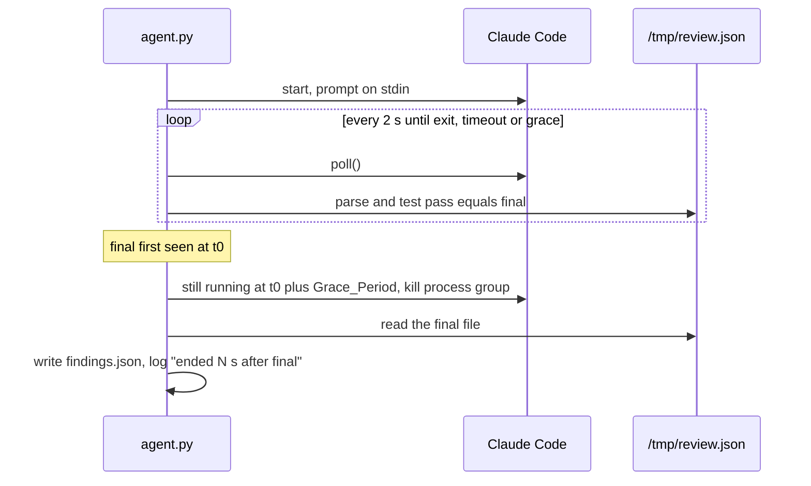
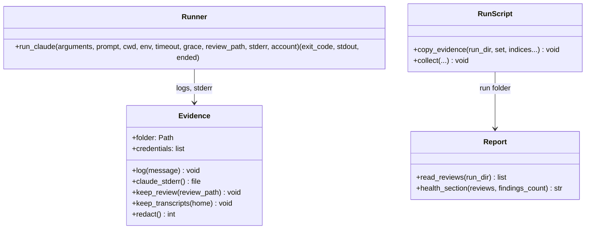

# Design Document

## Overview

The adapter gains an evidence writer that owns a `logs/` folder beside the findings file: it tees the adapter's log lines into `adapter.log` with timestamps, hands Claude Code a `claude.log` for its standard error, and on every exit path copies the review file and the session's transcripts in, then redacts any credential value from every file it wrote. The adapter's runner stops blocking on Claude Code's exit and instead polls, so it can end the process a grace period after the review file turns final. `run.sh` copies each pull request's evidence from the runner's cache into the run folder, `collect` carries it along, and `report.py` reads the review files into a "Review health" section. ReviewBench still sees only the findings file.

## Architecture

The early finish, inside the adapter's runner:

Key decision, the evidence folder is written by the adapter into the output mount, not collected from the container by the runner. The runner's cache already keeps `out/<PR_Key>/` after the container exits, so a folder beside `findings.json` survives with no change to ReviewBench's runner, and `run.sh` only copies (Requirements 1.1, 3.1). The trade-off is that the evidence lives in the cache until `run.sh` copies it, and the runner deletes `out/<PR_Key>/` at the start of that pull request's next run, so a second run of the same pull request replaces the evidence; the run folder's copy is the durable one.

Key decision, the runner polls instead of blocking. `run_claude` today calls `communicate` with a timeout and cannot look at the review file meanwhile. It now drains stdout on a thread and loops every two seconds over `poll()`, the clock and the review file, ending the process group when the file has been final for the Grace_Period or the time limit is reached (Requirements 2.1, 2.2). The trade-off is a thread and a loop in place of one call, taken because the alternative, a shorter time limit, would cut off slow reviews that are still working.

Key decision, redaction after copying rather than filtering what is copied. Transcripts are Claude Code's files and the adapter cannot know where a credential could appear in them, so after every copy the adapter scans each evidence file for the bytes of each credential value and replaces them, logging how many files it changed (Requirement 1.8). The trade-off is one pass over the folder, cheap against a ten-minute review.

Key decision, the whole `projects/` directory is the transcript copy. The image's reviewer home holds only this run, so copying `$HOME/.claude/projects/` whole avoids deriving Claude Code's encoded project path (Requirement 1.6), at the cost of a few metadata files beside the transcripts.

Rejected alternative, keep the transcripts by mounting the reviewer's home from the host. It would need a change to ReviewBench's runner, which this harness pins and does not patch.

Rejected alternative, read the review file's verdict into the findings file's `agent` field for the report. ReviewBench's validator reads the findings file and an extra field is a risk for no gain, when the review file itself can travel in the evidence folder (Requirement 4.1).

## Components and Interfaces

### Evidence (`agent/agent.py`)

Owns the evidence folder for one pull request and writes everything into it.

| Operation | Input | Output | Requirements |
|-----------|-------|--------|--------------|
| `Evidence(folder, credentials)` | `<dirname(RB_OUT)>/logs`, the credential values present in the environment | the folder created; on failure a logged reason and a disabled writer that only prints | 1.1, 1.9 |
| `log(message)` | a line | the line on stderr as today, and in `adapter.log` prefixed `YYYY-MM-DDTHH:MM:SSZ ` | 1.3, 1.4 |
| `claude_stderr()` | none | an append handle on `claude.log` for `Popen(stderr=...)`, used by the review and repair runs | 1.2 |
| `keep_review(review_path)` | the review file path | `review.json` copied when the file exists | 1.5 |
| `keep_transcripts(home)` | the reviewer's home | `$home/.claude/projects/` copied to `transcripts/` when it exists and transcripts are kept | 1.6, 1.7 |
| `redact()` | none | every file under the folder with each credential value replaced by `[redacted]`; returns the count of files changed, logged | 1.8 |

`main` wraps its body so that `keep_review`, `keep_transcripts` and `redact` run on every return, including the early returns for a missing variable after the folder exists, a non-zero exit and an unparseable file (Requirements 1.5, 1.6).

### Runner (`agent/agent.py`, `run_claude`)

Runs Claude Code once and ends it at the time limit or a Grace_Period after the review file turns final.

| Operation | Input | Output | Requirements |
|-----------|-------|--------|--------------|
| `run_claude(arguments, prompt, cwd, env, timeout_seconds, grace_seconds, review_path, stderr, account)` | as today plus the grace, the review file to watch and the stderr handle | `(exit_code, stdout, ended)` where `ended` is `None` for an exit on its own, `"timeout"` or `"final"` | 2.1, 2.2, 2.4 |

The loop sleeps `POLL_SECONDS = 2` between checks. `review_is_final(path)` parses the file and tests `pass == "final"`; a file that does not parse is not final. The time it is first seen final is kept, and dropped again whenever a later check finds it absent, unparseable or at `pass: "first"`; when `now - first_final >= grace_seconds` and the process is still running, the process group is killed as the timeout path kills it, `ended` is `"final"`, unless the exit status shows Claude Code had already exited on its own before the kill, in which case `ended` is `None`; on a grace end the log says `ended claude {:.0f} s after the review file turned final`. The repair run passes `grace_seconds=None`, since its file is not a review file (Requirements 2.3, 2.5). The caller treats `"final"` exactly as `"timeout"`: it reads the file and records any cost the result reported (Requirement 2.6).

### Run script (`run.sh`)

| Operation | Input | Output | Requirements |
|-----------|-------|--------|--------------|
| `copy_evidence <run_dir> <set> [<index>...]` | the run folder, the set name and, for `pr` and `prs`, the indices run | for each index, or every entry of the set's manifest when none is given, the PR_Key derived with the same `jq` expression as `try-agent.sh`, and `$TRY_AGENT_WORK/out/<PR_Key>/logs` copied to `<run_dir>/logs/<PR_Key>/`; a line on stderr per pull request without one | 3.1, 3.2, 3.3 |
| `collect` | as today | also copies each source's `logs/<PR_Key>/` folders into the new folder; when two sources hold the same PR_Key, the source with `findings/<PR_Key>.json` keeps `logs/<PR_Key>/`, or else the last source listed, and every other copy goes to `logs/<PR_Key>.before-<source folder name>/`; folders are never merged | 3.4 |
| `clear_cached_evidence <set> [<index>...]` | the set and, for `pr` and `prs`, the indices about to run | `$TRY_AGENT_WORK/out/<PR_Key>/logs` removed for each, so a pull request whose fetch fails leaves no earlier run's evidence to copy | 3.1, 3.3 |
| `set_aside_earlier_attempt <run_dir> <PR_Key>` | the run folder and the key about to run | when `findings/<PR_Key>.json` or `logs/<PR_Key>/` exists, both moved into `logs/<PR_Key>.before-<UTC timestamp>/`, the findings file as `findings.json`, with `-2`, `-3` and so on added to the folder name when that name is taken; nothing otherwise | 3.5 |

`run_set` calls `clear_cached_evidence` and `set_aside_earlier_attempt` before and `copy_evidence` after each `try_agent` call for `pr` and `prs`, and `clear_cached_evidence` before and `copy_evidence` after the set for `test` and `full`, regardless of the call's status; a step that fails prints a line naming the PR_Key and the chunk goes on. `try_agent` passes `RB_KEEP_TRANSCRIPTS` and `RB_FINAL_GRACE_SECONDS` into the container by name. The judge globs `findings/*.json`, which is why an earlier attempt's findings move out of `findings/` and into its own evidence folder.

### Report (`report.py`)

| Operation | Input | Output | Requirements |
|-----------|-------|--------|--------------|
| `read_reviews(run_dir)` | the run folder | one entry per `logs/*/review.json`, each the parsed object or `None` when it does not parse or lacks `pass`, `verdict`, `second_pass` or `counts` | 4.1, 4.5 |
| `health_section(reviews, findings_count)` | the entries and the number of findings files | the "Review health" section text | 4.2, 4.3, 4.4 |

`render_report` appends the section after "Duration and cost".

### Documentation (`README.md`)

| Change | Requirements |
|--------|--------------|
| A "What a run folder holds" paragraph listing `findings/`, `scoring/`, `logs/<PR_Key>/` with its four entries, `run.json` and `report.md`, and the sentence that ReviewBench reads only the findings file | 5.1 |
| `RB_KEEP_TRANSCRIPTS` and `RB_FINAL_GRACE_SECONDS` in the variables list with their defaults, beside the other `RB_` variables | 5.2 |
| The "Review health" section named with the report's other sections | 5.3 |

## Data Models

Evidence folder, `<dirname(RB_OUT)>/logs/`, copied to `<run_dir>/logs/<PR_Key>/`:

| Path | Content | Requirements |
|------|---------|--------------|
| `adapter.log` | the adapter's lines, `<UTC timestamp> <message>` | 1.3, 1.4 |
| `claude.log` | Claude Code's standard error, review run then repair run | 1.2 |
| `review.json` | the review file as the skill left it | 1.5 |
| `transcripts/` | `$HOME/.claude/projects/` as Claude Code left it; absent when `RB_KEEP_TRANSCRIPTS=0` | 1.6, 1.7 |

Review file fields the report reads, from the review skill's findings object:

| Field | Type | Notes |
|-------|------|-------|
| `pass` | `"first"` or `"final"` | `"final"` is what the runner waits for |
| `verdict` | `"holds"`, `"findings"` or `null` | `null` when the wave review did not run or did not return |
| `second_pass` | boolean | |
| `counts.candidates` | integer | entries the arms returned across both passes |
| `counts.removed_by_merge` | integer | |
| `counts.removed_by_review` | integer | |
| `counts.failed_arms` | list of lens names | |

Review health section, counts over the run:

| Line | Source |
|------|--------|
| pull requests with a readable review file | entries that are not `None` |
| findings files | the number of findings files, on its own line: a failed review keeps its review file but writes no findings file |
| wave review `holds`, `findings`, none | `verdict` |
| second pass ran | `second_pass` |
| lost an arm, with each lens and its count | `counts.failed_arms` |
| mean and largest candidates; mean removed by the merge and by the review | `counts` |
| unreadable review files | entries that are `None` |

Adapter settings added:

| Variable | Default | Meaning |
|----------|---------|---------|
| `RB_KEEP_TRANSCRIPTS` | `1` | `0` runs Claude Code with `--no-session-persistence` and copies no transcripts |
| `RB_FINAL_GRACE_SECONDS` | `60` | seconds after the review file turns final before Claude Code is ended |

## Correctness Properties

### Property 1: No credential in the evidence

*For any* content Claude Code writes to its transcripts, its standard error or the review file, no file under the evidence folder contains the value of any credential the adapter was given.

**Validates: Requirements 1.8**

### Property 2: The findings do not depend on how Claude Code ended

*For any* final review file, the findings file the adapter writes is the same whether Claude Code exited on its own, was ended after the Grace_Period, or was killed at the time limit, except for the recorded usage.

**Validates: Requirements 2.2, 2.4, 2.6**

### Property 3: The grace end never comes early

*For any* run in which the adapter ends Claude Code with reason `"final"`, the review file had been final for at least the Grace_Period, and no run is ended with that reason while the file is absent, unparseable or at `pass: "first"`.

**Validates: Requirements 2.2, 2.3**

## Error Handling

| Condition | Category | Behavior | Requirements |
|-----------|----------|----------|--------------|
| Evidence folder cannot be created, or a file in it cannot be written | IO | Log the reason; the writer prints only; the findings file is still produced | 1.9 |
| No session directory under the reviewer's home | NOT_FOUND | Log it; no `transcripts/`; nothing else changes | 1.6 |
| Evidence written by root in the container lands on a Linux host as root-owned files, some mode 0600 | IO | When the adapter runs as root, it hands the evidence folder to the owner of the output folder after redacting | 1.9, 3.1 |
| Review file absent or at `pass: "first"` when Claude Code is still running | WAIT | Keep polling until exit or the time limit | 2.2, 2.3 |
| Claude Code exits on its own during the Grace_Period | NORMAL | No kill; proceed as today | 2.4 |
| No `logs/` for a pull request in the runner's cache | NOT_FOUND | `run.sh` prints `no evidence for <PR_Key>` and continues | 3.3 |
| A pull request runs again into a run folder that holds its earlier attempt | CONFLICT | The earlier findings and evidence move into `logs/<PR_Key>.before-<timestamp>/`; the new attempt takes their places | 3.5 |
| `review.json` does not parse or lacks a field | VALIDATION | Counted as unreadable in the health section, left out of the other counts | 4.5 |
| No review files in the run folder | EMPTY | The health section says so in one sentence | 4.4 |

## Testing Strategy

- Property 1 by example in `checks/test_reviewbench_agent.py`: the stub writes the API key and the OAuth token into a fake transcript under its `HOME/.claude/projects/` and into its standard error; the copied `transcripts/` file and `claude.log` hold `[redacted]` and neither value, and the existing tests that scan stdout and stderr for the key still pass.
- Property 2 by example: a stub action that writes a final review file and then sleeps, run with `RB_FINAL_GRACE_SECONDS=1`, gives exit 0, the same findings as the `good` action, a `claude.log`, and an `adapter.log` line saying it ended Claude Code after the file turned final.
- Property 3 by example: a stub action that writes a `pass: "first"` file and sleeps is not ended by the grace and is killed at the scaled-down time limit as today; a stub that writes the final file and exits within the grace is not killed and the log has no grace line.
- Example tests for the remaining rows: `RB_KEEP_TRANSCRIPTS=0` passes `--no-session-persistence` and writes no `transcripts/`; an unwritable evidence folder still produces the findings file; the repair run's stderr lands in `claude.log` after the review run's.
- `checks/test_reviewbench_report.py`: a run folder with three review files, one `holds`, one `findings` with a second pass and a failed `security` arm, one `null`, prints the counts and the lens; a folder with no review files prints the sentence; one unreadable file is counted and left out.
- `run.sh` has no unit tests; the executor proves `copy_evidence` and `collect` with the fake image used for the `prs` target, and the first real chunk after this change is the end-to-end check.
