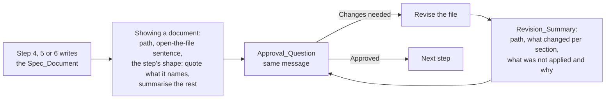

# Design Document

## Overview

The start-task skill gains one short section, "Showing a document", that holds the shape every spec document is shown in for approval: its path first, one sentence that the author can open the file, then the document's content in a fixed shape per document, quoting only what that shape names and summarising the rest, in the same message as the approval question and never the whole document; and the shape of a revision, the path plus what changed, section by section, in the same message as the question. The three writing steps, the resume sentence in step 1 and the Hand-backs bullet refer to that section instead of saying "show the author the document", and each writing step sets its shape: each requirement's user story quoted for the requirements, each key decision quoted then the rest summarised for the design, a table of leaf tasks by wave for the task list. The README's start-task row says the same in a clause. One new eval case answers the spec questions inside the request so the run reaches a written `requirements.md`, and grades the hand-back on naming the path, quoting a user story, giving one entry per requirement and containing no criterion. Beyond those, the spec folder moves from `.claude/specs/` to `.ponderly/specs/` in the plugin text, the evals and this repository's records, because the eval sandbox refuses every write under `.claude/` and the folder should name the plugin, not one tool.

## Architecture



**Key decision: one section holds the common shape, each step holds its depth.** The path line, the open-the-file sentence, the same-message rule, the rule to quote only what the shape names and the revision shape are the same for all three documents, so they are written once in a section the steps name (Requirement 6.2, 1.1 to 1.3, 5.1 to 5.4). What a summary holds differs by document and is the thing the author tuned, so it stays in the step that writes the document, where the author of the skill reads it beside the document's sections (Requirements 2, 3, 4). The trade-off is one more cross-reference inside the skill; the alternative, repeating the common shape three times, is the kind of duplication the no-cross-skill-internals practice exists to avoid, and a change to the shape would have to be made in three places.

**Key decision: the summary and the question go in one message, summary first.** A report written before a tool call is the thing most likely to be dropped, as the fit-question fix in the workflow-rule-wording spec showed; the step says "in the same message" so the summary is what the author reads above the options (Requirement 1.1). Rejected: putting the summary inside the question text. AskUserQuestion's question is one line and its option descriptions are short, so a summary there would be truncated or squeezed into the descriptions.

**Key decision: three fixed shapes, one per document, each quoting only what its shape names.** The requirements summary quotes each requirement's user story, its first sentence, which says what it is for and for whom, and leaves the criteria to the file; the design summary quotes each key decision paragraph, the things the author reviews, then summarises the rest for discussion; the tasks summary is the table of leaf tasks by wave that implement-spec already shows at its graph check (Requirements 1.4, 2, 3, 4, 5.4). A fixed shape per document makes the summary predictable and short with no size bound to police. Rejected: quoting nothing, the first draft, which left the author approving a paraphrase of the lines that matter; a free choice of highlights under a size bound, the second draft, which the wave review found unsettled on a small design and ambiguous about what a line is; and quoting every criterion, which is the full print this change removes.

**Key decision: the eval case reaches the document by answering the spec questions in the request.** The collaboration rule says an answer given in the request counts at its question, so a prompt that carries the four answers lets the skill write `requirements.md` and stop at the approval question in one run (Requirement 7.1). Rejected: a multi-turn case, which the eval harness does not run, and a case that grades the design or tasks hand-back, which would need two approvals the harness cannot give. The requirements hand-back is the one reachable in a single run, and the three steps share the common shape, so proving it there proves the frame; the design and tasks depths are read by the wave reviewer against Requirements 3 and 4.

**Key decision: deterministic graders for "not reprinted", "quotes a user story" and "no criterion reproduced", a literal llm grader for "every entry quotes a story".** `match: not_contains` on the document's own section headings, anchored to the start of a line so the words in prose are allowed, catches a reprinted document; a regex on `As an? .+, I want` proves a user story was quoted; and `match: not_contains` on `\bSHALL\b` proves no criterion was reproduced, since every criterion carries the word and no summary does. What is left for a judge is whether every list item quotes a story and no section is printed, two literal checks with an allowed-list, after two earlier wordings failed correct replies three votes to none (Requirement 7.2). A judge that sees only the reply cannot count the document's requirements, so the grader is named `every-entry-quotes-a-story` for what it proves, and the one-entry-per-requirement count is read by the wave reviewer and the first real spec. The case confirms at three runs.

**Key decision: specs move to `.ponderly/specs/`, out of `.claude/`.** Two probe runs showed the sandbox refusing the Write of `requirements.md` under `.claude/specs/`, with Write granted and with a path-scoped `Write(.claude/**)` grant, and a third showed a committed `CLAUDE.md` is not loaded, so no per-repository instruction can redirect the skill there. The folder moves to the plugin's own `.ponderly/`, which already holds repository overrides: it names the plugin rather than one tool, so a fork for Cursor or Codex keeps the same path, and the sandbox lets a skill write there (Requirement 8). Rejected: `specs/` at the root, which does not say who writes it; a `.ponderly/` setting file naming the folder, which would widen three components to serve one eval; and grading the resume path from a committed unapproved document, which leaves the write unproven.

## Components and Interfaces

### plugins/ponderly/skills/start-task/SKILL.md

Five edits, each quoted as it will read.

1. The Hand-backs bullet in "Working with the author" (Requirement 6.1). Today: "On Spec_Route, each document in full." After: "On Spec_Route, each document as its path and a summary, and each revision as its path and what changed, as the Showing a document section says."

2. A new section after "Working with the author" and before "## 1. Name the task and find its spec" (Requirements 1.1 to 1.3, 5.1 to 5.4, 6.2):

```markdown
## Showing a document

A document is shown for approval as its path and a summary, never as its whole text: the author opens the file to read it. The summary and the approval question go in one message, the summary first. The summary opens with the document's path from the repository root on its own line, says once that the author can open the file before answering, then gives the document's content in the shape the step that wrote it sets, quoting from the document only what that shape names and summarising the rest in plain words.

After `Changes needed`, revise the file, then show it again as its path and one line per section that changed, saying what changed in it and quoting a user story or key decision that changed; a section that did not change is not listed. If part of the request was not applied, say which part and why. The revision and the step's approval question go in one message, the revision first.
```

3. Step 1, the resume sentence (Requirement 1.6). Today: "Read what is there and resume at the first document that is missing or that the author says is not approved." After: "Read what is there and resume at the first document that is missing or that the author says is not approved; if that document exists, it is shown as the Showing a document section says, then its step's approval question is put."

4. The closing paragraph of each writing step (Requirements 2, 3, 4). Step 4, today: "Then show the author the document and ask with the AskUserQuestion tool, header `Approve`, ..." After:

   "Then show the document as the Showing a document section says. Its summary is one entry per requirement, in order: the requirement's number and title, then its user story, the requirement's first sentence, quoted; no criterion is quoted and the glossary is not listed. After the entries, name any question the requirements leave open that the author did not answer. Ask with the AskUserQuestion tool, header `Approve`, options `Approved` and `Changes needed`, whether these requirements say what they want built, with anything missing or wrong in the free text. Iterate until approved."

   Step 5, today: "Name anything that does not trace. Then show the author the document and ask ..." After:

   "Then show the document as the Showing a document section says. Its summary opens with each key decision quoted, its paragraph, in the document's order, as the things to review, then summarises the rest for discussion: the main flows and design concepts, the parts, what each is for and how the work moves through them, in a few lines, then anything that does not trace. It leaves out the data fields and types, the operations table, the correctness properties, the error-handling rows and the testing strategy. Ask with the AskUserQuestion tool, header `Approve`, options `Approved` and `Changes needed`, whether this design is how they want the requirements met, with anything missing or wrong in the free text. Iterate until approved."

   Step 6, today: "Then show the author the document and ask ..." After:

   "Then show the document as the Showing a document section says. Its summary is a table with one row per leaf task in wave order, with columns for the wave, the task's number, what it builds in a line, whether it is an optional test, the requirements it cites and the design property it names if any; none of a task's detail bullets. Ask with the AskUserQuestion tool, header `Approve`, options `Approved` and `Changes needed`, whether these tasks build the design in an order they accept, with anything missing or wrong in the free text. Iterate until approved."

5. Nothing else in the skill changes: the description, the ground rules, the Stops and How-it-asks bullets, the routes and step 7 stay as they are (Requirements 1.5, 6.4).

| Operation | Input | Output | Requirements |
|-----------|-------|--------|--------------|
| Show a document | a written Spec_Document and its step's shape | path, open-the-file sentence, the step's shape, then the Approval_Question, in one message | 1.1 to 1.6, 2, 3, 4 |
| Show a revision | the revised Spec_Document and the change request | path, one line per changed section with a changed user story or key decision quoted, unapplied parts with reasons, then the Approval_Question, in one message | 5.1 to 5.4 |

### plugins/ponderly/README.md

The start-task row's last sentence (Requirement 6.3), today: "..., following the team template, with you approving each document before the next." After: "..., following the team template, showing you each document as its path and a short summary and asking you to approve it before the next."

### evals/skills/start-task/summarises-requirements/

A new case on the calc fixture (Requirement 7).

- `case.yaml`: `schema_version: "1.1"`, `name: summarises-requirements`, `context.scaffold_script: scaffold.sh`.
- `scaffold.sh`: a regular executable file, the same as `names-task-and-asks/scaffold.sh`: finds the repository root and runs `evals/fixtures/setup.sh calc main`.
- `prompt.md` frontmatter: `description`, that with the spec questions answered in the request start-task writes `requirements.md` for the calc fixture and hands it back as its path and one entry per requirement with its user story quoted, not the text, then asks for approval; `tags: [skill, start-task]`; `max_turns: 12`, since the run reads the fixture, the template and writes a file; `allowed_tools: [Read, Glob, Grep, Write, Edit, Agent, Skill]`; `expected_outcome` in the same words as the description, with the path named, one entry per requirement with its user story quoted, anything the skill decided listed as an open question, no criterion quoted, no section of the document reprinted, `Approved` and `Changes needed` offered, and no code written. Prompt:

  "/ponderly:start-task Keep a history of every calculation: record each operation with its operands and result as it runs, and add a way to list the history. Answers to the spec questions: it is for a developer using the calc package from a script, so they can see afterwards what was computed and in what order; out of scope is keeping the history beyond the process or sharing it between processes, and clearing the history; no constraints beyond the standard library and the existing tests passing; keep it in a new module that wraps the operations, so only calls made through it are recorded, and record a call that raises as an entry holding the error instead of a result. I will not answer further questions in this run: decide anything else yourself and list it as an open question in the hand-back."

  The last sentence stops the skill from waiting on a further question, which the first probe showed it asks when the answers leave a gap, and exercises Requirement 2.3, the open questions after the entries. The description and expected_outcome say that anything the skill decided is listed as an open question.

- Graders, seven:

| Grader | Type | Checks |
|--------|------|--------|
| `writes-requirements` | `file_exists`, path `.ponderly/specs/*/requirements.md`, `exists: true` | the document was written during the run, in the Spec_Folder |
| `names-the-path` | `regex`, pattern `\.ponderly/specs/[a-z0-9-]+/requirements\.md` | the final message names the file |
| `not-reprinted` | `regex`, pattern `^#+\s*Acceptance Criteria\|^## Glossary`, flags `m`, `match: not_contains` | no heading of the document is in the final message; the words in prose are allowed |
| `offers-approval` | `regex`, pattern `^\s*(?:[-*•]\|\d+[.)])\s*[*_\x60]*Approved\b`, flags `im` | the approval question is put, its option on its own line as the sibling cases grade |
| `quotes-a-user-story` | `regex`, pattern `As an? .+, I want` | at least one requirement's user story is quoted in the final message |
| `no-criteria-reproduced` | `regex`, pattern `\bSHALL\b`, `match: not_contains` | no acceptance criterion is reproduced: every criterion carries SHALL and no summary does |
| `every-entry-quotes-a-story` | `llm`, judging the reply alone | checks only two things: before the approval options, a list in which every item quotes a user story that begins "As a" and contains "I want" and "so that"; and no section of the document printed. PASS when both hold, FAIL when either does not. It says what is allowed and never a reason to fail: a summary sentence after a quote, a bracketed reference such as (2.2), a list of decisions or open questions after the items, bold or backticks, options in plain text. It does not prove one entry per requirement, which the judge cannot count from the reply |

The `no-code-written` grader of the siblings is not carried: this case writes a file on purpose, and `file_exists` counts only files created during the run, so a grader on `**/*.py` with `exists: false` is added instead as `no-code-written` to keep the "writes no code" promise: no Python file is created anywhere in the workspace, since the skill writes only Markdown under `.ponderly/specs/`. That makes eight graders. The Makefile's start-task target already grants Write and Edit and runs scaffolds, so no Makefile change.

### The spec folder move

One replacement, `.claude/specs` to `.ponderly/specs`, in three groups of files, each its own task (Requirement 8).

| Group | Files | Beyond the replacement |
|-------|-------|------------------------|
| Plugin text and READMEs | `skills/start-task/SKILL.md`, `skills/implement-spec/SKILL.md`, `agents/task-executor.md`, `rules/workflow.md`, the plugin README, the root README | the plugin README's "Tune the plugin for a repository" section gains, after its first sentence: "The same folder holds the specs: `start-task` writes each task's three documents to `.ponderly/specs/<task>/`, and `implement-spec` reads them there." |
| Evals | the four `files/.claude/specs` fixture folders under `evals/skills/implement-spec/` (three) and `evals/rules/workflow/closed-spec-is-a-record/` (one), moved with `git mv`; every prompt, grader, scaffold and case README under `evals/` that names the path, the new case's `prompt.md` and graders included; `evals/README.md` | the sandbox note becomes: "Writes and edits under `.claude/` in the workspace are refused even when Write or Edit is granted, and so is a shell fallback; a path-scoped grant such as `Write(.claude/**)` does not lift it, and a committed `CLAUDE.md` is not loaded. Specs live under `.ponderly/specs/`, which the sandbox lets a skill write, so a spec being written or ticked can be graded there." |
| Records | `git mv .claude/specs .ponderly/specs`, the eleven folders, this spec's included | content untouched; `.claude/settings.json` stays |

The hook output and the rules size are unaffected beyond the one path in the workflow rule's record bullet, which `make check` proves.

## Data Models

The Document_Summary, as text:

```text
.ponderly/specs/<task-name>/<document>.md
<one sentence: open the file before answering>

<for requirements: "N. <title>" then "> <user story>" per requirement, then any open question>
<for design: "> <key decision paragraph>" per key decision, in order, then a few lines of flows and concepts, then anything that does not trace>
<for tasks: a table, columns Wave | Task | What it builds | Optional | Requirements | Property, one row per leaf task in wave order>
```

The Revision_Summary, as text:

```text
.ponderly/specs/<task-name>/<document>.md
- <section>: <what changed>, with "> <new passage>" when a user story or key decision changed
- Not applied: <which part>, because <why>
```

The eval case folder follows `checks/test_eval_cases.py`: `prompt.md` with its frontmatter fields, `graders/*.md` each with `type` and that type's fields, `case.yaml` naming an executable regular-file `scaffold.sh`.

## Correctness Properties

### Property 1: A document is never printed for approval

*For any* spec document start-task shows for approval, first time or after a revision, the message holds the document's path, quotes from the file only user stories and key decision paragraphs, and contains no acceptance criterion, section heading, data table, property, error row, testing strategy or task detail bullet from the file.

**Validates: Requirements 1.1, 1.2, 1.4, 2.2, 3.3, 4.2, 5.4**

### Property 2: The summary and the question travel together

*For any* approval start-task asks on Spec_Route, the summary or revision summary is in the same message as the question, above it.

**Validates: Requirements 1.1, 5.1**

### Property 3: Every requirement, wave and task has its line

*For any* requirements summary, the number of entries equals the number of requirements in the file; for any tasks summary, every leaf task of the dependency graph has exactly one row, and the rows run in wave order.

**Validates: Requirements 2.1, 4.1**

## Error Handling

| Condition | Category | Behavior | Requirements |
|-----------|----------|----------|--------------|
| The author answers Changes needed with a request that contradicts an approved earlier document | CONFLICT | say so in the revision summary as a part not applied, with the reason, and ask again | 5.3 |
| A change request names a section the document does not have | VALIDATION | say so as a part not applied; revise the rest | 5.3 |
| The sandbox refuses the write of `requirements.md` | SANDBOX | seen twice under `.claude/specs/`, with Write granted and with `Write(.claude/**)`: "Permission to use Write has been denied because Claude Code is running in don't ask mode"; the Spec_Folder moves out of `.claude/`; if `.ponderly/` is refused too, stop and report | 7.1, 8.5 |
| The eval run ends before the file is written for another reason | TURNS | `writes-requirements` fails; read the trace, raise `max_turns` as the evals README says, not the grader | 7.1 |
| The eval's llm grader fails while the regex graders pass | GRADER | read the reply in the report; a judge failing a reply that meets the grader's two literal checks is a grader fault, so make the grader more literal; a reply that fails them is the skill's fault, so fix the skill text | 7.2, 7.4 |
| An existing start-task case drops below its last result | REGRESSION | the edits touch only the closing paragraphs and the new section, so a drop points at the section's wording; shorten it and rerun | 7.4 |

## Testing Strategy

- `make validate` after the skill and README edits and after the case is added: the skills validator on the frontmatter, `checks/test_eval_cases.py` on the case, `checks/test_descriptions.py` on the README's agreement with the skills.
- `make eval-skill-start-task EVAL_ARGS="--runs 1 --case summarises-requirements"` to iterate the new case, then the whole target at the default three runs, since the case has an llm grader, with the table pasted into the pull request's Testing section (Requirement 7.4). The four existing cases are the regression check for the edited steps.
- There is no automated test for the entry count of the requirements summary, the requirements half of Property 3, since a grader that sees only the reply cannot count the document's requirements; nor for the design and tasks summaries, which no single-run case reaches; the wave reviewer reads the step 5 and step 6 text against Requirements 3 and 4, and the first real spec written with the changed skill is the check.
