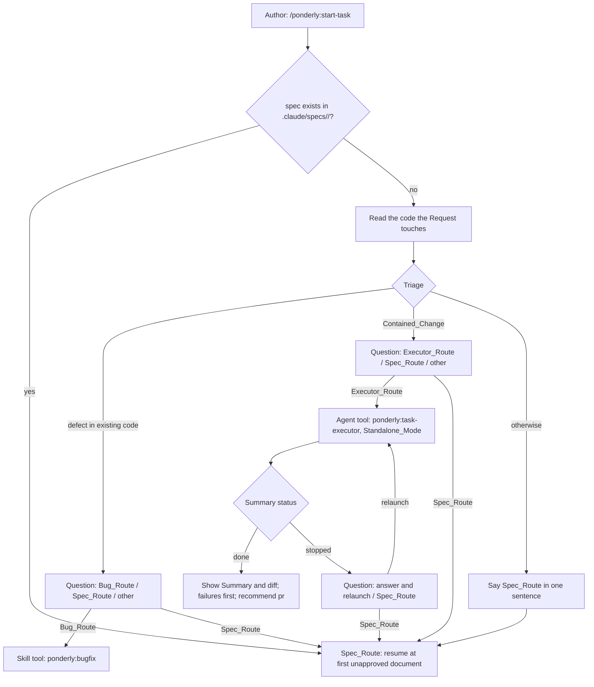
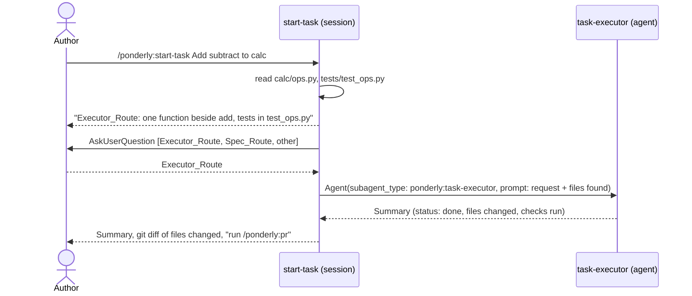

# Design Document

## Overview

Prompt and configuration only, no code of its own. `skills/start-task/SKILL.md` gains a Triage step between reading the codebase and asking the spec questions, a CX_Block after its ground rules, and two short exit paths: invoke `bugfix` through the Skill tool, or launch the Executor through the Agent tool and report its Summary (Requirements 1 to 3). `rules/workflow.md` is rewritten so that every bullet routes on the Author's words or a file on disk, with `start-task` as the default for everything else (Requirement 4). A fourth rule file, `rules/collaboration.md`, carries the six collaboration defaults and is picked up by the existing hooks without change, since they glob `rules/*.md` (Requirement 6). README rows, the three issue-form dropdowns, two new eval cases, one new eval directory, a Makefile line and the version bump wire it in (Requirements 5 and 6).

The one thing the design cannot settle from the docs is how `claude plugin eval` treats a call to AskUserQuestion in a headless run: whether the harness answers it, ends the turn, or errors. The eval cases are designed so the grade does not depend on the answer: they grade the Route statement and the absence of files, and accept the question in either form. Task 5.4 in the task list establishes the harness behaviour before the graders are finalised.

## Architecture

Key decision, Triage lives in the skill, not the rule. The rule is read before any code is, is capped by the hook limit, and has no structured way to ask; the skill has read the code by step 2 and can put a Question (Requirements 1.1, 4.5). Trade-off: a Request that the Author already knows is a bug or a one-liner still goes through the skill unless they name it, which the kept direct routes in the rule cover (Requirement 4.2, 4.3).

Key decision, Triage asks, except on Spec_Route. A wrong Executor or Bug call costs one Question; a wrong Spec call costs three documents. So the two cheap routes are offered and the expensive one is simply announced, which keeps today's behaviour for today's cases (Requirements 1.4, 1.5). Rejected alternative, launch the Executor without asking: faster, but the Author told us the goal is to earn trust, and the Executor's standalone mode writes code and tests the Author has not yet agreed to.

Key decision, the Executor is launched from `start-task`, not from a new skill. The agent already exists with the right mode and Summary shape; a new skill would duplicate the launch and review text that `implement-spec` already carries (Requirement 3.1). Rejected alternative, a `/ponderly:task` skill as the human entry point: the Author wants one front door, and `@agent-ponderly:task-executor` already serves anyone who wants to bypass it.

Key decision, Bug_Route is a hand-off, not a reimplementation. The skill invokes `bugfix` with the Request and stops, so the reproduction discipline stays in one place (Requirements 2.1, 2.2).

Key decision, a fourth rule file rather than bullets in `workflow.md`. The collaboration defaults apply to agents as much as skills and are not about routing; a file of their own keeps `workflow.md` short and gives the free size check a single file to cap (Requirements 6.1, 6.8). The hooks need no change: `load-rules.sh` concatenates every `rules/*.md`, and the issue-form check derives its dropdown from the same glob, so the three forms gain a `collaboration (rule)` entry or `make validate` fails.

Key decision, the Question is the AskUserQuestion tool, named in the skill. Nothing in the plugin names the tool today, which is why Claude falls back to prose. Naming it in the CX_Block and in the Triage step is the whole mechanism; the Collaboration_Rule makes it the default for the other skills' follow-ups (Requirements 1.8, 6.2).

## Components and Interfaces

| Component | Responsibility | Requirements |
|-----------|----------------|--------------|
| `skills/start-task/SKILL.md`, frontmatter | `description` gains the triage sentence so the skill triggers for any request to change code, not only large ones | 1.2, 4.1 |
| `skills/start-task/SKILL.md`, CX_Block | New section "Working with the author" after Ground rules: the stops, how each asks, what each hand-back holds, the hand-offs | 1.8, 1.9 |
| `skills/start-task/SKILL.md`, step 1 | Unchanged except: an existing spec means Spec_Route without Triage; beside the task name, propose the branch name in the contributing guide's shape, without creating it | 1.7, 1.10 |
| `skills/start-task/SKILL.md`, step 2 | Split in two: 2a read the codebase, 2b Triage: state the Route and reason, put the Question for Bug_Route or Executor_Route, say Spec_Route in a sentence, then act | 1.1 to 1.6 |
| `skills/start-task/SKILL.md`, step 2 Bug_Route | Skill tool, `ponderly:bugfix`, args: the Request; then stop | 2.1, 2.2 |
| `skills/start-task/SKILL.md`, step 2 Executor_Route | Agent tool, `subagent_type: ponderly:task-executor`, the Launch_Prompt below; on `done` show Summary, `git diff -- <files>`, failures first, recommend `pr`; on `stopped` show Summary and put the relaunch Question; never edit, commit, branch | 3.1 to 3.7 |
| `skills/start-task/SKILL.md`, steps 3 to 6 | Unchanged; the spec questions move to the head of step 3 | 1.1 |
| `rules/workflow.md` | Rewritten bullets: bug named, spec exists, PR asked, trivial change, default to `start-task`, never on main, keep the author in the loop | 4.1 to 4.5 |
| `rules/collaboration.md` | The six defaults, under 1,600 characters | 6.1 to 6.8 |
| `README.md` | `start-task` row, `rules/workflow.md` row, new `rules/collaboration.md` row; the rules-size paragraph says `make validate` fails past the limit; the Testing section describes the checks under `checks/` without listing them; the Agents section names `start-task` as a launcher of the executor | 5.1, 5.8, 5.9, 5.10, 6.9 |
| `agents/task-executor.md`, frontmatter `description` | Names `start-task` beside `implement-spec` as a launcher | 5.10 |
| `Makefile`, `eval-skill-start-task` | `CASE_ARGS += --allow-tools Write Edit --scaffold`, so the no-write graders can fail | 5.3, 5.4, 5.11 |
| `.github/ISSUE_TEMPLATE/*.yml` (three forms) | `collaboration (rule)` added to the component dropdown after `code-changes (rule)`, the alphabetical order `checks/test_issue_forms.py` enforces | 6.1, 5.7 |
| `.claude-plugin/plugin.json` | Version `0.6.0` | 5.2 |
| `evals/skills/start-task/contained-change-offers-executor/` | Scaffolded calc fixture; prompt is a Contained_Change; graders below | 5.3 |
| `evals/skills/start-task/bug-offers-bugfix/` | Scaffolded calc fixture with a planted defect; prompt describes it; graders below | 5.4 |
| `evals/skills/start-task/names-task-and-asks/` | Prompt unchanged (the link shortener is Spec_Route); `expected_outcome` gains the one-sentence Spec_Route statement | 5.5 |
| `evals/rules/workflow/*` | `feature-routes-to-start-task` and `small-change-skips-spec` pass as they are; `bug-routes-to-bugfix` prompt names it as a bug if it does not already | 5.6 |
| `evals/rules/collaboration/short-list-asks-with-tool/` | Prompt leads to a short fixed-list question; graders accept the tool call or prose with the same options | 6.10 |
| `Makefile` | `eval-skill-start-task: CASE_ARGS += --scaffold` so the two new cases get their fixture | 5.3, 5.4 |

## Data Models

Launch_Prompt, the text `start-task` gives the Executor on Executor_Route. Prose, in this order, with no sentence saying the task comes from a spec:

| Part | Content | Requirements |
|------|---------|--------------|
| Request | The Author's words, verbatim, from `$ARGUMENTS` and the message | 3.2 |
| Context found | The files and symbols step 2a read that the change touches, each as `path: what is there` | 3.2 |
| Author's additions | The free-text answer to the Question, if any, verbatim | 3.2 |
| Boundaries | "Make only this change. Commit nothing. Return the Summary." | 3.3, 3.7 |

CX_Block, the section each skill opens with. For `start-task`:

| Bullet | Content |
|--------|---------|
| Stops | Triage Question when the Route is Bug or Executor; the fit Question when the Request extends nothing in the codebase; approval of each of the three documents; the relaunch Question after a `stopped` Summary |
| How it asks | AskUserQuestion with fixed options plus free text at every stop; the spec questions of step 3 in prose, because the answers are the Author's own words |
| Hand-backs | On Executor_Route: the Summary verbatim, the diff, failures first; on Spec_Route: each document in full |
| Hand-offs | `bugfix` on Bug_Route; `pr` after a `done` Summary; `implement-spec` after `tasks.md` is approved. The branch name proposed in step 1 is created by the author, or by `implement-spec` at its set-up, never by this skill |

Triage_Question, the AskUserQuestion payload: one question, header `Route`, the options in this order: the chosen Route first with "(Recommended)", `Spec_Route` second, each with a one-sentence description; the harness adds the free-text option itself.

Rule text, `rules/workflow.md`, the routing bullets in order:

Under the heading, one sentence: "The first bullet that matches the request is the route." The order is the cascade, cheapest wrong match first among what the rule can check.

1. **Bug named: reproduce before fixing.** `bugfix`, keyed on the author calling it a bug or handing over a ticket filed as one.
2. **Spec exists: follow it.** `implement-spec`, as today.
3. **Pull request: use the skill.** `pr`, as today.
4. **Small changes stay small.** typo, one-line fix, rename: make it, as today.
5. **Anything else that changes code: start the task.** Run `/ponderly:start-task`. It reads the code and decides between the executor for one contained change, `bugfix` for a defect, and a spec for the rest, and asks before taking the first two. Do not judge the size yourself.
6. **Never work on the default branch.** As today.
7. **Keep the author in the loop.** As today.

Rule text, `rules/collaboration.md`, one bullet per criterion 6.2 to 6.7, each bold-led in the voice of the other rules, headed "Working with the author".

## Correctness Properties

### Property 1: No document before the answer

*For any* run of `start-task` where Triage chooses Bug_Route or Executor_Route, no file under `.claude/specs/` and no source file is created or edited before the Author answers the Question.

**Validates: Requirements 1.1, 1.4, 2.2, 3.3**

### Property 2: The Author's answer is the Route

*For any* answer to the Triage Question, the Route the skill takes next is the one the answer names, whatever the skill recommended.

**Validates: Requirements 1.4, 1.6**

### Property 3: Standalone launch

*For any* Executor launch from `start-task`, the Launch_Prompt contains the Request verbatim and does not contain a sentence saying the task comes from a spec.

**Validates: Requirements 3.1, 3.2**

### Property 4: Rules fit the hook

*For any* state of `rules/`, the concatenated output of `load-rules.sh` is under 10,000 characters and `rules/collaboration.md` is under 1,600.

**Validates: Requirements 4.4, 6.8**

### Property 5: Forms match disk

*For any* set of files under `rules/`, every issue form's component dropdown lists each as `<stem> (rule)`, in order.

**Validates: Requirement 6.1**

## Error Handling

| Condition | Category | Behaviour | Requirements |
|-----------|----------|-----------|--------------|
| Spec directory already exists for the task name | RESUME | Spec_Route, no Triage, resume at first unapproved document | 1.7 |
| Author picks a different Route than recommended | OVERRIDE | Take the Author's Route, no argument | 1.6 |
| Author's free-text answer is neither Route | UNCLEAR | Restate the two Routes in one sentence and ask again, once | 1.4 |
| Request extends nothing in the codebase | WRONG_PLACE | Say so in the route statement; Question with header `Fit`: `Spec it here` and `Wrong repository`; on the second, stop and say where it belongs if known | 1.11 |
| Executor returns `stopped` | DRIFT | Show Summary; Question: answer and relaunch, or Spec_Route; no unprompted relaunch | 3.5 |
| Executor returns `done` with a failed check | FAILED_CHECK | Say the failure first, show the Summary and diff, then recommend `pr` with the failure named | 3.6 |
| AskUserQuestion is not available (headless run) | FALLBACK | Ask the same question in prose with the same options on separate lines, then wait | 6.2, 6.10 |
| `bugfix` or `task-executor` not found | MISSING | Say the plugin component is missing and stop; do not reimplement | 2.1, 3.1 |

## Testing Strategy

- Free checks, run by `make validate`: the existing `checks/test_issue_forms.py` proves Property 5 once `collaboration (rule)` is in the forms; a new check in `checks/test_rules_size.py` proves Property 4 by running `hooks/load-rules.sh` and measuring, and by measuring `rules/collaboration.md` alone. The size check also closes issue #3's first half. `claude plugin validate --strict` proves the frontmatter.
- Eval case `contained-change-offers-executor` (Property 1, 3; Requirement 5.3): scaffold the calc fixture; prompt `/ponderly:start-task Add subtract(a, b) to calc/ops.py in the style of add`; `allowed_tools: [Read, Glob, Grep, Agent, Skill]`; `max_turns: 6`. Write and Edit come from the Makefile target's `--allow-tools` grant, the only route for them per `evals/README.md`, on purpose: a skill that writes a spec document or edits source before the Question must be caught by the `file_exists` and file-content graders, not prevented by the tool list. Graders: regex `executor` with `flags: i` in the final output (the harness's engine rejects inline `(?i)`); `file_exists` `.claude/specs/**` false; `tool_used` Agent with max 0; `tool_used` Skill with max 0; and the question grader, which task 3.1 settled as two regexes with `flags: im`, one per option as a list item at a line start. No `\?` grader: the prose fallback does not always end in a question mark, and the two option graders are the stronger proof that the question was put.
- Eval case `wrong-repo-asks-fit` (Requirement 1.11): scaffold the calc fixture; prompt the link shortener; graders: the two fit options as list items (`Spec it here`, `Wrong repository`), `file_exists` `.claude/specs/**` false, `tool_used` Agent and Skill max 0.
- Eval case `bug-offers-bugfix` (Property 1; Requirement 5.4): same fixture with `add` returning `a - b`; prompt `/ponderly:start-task Adding 2 and 3 in calc returns -1`; graders: regex `Bug_Route|bugfix`; `file_exists` `**/*.py` unchanged by a regex on `calc/ops.py` still containing the planted body; `tool_used` Skill max 0; the same question grader.
- Eval case `short-list-asks-with-tool` under `evals/rules/collaboration/` (Requirement 6.10): no plugin skill invoked; prompt asks Claude to pick between three named options for a config value it cannot infer; grader as the question grader above.
- Existing cases: `names-task-and-asks` run twice; `eval-rule-workflow` run twice; `eval-skill-start-task` twice. Each result table goes into the PR's Testing section.
- Manual check, recorded in the PR: in a session started with `claude --plugin-dir .` against the calc fixture, run the three prompts above by hand and confirm the Question renders as the interactive form and that answering Spec_Route continues to the spec questions (Property 2).
