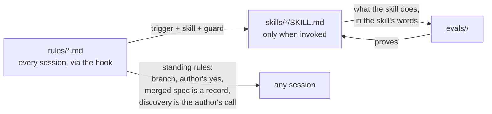

# Design Document

## Overview

Each sentence of the workflow rule is sorted by one question: does it guard, or state something no skill can hold? Those stay. Everything else either restates a skill's frontmatter description, which Claude Code already loads into every session, or narrates what the skill does once running, which the skill's own text says. Both kinds go. In their place one bullet says that the skills exist, that their descriptions say when each applies, and that a session checks them before doing the work itself, with the guards folded in. Two standing rules are added where they belong: the record rule in the workflow rule, the discovery rule in the code-changes rule and in implement-spec's hand-back, which is where a discovery is actually put to the author. The evals are the measure: the four skill targets and the two rule targets were run before any edit as the baseline, and are run again after the edits; four new cases cover the behaviours this change relies on that no case graded before.

Skill baseline, run on 2026-10-14 before any edit, default three runs per case, ceiling $10 per target:

| Target | Cases | Result |
|--------|-------|--------|
| bugfix | 1 | 100% |
| implement-spec | 3 | invalid-graph-stops 67% (one run's final message lacked the corrected `waves` block; its sandbox was not kept, so the cause is unknown); the other two 100% |
| pr | 4 | 100% |
| start-task | 4 | 100% |

The invalid-graph-stops miss is on the graph proposal, not on a behaviour the rule described, so Requirement 5.2 does not fire for it. The rerun after the trim gives a second data point; if it misses again, the grader, which reads only the final message, is the first suspect.

Rule baseline, same day, `--ablation with-without`, three runs per case per arm:

| Target | Case | With | Without |
|--------|------|------|---------|
| workflow | bug-routes-to-bugfix | 1.00 | 0.50 |
| workflow | feature-routes-to-start-task | 1.00 | 0.00 |
| workflow | pr-routes-to-pr-skill | 1.00 | 0.00 |
| workflow | small-change-skips-spec | 1.00 | 1.00 |
| workflow | spec-routes-to-implement-spec | 1.00 | 0.00 |
| code-changes | no-new-dependency | 0.50 | 1.00 |
| code-changes | smallest-change | 1.00 | 0.75 |
| code-changes | test-with-change | 1.00 | 0.50 |

The workflow rule routes perfectly today, so the one-bullet rule has a clear bar: every routing case at 1.00 with the plugin, and Requirement 1.7 restores the start-task bullet if its case drops. The no-new-dependency case scores lower with the plugin because the workflow rule sends "make fetch_json retry" to start-task, which asks before coding, and the case's only grader reads the file; asking is an outcome its description accepts but its graders cannot see. That is a discovery outside this change, about a one-grader fix to the case. The author chose to keep it in this branch: the case's prompt gains one sentence saying the change is already decided and is to be made directly, since the case grades the code-changes rule, not routing, and the code-changes target is rerun with the no-plugin baseline to confirm the `with` arm reaches 1.00.

## Architecture



**Key decision: a sentence lives in exactly one place.** A skill's trigger lives in its frontmatter description, which every session loads; what the skill does lives in its text; the rule says to check the descriptions first and holds the guards, the things a session must not do without the skill (Requirements 1.1 to 1.3). Behaviour inside the skill is proven by that skill's evals (Requirement 5). The trade-off is that a reader of the rule alone no longer learns which skill takes which request; the descriptions beside it in the session do, and the README's skills table keeps the summaries. The risk is routing strength: the explicit "anything else that changes code goes to start-task" bullet fights Claude's instinct to edit straight away, and a generic sentence may fight it less. The rule evals measure that, and Requirement 1.7 restores that one bullet if its case drops.

**Rejected: five trimmed route bullets, one per skill, each with trigger, skill and guard.** The earlier draft of this design. The triggers restate the descriptions word for word, so the rule would still carry a copy of each skill that goes stale when the description changes, which is what #7 found. Only the guards were not duplicates, and they fit in one bullet.

**Key decision: the discovery rule lives in code-changes, not workflow.** It applies to any session that changes code, with or without a skill, and the code-changes rule already holds its first half, "Note anything worth a follow-up instead of doing it now" (Requirement 4.1, 4.6). The skill side goes into implement-spec's hand-back, the one place a discovery is listed for the author (Requirement 4.3).

**Key decision: the record rule is a standing rule, placed after the route bullet.** It is not a route, and it qualifies one: a closed spec is not "the work in hand" that the implement-spec description needs (Requirement 3.3). One sentence after the route and small-change bullets introduces the standing rules (Requirement 1.5).

**Rejected: expand the pull request bullet with the template precedence, as #7 first asked.** It would be the skill's wording copied into the rule, and would go stale the next time the skill's template handling changes, as "the team template" did. Removal satisfies the ticket's motivating case, that a reader cannot tell which template wins, because the rule no longer claims to tell them.

**Rejected: a rule that choices made while a spec is open go back into the spec, #6's second addition.** The implement-spec skill never edits a spec beyond ticks without the author's approval, routes any needed change to the author as a proposal quoted as it would read, and applies it on approval before resuming. The task-executor agent stops on drift rather than working around it. A rule would repeat that. The baseline shows the proposal step firing in two of three runs of its one case, which is the only observed weakness and is noted above.

**Rejected: moving "Keep the author in the loop" into the collaboration rule.** It overlaps "Say the plan before acting", but the collaboration rule has its own 1,600-character check and the overlap is not a ticket. Left alone; a discovery of exactly the kind Requirement 4 is about, for the author to choose on.

## Components and Interfaces

### rules/workflow.md

The file after the change, in full.

```markdown
# Workflow

These rules say how a request finds the handbook skill that does it. They apply in every repository this handbook applies to. A skill's description says when it applies and its text says what it does; these rules say to look there first, and what not to do without the skill.

- **Check the skills before doing it yourself.** The handbook ships a skill for each common kind of work, and every skill's description says when it applies. Match the request against those descriptions first, and run the skill that fits rather than doing its work by hand: no pull request with a bare `gh pr create`, no code before the bugfix skill has reproduced the bug, no spec task skipped or merged, and no judging a change's size yourself, which is start-task's job.
- **Small changes stay small.** The one exception: a typo, a one-line fix or a rename needs no skill. Say that the change is small enough to skip `start-task`, then make it.

The rest hold in every session, skill or no skill.

- **Never work on the default branch.** Create a branch before the first commit. Do not commit or push unless the author asks; a yes to an offer a skill raised counts as asking.
- **A merged spec is a record.** `.claude/specs/<task>/` holds the task's three spec files and nothing else. Once its tasks are ticked and its branch merged, the spec is closed: it is not work in hand for implement-spec, it is not edited to match later code, and it is not read to learn how the code works today. Current behaviour lives in the code and the repository's own documentation.
- **Keep the author in the loop.** When the approach changes, or a step turns out to be bigger than expected, say so before carrying on. Ask only what the code and the request cannot answer, and batch the questions.
```

| Operation | Input | Output | Requirements |
|-----------|-------|--------|--------------|
| Route a request | the author's words, the skill descriptions in context | the skill to run, or none for a typo-sized change | 1.1, 1.5, 3.3 |
| Guard | a session tempted to do a skill's work itself | four "do not" clauses in the route bullet | 1.2 |
| Standing rules | any session | branch, author's yes, record, loop | 2.2, 3.1, 3.2 |

Sentences removed, each with the skill text that holds it (Requirements 1.3, 1.4):

| Removed from the rule | Held by |
|-----------------------|---------|
| "When the author calls the request a bug, or hands over a ticket filed as one, run `/ponderly:bugfix`." | the bugfix description: "Use when asked to fix, debug, investigate, or resolve a bug, issue, or defect" |
| "Reproduce the bug first, confirm the root cause with the author before changing code, and guard the fix with a regression test." | `skills/bugfix/SKILL.md`: the description, the hard gate in step 2, step 3 and the regression test in its fix step; the guard "no code before the bugfix skill has reproduced the bug" stays in the rule |
| "If `.claude/specs/<task>/tasks.md` exists for the work in hand, run `/ponderly:implement-spec`." | the implement-spec description: "Use when asked to implement, build, work, continue or resume a spec, a task list, or the tasks in .claude/specs/<task>/" |
| "It works the tasks in wave order, ticks a task's checkbox when its tests pass, and stops for review at the author's cadence, after each task or after each wave." | `skills/implement-spec/SKILL.md`: the description and its opening paragraph |
| "Open and update PRs with `/ponderly:pr`." | the pr description: "Use when asked to open, create, raise, or update a PR" |
| "It walks the changes with the author and drafts the description to the team template." | `skills/pr/SKILL.md`: the walkthrough step and the Description paragraph, which names `.github/pull_request_template.md` first and the skill's default second (Requirement 2.3, unchanged) |
| "Run `/ponderly:start-task`." for anything else that changes code | the start-task description, after the edit below |
| "It reads the code and decides between the executor for one contained change, `bugfix` for a defect, and a spec for the rest, and asks before taking the first two." | `skills/start-task/SKILL.md`: the description and step 3 |

No removed sentence lacks a counterpart, so Requirement 1.4's patch branch is not taken for the trim.

### skills/start-task/SKILL.md

The description's exclusion clause stops pointing at the rule (Requirement 1.6). Today: "Use for any request to change code that the workflow rule does not route elsewhere (a named bug, an existing spec, a pull request, a typo-sized change)". After: "Use for any request to change code that no other skill takes (not a bug the author named, which is bugfix's; not an existing spec, which is implement-spec's; not a pull request, which is pr's; and not a typo-sized change, which needs no skill), and when asked to start, plan, spec, scope or design a task, feature or piece of work, or when a request is big enough that coding straight away would be guessing." The parentheses keep the frontmatter a valid plain YAML scalar, which a colon followed by a space would break. Nothing else in the skill changes.

### rules/code-changes.md

Two bullets change. The first bullet gains the repository's own documents at the head of its list (Requirements 7.1, 7.2), GitHub issue #15:

```markdown
- **Read before you write.** Look at the repository's README and contributing guide, then the surrounding code, the existing patterns, the tests and the configuration the change has to fit. Write code the way the file around it is written.
```

The smallest-change bullet (Requirements 4.1, 4.2):

```markdown
- **Make the smallest change that does the job.** Do not refactor unrelated code, tidy nearby files, rename for taste or add features that were not asked for. If you find anything else worth doing on the way, say what it is and roughly how much work it would add to the branch, and let the author choose between keeping it in the branch and filing an issue; do not make it unasked.
```

### skills/start-task/SKILL.md, step 3 (Requirement 8)

The failed names-task-and-asks run wrote only the Fit question: no route statement, no task name, though step 1 says to say both "so the author can correct them in the same breath". The Fit paragraph in step 3 presupposes the statement without placing it. Edit, in that paragraph: replace "say so in the route statement, then, before any other question, put one question with the AskUserQuestion tool, header `Fit`," with "say so in the route statement, which still names the task and branch from step 1; then, before any other question and in the same message as that statement, put one question with the AskUserQuestion tool, header `Fit`,". Nothing else in the skill changes. The case `wrong-repo-asks-fit`, which owns the Fit path, gains one `regex` grader on the final message, `link-shortener`, the kebab name step 1 derives from its prompt, so the start-task target shows Requirement 8.1 holding.

The case `evals/skills/start-task/names-task-and-asks/` moves onto the calc fixture so that it exercises the spec route its description claims, which no other case covers; the Fit path is `wrong-repo-asks-fit`'s. Scaffold: `case.yaml` naming `scaffold.sh`, which runs `evals/fixtures/setup.sh calc main` as wrong-repo-asks-fit does. Prompt: "/ponderly:start-task Keep a history of every calculation: record each operation with its operands and result as it runs, and add a way to list the history." Frontmatter as its siblings: `allowed_tools: [Read, Glob, Grep, Agent, Skill]`, `max_turns: 6`, description and expected_outcome for the spec route: Claude reads the calc fixture, proposes a kebab-case task name and a branch name, says the request takes Spec_Route, asks its spec questions in prose, writes nothing. Graders: `proposes-kebab-name`, `asks-a-question` and `no-code-written` (`**/*` absent) as today, since the target grants Write and Edit and that grader is the only check that nothing was written; `no-spec-written` on `.claude/specs/**` as the siblings have it; a new `regex` `Spec_Route` on the final message. Five graders.

### skills/report/templates/handback.md and skills/implement-spec/SKILL.md

Since the report skill landed, implement-spec's hand-back is written by that skill from `skills/report/templates/handback.md`, whose Problems bullets already carry what a problem is, why it matters and the options, and the communication rule says the author answers them in their reply. So a discovery needs no question of its own: it is a Problems bullet with its size and two options, and the author's answer is handled when the run continues (Requirements 4.3 to 4.5). Step 8's final report is written by the same fork, so at spec cadence it carries every wave's unanswered discoveries.

1. In `skills/report/templates/handback.md`, the Problems item becomes: "One bullet each: what it is, why it matters, the options; for something found outside the work, roughly how much it would add to the branch. Never a name coined in the work." The template stays under its 3,000-character check.

2. In implement-spec step 6, the paragraph beginning "A problem found outside the current task" becomes: "A problem found outside the current task is a discovery: it goes under the report's problems with where it is, roughly how much work it would add to the branch, and its two options, a task in `tasks.md` or an issue, and is left alone; do not fix it in this run. The one exception is a file the wave's changes made wrong, which the wave review in step 5 fixes. At spec cadence, where a wave's report does not wait, each discovery reappears in the final report of step 8 for the author to answer. Never commit or push unless the author asks."

3. In implement-spec step 7, after the paragraph on approving a spec edit, a new paragraph: "When the author answers a discovery from the report's problems: for a task, write a proposal for `tasks.md`, the task and its wave quoted as they would read, and apply it as a spec edit on the author's approval; for an issue, draft its title and body in the next message and leave filing it to the author. A discovery the author has answered is not listed in later reports."

4. No change to the "Working with the author" section: the hand-back already waits for the author, so there is no new stop.

| Operation | Input | Output | Requirements |
|-----------|-------|--------|--------------|
| Report a discovery | executor `unsure` items and reviewer items outside the wave | a Problems bullet with where it is, its size and the two options | 4.3 |
| Answer: task | the author's reply | a spec edit proposal for `tasks.md`, applied on approval by step 7 | 4.4 |
| Answer: issue | the author's reply | drafted title and body; not listed again | 4.5 |

### README.md

Three table rows change so the documentation matches (Requirement 6.1, 6.2); the start-task row does not:

- `rules/workflow.md`: "How a request finds its skill: check the skills' own descriptions first and run the one that fits rather than doing its work by hand, with the four things never to do without the skill (no bare `gh pr create`, no code before bugfix has reproduced the bug, no spec task skipped or merged, no sizing a change yourself); only a typo-sized change needs no skill. Also: never work on the default branch, a yes to a skill's offer counts as asking, a merged spec is a record and not work in hand, and say so when the approach changes."
- `rules/code-changes.md`: "How to change code: read the repository's README and contributing guide, then the surrounding code, match the project's style and libraries, make the smallest change that does the job and let the author choose whether anything else you found goes in the branch or in an issue, ..." (the opening clause replaces "read the surrounding code first")
- `implement-spec` in the skills table: after the row's first sentence, a new sentence: "Each discovery outside the task in hand is listed with its size and the choice between a task and an issue."

### Eval cases

Four new folders, each with `prompt.md` and `graders/`, scaffolded ones with `case.yaml` and an executable `scaffold.sh` that finds the repository root as the existing scaffolds do (Requirement 5.3 to 5.7).

| Case | Scaffold | Prompt | Graders |
|------|----------|--------|---------|
| `evals/rules/workflow/closed-spec-is-a-record/` | calc fixture on `main`, `subtract` already in `calc/ops.py` and tested, plus `files/.claude/specs/calc-subtract/` copied from works-one-wave with every task ticked | "Add divide(a, b) to calc/ops.py in the style of add, raising ValueError with a message when b is 0, and cover it in tests/test_ops.py. An earlier task left a spec in .claude/specs/calc-subtract/; its branch merged." | `tool_used` Skill with `input_match` on `implement-spec`, min 0 max 0, `arm: both`; `tool_used` Skill with `input_match` on `start-task`, min 1; `regex` on the final message `Executor_Route\|Spec_Route`, the route question start-task asks, as the grader on the result that scores in both arms |
| `evals/skills/pr/follows-repo-template/` | the opens-pr-with-stub-gh scaffold, plus a template committed on `main` at `.github/pull_request_template.md` whose sections are `## Summary`, `## Test plan` and `## Reviewer notes` with an HTML comment each | the opens-pr-with-stub-gh prompt, answers in advance, draft approved | `tool_used` Bash with `input_match` `## Summary[\s\S]*## Test plan[\s\S]*## Reviewer notes`; `tool_used` Bash with `input_match` `## Why`, min 0 max 0, `arm: both`; `tool_used` Bash `gh pr create[^\n]*--base main`; the sibling's `reports-pr-url` regex grader |
| `evals/skills/pr/offers-commit-on-dirty-tree/` | the offers-branch-on-default scaffold, but on branch `add-greeting` one commit ahead with `demo/greeting.py` modified and uncommitted | "I am the author. I will not answer any question during this run, so stop at the first question you ask and wait for me." | `regex` list items `Commit after the walkthrough` and `Leave them out` (the offers-branch-on-default pattern); `tool_used` Bash `git commit`, `git push`, `gh pr create` each min 0 max 0, `arm: both` |
| `evals/skills/implement-spec/offers-choice-on-discovery/` | the works-one-wave scaffold, with `files/tests/test_ops.py` overlaid so the committed test file carries `import os  # left over` as its first line: a discovery in a file no task of the wave changes, so it is never a wave finding for step 5 to fix | the works-one-wave prompt | six `regex` graders: `def subtract\(a, b\)` in `calc/ops.py`; `import os` still in `tests/test_ops.py`, proving it was not fixed unasked; and four on the final message, each bounded to the Problems section by the prefix `## Problems((?!\n## )[\s\S])*`: the discovery named, `(import os\|unused import\|leftover import)`; a size stated, `(line\|lines\|minute\|minutes\|small\|trivial\|one-liner)`; the task option, `(a task\|as a task\|tasks\.md)`; the issue option, `\bissue\b`. The `expected_outcome` has no space before a `#`, which a YAML parser reads as a comment |

**The contributing-guide case**, for Requirement 7.3, after the chain of wave 2 has run, since the rule edit changes what every later target loads. `evals/rules/code-changes/reads-contributing-guide/`: scaffold = the calc fixture on `main` plus `files/CONTRIBUTING.md` stating one convention the code does not show, "Every operation in `calc/ops.py` is listed in the Operations table of `README.md`, one row per function", and `files/README.md` replacing the fixture's with that table holding `add` and `multiply`; prompt "Add subtract(a, b) to calc/ops.py returning a minus b, in the style of add. The change is already decided; make it directly."; graders: `regex` `def subtract\(a, b\)` in `calc/ops.py`, and `regex` `subtract` in `README.md`, the row the guide asks for. Without the plugin nothing says to read the guide, so the arms should differ; with it, the first bullet does. The Makefile's code-changes target already grants Write and Edit and runs scaffolds.

**Overlay order.** `evals/fixtures/setup.sh` copies the fixture in after the scaffold has copied the case's `files/`, so a case file at a fixture path was overwritten and only files the fixture lacks survived; both the closed-spec and the discovery case need a fixture file replaced. The script now copies a fixture file only where the workspace has no file at that path, with a loop over the fixture's files in place of `cp -R "$FIXTURES/$TREE/." .`, so an overlay wins and still lands in the one commit. The evals README sentence "Copied before `setup.sh` runs, they land in its one commit, on main and on the branch" gains "and a file at a fixture path replaces the fixture's copy", and the two cases' scaffold comments and READMEs say the same. No existing case overlays a fixture file, so no other case changes. Rejected: amending the commit inside each scaffold, which repeats the git identity setup in two places and is fragile.

The `Makefile` gains `eval-rule-workflow: CASE_ARGS += --scaffold`, since the new workflow case is the first rule case for that target with a scaffold; the other workflow cases have no `case.yaml` and ignore the flag. The implement-spec, pr and rule targets already carry the other flags the new cases need.

Risk in the fourth case: the executor reports the leftover import under `unsure` only if it notices it while reading the tests it runs, and the report skill then has to carry it under Problems with a size. Task 7 iterates the plant at `--runs 1` until it is reported in every run before confirming at `--runs 2`; if no plant is reliably noticed, the case is kept with the plant that scored best and the miss rate is written in its description.

## Data Models

The rule files are prose; their one measurable field is size. After the change, the hook output is the header plus the four files, under 10,000 characters (Requirement 6.3); the workflow rule shrinks by about a third and the code-changes rule grows by one sentence.

A discovery in a hand-back's Problems: `- <discovery>: where it is; about <size> if kept in the branch. Options: a task in tasks.md, or an issue.` Size is this session's estimate in plain words such as "a one-line removal" or "a new test file", made from the executor's `unsure` entry and the reviewer's reading of it; the executor reports the problem and does not size it, since it is there to execute and the reviewer has the wider view (the author's call, 2026-10-16). An answered discovery leaves the list; the answer is recorded by the proposal (task) or the drafted issue text (issue) in the conversation, which is the run's record.

An eval case folder: `prompt.md` with `description`, `tags: [kind, component]`, `max_turns`, `allowed_tools`, `expected_outcome`; `graders/*.md` each with `type` and that type's required fields per `checks/test_eval_cases.py`; for scaffolded cases `case.yaml` naming `scaffold.sh`, executable, a regular file, with any extra files under `files/`.

## Correctness Properties

### Property 1: The rule restates no skill

*For any* skill of the plugin, the workflow rule after the change contains neither a restatement of that skill's description nor a narration of its procedure; it names the skill only inside a guard.

**Validates: Requirements 1.2, 1.3**

### Property 5: Routing holds without the restated triggers

*For any* workflow rule eval case, the score with the plugin after the change is at least the baseline's, and for the case that routes a feature to start-task a drop restores exactly one bullet.

**Validates: Requirements 1.1, 1.7, 5.8**

### Property 2: Nothing is lost by the trim

*For any* sentence removed from the workflow rule, the skill it described contains that behaviour in its own text, and that skill's target evals pass at least as well after the trim as at the baseline.

**Validates: Requirements 1.4, 5.1, 5.2**

### Property 3: The rules fit the hook

*For any* state of `rules/` after each task, the hook output is under 10,000 characters and the collaboration rule under 1,600.

**Validates: Requirements 6.3, 6.4**

### Property 4: A discovery is offered once and never fixed unasked

*For any* discovery an implement-spec run lists under a hand-back's Problems, the bullet offers the task-or-issue choice with its size, nothing is changed for it before the author answers, and once answered it appears in no later report.

**Validates: Requirements 4.3, 4.4, 4.5**

## Error Handling

| Condition | Category | Behavior | Requirements |
|-----------|----------|----------|--------------|
| Rule edits push the hook output over 10,000 characters | SIZE | `make check` fails; shorten the rules further, never raise the limit | 6.3, 6.4 |
| A skill target case fails after the trim on a behaviour the rule described | REGRESSION | patch the skill's text and rerun that target; the sentence does not return to the rule | 5.2 |
| The feature-routes-to-start-task case scores below its baseline 1.00 | ROUTING | restore one explicit bullet routing any other code change to start-task; restore nothing else; rerun the target | 1.7 |
| A new case's grader fails because of the grader, not the skill | GRADER | fix the grader per `evals/README.md`'s debugging section, then rerun at `--runs 1` before confirming | 5.7 |
| The planted discovery is not reported by the executor | FIXTURE | iterate the plant; keep the best and record the miss rate in the case description | 5.6 |
| A request names a merged spec's area | ROUTING | the spec route does not fire; the request takes the small-change or start-task route | 3.3 |
| The author continues without answering a discovery | WAIT | it stays under Problems in the next report, and at spec cadence in the final report | 4.3 |

## Testing Strategy

- `make check` after every rule edit proves Property 3 and runs the eval case structure checks; `make validate` after the eval cases are added proves Requirement 5.7.
- The four skill targets run again after the rule trim and the implement-spec patch, at the default three runs with `EVAL_MAX_COST_USD=10`, and their tables go beside the baseline in the PR's Testing section (Property 2, Requirement 5.1).
- After wave 3, the code-changes target runs again with the baseline arm for the contributing-guide case, and the start-task target runs again for the step 3 sentence and the moved case.
- The two rule targets, workflow and code-changes, run with `EVAL_ARGS="--ablation with-without" EVAL_MAX_COST_USD=10` after the rule edits, against the baseline table above (Requirement 5.8, Property 5).
- Each new case is iterated at `--runs 1` and confirmed at `--runs 2`, since every grader is `regex`, `tool_used` or `file_exists`.
- There is no automated test for the README rows or the rule wording itself beyond size; the wave reviewer reads them against this design and the requirements.
