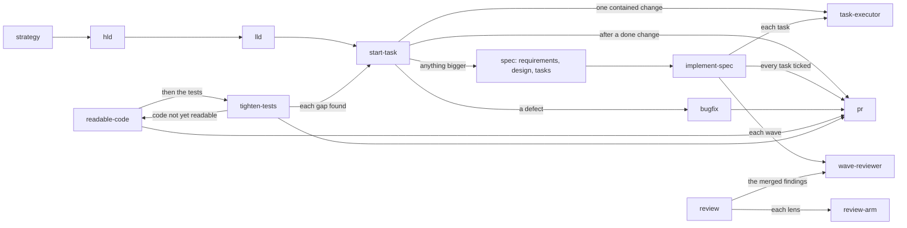

# ponderly

This plugin helps you write code like a seasoned engineer, even if you don't know all the best practices. It leans on our own thinking for reasoning, since even the best AIs cannot reason: they predict the next token in a sequence, and we have to decide which direction to point them in. It aims to slow the AI down when the scope is unclear and let it run fast when it knows what to do. At the same time, it catches the AI before it lets itself make mistakes or assumptions, so the pace always fits the level of understanding.

Docs: guides to [plan a year](docs/guides/plan-a-year.md), [build a feature](docs/guides/build-a-feature.md), [fix a bug](docs/guides/fix-a-bug.md), [make a small change](docs/guides/make-a-small-change.md) and [tune a template](docs/guides/tune-a-template.md); [the Reference](docs/reference.md); [the evidence](docs/evidence.md); [contributing](.github/CONTRIBUTING.md).

## Install

`ponderly` is a plugin for [Claude Code](https://claude.com/claude-code).
It adds skills, agents and team rules that every session loads. This
repository is its marketplace, `sabind`, and the marketplace holds one
plugin, `ponderly`. From any terminal:

```bash
claude plugin marketplace add sabind/ponderly
claude plugin install ponderly@sabind
```

The plugin loads the next time you start Claude Code. In a session that is
already open, run `/reload-plugins`.


## What it does

You ask Claude for a job, and the plugin runs the skill that fits it. A small,
contained change goes to one agent that builds it and proves it. A bug goes to
`bugfix`, which reproduces it before any code changes. Anything bigger becomes
a spec of requirements, design and tasks, each of which you approve before the
next, and `implement-spec` builds it wave by wave. Before the pull request,
`readable-code` makes the branch's code read plainly without changing what it
does, and `tighten-tests` slims its tests without losing a covered line.



[The Reference](docs/reference.md) describes each skill and agent, including
`report`, which writes hand-backs like the one above.

## When to use it

- **Claude Code without the plugin.** Claude Code is an agentic coding tool
  that reads your codebase, edits files and runs commands, in the terminal,
  an IDE, a desktop app or the browser. Use the plugin on top of it when you
  want each request routed to a skill, specs you approve before code, and the
  same team rules in every session.
- **Kiro.** Kiro is an agentic IDE built around spec-driven development: it
  breaks complex features into detailed implementation plans with tracking,
  and its steering files hold a project's rules. In ten months of my own use
  it was good for thinking a feature through, but it often reported a fix or
  a task as done before checking it, and I had to restate rules in each
  workspace. The plugin brings the same spec way of working into Claude Code,
  ticks a task only after its checks have run, and loads the same rules in
  every repository.

## How it is tested

`make validate` runs the free checks under `checks/` and `claude plugin
validate`, with no model call, and CI runs it on every pull request. The
`make eval-*` targets run `claude plugin eval` cases for the skills, agents,
hooks and most rules; each case is a real model call, so they run by hand and
never in CI, and [the evidence](docs/evidence.md) shows what they found.

## What this does not do

- It does not commit, push or open a pull request unless you ask, and `pr`
  opens one only after you approve its draft. `readable-code` and
  `tighten-tests` leave their changes uncommitted.
- It does not commit on the default branch. When you are on it, `pr` and
  `implement-spec` offer to create a branch first.
- It does not decide what to build. You own each spec document and approve it
  before the next, and `implement-spec` never edits the spec beyond its
  checkboxes without your approval.
- The plugin itself does not read a credential or send anything anywhere
  except through `git` and `gh` to your repository's own remote.
  The `task-executor` agent and the `readable-code` and `tighten-tests`
  skills also run the project's own tests, and the two skills its other
  tools, which do whatever they do in that project. `tighten-tests` adds a
  coverage tool only when you say yes. What each part runs is in the
  Reference's
  [What the plugin runs and sends](docs/reference.md#what-the-plugin-runs-and-sends).

## Develop the plugin

To set up, test and submit a change, read [the contributing guide](.github/CONTRIBUTING.md).

## License

MIT. See [LICENSE](LICENSE).
