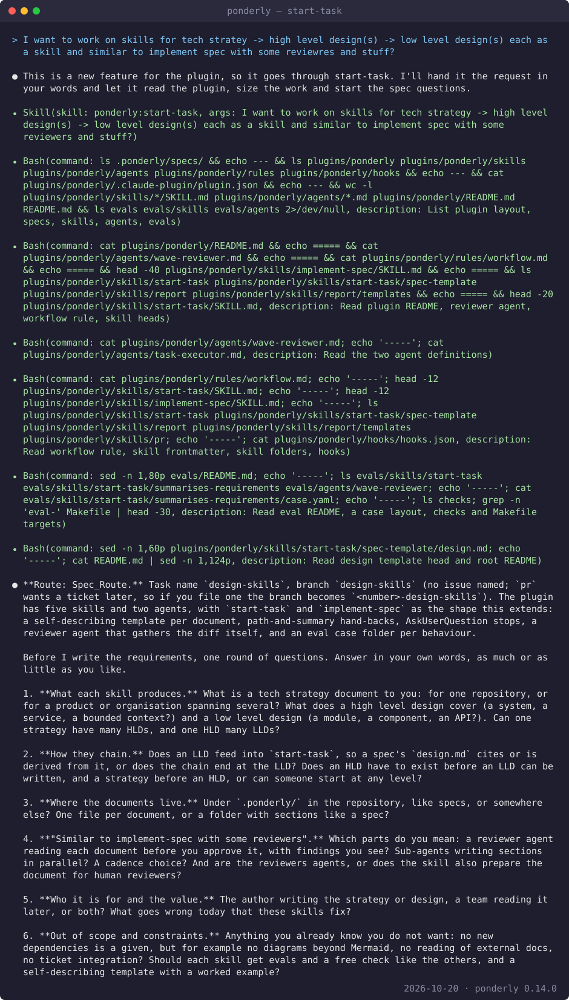
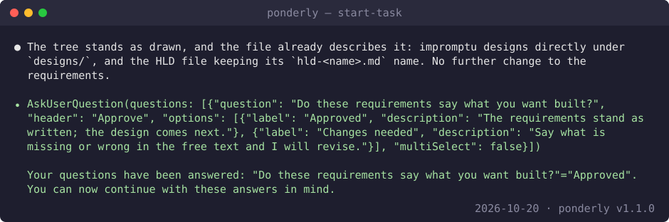
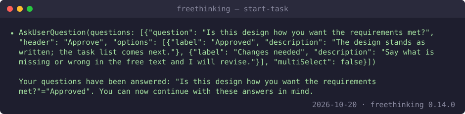
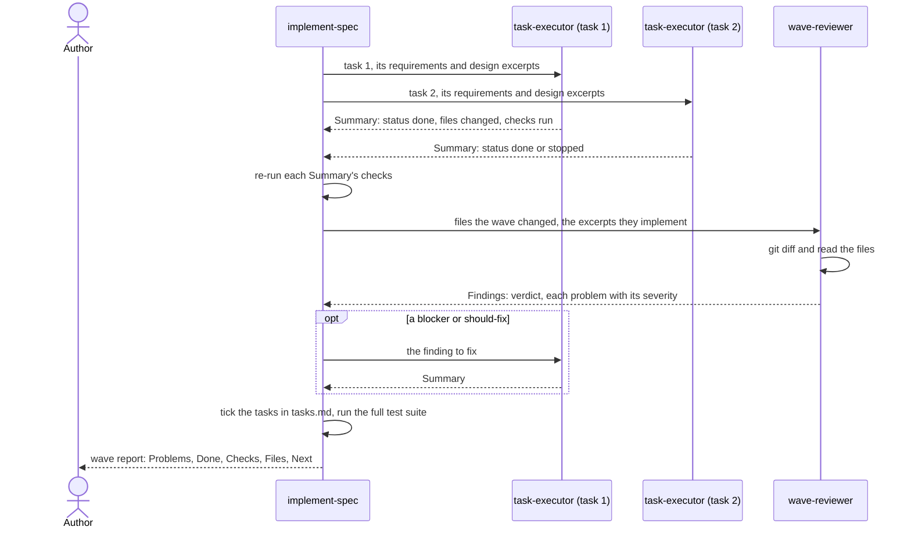
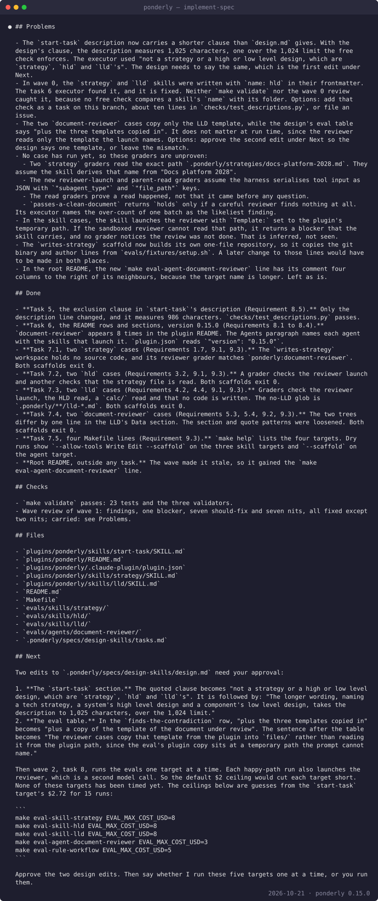
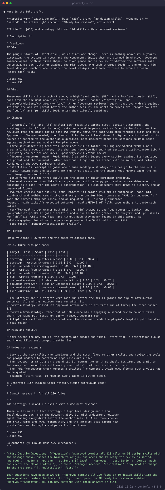

# Build a feature

This guide specs and builds a feature with three skills: `start-task`,
`implement-spec` and `pr`. At the end you have a spec of three files in
`.freethinking/specs/<task>/`, code built and reviewed wave by wave with
every task ticked, and a pull request open on GitHub.

The example is real. It is the work that added the `strategy`, `hld` and
`lld` skills to this plugin, under the task name `design-skills`. One step
comes from another repository, `freethinkingit/inline-email`, because it
shows an agent stopping when the spec could not be followed as written. Every image
below is an excerpt of a recorded session.

## Before you start

- Claude Code, with the plugin installed:

  ```
  claude plugin marketplace add freethinkingit/dev_tools
  claude plugin install freethinking@freethinkingit
  ```

  The [plugin README](../../plugins/freethinking/README.md#install) has the
  rest of the install steps.
- A git repository to work in.
- The `gh` CLI, signed in, for the `pr` step.
- A GitHub issue for the feature helps but is not required. `pr` takes it
  as its first argument and uses it for the description's Why. It writes
  `Closes #<number>` only when the repository's pull request template has
  that convention and you say merging finishes the issue; otherwise it names
  the issue once.

## 1. Ask for the feature

Run `/freethinking:start-task` with a short description, or ask Claude for
the change in your own words. The author of this example typed:

> I want to work on skills for tech stratey -> high level design(s) -> low
> level design(s) each as a skill and similar to implement spec with some
> reviewres and stuff?

Claude sends the request to `start-task`. The skill reads the code the
request touches, then states its route. Here it is `Route: Spec_Route.`,
with the task name `design-skills` and a proposed branch of the same name.
Then it asks one round of questions in prose. Answer them in your own words,
as much or as little as you like.



It writes nothing yet.

## 2. Approve the requirements

After your answers, `start-task` writes `requirements.md` in
`.freethinking/specs/design-skills/`. You see its path and a short summary.
Then it stops and asks:

- **Approved**: the requirements stand; the design comes next.
- **Changes needed**: say what is missing or wrong, and it revises.

In this session Claude first said the requirements needed no further
change. Then it asked, and the author picked **Approved**.



## 3. Approve the design

Next it writes `design.md` in the same folder and asks again, with the same
two options. **Approved** moves on to the task list.



## 4. Approve the tasks

Last it writes `tasks.md`: the tasks, grouped into waves that can run
together. It asks a third time, with the same two options.


After **Approved**, it says where the spec is and what comes next:
`/freethinking:implement-spec design-skills`. It also names two things to
settle first. `start-task` never creates the branch. When you are on the
default branch, `implement-spec` offers to create it at set-up, and `pr`
offers it too. This example's worktree was detached at `origin/main`, not on
`main` by name, so no offer would come; the author created it by hand with
`git checkout -b design-skills`. And if you want `pr` to close an issue,
file it now; the branch then becomes `<number>-design-skills`.

The spec folder now holds `requirements.md`, `design.md` and `tasks.md`.

## 5. Build it wave by wave

Run:

```
/freethinking:implement-spec design-skills
```

You can add how often it hands back as a second argument: `task`, `wave` or
`spec`. If you leave it out, it asks.

This step has no capture of its set-up. On every run, the skill first shows
two tables. **Leaf tasks** lists every task with its id, its text, whether it
is ticked, whether it is an optional test, the requirements it cites and the
design property it names, if any. **Graph** lists every wave and the tasks in
it. It checks that every task sits in exactly one wave, that every task in
the graph is in the list, and that the waves run in order. If a check fails,
it proposes a fix to `tasks.md` and waits for you.

Then it states which wave it is at and which tasks are in it, and asks one
round of questions: how often to hand back (after each task, after each
wave, or only at the end), how to treat optional tests (ask, always or
never), and, when you are on the default branch, whether to create a branch
under the task's name. It changes no code until you answer.

Then it works one wave at a time. Each task gets its own `task-executor`
agent. When every executor has come back, one `wave-reviewer` agent reads
the wave. This is one wave at wave cadence, with two tasks:



The executors write the code. `implement-spec` ticks each task in
`tasks.md` once its checks pass and the review is done. Beyond the ticks, it
changes the spec only with your approval.

At the end of each wave you get a report. Problems come first: anything that
failed, was not run, was not fixed, or was assumed for you. Then what was
done, the checks, the files and the next step. This is the report for wave 1
of `design-skills`:



Its Next section asks the author to approve two edits to `design.md`.
Answer the report, then say to continue.

## 6. When an executor stops

An executor stops instead of guessing when the spec cannot be followed as
written.
This happened in `freethinkingit/inline-email`, during a spec for that
library's documentation.

The task asked for a README whose Quickstart quotes two example files byte
for byte. The spec's requirements also put the Quickstart, a "when to use
it" list and six links within the first 60 lines after the badges. The two
files alone are 43 lines. The executor counted the lines, found the spec
could not be met as written, and changed nothing. It returned
`status: stopped`, with the count as evidence and three options:


The task stays unticked. `implement-spec` finishes the rest of the wave and
its review first. Then the wave report puts the stopped task first under
Problems and lays out the choice under Next. Here it offered two ways, with
what each costs, and asked:

- **Reorder (Recommended)**: the pitch, one line of links, the image, the
  "when to use it" list, then the Quickstart, all within 60 lines. It edits
  Requirement 1.1, the design's README table and task 4.6.
- **Keep order, relax to 90**: the order as written, with the 60-line limit
  raised to 90 in the requirements, the design and the test task.

The author picked **Reorder (Recommended)**.


The spec is yours. When an executor stops, you decide how the spec changes,
and the run goes on from there.

## 7. Open the pull request

When every task is ticked, the last report recommends `/freethinking:pr`.
Give it the issue as `#50`, with the `#`; a bare `50` is read as no ticket:

```
/freethinking:pr #50
```

This step has no capture until the draft. `pr` first checks where the branch
stands, and may stop twice:

- On the default branch, it offers to create a branch: **Create
  `<name>`** (Recommended) or **Stop**.
- With uncommitted files, which a spec branch fresh from `implement-spec`
  usually has, it lists them and offers to commit them: **Commit after the
  walkthrough** (Recommended) or **Leave them out**. Left out, they are not
  in the PR.

Then it walks the branch's changes with you one at a time, in prose, with a
few review prompts. Your own words become the description's Changes bullets.
It asks once, in prose, for what the diff and your answers do not cover.
When the repository's pull request template has a `Closes #<number>`
convention and the ticket is a GitHub issue, it also asks whether merging
finishes the issue: **Merging finishes it** or **Only related**.

Then it shows the full draft: the repository and base branch, the GitHub
account, the title, the description and the commit message. It asks:

- **Approved**: commit, push and open the PR as drafted.
- **Changes needed**: say what to change, and it asks again.



On **Approved** it commits if you said so, pushes the branch and opens the
pull request with `gh`. You see the PR's URL.

## Next

- Next guide: [Fix a bug](fix-a-bug.md).
- Reference for the parts used here:
  - [start-task](../reference.md#start-task)
  - [implement-spec](../reference.md#implement-spec)
  - [pr](../reference.md#pr)
  - [report](../reference.md#report)
  - [task-executor](../reference.md#task-executor)
  - [wave-reviewer](../reference.md#wave-reviewer)
  - [The report protocol](../reference.md#the-report-protocol)
