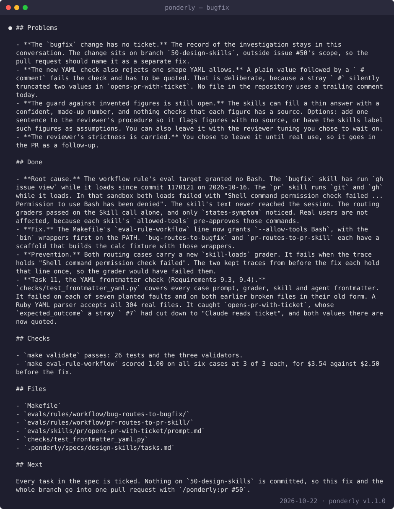

# Fix a bug

This guide fixes one bug with the `bugfix` skill and opens the pull request
with the `pr` skill. At the end you have the bug's root cause, confirmed by
you, a fix for that cause, a regression test that fails without the fix, and
a pull request. Or, if you choose, a comment on the ticket instead of the
pull request.

The example is a real bug in this repository, issue #52. An eval case,
`evals/rules/workflow/bug-routes-to-bugfix`, failed its `states-symptom`
grader in every run. The images are from that session, run on plugin 0.15.0
on 2026-10-22.

## Before you start

- Claude Code with the plugin installed:

  ```bash
  claude plugin marketplace add sabind/ponderly
  claude plugin install ponderly@sabind
  ```

- The `gh` CLI signed in, if your ticket is a GitHub issue. `bugfix` reads the
  issue with it, and `pr` needs it to open the pull request. `gh auth status`
  tells you whether you are signed in.
- A git repository with a test framework. If the project has none, `bugfix`
  says so and records a manual check in place of the test. It does not add a
  framework unless you ask.

## 1. Give it the ticket

Type the skill with the ticket:

```
/ponderly:bugfix #12
```

The ticket can be a GitHub issue number, such as `#12`, an issue URL, or a key
from another tracker, such as `ENG-412`. After the ticket you can add what you
already know, such as a suspected file or a recent commit:

```
/ponderly:bugfix #12 started after the date parser change
```

You can also just ask Claude to fix the bug. The skill's description matches
the request, and Claude runs it.

The skill first says, in one line, how it read what you typed and what it
took as the ticket. For a GitHub issue, it reads the issue and its comments
with `gh`. For another tracker's key, or an issue `gh` cannot read, it stops
and asks you to paste the ticket text.

The example did not start from a ticket. It started from a description of
the failing eval case. With no ticket, the skill takes the symptom and the
expected behaviour from the description, and asks for whichever is missing.
Issue #52 was filed after the hand-off.

## 2. Check the read-back

Before it reproduces anything, the skill states the ticket back to you in
three parts:

- **Symptom**: what actually happens, with the exact error or wrong output.
- **Expected**: what should happen instead.
- **Context**: the environment, the version, the affected area and any steps
  to reproduce the ticket gives.

The captured session does not show this part, so there is no image of it.
Read it and correct anything it got wrong. Everything after this is built on
it.

If you named no lead when you started, the skill then stops and asks about
the approach. The question has the header `Approach` and two options:

- **Go ahead (Recommended)**: the skill reproduces the bug its own way.
- **I have a lead**: type a suspected cause, a file or function, a recent
  change, or a reproduction you have run, in the free text.

A lead is tried first, but it is a hypothesis. If the evidence rules it out,
the skill says so and carries on.

## 3. Watch it reproduce the bug

The skill reproduces the bug before it changes any code. It prefers a
reproduction that runs on demand: a failing test, a script or a command. When
the bug lives somewhere it cannot drive, such as a UI flow or an external
service, it writes numbered steps for you to run and asks you, in prose, what
you saw. After the fix, it asks you to run the same steps again and report
each step's result, in prose; this stop has no fixed options.

After each attempt it posts a running summary: the candidate causes, and
which are open, ruled out or confirmed, with the evidence for each.

In the example, the reproduction was one run of the failing case:

```bash
make eval-rule-workflow EVAL_ARGS="--case bug-routes-to-bugfix --runs 1 --keep-temp" EVAL_MAX_COST_USD=2
```

The kept trace showed that the `bugfix` skill never loaded inside the eval:
its load failed on a permission error. The skill then found the same failure
for the `pr` skill in the same eval target.

If the bug cannot be reproduced, the skill says what it tried and asks you for
the missing conditions. It does not move on to a fix unless you choose to
waive reproduction, and then it says the fix cannot be verified.

## 4. Confirm the root cause

When the evidence points to one cause, the skill states it: what is wrong,
where, and why it produces the symptom. It marks anything it inferred rather
than observed. Then it stops and asks you to confirm, with the header
`Root cause` and two options:

- **Confirmed**: the diagnosis is right; go on to the fix.
- **Different cause**: say what you think the cause is in the free text.

No code that fixes the bug changes before you answer.


In the example, the running summary ruled out three causes: a wrong grader,
too few turns, and the skill no longer stating the symptom. It confirmed the
fourth: the workflow rule's eval target granted no Bash, so the `bugfix` and
`pr` skills, which run `gh` and `git` while they load, could not load there.
The skill also said what it could not observe: that `states-symptom` passed
before the commit that started the failure. The author picked `Confirmed`.

A plain "yes" in the free text counts as `Confirmed`. A "yes, but" does not.
When the "but" names a cause, the skill takes your account as the root cause
and goes on to the fix. When it only expresses doubt, the skill keeps
investigating and does not fix.

## 5. Let it fix the cause and add the regression test

After you confirm, the skill makes the smallest change that corrects the
cause, in the project's own style. It adds a regression test in the project's
test framework, and checks that the test fails without the fix and passes
with it. Then it runs the reproduction again, the new test, and the
surrounding tests, and removes anything it added only to investigate.

It writes the fix and the test into your working tree. It does not create a
branch, commit or push.

In the example, the fix is in the `Makefile`. The workflow target now grants
Bash, with the `bin` wrappers first on the PATH:

```make
eval-rule-workflow: CASE_ARGS += --allow-tools Bash --scaffold
eval-rule-workflow: export PATH := bin:$(PATH)
```

The two routing cases, `bug-routes-to-bugfix` and `pr-routes-to-pr-skill`,
each got a scaffold that builds their workspace with the `bin` wrappers. The
regression guard is a new `skill-loads` grader on both cases. It fails when
the trace holds "Shell command permission check failed", so a skill that
cannot load now fails its case instead of passing on the call alone. The two
traces kept from before the fix each hold that line, so the grader would have
failed them.

## 6. Read the hand-back and choose the hand-off

When the fix is verified, the skill hands back. Problems come first: anything
that could not be verified, and, when the ticket was not read with `gh`, a
note that the record of the investigation stays in the conversation. Then the
root cause, the fix, the prevention, the checks that were run with their
results, the files changed, and the next step.



The hand-back is the text of the skill's last question, with the header
`Pull request`. Its options are:

- **Open it now (Recommended)**: the skill hands the fix to the `pr` skill,
  with the ticket as its argument.
- **Stop and comment on the ticket**: the skill posts the root cause, fix,
  prevention and verification as a comment on the ticket, and stops. It
  offers this only when it read the ticket with `gh`.
- **Stop here**: the skill posts nothing and stops.

At both stops it tells you which branch the uncommitted fix sits on and which
files it is in, and, when there is a ticket, that `/ponderly:pr <ticket>`
picks it up later.

In the example there was no ticket, so the comment option was not offered.
The fix sat on the branch of other work, `50-design-skills`, so the
hand-back's Next said to open one pull request for both with
`/ponderly:pr #50`. That pull request, #53, closed both #50 and #52.

## 7. Open the pull request

If you picked `Open it now`, the `pr` skill starts on its own. Otherwise run
it yourself with the ticket:

```
/ponderly:pr #12
```

On the default branch it first asks whether to create a branch. Then, because
the fix is still uncommitted, it lists the files and stops with the header
`Commit` and two options:

- **Commit after the walkthrough (Recommended)**: the files are committed
  after the walkthrough, with a message drafted from your words.
- **Leave them out**: the files are not in the pull request.

It walks the branch's changes with you, drafts the title and description,
and asks for your approval of the draft, with the header `Approve` and the
options `Approved` and `Changes needed`. On `Approved`, it commits the files
if you chose to, pushes the branch, opens the pull request with `gh`, and
shows you its URL.

## Next

- [Make a small change](make-a-small-change.md): one contained change through
  the `task-executor` agent.
- Reference: [bugfix](../reference.md#bugfix), [pr](../reference.md#pr) and
  [report](../reference.md#report), which writes the hand-back.
