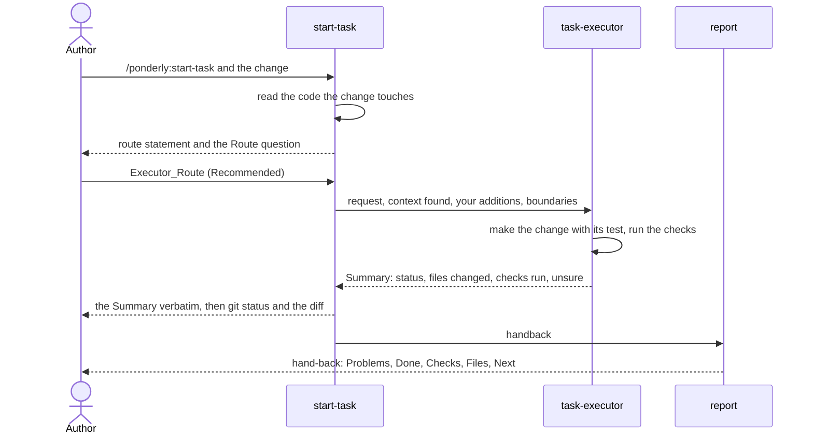

# Make a small change

This guide makes one contained change with the `start-task` skill and its
`task-executor` agent. A contained change is one you can describe in a
sentence or two, in a place in the code you can name, with no design
decision and no new dependency, framework or tool. At the end you have the
change in your working tree, uncommitted, with its test or check, the
executor's Summary of what it did, and a hand-back that says what to do
next.

The example is real. It added an eval case to this repository's `bugfix`
skill, `evals/skills/bugfix/reads-back-without-ticket/`, which checks that
the skill states the ticket back to the author before it reproduces
anything. The images are from that session, run on plugin 0.15.0 on
2026-10-22.

## Before you start

- Claude Code with the plugin installed:

  ```bash
  claude plugin marketplace add sabind/ponderly
  claude plugin install ponderly@sabind
  ```

  The [plugin README](../../plugins/ponderly/README.md#install) has the
  rest of the install steps.
- A git repository to work in.
- The `gh` CLI, signed in, only if you go on to open a pull request with
  `pr`.

## 1. Ask for the change

Type the skill with the change, in a sentence or two:

```
/ponderly:start-task <the change, in a sentence or two>
```

You can also ask Claude for the change in your own words. The skill's
description matches the request, and Claude runs it with your words as its
argument.

In the example, the author typed "add an eval case" in answer to an earlier
question from Claude. Claude then ran `start-task` with the request spelled
out and the author's words quoted at the end.

The skill first reads the code the request touches. In the example it listed
the `bugfix` eval cases and read the two that exist, `reads-ticket-first` and
`hands-off-to-pr`.

## 2. Check the route statement

Before it asks anything, the skill says which route the request takes, and
why:

- **Executor_Route**: a contained change, built by the `task-executor`
  agent.
- **Bug_Route**: a defect in code that already exists, handed to `bugfix`.
- **Spec_Route**: everything else, which gets a spec of requirements, design
  and tasks first.

The reason is two or three sentences that name the code it read. The
statement also names the task and a proposed branch. The skill does not
create the branch.

The example's route statement was shown in the session but is not in the
saved transcript, so there is no image of it. Read it and check that the
code it names is the code the change belongs in.

## 3. Answer the route question

One stop can come before this one. If the skill found nothing in the code
that the request would extend, no module, pattern or test it builds on, its
route statement says so. Then it asks, with the header `Fit` and two
options:

- **Spec it here**: write the spec in this repository anyway. The skill goes
  on with the route, and asks the route question next if the route has one.
- **Wrong repository**: stop. The skill says where the work belongs, if the
  request or the code says, and writes nothing.

The example's request extended the existing `bugfix` eval cases, so it was
not asked.

On Executor_Route the skill stops and asks you to confirm the route, with the
header `Route` and two options:

- **Executor_Route (Recommended)**: the `task-executor` agent makes the
  change.
- **Spec_Route**: write requirements, design and tasks for the change first.

You can also type in the free text. Anything you add there goes to the
executor with your request. If your free text picks neither route, the skill
restates the two routes in one sentence and asks once more. If you pick `Spec_Route`, the skill takes it
without arguing and starts the spec, as in [Build a feature](build-a-feature.md).


The author picked `Executor_Route (Recommended)`.

## 4. Let the executor make the change

The skill launches the `task-executor` agent once. Its prompt holds your
request word for word, the files the skill read that the change touches, your
free-text answer if you gave one, and one boundary: "Make only this change.
Commit nothing. Return the Summary."



The executor reads the code around the change, makes the smallest change
that does the job in the project's style, and adds a test the way the
project writes tests. If the project has no test framework, it says so and
records a manual check instead. It runs the tests for what it touched, and
deletes any scratch script it used.

The executor writes the change into your working tree. Nobody commits it:
not the executor, not the skill.

## 5. Read the Summary and the change

When the executor finishes, the skill shows its Summary word for word. If
any check failed, the skill says so first. The Summary has these fields:

- `status`: `done` or `stopped`.
- `files changed`: every file it created or edited.
- `checks run`: each command it ran, with the result it saw.
- `ephemeral check`: the scratch check it ran and deleted, or why none
  applied.
- `unsure`: anything it inferred rather than saw, and anything it noticed
  outside the change.


In the example the change was a new eval case folder with a prompt and four
graders. The executor ran `make validate`, which passed, and a scratch
script that tried the graders' patterns on made-up run records. It did not
run the eval itself: the launch told it not to, because a run costs money.

Read `unsure` closely. In the example it said the graders might pass whether
or not the skill reads back, and how to find out on the first run.

After the Summary, the skill shows the change. It runs `git status --short`
on the files the Summary lists, then shows the diff of each one. In the
example, the `git status --short` line marked the new folder `??`, as
untracked. Then each new file appeared as a diff, every line added. That
output was shown in the session, but the capture images draw only the tool
calls, not their output, so this guide has no image of it.

## 6. When the executor stops

The executor stops instead of guessing when the change is unclear or would
need a new dependency, framework or tool. Its Summary then has
`status: stopped` and a `stopped because` field with the question you must
answer. The example did not stop, so there is no image of this.

The skill shows the Summary and any partial edits, and says those edits are
in your working tree. Then it asks, with the header `Relaunch` and two
options:

- **Answer and relaunch**: answer the question under `stopped because`, and
  the skill launches the executor again with your answer.
- **Spec_Route**: write a spec for the change instead.

A free-text answer counts as `Answer and relaunch`, with that text as the
answer. If you pick `Answer and relaunch` with no text, the skill asks you
for the answer in prose, once, before it relaunches. The skill never
relaunches on its own.

## 7. Read the hand-back

After a `done` Summary, the skill writes a hand-back with the `report`
skill. Problems come first, then what was done, the checks, the files and
the next step.


The image's last paragraph is about other work in the same session, not about
this change.

Next names the branch the change sits on, uncommitted, and recommends
`/ponderly:pr` to open the pull request, with the ticket when your
request named one. On the default branch, `pr` offers to create a branch, and
it offers to commit the change.

In the example, the new case stayed uncommitted on the branch
`newcomer-docs`, beside other work, to go out in that branch's pull request.

## 8. Open the pull request

When you are ready, run `pr` with the ticket, if there is one:

```
/ponderly:pr #12
```

It walks the change with you, drafts the pull request, and asks for your
approval before it commits, pushes and opens it. [Build a feature](build-a-feature.md#7-open-the-pull-request)
shows that step.

## Next

- Next guide: [Tune a template](tune-a-template.md).
- Reference for the parts used here:
  - [start-task](../reference.md#start-task)
  - [task-executor](../reference.md#task-executor)
  - [report](../reference.md#report)
  - [pr](../reference.md#pr)
