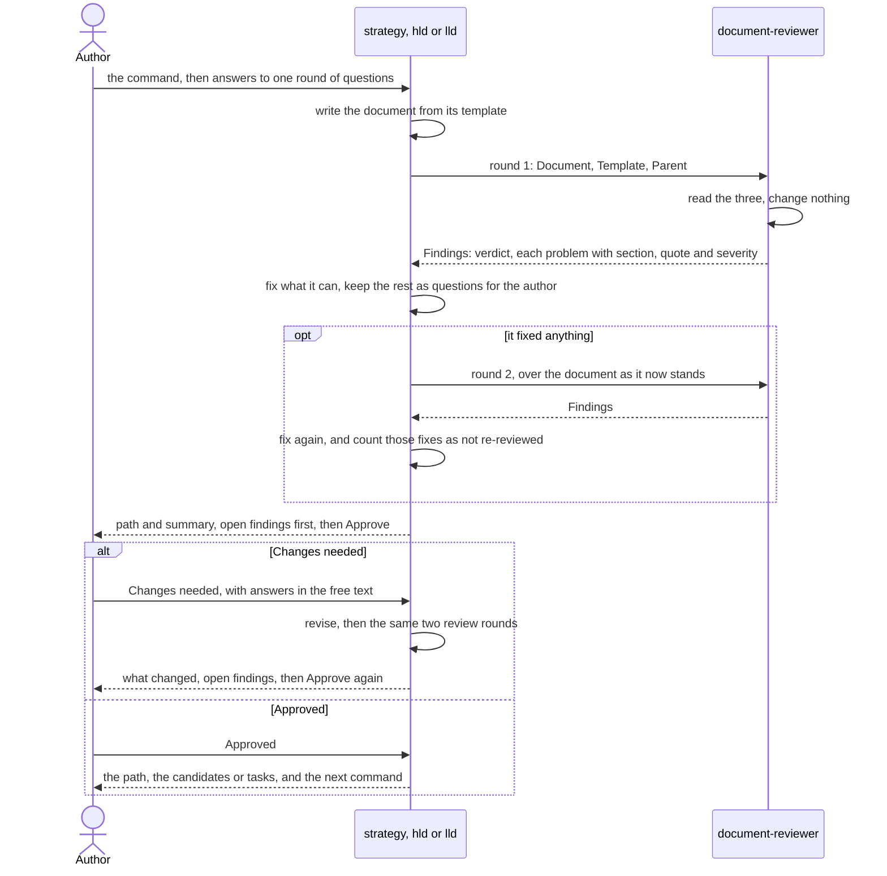

# Plan a year

This guide plans a year of work with three skills: `strategy`, `hld` and
`lld`. At the end you have three reviewed documents you approved: a tech
strategy for the year, a high level design for one of its streams of work,
and a low level design for one of that design's components. The low level
design ends with tasks, each sized for one run of `start-task`, which is
where [Build a feature](build-a-feature.md) begins. None of the three
skills writes code.

The example is real. It plans 2027 for `linkshort`, a small link shortener
that keeps its links in SQLite, in a demo repository. The images are from
that session, run on plugin 1.1.0 on 2026-10-28.

It was not a straight run, and this guide shows it as it went. Each
document was approved with review findings still open. The high level
design needed a round of **Changes needed**. The low level design's
answers contradicted the high level design, and the high level design was
changed to match.

## Before you start

- Claude Code with the plugin installed:

  ```bash
  claude plugin marketplace add sabind/ponderly
  claude plugin install ponderly@sabind
  ```

  The [plugin README](../../plugins/ponderly/README.md#install) has the
  rest of the install steps.
- A repository to write the documents in. `strategy` and `hld` need no
  source code, so a docs repository works. `lld` reads the code the
  component touches when the repository holds it, so run it where the code
  is.
- Your own answers. Each skill asks one round of questions about goals,
  figures, decisions and risks. Its rule is to ask when a goal, a decision
  or a trade-off is in neither your words nor the documents it read, not to
  guess. Some points still follow from your answers without being stated
  in them. In this session the `hld` and `lld` skills each wrote two such
  points themselves and named them above the summary, so read those lines
  before you approve.
- No `gh` CLI is needed. The skills write files and commit nothing.

## How each document is reviewed

The three skills work the same way. Each asks you one round of questions,
writes the document from its template, and has the `document-reviewer`
agent read the draft before you see it. The reviewer reads the document,
the template and the parent document itself, and changes nothing. It
returns each problem with its section, an exact quote and a severity:
`blocker`, `should-fix` or `nit`. The skill fixes what it can and keeps as
a question for you what only you can answer. If it fixed anything, the
reviewer reads once more. There is no third round. You then see the
document's path and a summary, with the findings still open first, and
approve it or ask for changes. A revision is reviewed the same way, for up
to two rounds: the second runs only when the first led to a fix.



In this session every document had two review rounds on its draft, and
two more on each revision.

## 1. Ask for the strategy

Run `/ponderly:strategy` with the subject in your own words, or ask Claude
to plan a year or write a tech strategy. The author of this example typed:

```
/ponderly:strategy linkshort's plan for 2027
```

The skill first reads any strategies already under `.ponderly/strategies/`.
Its first message names the document, `linkshort-2027`, gives its path, and
says whether it replaces, extends or leaves alone each strategy it found.
Here there were none. If the path already exists, it stops and asks, with
the header `Existing`: **Resume** (Recommended), to go on from the first
unfinished section, or **Overwrite**.

Then it asks one round of questions in prose, one per section of the
template it has no answer for: horizon, who it serves, goals with their
measures and worth, current state, principles and constraints, streams of
work, risks, and out of scope. Answer them in one reply, in your own words.
The author answered each by number, and asked Claude to propose the
streams.

![Claude runs the strategy skill for linkshort's plan for 2027, names the document linkshort-2027 and asks eight questions in one round: horizon, who it serves, goals with measures and worth, current state, principles and constraints, streams of work, risks, and out of scope. The author pastes one numbered answer per question: a quarterly-reviewed 2027, growth from 40 engineers to 600 people, three ranked goals, a single VM with SQLite, Kubernetes and Postgres with two half-time engineers, a request that Claude propose the streams, three risks with responses, and three exclusions.](../images/plan-strategy-questions.svg)

It writes `.ponderly/strategies/linkshort-2027.md`, and the reviewer reads
it for two rounds.

## 2. Approve the strategy

You see the path, then the review block, then one line per section. The
review block lists each finding still open, quoting the line it is about
and asking the question only you can answer. A line such as
`fixed after round 2, not re-reviewed: 1` counts the fixes the second round
asked for, which no reviewer has read since. In this session Claude also
said what it had written that the author had not said: it had proposed the
three streams.

Then it stops and asks, with the header `Approve`:

- **Approved**: the document stands as written; the high level designs come
  next.
- **Changes needed**: put your answers or corrections in the free text, and
  it revises, reviews and shows the revision.

The author picked **Approved** with eight findings still open, such as
what the third goal is worth and whether "next year" means 2028.


This step has no capture of the hand-off. In this session it said the
strategy was approved with eight findings open, listed them in a line each,
and said the high level designs would run into them. Then it named the
three candidate high level designs, `platform-move`,
`identity-and-ownership` and `adoption`, and said
`/ponderly:hld .ponderly/strategies/linkshort-2027.md <candidate>` writes
each one.

Approving with findings open is allowed, but they do not go away. To settle
them now, pick **Changes needed** and answer them in the free text. In this
session they were left open, and the later documents had to answer several
of the questions they raised: the low level design's round of questions in
step 6 asks some of the high level design's open findings again.

## 3. Ask for a high level design

Run `hld` with the strategy's path and one of its candidates:

```
/ponderly:hld .ponderly/strategies/linkshort-2027.md platform-move
```

It reads the strategy in full first. It can stop here for you:

- When the strategy's path cannot be read, it says so, naming the path, and
  asks you in prose to paste the strategy's candidates section and the parts
  this design will serve.
- When you give no strategy path, it asks whether to go on without one,
  with the header `Parent`: **Go on without one** or **Stop**.
- When your words name none of the strategy's candidates, it asks which,
  with the header `Candidate`, offering the candidates.
- When the document's path already exists, it asks with the header
  `Existing`: **Resume** (Recommended), to go on from the first unfinished
  section, or **Overwrite**.

Here the path was readable, the candidate was named and the document was
new, so none came up.

Its first message names the document, gives its path and the candidate it
takes, and lists what it took from the strategy. In this session it also
read the repository's README and code, which the `hld` skill does not ask
for, and listed what it found there under "From the code". Then it asks
one round of questions in prose, on what the strategy did not answer. Here
there were nine.


It writes `.ponderly/designs/linkshort-2027/platform-move/hld-platform-move.md`,
with a Mermaid diagram of the components, and the reviewer reads it for two
rounds against the template and the strategy.

## 4. Answer the findings with Changes needed

The summary had nine findings open. Two were blockers: the two risks the
author had named, ingress latency and a noisy neighbour on the shared
Postgres, had no likelihood, cost or response. Claude also named two points
it had written itself, since the answers did not state them: where SQLite
lives during the month of dual-write, and a one-time copy of the existing
links.

It asked with the same `Approve` question. The author picked **Changes
needed** and wrote, in the free text, the likelihood, cost and response for
both risks, and that cutover waits for the full month with the last seven
nights clean.

![Claude names two points of the platform move design it wrote itself, then shows the summary of hld-platform-move.md: nine review findings still open, two of them blockers because the ingress latency and noisy neighbour risks have no likelihood, cost or response, then one line per section. It asks whether this is the design the author wants. The author answers Changes needed, giving the likelihood, cost and response for both risks and saying cutover waits for the full month with the last seven nights clean.](../images/plan-hld-approval.svg)

On **Changes needed**, the skill reads the file as it stands on disk first,
so edits you made in your editor are kept. It revises, runs the two review
rounds again, and shows what changed.

## 5. Approve the revised high level design

The revision is shown as the path, then one line per section that changed,
then the review block over the revision. Any part of your request it did
not apply gets a `Not applied` line saying why. Here every part was
applied. Both blockers were gone, but the new review found nine other
questions, such as what request rate the load test must pass at.


The author picked **Approved**, with those nine still open. This step has
no capture of the hand-off. In this session it listed the nine, said the
low level designs would have to settle them, named the three candidate low
level designs, `linkshort-service`, `link-stores-and-migration` and
`kubernetes-deployment`, and said
`/ponderly:lld .ponderly/designs/linkshort-2027/platform-move/hld-platform-move.md <candidate>`
writes each one.

## 6. Ask for a low level design

Run `lld` with the high level design's path and one of its candidates:

```
/ponderly:lld .ponderly/designs/linkshort-2027/platform-move/hld-platform-move.md link-stores-and-migration
```

It reads the high level design in full, then the code the component builds
on. It has the same stops as `hld`: it asks you in prose to paste the high
level design's candidates section and the parts this design will serve when
its path cannot be read; it asks with the header `Parent` (**Go on without
one** or **Stop**) when you give no path; with the header `Candidate` when
your words name none of its candidates; and with the header `Existing`
(**Resume** (Recommended) or **Overwrite**) when the document's path already
exists. None came up here. Its first message names the document, gives its
path and the candidate, and lists what it found in the code and took from
the high level design. Then it asks one round of questions in prose. Here
there were ten, and several were findings the high level design had left
open.

![Claude runs the lld skill for link-stores-and-migration, lists what it takes from the platform move design and what it found in the code, such as LinkStore's add and resolve and the project having no dependencies, then asks ten questions, several of them findings the high level design left open: the Postgres driver, the schema, the store interface and collision retry, the order of the copy and dual-write, repairing a mismatch, rollback, the compare job on the VM, retiring SQLite, testing and risks. The author pastes one numbered answer per question.](../images/plan-lld-questions.svg)

It writes
`.ponderly/designs/linkshort-2027/platform-move/lld-link-stores-and-migration.md`,
in the high level design's folder, and the reviewer reads it for two rounds
against the template and the high level design.

## 7. Settle a contradiction with the high level design

Three of the author's answers contradicted the high level design the author
had approved: the order of the one-time copy and dual-write, the SQLite
store's `add`, and the rollback. The reviewer marked the contradiction as a
blocker. In this session Claude laid out the contradiction before the
summary and offered two ways to settle it, in prose:

- **Update the platform move design to match.** "It gets a short revision,
  then a review, and you approve it again. This design stays as written."
- **Revert this design** to the platform move design's order and rules.

It recommended updating the high level design, and asked for the choice in
the free text of the `Approve` question. The summary had thirteen findings
open, two of them the blockers. The author answered that this design
stands, the high level design is updated to match on the three points, and
two related changes land in one pull request.

![Claude reports that three of the author's answers contradict the approved platform move design, on the copy order, the SQLite store's add and the rollback copy-back, offers to update that design or revert this one and recommends updating it. It names two points it wrote itself and shows the summary of lld-link-stores-and-migration.md with thirteen review findings still open, two of them blockers. The author answers that this design stands, the platform move design is updated to match on the three points, and the store-interface and linkshort-service changes land in one pull request.](../images/plan-lld-approval.svg)

The `lld` skill's text rules against this. It says to "Write the document
and nothing else; add no other file to the repository", and that "A change
that contradicts the parent is not applied, and its line quotes the
parent's line it contradicts". Claude went beyond its skill in this
session. If you ask for the same thing, you may get a `Not applied` line
that quotes the parent instead.

## 8. Approve the revised low level design

The revision changed both documents. Claude said first that the high level
design had changed at the author's request and had been read only as this
design's parent: its own review had not run again, and its new lines were
not re-approved. That falls short of the offer in step 7, which said the
high level design would get a review and your approval again. Then it
listed what changed in each, and the seven findings still open.


The author picked **Approved**, for both documents, with seven findings
open.

This step has no capture of the hand-off. In this session it grouped the
seven open findings under six headings: network opening, cutover order,
rollback, compare timing, driver and risks. The first four named the task
each lands on, such as `cutover-steps`; driver and risks named no task.
Then it listed the twelve tasks
in order, from `store-interface` to `retirement`, and said
`/ponderly:start-task <task>` starts each one.

## What you have at the end

```
.ponderly/strategies/linkshort-2027.md
.ponderly/designs/linkshort-2027/platform-move/hld-platform-move.md
.ponderly/designs/linkshort-2027/platform-move/lld-link-stores-and-migration.md
```

The strategy names two more high level designs, and the high level design
two more low level designs; each is written the same way. Nothing is
committed. Each task of the low level design starts with `start-task`.

## Next

- Next guide: [Build a feature](build-a-feature.md).
- Reference for the parts used here:
  - [strategy](../reference.md#strategy)
  - [hld](../reference.md#hld)
  - [lld](../reference.md#lld)
  - [document-reviewer](../reference.md#document-reviewer)
  - [start-task](../reference.md#start-task)
