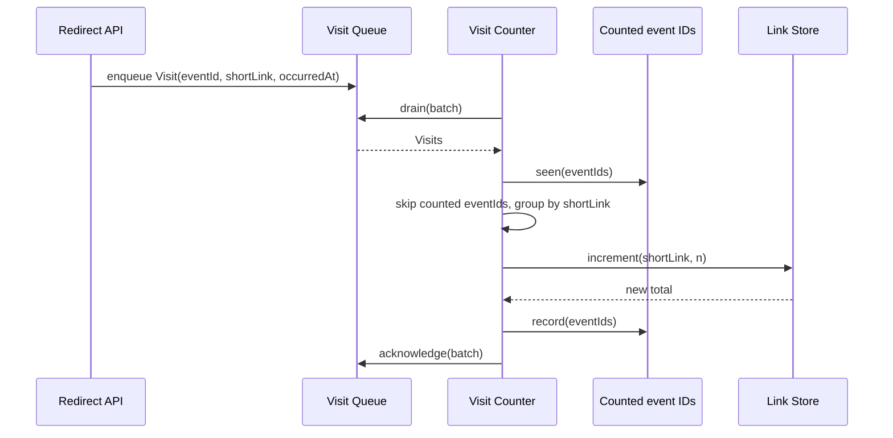

# Visit Counter

Parent: .freethinking/designs/links-2027/shortener-service/hld-shortener-service.md

## Responsibility

The Visit Counter turns Visit events into stored counts. It is the worker that the
parent's first key decision calls for: visit counting is asynchronous, off the redirect
path. It drains Visits from the Visit Queue, skips those it has already counted, and
increments `visitCount` in the Link Store. It does not resolve links, enqueue Visits,
own the queue or own the Link record; those stay with the Redirect API, the Visit Queue
and the Link Store.

## Interfaces

| Operation | Called by | Input | Output | Failure |
|-----------|-----------|-------|--------|---------|
| `drain(batch)` on the Visit Queue | Visit Counter, in a loop | the most events to take, 100 | up to 100 Visit events | queue unavailable: the worker waits five seconds and drains again |
| `acknowledge(batch)` on the Visit Queue | Visit Counter, after a batch is handled | the batch's events | none | queue unavailable: the batch is redelivered later, and its counted `eventId`s stop a second count |
| `seen(eventIds)` on the Counted event IDs store | Visit Counter, once per batch | the batch's `eventId`s | those already counted | store unavailable: the batch is not acknowledged and is redelivered |
| `record(eventIds)` on the Counted event IDs store | Visit Counter, after each increment | one Short_Link's `eventId`s | none | store unavailable: the batch is not acknowledged; on redelivery those Visits are counted again, the window the Key decisions section accepts |
| `increment(shortLink, n)` on the Link Store | Visit Counter | a Short_Link and a positive count | the new total | store unavailable: the batch is not acknowledged and is redelivered; Short_Link missing: that Short_Link's events are discarded and logged |

The Visit Counter exposes no operation of its own; every row is a call it makes on a
component the parent names.

## Data

The Visit event, as the Redirect API puts it on the Visit Queue; this component reads it
and never changes it:

| Field | Type | Notes |
|-------|------|-------|
| `eventId` | string | unique per redirect; used to skip a redelivered event |
| `shortLink` | string | the Short_Link that was resolved |
| `occurredAt` | string | UTC timestamp of the redirect |

The counted event record, in the Counted event IDs store, which the Visit Counter owns:

| Field | Type | Notes |
|-------|------|-------|
| `eventId` | string | key; the Visit already counted |
| `expiresAt` | string | UTC timestamp 24 hours after it was counted, as the parent decides; the record is deleted then |

On the Link record, which the Link Store owns, the Visit Counter writes one field,
`visitCount`, and only ever increments it.
The redirect handler increments `visitCount` in the Link Store before it returns the redirect.

## Behaviour

The worker records a Short_Link's `eventId`s as counted as soon as its increment
succeeds, and acknowledges the batch once every Short_Link in it is incremented or
discarded. When `increment` reports a Short_Link missing, the worker discards and logs
that Short_Link's events and treats them as handled. When the Link Store is unavailable,
the worker stops the batch without acknowledging it; the queue redelivers it, and the
recorded `eventId`s stop the Short_Links already incremented from being counted twice.
When the Counted event IDs store is unavailable, on `seen` or on `record`, the worker
stops the batch the same way, and logs a failure on `record`. When the queue is unavailable on a drain, the worker
waits five seconds and drains again; when it is unavailable on an acknowledgement, the
batch comes back and its counted `eventId`s are skipped.

## Key decisions

Key decision: one increment per Short_Link per batch. The worker drains up to 100 Visits
and writes one increment per Short_Link in the batch, so a popular link costs one write
per batch. The trade-off is that a count waits for its batch, a delay of seconds inside
the five minutes of lag the HLD accepts. Rejected: one write per Visit, which turns a
spike on one link into a write spike on one key.

Key decision: record a Short_Link's `eventId`s after its increment, not before. The
trade-off is that a failure between the two counts those Visits again on redelivery, a
rare over-count of at most one batch. Rejected: recording first, which turns the same
failure into Visits never counted; and one transaction across both stores, which the
HLD's separate Counted event IDs store rules out.

## Testing

- Unit tests with the queue, the Counted event IDs store and the Link Store mocked: a
  batch for two Short_Links yields two increments with the right counts; a redelivered
  `eventId` is not counted; a missing Short_Link's events are discarded and logged and
  the batch is acknowledged.
- Failure tests: the Link Store fails on the second increment of a batch, the batch is not
  acknowledged, and after redelivery the final count is exact; the queue fails a drain
  and the worker drains again after five seconds; the queue fails an acknowledgement
  and the redelivered batch adds nothing; the Counted event IDs store fails on `seen`
  and the batch is not acknowledged; it fails on `record` and the batch is not
  acknowledged, and after redelivery that Short_Link is counted once more.

## Risks

- The queue backs up under a traffic spike and counts lag. Mitigation: none inside this
  component; the HLD's Risks section answers it with scaling of workers on queue depth
  and an alert when the depth passes 10,000, both run by the deployment.
- A failure between an increment and its record counts up to one batch of Visits
  twice. Unlikely; the second key decision accepts it, and the worker logs each such
  failure so an over-count can be seen.

## Tasks

- `counted-event-store`: the counted event record with its 24-hour expiry, and its
  `seen(eventIds)` and `record(eventIds)` operations. Builds Data and Interfaces.
- `queue-client`: call `drain(batch)` and `acknowledge(batch)` on the Visit Queue and
  read each Visit's fields. Builds Interfaces and Data.
- `link-store-client`: call `increment(shortLink, n)` on the Link Store. Builds
  Interfaces.
- `drain-loop`: drain batches, skip counted `eventId`s, group by Short_Link, increment,
  record, and acknowledge, with each failure path above. Builds Behaviour and Key
  decisions.
- `worker-tests`: the unit and failure tests listed above. Builds Testing.
