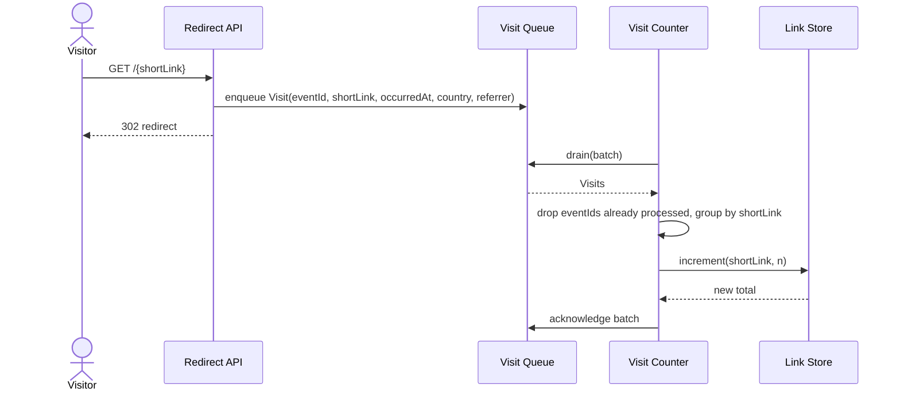

# Visit Counter

Parent: .freethinking/designs/links-platform-2027/shortener-service/hld-shortener-service.md

## Responsibility

This document is a self-describing template: it is a valid low level design whose own
content teaches how a low level design works, while actually designing the Visit
Counter, one component of the Shortener Service whose high level design is named on the
`Parent:` line above. That line sits on the third line of every low level design, under
the title, and names the parent's path from the repository root, or `none`, so a reader
can walk up the tree from the file as well as from its folder.

A low level design answers *how one component works*, inside the shape its high level
design already fixed. The high level design decided what the component is for and how
it talks to its neighbours; this document decides its interfaces, its data, its
behaviour and the choices inside it, then breaks it into tasks small enough to build one
at a time. The governing rule is fidelity to the parent: every section serves the
component the parent names, and nothing here contradicts a decision the parent made. A
decision this document cannot live with goes back to the parent, not around it.

The Responsibility section states, in a few sentences, what this component does within
its parent and what it leaves to others, citing the parent's decision it serves. A
reader should finish it knowing where the component's edges are.

The Visit Counter turns Visit events into stored counts. The Shortener Service's high
level design decided that counting is asynchronous and off the redirect path: the
Redirect API enqueues a Visit on the Visit Queue and returns, and a worker increments
the stored count later. This component is that worker. It does not resolve links, build
or enqueue Visits, own the queue or the Link record, or serve metrics; those stay with
the Redirect API, the Visit Queue, the Link Store and the Metrics Reader, which reads
the count this component writes. The click analytics stream reads the same Visits from
the queue for itself.

## Interfaces

This section defines every operation the component exposes or calls: its name, inputs,
outputs and failures, and who is on the other side. Write it so another engineer could
build against the component without reading its code. Keep the list small; an
operation no neighbour needs is scope creep.

| Operation | Called by | Input | Output | Failure |
|-----------|-----------|-------|--------|---------|
| `drain(batch)` on the Visit Queue | Visit Counter, in a loop | up to 100 Visit events | acknowledgement per event | store unavailable: events are not acknowledged and are redelivered |
| `increment(shortLink, n)` on the Link Store | Visit Counter | a Short_Link and a positive count | the new total | Short_Link missing: the event is discarded and logged |

The Visit Counter exposes no operation of its own: it is a worker, and both rows are
calls it makes on neighbours the parent names.

## Data

This section describes the data the component owns or touches: fields, types, keys and
constraints, and which component is the owner of each. Stay consistent with the
parent: if the high level design says where data lives, this section names the fields,
not a different home.

The Visit event, as the Redirect API puts it on the Visit Queue; this component reads
it and never changes it:

| Field | Type | Notes |
|-------|------|-------|
| `eventId` | string | unique per redirect; the worker uses it to ignore a redelivered event |
| `shortLink` | string | the Short_Link that was resolved |
| `occurredAt` | string | UTC timestamp of the redirect |
| `country` | string | the visitor's country; read by the click analytics stream, ignored here |
| `referrer` | string | the referring site, empty when there is none; read by the click analytics stream, ignored here |

The worker writes one field on a record it does not own: `visitCount` on the Link
record, which the Link Store owns. The worker only ever increments it, never sets it,
so the count is non-decreasing. Processed `eventId`s are kept in the Visit Counter's own
store, where the parent puts them, for 24 hours, longer than the queue's redelivery window, to make increments
idempotent.

## Behaviour

This section shows how the component behaves over time: the main path, the order of
calls, and what happens on each failure the Interfaces section names. Use a sequence
diagram when the order of calls matters, a class diagram when the shape of the types
does, a state diagram when one entity has a lifecycle; draw only the diagrams the
behaviour needs, and follow each with the prose a diagram cannot carry.

The counting path, from redirect to stored count:

The redirect returns before the count is written, as the parent decided. The worker
acknowledges a batch only after every increment in it succeeded; if the store fails
part way, the whole batch is redelivered and the processed `eventId`s stop the
succeeded part being counted twice.

## Key decisions

This section records each choice made inside the component, the trade-off it accepts,
and the alternative it rejected, citing the parent where the parent constrains it.
Rejected alternatives are what make a design trustworthy: they show the choice was
made, not assumed.

Key decision: batch and group increments. The worker drains up to 100 Visits and writes
one increment per Short_Link in the batch, not one per Visit, so a popular link costs
one write per batch. The trade-off is that a count waits for its batch, which adds to
the lag by the queue's depth that the parent accepts, minutes under a traffic spike,
since an owner's metrics show a total, not real-time precision. Rejected: one write
per Visit, which is simpler but turns a traffic spike on one link into a write spike on
one key.

Key decision: idempotent increments over the parent's at-least-once queue. The queue
may deliver a Visit twice; the worker discards an `eventId` it has seen. The trade-off
is 24 hours of `eventId`s to store. Rejected: exactly-once delivery from the queue,
which the queue the parent chose does not offer.

## Testing

This section states how the component will be proven: which behaviour each test
covers, at what level, and what is mocked. Name a test for every failure the
Interfaces section lists, so error paths are tested by design rather than by luck.

- Unit tests for the worker with the queue and store mocked: a batch of Visits for two
  Short_Links yields two increments with the right counts; a redelivered `eventId` is
  not counted; a missing Short_Link is discarded and logged.
- A failure test: the store fails on the second increment of a batch; the batch is not
  acknowledged, and on redelivery the final count is exact.
- An integration test: resolve one Short_Link 50 times through the Redirect API,
  wait for the queue to drain, and assert the stored count is 50.

## Risks

This section names what could make the design fail and what is done about each:
the risk, its likelihood or impact, and the mitigation or the signal that will show it
happening. A risk with no mitigation says so plainly.

- The queue backs up under a traffic spike and counts lag by minutes. Mitigation: alert
  on queue depth over 10,000 and scale workers on depth.
- The Redirect API drops Visits when the queue is unavailable, so counts fall short.
  Mitigation: the parent's Redirect API reports dropped visits; there is no replay,
  which the parent's drop-and-log decision accepts.
- The processed-`eventId` store grows with traffic. Mitigation: 24-hour expiry; size it
  before launch from the parent's 2,000,000 redirects a day.

## Tasks

This closing section breaks the component into tasks, each small enough for one
`/freethinking:start-task` run, roughly a dozen or fewer for one low level design.
Each entry is a short name, a line on what it covers, and the section of this document
it builds, so a reader can check that every section describing something to build
(Interfaces, Data, Behaviour and Testing) is built by some task and every task builds
something designed here. Order them so each can start once the ones above
it are done.

- `visit-event-reader`: read the Visit event's fields from the queue. Builds Data.
- `processed-event-store`: store processed `eventId`s with a 24-hour expiry. Builds
  Data.
- `queue-consumer`: call `drain(batch)` on the Visit Queue and acknowledge events.
  Builds Interfaces.
- `link-store-client`: call `increment(shortLink, n)` on the Link Store. Builds
  Interfaces.
- `worker-drain-loop`: drain batches, drop seen `eventId`s, group by Short_Link and
  acknowledge on success. Builds Behaviour and Key decisions.
- `worker-failure-handling`: leave a batch unacknowledged on store failure; discard and
  log a missing Short_Link. Builds Behaviour.
- `worker-tests`: the unit, failure and integration tests listed above. Builds Testing.
- `queue-alerts`: alerts on queue depth, and scaling on depth. Builds Risks.
