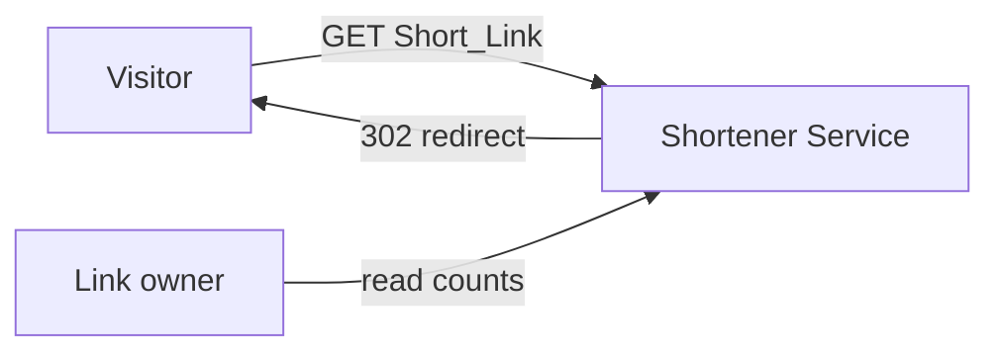
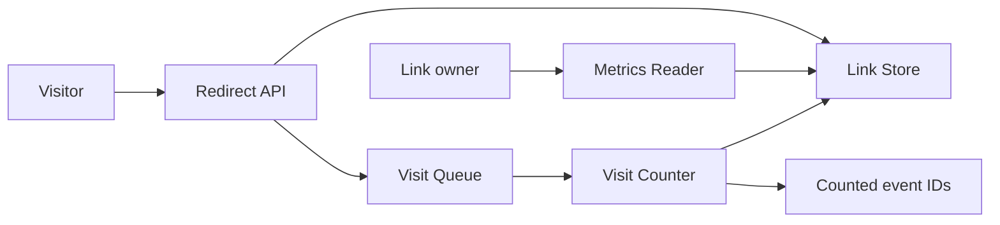

# Shortener Service

Parent: .ponderly/strategies/links-2027.md

## Scope

This design takes the strategy's shortener stream: the service that resolves
Short_Links and counts their visits, brought to general availability. It serves the
goals of a shortener in general availability and of visit counts owners can trust.

## Context

Visitors follow Short_Links; owners read their visit counts. Nothing else crosses the
boundary.

## Architecture

- Redirect API: looks the Short_Link up in the Link Store, enqueues a Visit event with a
  unique `eventId`, and redirects.
- Link Store: holds each Link record keyed by its Short_Link, with its destination and
  its `visitCount`.
- Visit Queue: carries Visit events from the Redirect API to the Visit Counter.
- Visit Counter: drains the queue, skips events it has already counted, and increments
  `visitCount` in the Link Store; it keeps the `eventId`s it has counted for 24 hours in
  a store of its own.
- Metrics Reader: answers an owner's request for one Short_Link's visit count by
  reading `visitCount` from the Link Store.

## Key decisions

**Key decision: visit counting is asynchronous, off the redirect path.** The Redirect API
enqueues a Visit and redirects at once; the Visit Counter writes the count later. This
keeps redirects under the strategy's 100 ms. The trade-off is that counts lag by the
queue's depth, within the strategy's five minutes in normal traffic. Rejected: counting
inline on the redirect, which is simpler but makes every redirect wait on a write.

**Key decision: the Visit Queue is the cloud account's managed queue, delivering at least
once.** The strategy allows no new vendor. The trade-off is that a Visit can arrive
twice, so each carries a unique `eventId` and the Visit Counter skips one it has counted
in the last 24 hours, longer than the queue's redelivery window. Rejected: an
exactly-once queue, which the account's managed services do not offer.

## Cross-cutting concerns

- Performance: a redirect is one key lookup and one enqueue, sized for 2,000,000
  redirects a day, ten times the pilot's load.
- Observability: the Visit Queue's managed metrics report its depth, so a lag in counts
  is visible.

## Risks

- Queue backlog under a traffic spike makes counts lag. Likely at launch; the deployment
  scales the Visit Counter's workers on queue depth, and an alert on the queue's metrics
  fires when the depth passes 10,000.

## Out of scope

- Creating and disabling Short_Links: unchanged from the pilot.
- Signing owners in and checking which Short_Links each may read: the pilot's sign-in,
  in front of the service, unchanged.

## Low level designs

- `visit-counter`: the worker that drains the Visit Queue and increments counts, with its
  handling of duplicate deliveries.
- `metrics-reader`: the owner's request for one Short_Link's visit count, read from the
  Link Store.
