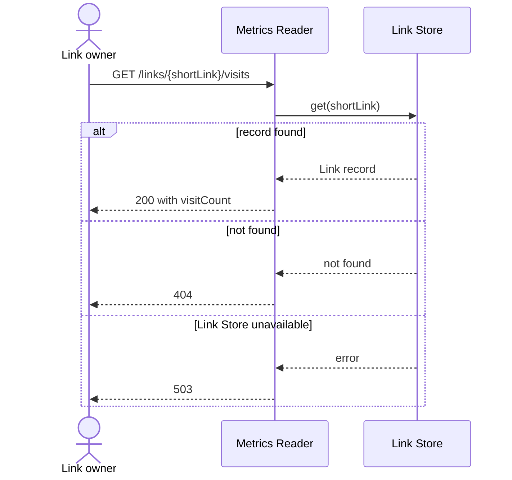

# Metrics Reader

Parent: .ponderly/designs/links-2027/shortener-service/hld-shortener-service.md

## Responsibility

The Metrics Reader answers a link owner's request for one Short_Link's visit count, as
the parent's Architecture section gives it: it reads `visitCount` from the Link Store
and returns it. It does not count visits, which the Visit Counter does. It does not sign
owners in or check which Short_Links each may read; the pilot's sign-in in front of the
service does both, as the parent's Out of scope section says.

## Interfaces

| Operation | Called by | Input | Output | Failure |
|-----------|-----------|-------|--------|---------|
| `GET /links/{shortLink}/visits` | a signed-in link owner | a Short_Link | `200` with the Short_Link and its visit count | Short_Link not in the Link Store: `404`; Link Store unavailable: `503` |
| `get(shortLink)` on the Link Store | Metrics Reader | a Short_Link | the Link record, or not found | Link Store unavailable: an error, which the Metrics Reader returns as `503` |

## Data

The Metrics Reader owns no data. It reads two fields of the Link record, which the Link
Store owns, and writes nothing:

| Field | Type | Notes |
|-------|------|-------|
| `shortLink` | string | the key the record is read by |
| `visitCount` | integer | the Link's total of counted Visits; 0 for a Link with none |

The `200` response body is `{"shortLink": "<Short_Link>", "visitCount": <integer>}`.

## Behaviour

Each request makes one `get` and returns; the Metrics Reader keeps no state between
requests.

## Key decisions

Key decision: read `visitCount` from the Link Store on every request, with no cache in
the Metrics Reader. The trade-off is one key lookup in the Link Store per request, the
same lookup a redirect makes. Owner reads are expected, by the author's estimate, at no
more than 20,000 a day, 1% of the 2,000,000 redirects a day the parent sizes the service
for, so they fit inside that sizing. Rejected: caching counts in the Metrics Reader,
which would add the cache's age to the lag the parent already accepts.

## Testing

- Unit tests of the request handler, with the Link Store mocked: a record with a
  `visitCount` of 3 returns `200` with 3; a record with a `visitCount` of 0 returns
  `200` with 0; not found returns `404`; an unavailable Link Store returns `503`.
- One integration test, with nothing mocked, against a test Link Store: write a Link
  record with a `visitCount` of 3, request its visits, and get `200` with 3.

## Risks

- A count lags the latest Visits by the Visit Queue's depth, as the parent's first key
  decision accepts: within five minutes in normal traffic, more under a spike. There is
  no mitigation inside this component; it returns the count the Link Store holds. The
  signal is the parent's: the Visit Queue's managed depth metrics, and the alert when
  the depth passes 10,000, both run by the deployment.

## Tasks

- `link-store-read`: call `get(shortLink)` on the Link Store and read `shortLink` and
  `visitCount` from the Link record. Builds Interfaces and Data.
- `visits-endpoint`: serve `GET /links/{shortLink}/visits` with its `200`, `404` and
  `503` replies. Builds Interfaces and Behaviour.
- `metrics-reader-tests`: the unit and integration tests above. Builds Testing.
