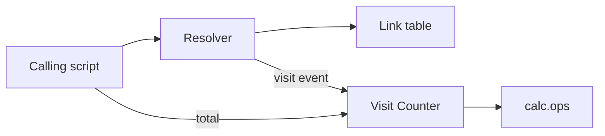

# Shortener Service

Parent: .ponderly/strategies/links-2027.md

## Scope

This HLD takes the links 2027 strategy's shortener stream as a first, in-process
version built in this repository: a Python package that resolves Short_Links,
emits a visit event per resolve and keeps a total of visits per Short_Link. It
serves the strategy's goal of a shortener a pilot can run from a script. Serving
links over HTTP is a later version.

## Context

A calling script is the only actor: it asks for a Short_Link's destination and for
its visit total. Nothing else crosses the boundary.

## Architecture

- Resolver: looks a Short_Link up in the link table, hands a visit event to the
  Visit Counter, and returns the destination.
- Link table: a dict from Short_Link to destination, loaded by the calling script.
- Visit Counter: counts visit events per Short_Link and reports totals, doing its
  arithmetic with the existing `calc.ops` functions.

## Key decisions

**Key decision: build on the calc package, standard library only.** The service
lives beside `calc/` and reuses `calc.ops` for its arithmetic, so the pilot adds
no dependency. The trade-off is that the service shares the package's release.
Rejected: a separate package, which would duplicate the arithmetic and its tests.

**Key decision: visit events carry an ID and may arrive twice.** The resolver may
retry a hand-off, so delivery is at least once and every event has an `event_id`.
The trade-off is that the Visit Counter must skip an event it has already counted.
Rejected: exactly-once hand-off, which would need the resolver to track
acknowledgements.

## Cross-cutting concerns

- Testing: every module has a `unittest` test module under `tests/`, run with
  `python3 -m unittest`.
- Performance: resolving and counting stay in memory; nothing on the resolve path
  touches disk.

## Risks

- Counts are lost when the process ends. Accepted for the pilot; persistence is out
  of scope.

## Out of scope

- Persisting links or counts beyond the process: a later version.
- Serving Short_Links over HTTP: the strategy's self-serve API stream.

## Low level designs

- `resolver`: the lookup, the visit event it builds and the retry of its hand-off.
- `visit-counter`: counting visit events per Short_Link with `calc.ops`, skipping
  duplicates by `event_id`, and reporting totals.
