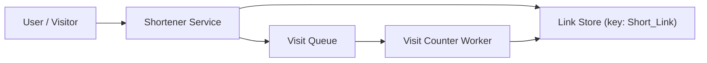
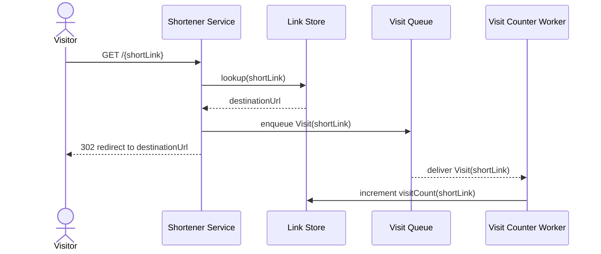
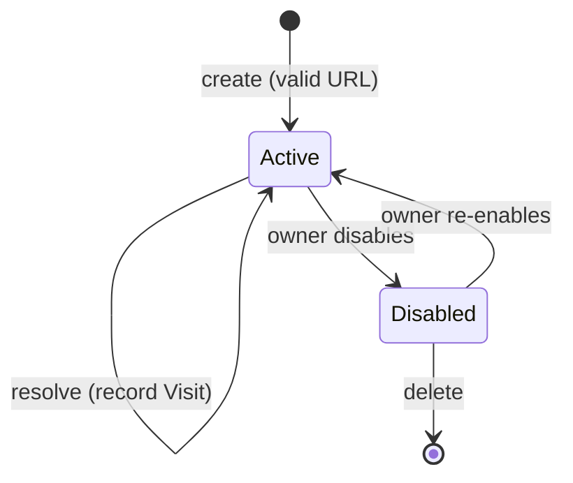
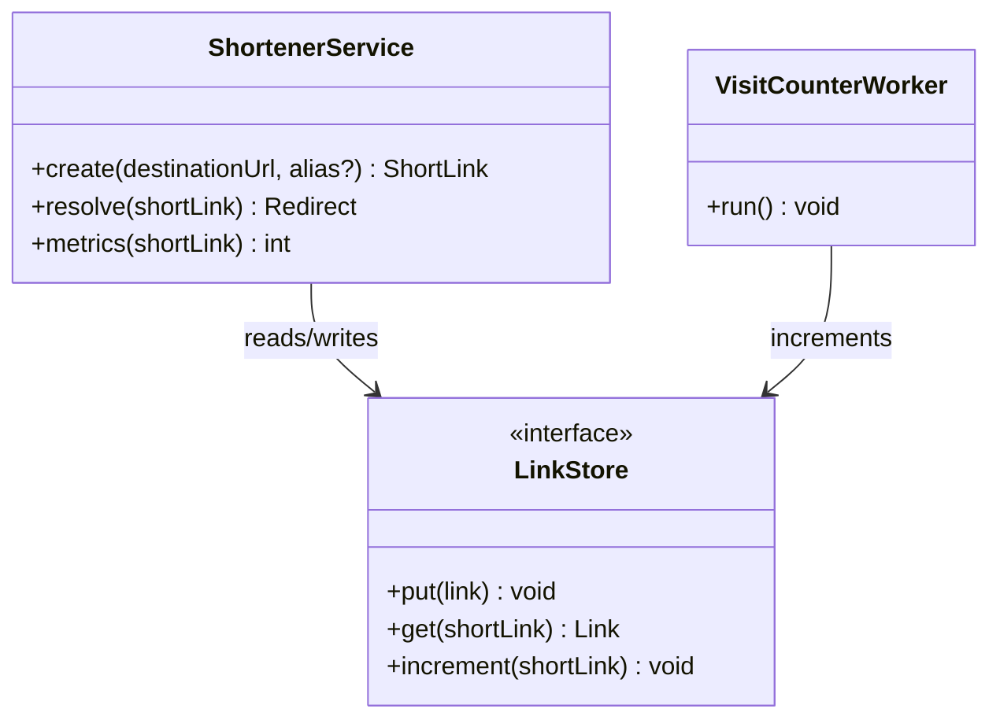
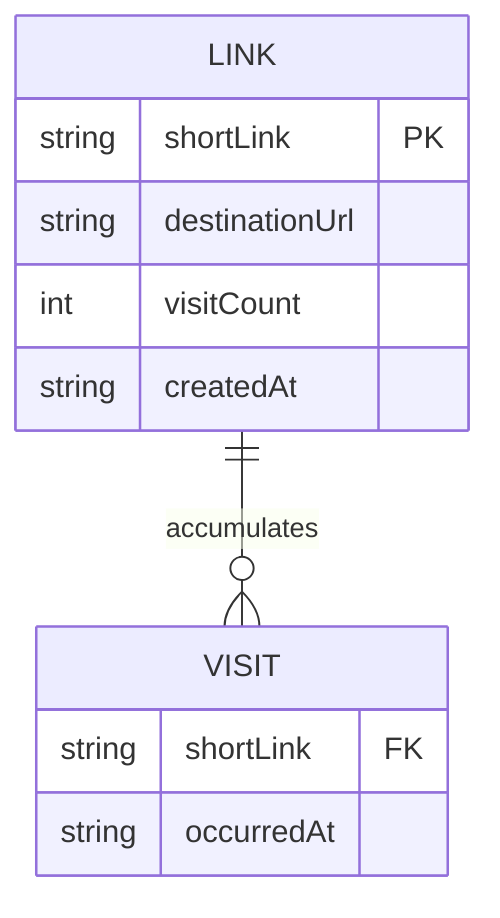

# Design Document

## Overview

This document is a self-describing template: it is a valid design document whose own
content teaches how a design document works, while actually designing the example
Link Shortener feature from the requirements document.

A design document answers *how* the requirements will be satisfied. Where requirements
state what must be true, the design makes and justifies the technical decisions —
architecture, components, data shapes, correctness properties, error handling, and the
testing approach. The governing rule is traceability: every design decision should
trace back to a requirement, and every requirement should be satisfied somewhere in the
design. This Overview section itself models the guidance it describes: it states the
solution shape in a couple of sentences so a reader knows roughly how the pieces fit
before diving in.

The example feature's shape: the Link Shortener is a small web service whose create,
resolve, and metrics operations share one data store keyed by the Short_Link
identifier. Redirects must be fast (Requirement 2.1), so resolution is a single
key lookup, and Visit counting happens asynchronously so recording a Visit never slows
the redirect itself. Each section below is written to be both a real part of this
design and an explanation of what that part of a design is for.

Diagrams in this document use Mermaid, which renders natively on GitHub and in the
VS Code Markdown preview (with the common Mermaid extension). This template deliberately
sticks to the widely-supported, portable diagram types — flowchart, sequence, class,
state, and entity-relationship — and shows one worked example of each so you can see
when to reach for which. The guidance beside each diagram explains what that diagram
type is best at.

## Architecture

The Architecture section shows the big picture — the components and how requests flow —
usually with one or more diagrams, and then calls out the key decisions together with
the alternatives that were considered and rejected. Documenting rejected alternatives is
what makes a design trustworthy, because it shows the decision space was explored rather
than assumed. Notice how each decision below cites a requirement and names a tradeoff.

A flowchart (`flowchart` / `graph`) is the workhorse for showing components and the
flow of data or control between them. Reach for it first when answering "what are the
pieces and how do they connect."

A sequence diagram (`sequenceDiagram`) shows the ordering of interactions between
participants over time. Reach for it when the *order* of calls matters — request/response
flows, handshakes, async hand-offs. Here it makes the asynchronous Visit-counting
decision concrete: the redirect returns to the visitor before the count is written.

A state diagram (`stateDiagram-v2`) shows the lifecycle of a single entity and the
transitions between its states. Reach for it when something has distinct states and
rules about moving between them. Here it captures the lifecycle of a Short_Link.

Key decision — asynchronous Visit counting. Resolving a Short_Link enqueues a Visit
event and redirects immediately rather than writing the count inline, exactly as the
sequence diagram shows. This keeps redirect latency low (Requirement 2.1) at the cost of
counts being eventually consistent, which is acceptable because Requirement 3 needs only
totals, not real-time precision.

Rejected alternative — count inline on redirect. This is simpler, but every redirect
would block on a write, undermining the latency intent of Requirement 2.1 under load.
It is recorded here so a future reader understands why the asynchronous path was chosen.

## Components and Interfaces

This section names each component, states its single responsibility, and defines its
interface — the operations it exposes — mapping each operation to the requirements it
serves. Keeping interfaces small and explicitly traced is how you confirm the design
covers the requirements and nothing extraneous.

A class diagram (`classDiagram`) shows types, their operations and fields, and the
structural relationships between them. Reach for it to express the shape of the code —
interfaces, their methods, and what depends on what — at a glance.

### Shortener Service

Handles create, resolve, and metrics requests over the shared Link Store.

| Operation | Input | Output | Requirements |
|-----------|-------|--------|--------------|
| `create(destinationUrl, alias?)` | Destination_URL and optional Alias | a Short_Link, or a validation/conflict error | 1.1, 1.2, 1.3, 1.4 |
| `resolve(shortLink)` | a Short_Link identifier | redirect to Destination_URL, or not-found | 2.1, 2.2, 2.3 |
| `metrics(shortLink)` | a Short_Link identifier | total Visit count | 3.1, 3.2 |

### Visit Counter Worker

Drains the Visit Queue and increments the stored count for the referenced Short_Link,
decoupling counting from the redirect path (Requirements 2.2, 3.1).

## Data Models

This section describes the shape of stored and exchanged data — fields, types, keys,
and constraints — tying constraints back to requirement bounds where they exist. A
reader should be able to see how the data supports every operation above.

An entity-relationship diagram (`erDiagram`) shows data entities, their attributes, and
how they relate (one-to-one, one-to-many). Reach for it when the data model has multiple
related entities; it complements the field-level table below.

Link record, keyed by `shortLink`:

| Field | Type | Notes |
|-------|------|-------|
| `shortLink` | string (key) | the identifier, system-generated or a user-supplied Alias (Req 1.2) |
| `destinationUrl` | string | the validated target (Req 1.3) |
| `visitCount` | integer | starts at 0 and is only ever incremented (Req 3.2) |
| `createdAt` | string | creation timestamp in UTC |

## Correctness Properties

A correctness property is a statement that must hold across all valid executions, not
just one example. Properties are the bridge between the specification and automated
verification: a property-based testing library generates many random inputs trying to
falsify them. Each property is written as a universally-quantified statement and cites
the requirements it enforces. The exact "### Property N: Title" heading shape and the
"Validates" line are part of the format so tooling can map properties to tests.

### Property 1: Round-trip resolution

*For any* Destination_URL that is successfully shortened, resolving the returned
Short_Link redirects to exactly that Destination_URL.

**Validates: Requirements 1.1, 2.1**

### Property 2: Visit count is non-decreasing and accurate

*For any* sequence of resolutions of a Short_Link, the reported Visit count is
monotonically non-decreasing and equals the number of Visits recorded for that
Short_Link.

**Validates: Requirements 2.2, 3.1**

## Error Handling

This section enumerates the failure modes, assigns each a category, and states the
observable behavior, so that error paths are designed deliberately rather than
discovered in production. A compact table keeps the coverage honest and complete.

| Condition | Category | Behavior | Requirements |
|-----------|----------|----------|--------------|
| Empty or malformed Destination_URL | VALIDATION | Reject; return a validation error naming the problem | 1.3 |
| Requested Alias already in use | CONFLICT | Reject; return an error indicating the Alias is taken | 1.4 |
| Short_Link not found on resolve | NOT_FOUND | Return a not-found response; change nothing | 2.3 |

## Testing Strategy

This section states how the design will be proven correct: property-based tests for the
invariants, example and edge-case tests for specific behaviors, and integration tests
for the wiring. Naming the approach here ensures testing is planned alongside the
design rather than improvised later.

- Property-based tests implement Properties 1 and 2, generating random Destination_URLs
  and random resolution sequences, running a minimum of 100 iterations each, with the
  Link Store mocked so the tests are deterministic.
- Example and edge-case tests cover each Error Handling row: a malformed URL, a taken
  Alias, and a resolve of a missing Short_Link.
- An integration test exercises create then resolve then metrics end-to-end and asserts
  the reported count reflects the number of resolutions performed.
