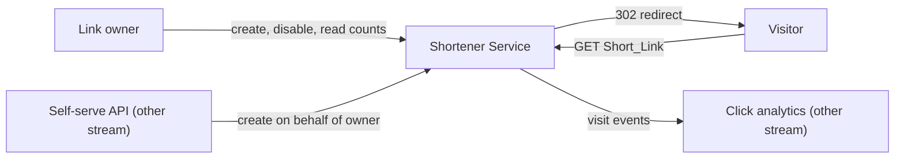
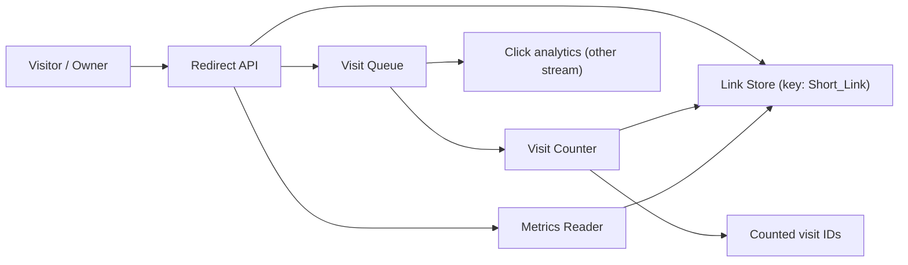

# Shortener Service

Parent: .ponderly/strategies/links-platform-2027.md

## Scope

This document is a self-describing template: it is a valid high level design (HLD),
written as `.ponderly/designs/links-platform-2027/shortener-service/hld-shortener-service.md`,
whose own prose explains how an HLD works while it designs the example shortener service
of the links platform strategy. The line under the title names the parent strategy by
its path from the repository root, so the tree of documents can be walked from the line
as well as from the folders; when an HLD serves no strategy, that line reads
`Parent: none`.

An HLD is the design of one system, service or stream of work that a strategy names. It
answers how that system is shaped: its boundary, its components, how a request moves
through them and which decisions hold it together. It stops above the design of any one
component, which belongs to a low level design (LLD) of its own. The Scope section says
which stream of the parent strategy this HLD takes, what part of that stream it covers,
and which of the strategy's goals it serves, so a reader can check the design against
the parent before reading on.

This HLD takes the strategy's shortener stream: the service that creates Short_Links,
redirects visitors to their destinations and counts visits, brought to general
availability within the year. It serves the strategy's goal of a shortener in general
availability, and it emits the visit events, each with its country and referrer, that
the click analytics stream builds on.
The analytics product and the self-serve API are other streams with HLDs of their own.

## Context

The Context section draws the system's boundary: who and what sits outside it, and what
crosses the boundary in each direction. Name every actor and every neighbouring system
the service talks to, so that nothing the design depends on is left implicit. A
flowchart with the system as one box and its neighbours around it is usually enough.

Owners create and manage Short_Links; visitors follow them; the click analytics stream
reads visit events, each carrying the Short_Link, the time, the visitor's country and
the referrer; the self-serve API calls the service on an owner's behalf. Nothing else
crosses the boundary.

## Architecture

The Architecture section shows the components inside the boundary and how a request
moves through them. Use at least one Mermaid flowchart of the components, in the
portable diagram types (flowchart, sequence, class, state, entity-relationship), and
follow it with a sentence per component saying what it is responsible for. Each
component named here is a candidate for an LLD of its own in the closing section.

- Redirect API: takes create, resolve and metrics requests; on resolve it looks the
  Short_Link up, enqueues a visit event carrying the Short_Link, the time, the visitor's
  country and the referrer, and redirects.
- Link Store: holds each link keyed by its Short_Link, with its destination and its
  total visit count.
- Visit Queue: carries visit events from the redirect path to the Visit Counter and to
  the click analytics stream.
- Visit Counter: drains the queue, skips events it has already counted, and increments
  the stored totals; it keeps the IDs of the events it has counted in a store of its
  own.
- Metrics Reader: serves the total visit count for a Short_Link.

A resolve request reads the store once, puts one visit on the queue and returns the
redirect; the count is written later, off the visitor's path.

## Key decisions

The Key decisions section records the choices that shape the system. Each decision says
what was chosen and why, names the trade-off it accepts, and names at least one rejected
alternative with the reason it lost. Recording the rejected alternative is what shows
the decision space was explored rather than assumed, and it saves a later reader from
reopening a settled question.

**Key decision: visit counting is asynchronous, off the redirect path.** Resolving a
Short_Link enqueues a visit event and redirects at once; the Visit Counter writes the
count later. This keeps redirects fast under load, which general availability needs. The
trade-off is that counts are eventually consistent and can lag by the queue's depth,
minutes under a traffic spike, which is acceptable because an owner's metrics show a
total, not real-time precision, and the analytics stream reads the visit events
themselves rather than the totals.
Rejected: counting inline on the redirect, which is simpler but makes every redirect
wait on a write.

**Key decision: the Visit Queue is the cloud account's managed queue, delivering at
least once.** The strategy allows no new vendor, and a managed queue lets the Visit
Counter and the click analytics stream each read every visit event. The trade-off is
that an event can arrive twice, so each event carries a unique ID and each consumer must
tolerate a duplicate; the Visit Counter skips an event it has already counted. Rejected:
an exactly-once queue, which the account's managed services do not offer.

**Key decision: one Link Store keyed by the Short_Link.** Create, resolve and metrics
all address a link by its Short_Link, so one key lookup serves every operation. The
trade-off is that queries by owner or by destination need an index added later.
Rejected: separate stores for links and counts, which doubles the lookups on the
metrics path for no gain at this scale.

## Cross-cutting concerns

The Cross-cutting concerns section covers what runs through every component rather
than living in one: security, observability, performance, availability, data
retention. Say for each what the system does about it and which component carries it.

- Performance: a redirect is one key lookup in the Link Store and one enqueue, each no
  slower than a key lookup, and nothing on the path waits on a count being written. The
  design is sized for 2,000,000 redirects a day, ten times the pilot's 200,000.
- Availability: if the queue is unavailable the redirect still succeeds and the visit
  event is dropped and logged, so counting fails before redirecting does.
- Security: destinations are validated as URLs on create; owners are authenticated for
  create, disable and metrics, and visitors need no authentication.
- Observability: the Redirect API reports latency, error rate and dropped visits; the
  Visit Counter reports queue depth, so a lag in counts is visible before owners report
  it.

## Risks

The Risks section names what could make the design fail or cost more than planned, with
how likely it is, what it would cost and what the design does about it. A risk with no
response is a question for the author, not a risk.

- Queue backlog under a traffic spike makes counts lag by minutes. Likely at launch;
  the Visit Counter scales on queue depth and the lag is reported.
- Abuse of the shortener for phishing destinations. Possible; checking destinations
  against a block list belongs to the self-serve API stream, which opens public
  creation, and here owners can be disabled.
- Hot Short_Links concentrate reads on one key. Possible for viral links; the Redirect
  API caches resolved links for a short time.

## Out of scope

The Out of scope section lists what a reader might expect this HLD to cover and it does
not, with where that work lives instead, so the boundary of the design is stated rather
than inferred.

- Aggregating and reporting visit events by day, country and referrer: the click
  analytics stream's HLD.
- The public self-serve API, its keys and its block list checks: the self-serve API
  stream's HLD.
- Custom domains for Short_Links: not planned this year.

## Low level designs

The Low level designs section closes the HLD with its Candidates: one LLD per component
that needs a design of its own, each named in a line with what it covers. A component
simple enough to build straight from this HLD gets no candidate. Each candidate becomes
`.ponderly/designs/links-platform-2027/shortener-service/lld-<name>.md`, whose
parent line names this HLD.

- `redirect-api`: the create, resolve and metrics endpoints, validation, caching of hot
  links, building the visit event and the drop-and-log path when the queue is
  unavailable.
- `visit-counter`: the worker that drains the Visit Queue and increments counts, its
  handling of duplicate deliveries, retries and scaling on queue depth.
- `link-store`: the link record, its key, the visit count field with its increment
  operation, and the indexes added later for owner queries.
